# Agent Session Loop (ASL)

ASL executes a prepared plan one session at a time. Its Autopilot supervisor starts or attaches to `asl run`, watches the active worker, and uses a per-plan mailbox to exchange live guidance, notices, questions, and answers without restarting the session.

```mermaid
flowchart TD
    U[User] <--> S[Autopilot supervisor]
    S -->|starts or attaches| R[asl run]
    R -->|launches next session| W[Worker agent]

    subgraph State[Per-plan ASL state]
        M[(mailbox.jsonl<br/>append-only message log)]
        L[mailbox-lease.json<br/>supervisor heartbeat]
    end

    S -->|renews| L
    S -->|guidance, reply, or resolution| M
    M -->|guidance| W
    W -->|notice or question| M
    M -->|notice or question| S
    M -->|reply or resolution| W
    W -->|consumption receipt| M

    W -->|session result| R
    R -->|next session or final status| S
    W -. no fresh lease, timeout, or mailbox error .-> P[Ordinary paused-run flow]
    P --> S
```

The mailbox is a durable, append-only history; the first reply or resolution closes a question, and the worker records when it consumes that closure. The separate lease proves that a supervisor is still watching; if supervision disappears or mailbox waiting fails, ASL falls back to its normal pause-and-resume path. When `asl outbox wait` actually surfaces an open question, it also persists that run's body-free question projection and makes a best-effort `AgentSessionLoopMailboxQuestion` handoff to AgentMux. Notification failure never changes the outbox result, and closed history does not alert.

ASL's workspace domain keeps ordered repository declarations separate from plan parsing and runner behavior. It normalizes aliases, relative paths, and credential-free origin identities, then resolves repositories only when each path remains beneath the workspace, is an exact Git top-level, and has the expected origin. Legacy single-repository plans retain version 1 `plan-metadata.json`; version 2 binds a multi-repository plan to a canonical `workspace_root` and registry digest.

Repository mutation evidence is provided by a reusable fail-closed engine rather than being embedded in the runner. Its single-repository payload preserves the review guard's HEAD, tracked and staged patches, untracked nodes, index flags, and ignore-source evidence. It can also inventory ordinary and linked Git worktrees recursively without following symlinks, capture a deterministic workspace vector, and compare vectors with changed, added, removed, unavailable, and repository-qualified path details. Inventory is capped explicitly to bound Git probe work over broad workspaces.

Multi-repository source plans declare one `## Repositories` Markdown table before the first session, with the exact ordered columns `Alias`, `Path`, and `Origin`. `asl split --check` validates the declaration without writing, and `asl split` moves its normalized ordered registry into `manifest.md`; `context.md` contains only the remaining shared source context. Registry details are additive in split JSON, while plans without a registry retain their historical files and response fields.

Every session in a registered plan also declares exact `**Reads repositories**:` and `**Writes repositories**:` fields. Reads are non-empty; writes may be `(none)` and must be a subset of reads. ASL renders those fields before the session instructions, preserves them in readiness identity, and rejects missing, duplicate, malformed, or unknown aliases. Completed handoffs qualify each modified path as `Alias:path`, and resplit children inherit the parent scope unchanged. Plans without a registry retain the legacy session, handoff, and resplit formats.

Completion-contract checks in a registered plan are repository-attributed with `"repo": "Alias"`. Every check needs an explicit alias when the registry has multiple entries; a one-entry registry supplies its sole alias when omitted. Registered contracts reject absolute or upward-traversing `path` and `cwd` values, while legacy plans retain their existing absolute-path behavior. The alias survives rendering, review repair, baseline normalization, static contract-check rows, and verification observer events; repository-dispatched execution is introduced separately.

> **Maintenance note:** Any work on ASL should include checking this README and updating it when behavior or architecture changes.
