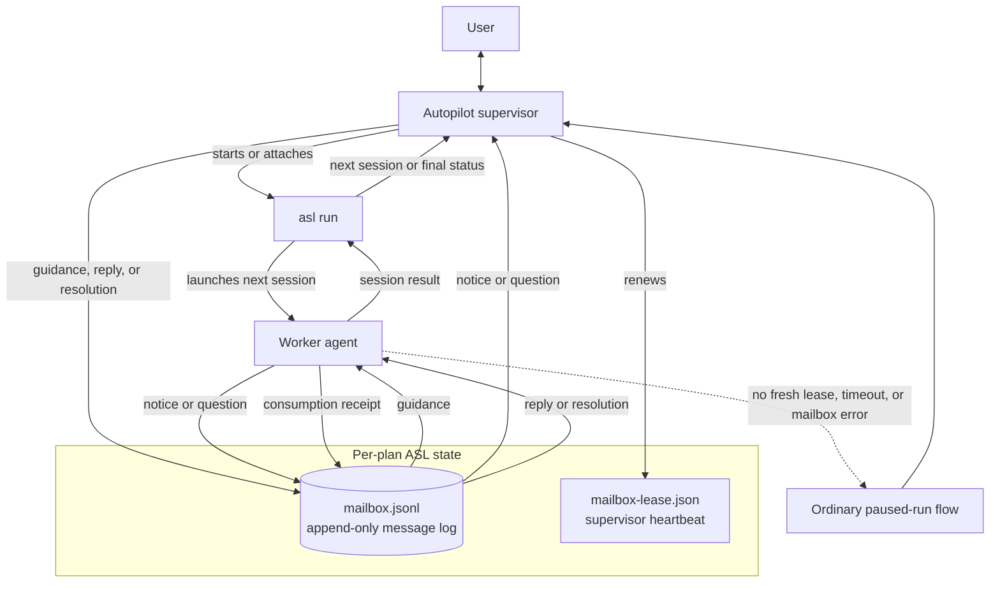

# Agent Session Loop (ASL)

Copilot audit argv adapts to the remote-option change in CLI 1.0.103: newer
prompt-mode turns use `--sync-session=off`, while earlier or unknown versions
keep `--no-remote --no-remote-export`. The adapter reprobes before each audit
because the npm loader can update its package without changing its own file
identity. Read-only tools, denied write/shell/URL tools, and the other audit
restrictions apply to both forms.


`asl outbox supervise` recovers its launch's terminal record even after the
persisted cursor has advanced past it. If output is interrupted after saving
the cursor, retrying returns `DONE` immediately instead of reporting `IDLE` or
a false `LOST`. Terminal records from other launches remain cursor-scoped;
the general-purpose `asl outbox wait` retains its ordinary `--since` behavior.

Completion contracts keep their imports in `contracts`, with models, Markdown
sections, check validation, and recipe parsing in `contract_*`. The
`handoff_guard_*` modules separate session reopening, mailbox completion,
review mutation, plan artifacts, and snapshot capture. Prompt fragments live
in `run_prompt_*`; preparation models, review refresh, repair resumption, and
packet construction live in `turn_preparation_*`.

`redirect_control` preserves its public controller and records. The controller
handles acceptance and phase transitions; its `UrgentEscalation` base owns the
shared turn state, watchdog, termination evidence, and successor gate.
`operation_store`, `operation_journal`, `operation_evidence`, and
`operation_mutations` separate the store's entry points, journal storage,
evidence collection, and mutation admission. These public modules use explicit
imports to preserve existing callers.

Operation-journal compaction publishes an owner-only `operations.jsonl.compact`
recovery file before truncating `operations.jsonl`. Readers use that replacement
after an interrupted rewrite; the next writer restores and syncs the journal,
then durably removes the recovery file before appending. The journal keeps its
inode and `flock`, so recovery preserves both outstanding operations and
cross-process admission ordering. Torn-tail separators count toward the journal's
byte limit before an append is admitted.

Operation-journal replay skips JSON that exceeds the decoder's nesting limit,
just as it skips torn lines, preserving usable records and later writes.
Admission refusals retain the journal's reason and message, including
conflicting reuse of an operation id and uncertain prior outcomes.

Local reply settlement also preserves a consumption receipt when a reconciliation
sweep observes the worker reading the reply before the delivery call returns.
Late acceptance returns that stronger receipt without rewriting it. Explicit
operation confirmation moves directly to `consumed`, allowing late evidence to
resolve `unconfirmed` operations; repeated confirmation preserves the original
receipt and settlement time.

Admission supersedes an uncertain operation only for a new operation id in the
same scope. Replaying an older request, refusing conflicting reuse of its id,
or submitting an unrelated action preserves the uncertain record so late
evidence can still settle it. Launch and resume share the run-start scope and
can replace one another when the plan is idle and the prior owner is gone.

The public imports for commit messages, conversation continuity, AgentMux
contracts, and overseer decisions, context, and CLI commands remain in their
original modules. Their implementations live in focused sibling modules:
`commit_message_*` separates diff processing, Git operations, formatting,
generation, and command handling; `conversation_*` separates references,
validation, capabilities, storage, selection, and relocation;
`agent_mux_contract_*` separates schema linting, validation, manifests, and
corpus checks. The `overseer_decision_*`, `overseer_context_*`, and
`overseer_cli_*` families separate evidence, models, policy, and command paths.
Internal calls use the owning modules; tests patch those
owners when substituting collaborators. Shared test fixtures live in dedicated
support modules, and each split test module is registered in the same suite
lanes as its original.

The overseer adapters retain their entry points in `overseer_resume`,
`overseer_checkpoint`, and `overseer_mailbox`. Their siblings separate launch
recovery and ownership, checkpoint evidence and Git reads, and mailbox posting
and authority checks. `assurance_ledger` owns transactions, with vocabulary,
records, parsing, file reads, and index rebuilding in `assurance_ledger_*`.

Turn dispositions retain their entry points in `turn_dispositions.py`, with
continuation models, redirect settlement, mailbox waits, and failure handling in
`turn_disposition_*`. The tail keeps its CLI and follower in `tail.py`; its
`tail_*` siblings own records, control messages, event formatting, and log reads.
The tail uses state-derived logs and completion only when the state still names
the run being followed, so a later run cannot add output to the earlier run's
tail. Log following fingerprints the consumed prefix of an opened file: an
atomic replacement that preserves that prefix contributes only its new lines,
while a changed prefix is replayed from the start.
Process diagnostics keep their public entry points in `process_tree.py`, backed
by `process_sampling`, `process_recovery`, `process_sweep`, and
`process_termination`; sampler patches belong on `process_sampling`.
`CodexAppServerSession` remains in `codex_app_server.py`, inheriting protocol
handling from `codex_app_server_protocol` and locked state and transport
primitives from `codex_app_server_transport`. `codex_app_server_types` owns
shared protocol values. The inheritance chain uses one session object and the
same locks across reader, driver, and mailbox threads.

App-server teardown closes stdin and applies the shutdown grace period after
failed or cancelled handshakes as well as completed turns. A server that ignores
EOF is then sent SIGTERM; if it remains alive for another grace period, SIGKILL
ends it so a run without a harness timeout cannot wait indefinitely. This also
covers handshake timeouts, restore refusals, and submission cancellations. The
existing fallback rules still prevent replay after a turn has been dispatched.

Implementation runs can explicitly authorize an external data directory with
`--external-write-root /absolute/directory` (repeatable). Admission pins existing,
narrow canonical roots; `run_config` retains them for `--resume`. The external
write guard records their before/after digests as `authorized-external-data`,
including roots omitted from the worker's message. Other paths remain subject
to the existing guard; this grants no repository or review write authority.
Symlink escapes and redirected or unreadable roots fail closed. This option
does not waive a prior incident or mark a session complete.

The bridge's bounded snapshot reserves space for running and verifying work,
then the freshest dated blockers, before undated backlog. The selected rows
retain normal urgency order. The 200-row and frame-size ceilings still apply;
omitted rows leave the snapshot explicitly partial.

Bridge question snapshots, body retrieval, intervention facts, and action
validation select unanswered records owned by the displayed `run_id`. A live
wait's timestamp, session, and turn come from its exact waiting question;
missing metadata stays unknown. Historical questions remain in the append-only
mailbox and available to direct mailbox workflows. Paused-run activity uses the
latest valid finish or turn timestamp from that run, falling back to its start
only when no later activity is recorded.

ASL executes a prepared plan one session at a time. Its Autopilot supervisor starts or attaches to `asl run`, watches the active worker, and uses a per-plan mailbox to exchange live guidance, notices, questions, and answers without restarting the session.

Mailbox logs and leases must be regular files with a single link. A symlink, hard link, FIFO, or other special file at either path produces a mailbox or lease error without following the link or waiting for a FIFO writer. Supervision cursor reads treat those unsafe file types as missing, so a FIFO cannot stall a supervisor and a linked payload cannot advance its cursor.



A heartbeat that finds an active mailbox wait for that exact worker turn projects `input_wait_active` and suspends hang sampling until the wait closes, so intentional operator latency is never accumulated as zero-CPU evidence.

The mailbox is a durable, append-only history; the first reply or resolution closes a question, and the worker records when it consumes that closure. A runner's reply wait gives up as `mailbox-full` once no answer can land under the strict wait-closure cap, which still leaves its wait-end inside the wait-end reserve; a wait-end that cannot be written anyway, or a resumed wait start the mailbox refuses, becomes an ordinary pause rather than a crash, and a wait the run leaves by an interrupt or a failed state write is ended best-effort, without receipting an answer it never delivered. Durable mailbox, event, and state-ledger writes use `fcntl(F_FULLFSYNC)` on Darwin to flush the device cache, falling back to `fsync` when the filesystem does not support that device barrier; other platforms use `fsync` directly. Atomic state replacement also syncs its parent directory. During a harness turn, every stdout and stderr chunk updates the shared in-memory active-turn counters and preview immediately, while ordinary activity is coalesced into durable state by the existing 30-second heartbeat. Turn lifecycle changes, action-required and hang transitions, observed-model updates, control changes, and finalization remain immediately durable. Completed turn results and events include additive `stream_io` telemetry for chunk and character counts plus cumulative callback time. Plan publication and recovery share a marker-scoped plan transaction lock so readers never observe a partially published transaction. Plan reads wait at most five seconds for that lock; a timeout reports the holder's pid, hostname, and thread rather than hanging indefinitely. The separate lease proves that a supervisor is still watching; if supervision disappears or mailbox waiting fails, ASL falls back to its normal pause-and-resume path. When `asl outbox wait` actually surfaces an open question, it also persists that run's body-free question projection and makes a best-effort `AgentSessionLoopMailboxQuestion` handoff to AgentMux. Notification failure never changes the outbox result, and closed history does not alert. The end of supervision is itself a mailbox record: the Autopilot helper appends one terminal `supervision-end` message carrying its raw exit reason and a coarse outcome, and `asl outbox wait --include all` wakes on it and reports it through `supervision_ends` and `supervision_ended`. That record ends the helper's supervision lifetime and does not prove the supervised run is quiescent: a `worker_hung` stop leaves the `asl run` child alive holding the plan lock, so later worker questions and notices can still land after the terminal record. Before that unresolved stop, the runner gives only `result_received_process_alive` one automatic recovery attempt: after the existing result grace and two zero-CPU confirmations it re-samples the tree, identity-checks the harness root and deepest leaves by pid, birth time, command, and ancestry, and sends those leaves SIGTERM once. It never escalates to SIGKILL, never applies this policy to ordinary no-result stalls, and the process-sweep opt-out disables it. The live `hang_suspected.recovery` report records the policy, attempt time, signal, candidates, signalled and already-gone pids, identity mismatches, and signal failures; resumed output clears the episode and continues the same run, while a later `worker_hung` preserves the unresolved report under `result.hang`. Every outcome except `error` is appended after the helper flushed its complete result, so stdout is parseable when the wait returns; `error` marks an abnormal exit whose stdout may be missing, truncated, or unproven and must be decided from the record alone. Because it is durable log content read through a sequence cursor rather than a live notification, a helper that already exited returns it on the next wait instead of burning the full timeout; a terminal-only wake makes no AgentMux handoff and writes no question projection. The runner emits no such record — only the helper's own exit ends supervision — and `--no-mailbox`, SIGKILL, or a crash leave none at all, so the stdout-tail fallback remains. Because two helper lifetimes can overlap on one plan, every launch carries a `supervision_id`: the launching agent passes `--supervision-id` to the helper and to `asl outbox wait`, which then reports `supervision_ended` only for that launch's own record while another launch's record still advances the cursor. The supervision loop itself uses `asl outbox supervise`, which wakes only on questions and terminal records, keeps its own resumable cursor in `mailbox-supervision-<supervision-id>.json` so no `--since` is threaded by hand, absorbs another launch's terminal record and already-closed questions without printing anything, and reports one of `IDLE`, `ACTION questions=<n>`, `DONE outcome=<outcome> seq=<n>`, or `LOST reason=<reason>` at exit code 0; `asl outbox wait` is unchanged and stays the general-purpose reader. `LOST` closes the gap that made a mis-launched helper look healthy: the helper records its `(pid, process birth time)` identity before starting the child, and each supervise pass that reads no record probes that identity, so `helper-exited-without-record` reports a helper whose process is gone and `helper-never-started` reports one that never wrote an identity while no run holds the plan — the latter only after a 120-second grace window, and neither ever preempting `DONE` or `ACTION`. The token carries the run evidence that decides what to do next — lock, `run_id`, runner-state freshness, active turn, and session counts, exposed under `--json` as `lost_reason` and `run_evidence` — because a helper killed under a live lock means only supervision needs relaunching, while a helper that never started means nothing is running at all. Supervision is launched detached (`asl-autopilot.py --detach`), which forks the supervision away from the launching shell and prints one JSON launch handshake carrying `pid`, `result_path`, and `stderr_path`, so an hours-long run no longer depends on the lifetime of the shell that started it and the run's verdict is read from `result.json` rather than the launcher's stdout.

A failed process probe leaves helper liveness unverified: only an empty `ps`
selection (exit 1 without output) or a verified process identity mismatch proves
the helper is gone. After detecting that exit, supervision must successfully
read the mailbox again before reporting `LOST`, since the helper may have
published its terminal record during the probe. Transient failures of that
final read retry within the poll's remaining timeout. An unreadable mailbox at
the deadline reports `mailbox-read-error` even if an earlier read succeeded,
since that earlier snapshot cannot rule out a newly appended question or
terminal record.
Liveness record cleanup checks the identity of records older than 30 days and
keeps any helper that is alive or cannot be verified; age alone does not prove
that a long-running supervisor has exited.

## Implementation architecture

The [implementation architecture reference](../docs/asl-implementation-architecture.md)
explains module ownership, turn boundaries, supervision and persistence.

> **Maintenance note:** Any work on ASL should include checking this README and updating it when behavior or architecture changes.


Audit scope collection uses authoritative session discovery, retaining exact zero-padded numeric filenames for historical evidence: expansion notes and supporting evidence documents remain artifacts, not malformed sessions. Mailbox collection also joins backwards from this run's guidance-delivery receipts to their referenced guidance, including explicit inbox reads without runner delivery events. Referenced guidance retains sequence, provenance and a redacted content digest; missing targets are counted and recorded as omissions, and deferred attempts never claim successful delivery. Write-guard pause diagnostics distinguish external paths with unresolved write authority from unavailable repository evidence, without changing the guard's fail-closed verdict.

A worker's own control commands fail where only the worker sees them, so each worker turn's environment carries `ASL_CONTROL_PLANE_FAILURE_LOG`, naming `control-plane-failures.jsonl` in that turn's artifact directory. `cli.main` appends one content-free record there (command, outcome, exit code, exception class and ASL source site) when `inbox read`, `inbox acknowledge`, `ask` or `notify` crashes, or when `inbox read` exits nonzero. Turn finalization reads it back into the result's `control_plane_degradation`, appends a `control_plane_degraded` event, and the supervisor audit counts the turn as `degraded`; the turn keeps the status it earned. Recording is best effort: a sandbox that cannot write the run directory leaves no record, and the turn's logs and the CLI trace remain the evidence.

A mailbox `pause` resolution closes its question. Both worker and runner wait paths retain the closure in `pause_details.mailbox_resolution`; the terminal action explains how to supply a new decision with `asl run PLAN_DIR --resume --reply-stdin`, preserving any custom state root. This is an explicit resume, and never reopens the closed inbox question or retries the paused session automatically.

The deterministic `lifecycle.conversation-restore-refusal` check accounts for provider refusals separately from ordinary harness failures. It requires a matching failed turn exit, an explained and retired conversation, and the corresponding recovery pause. Only that exact session and turn leave the unclassified-failure catch-all; mismatched exits, timeouts, missing evidence, and other failed turns remain visible.

Claude background tasks keep the stream-input conversation open after an early result. ASL tracks `task_started` and `task_notification` records and waits for a subsequent result after all known tasks finish before closing stdin. The main turn can consume task outcomes inline, so that result need not come from a separate synthetic follow-up; a task follow-up result settles the guidance the CLI echoed before it (the CLI folds guidance taken up mid-follow-up into that answer) but never queued guidance it has not echoed. Task notifications invalidate the earlier terminal-result hang clock; a follow-up result with no background task left restarts it, so an idle root left behind any remaining stdin hold still reaches post-result recovery (stdin released first, then the verified signal path). Provider errors and operator interruption still end the conversation and retain their failure semantics.

After a terminal harness result and confirmed idle CPU samples, hang recovery can shut down a harness with no descendants. It verifies the root's PID, birth time, and command before SIGTERM, then waits 30 seconds before a fresh identity and descendant check permits one SIGKILL escalation. Resumed output, CPU progress, a new protocol request, and mailbox input waits cancel the episode; process-sweep opt-out also disables this recovery. Heartbeats retain each recovery attempt, and the turn result and execution event preserve `harness_shutdown` evidence. A matching signal exit is classified as `post-result-shutdown` under the existing non-retryable `nonzero-exit` policy. It earns no completion or authoritative verification and requires operator recovery.

The deterministic `lifecycle.worker-pause-exit-accounting` check grades failed exits that carry a worker pause declaration. It requires matching session, turn, and exit evidence, a trusted declaration source, and a held pause or write-guard refusal that reverted the session to pending. Only matching exits leave the unclassified-failure catch-all; shutdown causes remain the resource lane's responsibility. An explicitly aborted exit is owned by `lifecycle.operator-abort`, which now detects a missing acknowledgment even when no honored-abort record survived. The runner records an honored abort when a post-turn guard pauses a killed turn, preserving the guard's failure and pending session.

## Typing registries

`pyproject.toml` enables strict mypy codes for the product package. The
`config/typing/` registries separately record which modules must also satisfy
the extraction rules; the typing ratchet checks their coverage and floors.

## Extracted façade boundaries

`supervisor_audit.py` remains the compatibility entry point, while `supervisor_audit_config.py`, `supervisor_audit_restricted.py`, `supervisor_audit_agent_models.py`, `supervisor_audit_agent_run.py`, and `supervisor_audit_terminal.py` own configuration, the read-only invocation, attempt records, retry processing, and terminal publication. `assurance_cli.py` similarly delegates shared rendering, browse, mutating, pending, and reconciliation commands to `assurance_cli_common.py`, `assurance_cli_browse.py`, `assurance_cli_actions.py`, `assurance_cli_pending.py`, and `assurance_cli_reconcile.py`; new callers patch or import the implementation owner, while the façade retains the established command surface.

## Accepting remote-ref updates after a paused review

A push or fetch during a read-only review can update remote-tracking refs and
trip `workspace-write-scope-violation` even when the working files and local
HEAD stay unchanged. After explicit operator approval, use the narrow recovery
command to retain those historical updates without granting the review write
access:

```sh
asl accept-ref-updates PLAN_DIR --session SESSION_ID --json
asl accept-ref-updates PLAN_DIR --session SESSION_ID --accept DIGEST --reason 'Operator approved these ref updates' --json
```

The first command previews the exact ref transitions and current repository
HEADs. The second requires the reviewed `evidence_digest`; a stale digest is
refused without returning a replacement. Both commands exclude an active runner
with the plan lock. Acceptance requires complete original snapshots differing
only in existing `refs/remotes/` values, an unchanged registry and worktree
topology, clean current worktrees, and refs still at the retained values. Source,
local branch, tag, ref creation/deletion, and unavailable-evidence incidents
need their own recovery. Clean operator commits made after the rejected turn
are shown in the preview and bound into the approval digest.

`scope_recovery.py` owns this operator action. It appends a
`workspace_ref_updates_accepted` event bound to the retained guard hash and the
current evidence, preserving the original violation. The event clears only that
incident for that session; it does not pass a failed review, complete its
handoff, edit its scope, mark readiness, or suppress future guard failures.
The next ordinary `asl run` refreshes readiness and reruns the pending session
with a fresh baseline and the full write guard. A fresh expansion is unnecessary
because acceptance changes no session scope or contract.


`redirect_restart.py` enforces recovery before startup reconciliation, commit
recovery, every retry, and completion. Controllers persist worker ownership and
full descendant evidence under `redirect-predecessors/` before allowing a
successor. Restart rechecks uncleared groups and descendant identities without
signalling them; missing evidence, foreign ownership, survivors, or disabled
process sweeping block with `redirect-successor-blocked`. A stopped proof is
durable, so process-ID reuse cannot revive an already cleared obligation.
Neither fresh conversations nor new run IDs waive that proof.

An unresolved submission window pauses its pending session with
`redirect-submission-unresolved`. The operator inspects native history and uses
`asl control resolve-redirect PLAN_DIR --operation-id ID --outcome OUTCOME --reason EXPLANATION`,
choosing `submitted` or `not-submitted` explicitly.
The plan lock excludes live workers while that explicit decision is recorded.
A submitted decision never fabricates a receipt or replays feedback; a confirmed
unsent decision releases only a carry without recorded delivery. No timeout or
default resolves ambiguity. Run state exposes the operation and resolution
command for CLI and supervisor inspection.

### Verification cache write scope

The shared repository-authority block in packet and legacy skill-mode prompts
warns that inspection and verification can write caches or generated artifacts.
Read-only dependencies remain read-only for untracked and ignored files too.
Workers should use Ruff's `--no-cache` for those dependencies and disable other
tool writes or direct them to an already-authorized scratch location. This is
worker guidance, not sandboxing or a guard exemption; tool caches do not justify
widening a session's write scope.

### Explicit plan-store write roots

Before launching a selected session, ASL checks its completion contract's
Done-when bullets that declare plan-store writes with a concrete
`--state-dir` root (absolute or `~/`-relative, optionally quoted). For example:
`All plan-store writes used --state-dir ~/.local/share/agent-plans`.
If that required tree is outside the effective control-plane guard roots,
the run pauses with `workspace-write-guard-unavailable`, records the required
and effective roots in `pause_details.plan_store_state_root`, and spends no
worker turn. This applies to registered and legacy runs, packet and skill
modes, and reply/resolution continuations. A matching or covering configured
root passes, as does a write tree already inside this plan's own directory.
Examples, verification commands, and historical handoffs do not declare a
state-root requirement; this narrow check is not a general prose write detector.
An operator must inspect the requirement and explicitly relaunch with the
intended state root or repair the contract. ASL never supplies an override:
changing `--state-dir` also changes where the run keeps its bookkeeping.

For a registered `--commit-per-session` run paused after independent repository
changes, the operator can acknowledge the historical incident and explicitly
checkpoint retained owned work:

```sh
asl acknowledge-external-changes PLAN_DIR --session SESSION_ID --repository ALIAS --json
asl acknowledge-external-changes PLAN_DIR --session SESSION_ID --repository ALIAS --accept DIGEST --reason 'Independent changes authorized by operator' --checkpoint-retained --json
```

Repeat `--repository` for each independent alias. Preview never establishes
authorship or changes Git contents, indexes, refs, or session status. Acceptance
requires explicit operator authorization, a reason, the exact reviewed digest,
complete evidence, unchanged original roots/origins, binding, registry, scope,
plan content and guard policy, and no active runner. External changes cannot be
acknowledged in a writable repository. Dirty read-only repositories needed by
the current session block recovery. The retained writable paths must match the
rejected turn's original file and index fingerprints; unrelated staged files,
new dirt or content drift block checkpoints. Linked worktrees remain under their
owning alias and use their own staging root.

Recovery persists progress before committing and records checkpoint SHAs. A
partial failure prints `resume_argv`; rerun that exact command after repairing
the failure. Recorded successes are never recommitted, and interrupted commits
require exact parent, message, paths and content proof. Acknowledgement is
recorded only after checkpoint targets are clean and unrelated evidence remains
unchanged. The rejected turn and assurance issues remain intact. Checkpoints
retain unverified work and leave the session pending; verification and review
still run on resumption.

Only the current session's read/write union needs clean repositories before a
registered per-session worker launch. This check repeats before each worker, so
a previously unused dirty repository blocks when a later session needs it.
Missing or malformed scope fails closed. Complete workspace mutation guards
remain active: new changes in unused repositories still reject the turn and
require a fresh acknowledgement. Legacy and `--commit-at-end` checks retain
their existing behavior. `asl status --json` exposes preview commands and durable
recovery progress for operator inspection and supervisor audit.

The plan listing, plan summaries, recovery cards, and launch are split by what each module owns, and every dependency between these modules points one way. The registry, plan discovery, the per-plan summary, and launch live in a layered set of modules, each importing only the ones before it: `plan_pins_models.py` holds the registry constants and record types (`LaunchProfile`, `RegistryPin`, `PlanRegistry`, `DiscoveredPlan`, `DiscoveryResult`, `PlanRegistryError`); `plan_pins_coerce.py` tolerantly coerces hand-edited registry values; `plan_pins.py` loads, saves and locks the registry (`load_registry`, `save_registry`, `mutate_registry`, `upsert_pin`); `plan_scan.py` owns `discover_plans`; `plan_summary_model.py` holds the primary-state vocabularies and the `PlanSummary` record; `plan_summary_helpers.py` holds the small summary helpers; `plan_summary_context.py` gathers one plan's inputs (`gather_context`) and builds the record (`SummaryContext.make`); `plan_summary_active.py`, `plan_summary_paused.py` and `plan_summary_settled.py` hold the state classifiers; `plan_summary.py` owns `build_plan_summary` and `build_plan_summaries`, trying the classifiers in priority order; `plan_launch.py` owns `launch_plan` and `resume_plan_with_reply`; and `plans_cli.py` owns the `asl plans` handler. Recovery cards live in the `recovery_card_*.py` modules, layered so each imports only the ones before it: `recovery_card_models.py` holds the `RecoveryCard` card and its evidence, action and command types, the `RECOVERY_KINDS` and `RECOVERY_ACTION_TARGETS` vocabularies and the pause-reason mapping; `recovery_card_state.py` holds the state-reading helpers the summary shares with it; `recovery_card_commands.py`, `recovery_card_evidence_checks.py` and `recovery_card_evidence_commit.py` build the action cards, repair commands and evidence rows; `recovery_card_payload.py` assembles the card; `recovery_card_builders_run.py`, `recovery_card_builders_state.py`, `recovery_card_conversation.py` and `recovery_card_review.py` hold the per-blocker builders; and `recovery_card_build.py` owns `build_recovery_card`. `plan_summary` imports the build and state modules, and `recovery_card_build` names `DiscoveredPlan` for type checking only, so none of them imports the summary or registry modules at runtime. `plan_workspace.py` is the lowest layer, the workspace projection (`_workspace_projection`, `_workspace_payload`) that summaries, pins, launches and recovery cards all report, importing only the `plans_*` modules. Call and patch each of these names at the module that owns it; no module keeps an alias for any of them.

Worker `asl ask --wait` deadlines now bound unsupervised time: a fresh mailbox lease extends the wait, while zero still polls once and lost supervision leaves a bounded deadline. Exhausted verification repairs carry `verification_repair_exhausted` into pause policy v5, requiring inspection instead of another automatic retry. Pause policy v6 does the same for an exhausted review-verdict repair (`review_verdict_repair_exhausted`), which shares the `verify-failed` reason. Commit-preflight pauses name the actual commit checkouts and apply to both startup and continuation. A repository refusal sourced from a task packet explains that registration scans plan files; intended additional scope must be declared there before migration. Audit evidence retains allowed external HEAD transitions as observations without adding them to the session's commit attempts or groups.
