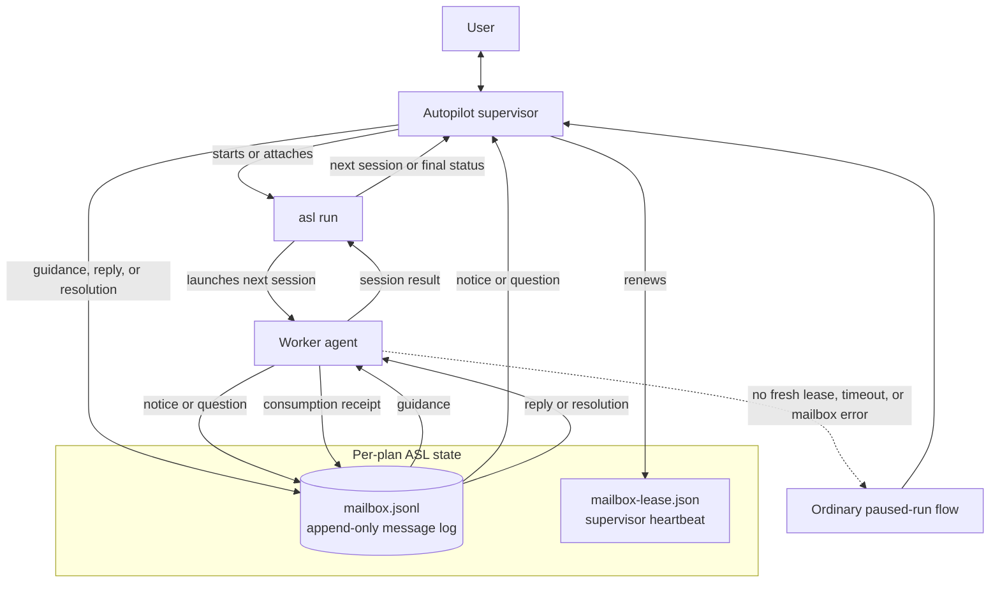

# Agent Session Loop (ASL)

ASL executes a prepared plan one session at a time. Its Autopilot supervisor starts or attaches to `asl run`, watches the active worker, and uses a per-plan mailbox to exchange live guidance, notices, questions, and answers without restarting the session.

The mailbox is a durable, append-only history; the first reply or resolution closes a question, and the worker records when it consumes that closure. Durable mailbox, event, and state-ledger writes use `fcntl(F_FULLFSYNC)` on Darwin to flush the device cache, falling back to `fsync` when the filesystem does not support that device barrier; other platforms use `fsync` directly. Atomic state replacement also syncs its parent directory. During a harness turn, every stdout and stderr chunk updates the shared in-memory active-turn counters and preview immediately, while ordinary activity is coalesced into durable state by the existing 30-second heartbeat. Turn lifecycle changes, action-required and hang transitions, observed-model updates, control changes, and finalization remain immediately durable. Completed turn results and events include additive `stream_io` telemetry for chunk and character counts plus cumulative callback time. Plan publication and recovery share a marker-scoped plan transaction lock so readers never observe a partially published transaction. Plan reads wait at most five seconds for that lock; a timeout reports the holder's pid, hostname, and thread rather than hanging indefinitely. The separate lease proves that a supervisor is still watching; if supervision disappears or mailbox waiting fails, ASL falls back to its normal pause-and-resume path. When `asl outbox wait` actually surfaces an open question, it also persists that run's body-free question projection and makes a best-effort `AgentSessionLoopMailboxQuestion` handoff to AgentMux. Notification failure never changes the outbox result, and closed history does not alert. The end of supervision is itself a mailbox record: the Autopilot helper appends one terminal `supervision-end` message carrying its raw exit reason and a coarse outcome, and `asl outbox wait --include all` wakes on it and reports it through `supervision_ends` and `supervision_ended`. That record ends the helper's supervision lifetime and does not prove the supervised run is quiescent: a `worker_hung` stop leaves the `asl run` child alive holding the plan lock, so later worker questions and notices can still land after the terminal record. Before that unresolved stop, the runner gives only `result_received_process_alive` one automatic recovery attempt: after the existing result grace and two zero-CPU confirmations it re-samples the tree, identity-checks the harness root and deepest leaves by pid, birth time, command, and ancestry, and sends those leaves SIGTERM once. It never escalates to SIGKILL, never applies this policy to ordinary no-result stalls, and the process-sweep opt-out disables it. The live `hang_suspected.recovery` report records the policy, attempt time, signal, candidates, signalled and already-gone pids, identity mismatches, and signal failures; resumed output clears the episode and continues the same run, while a later `worker_hung` preserves the unresolved report under `result.hang`. Every outcome except `error` is appended after the helper flushed its complete result, so stdout is parseable when the wait returns; `error` marks an abnormal exit whose stdout may be missing, truncated, or unproven and must be decided from the record alone. Because it is durable log content read through a sequence cursor rather than a live notification, a helper that already exited returns it on the next wait instead of burning the full timeout; a terminal-only wake makes no AgentMux handoff and writes no question projection. The runner emits no such record — only the helper's own exit ends supervision — and `--no-mailbox`, SIGKILL, or a crash leave none at all, so the stdout-tail fallback remains. Because two helper lifetimes can overlap on one plan, every launch carries a `supervision_id`: the launching agent passes `--supervision-id` to the helper and to `asl outbox wait`, which then reports `supervision_ended` only for that launch's own record while another launch's record still advances the cursor. The supervision loop itself uses `asl outbox supervise`, which wakes only on questions and terminal records, keeps its own resumable cursor in `mailbox-supervision-<supervision-id>.json` so no `--since` is threaded by hand, absorbs another launch's terminal record and already-closed questions without printing anything, and reports one of `IDLE`, `ACTION questions=<n>`, `DONE outcome=<outcome> seq=<n>`, or `LOST reason=<reason>` at exit code 0; `asl outbox wait` is unchanged and stays the general-purpose reader. `LOST` closes the gap that made a mis-launched helper look healthy: the helper records its `(pid, process birth time)` identity before starting the child, and each supervise pass that reads no record probes that identity, so `helper-exited-without-record` reports a helper whose process is gone and `helper-never-started` reports one that never wrote an identity while no run holds the plan — the latter only after a 120-second grace window, and neither ever preempting `DONE` or `ACTION`. The token carries the run evidence that decides what to do next — lock, `run_id`, runner-state freshness, active turn, and session counts, exposed under `--json` as `lost_reason` and `run_evidence` — because a helper killed under a live lock means only supervision needs relaunching, while a helper that never started means nothing is running at all. Supervision is launched detached (`asl-autopilot.py --detach`), which forks the supervision away from the launching shell and prints one JSON launch handshake carrying `pid`, `result_path`, and `stderr_path`, so an hours-long run no longer depends on the lifetime of the shell that started it and the run's verdict is read from `result.json` rather than the launcher's stdout.

Spending a turn is one typed boundary rather than a stretch of the run loop. `turn_execution.py` owns launch, the heartbeat and hang sentinel, artifact capture, and publication; `runner.py` builds a `TurnExecutor` per turn and calls it exactly three times — `launch` starts the harness and returns the finished live record, `finalize` collects the exited process into `result.json` and a re-read plan, and `commit` publishes the accepted turn. Each returns a frozen record (`TurnExecution`, `TurnFinalization`, `TurnCommit`) instead of mutating a shared dictionary, so what a phase produced is fixed once it hands back. Everything the loop does between those calls is the guards, which the boundary deliberately knows nothing about: `finalize` cannot announce completion, and `commit` is still the only emitter of `turn_finished`. The module never imports the runner — the run's serialized state writer and its progress reporter reach it through the `TurnPersistence` and `TurnProgress` protocols, and the leaf helpers both sides need live in `clock.py`, `durability.py`, `agent_mux_delivery.py`, and `plans.py`. Because the boundary is typed, it re-enables the `arg-type`, `union-attr`, and `index` checks the repository still suppresses elsewhere.

Verification and review are declared as state machines rather than executed as a chain of conditionals. `transitions.py` is the shared mechanism and carries no domain knowledge: a `StateMachine` validates its own table at construction, enumerates both halves of the state-by-event grid through `legal_transitions()` and `illegal_transitions()`, and raises `IllegalTransitionError` on any step it never declared, while a `MachineCursor` walks one instance and keeps the route it actually took rather than the route the table allows. `verification_transitions.py` declares the per-session lane — `scheduled` into `contract-ready`, `running`, and the settled `passed`, `deferred`, `failed`, `unenforced`, and `refused` — and declares Session 2's terminal required-check and final-review policy beside it, so success is still tested by exactly one adjudicator and that adjudicator now sits next to the states whose evidence it reads. `review_transitions.py` declares two: the verdict machine (`submitted`, `retrying`, and the settled `accepted`, `exhausted`, `declined`) and the cycle machine (`reviewed`, `materializing`, and the settled `settled`, `reopened`, `refused`), which is where finding recurrence, the per-group repair cap, broad-failure deferral, and rereview become named states instead of branch conditions. What the modules return are frozen decisions — schedules, refusals, adjudications, repair budgets, finding deltas, cycle and materialization classifications — and every effect stays in `runner.py`: pausing, reverting, writing `result.json`, and appending durable events. Neither lane module imports the runner, and the runner keeps a module-level alias for each moved symbol so existing `mock.patch.object` targets still resolve. All three modules re-enable `arg-type`, `union-attr`, and `index`, and their tests are model tests: they walk the declared enumerations, so every legal transition is exercised and every illegal one is asserted to raise.

Everything that races the run loop from outside it is one typed boundary too. `run_coordination.py` owns the three durable slots a non-loop actor writes: `waiting_for_reply` belongs to a `WaitStateStore` whose every begin, lease stamp, deadline rebase, and clear is a compare-and-set against the question that opened the wait, so a probe for a wait the loop has already finished is dropped instead of resurrecting it; `control` is written only through `record_run_control_action`, so a durable event and the control payload can never disagree about what was requested; and `assurance` is published by a `TerminalAssuranceCoordinator` that closes its finalization phase whether the advisory audit rendered a verdict, was cancelled, or raised. A `MailboxWaitCoordinator` brackets one reply-capable pause end to end — announced before it can block, cleared after it stops, including when the poll raises — and a `SupervisionCursor` carries the lease-and-clock ratchet a bounded wait advances, where only a fresh lease rolls the unsupervised ceiling forward and a detected suspend restarts it at the wake instant. The exactly-once reply guarantee is stated in one place: the poll loop reads the mailbox without its lock, so `mailbox.finish_wait` re-checks under it and whatever closure it finds there overrides the timeout the loop arrived with. The module never imports the runner — serialized persistence, the AgentMux notification seam, and the compacted state projection the audit reads enter through the `CoordinationPersistence`, `WaitNotifier`, and `state_snapshot` seams — and the runner keeps a module-level alias for each moved symbol so existing `mock.patch.object` targets still resolve. It re-enables `arg-type`, `union-attr`, and `index`, and `tests/test_asl_typing_ratchet.py` keeps that opt-in from eroding: no code may join the repository-wide `disable_error_code` baseline, no per-module override may add a suppression of its own, no extracted module may leave the `enable_error_code` list, and every public signature in a ratcheted module stays annotated with no bare `dict`, `Mapping`, or `list` crossing the boundary. A future extraction adds its module to `pyproject.toml`, to `REQUIRED_RATCHETED_MODULES`, and to `FAST_MODULES` in `tests/run_suite.py`.

That workflow also has one canonical machine-readable source. `asl supervisor-guide [--harness auto|codex|claude|copilot] [--json]` renders text and JSON from a single model, so both carry equivalent commands: the `$asl` / `/asl` skill invocation carrying the user's exact `asl run` command, the detached helper launch and its `--reply-stdin` resume, the `asl outbox supervise`, `asl inbox reply`, `asl inbox resolve`, `asl inbox guidance`, and `asl status` operations, and reading the helper's verdict from the handshake's `result_path`. Skill prefixes are derived from the harness adapters rather than restated, `--harness auto` reuses the existing invoking-harness detection and offers every candidate when detection is absent or ambiguous, and the command is registered through the lazy `handler_ref` mechanism so building the parser never imports it. The same discoverability gap is closed on nested groups: `bridge`, `workbench`, `control`, `inbox`, `outbox`, and `assurance` each carry an epilogue saying their help lists leaves only and naming the leaf help that owns the flags, such as `asl outbox supervise --help`.

`startup_context.py` distributes that same model to session startup so an agent learns the route before it decides whether to load the skill. It renders a compact card — the `asl supervisor-guide` entry point, the harness-specific skill invocation, the generated reference path, and the `supervise`, `reply`, `guidance`, and `status` commands lifted straight from `supervisor_guide.guide_payload` — and maintains it as one `<!-- ASL_CONTEXT_START <digest> -->` / `<!-- ASL_CONTEXT_END -->` block in the stow-managed Codex and Claude context files plus the fully generated `skills/asl/references/supervisor-context.md`. Rendering is a pure function of the guide model, never of the ambient environment, so `just sync-skills` is idempotent and everything outside the markers survives byte for byte; the digest in the start marker is what `--check` and `just verify-asl-install` use to detect a stale block without rewriting it. `install_verify` extends that to the live install: the active Codex and both Claude context files must carry the current marker, each installed ASL skill must retain its reference-loading instruction, and its bundled `asl-autopilot.py` must resolve to this checkout.

`install_verify` also reports the health of a paired Agent Mux cockpit, and reports it *advisorily*: a check may be `ok`, `FAIL`, or `warn`, and only a non-advisory failure makes `just verify-asl-install` exit nonzero. Every cockpit finding is advisory, because Agent Mux is an optional consumer of ASL's projection and never a dependency of it — ASL must install, verify, and run with no cockpit present at all, and a missing `amx` is reported as a passing advisory rather than as an absence to explain. `--require-agent-mux` promotes the whole advisory set to failures for an operator who has decided the pairing is load-bearing on their machine. What the check exists for is the one failure neither side can see alone: a daemon that resolved a *different* `asl` than the one on the operator's PATH keeps working and keeps being wrong, so its `executable` is compared against the verified wrapper and a mismatch names both paths and points at `amx config asl-sync`. Contract-set drift and an unreachable bridge are reported the same way, with the daemon's own reason quoted rather than re-derived.

ASL's workspace domain keeps ordered repository declarations separate from plan parsing and runner behavior. It normalizes aliases, relative paths, and credential-free origin identities, then resolves repositories only when each path remains beneath the workspace, is an exact Git top-level, and has the expected origin. Legacy single-repository plans retain version 1 `plan-metadata.json`; version 3 binds a multi-repository plan to a canonical `workspace_root` and registry digest. Version 2 remains readable as the same binding, and a version 3 file left over from the retired workspace inventory policy still loads: a well-formed `workspace_inventory_excludes` array is accepted and discarded.

Repository mutation evidence is provided by a reusable fail-closed engine rather than being embedded in the runner. Its single-repository payload preserves the review guard's HEAD, every durable Git ref tip, tracked and staged patches, untracked nodes, index flags, and ignore-source evidence. Comparisons retain the exact HEAD tips and added, removed, or moved refs; when HEAD changes, an ancestry probe classifies the move as creation, fast-forward, rewind, deletion, or rewrite and records bounded added/removed commit counts while the old objects are still available. Per-path patch evidence is attributed by walking the diff queue as `--name-status` reports it, because a change of type — regular file to symlink, symlink to gitlink — is one name entry that git can only render as two patch sections, the old type's deletion followed by the new type's creation. Both sections are hashed together as that path's evidence; pairing one section per entry would misalign every remaining path in the queue and, for a repository carrying any typechange at all, fail the capture outright. A queue that still does not add up remains fail-closed rather than pairing short. It can also inventory ordinary and linked Git worktrees recursively without following symlinks, capture a deterministic workspace vector, and compare vectors with changed, added, removed, unavailable, and repository-qualified path details. Recursive inventory always inspects the supplied root, then prunes hidden descendant directories before Git probes; its additive `discover_git_worktree_inventory` result reports the discovered roots and the count of pruned hidden workspace subtrees. Git metadata directories are pruned separately and are not counted. An invalid marker in a visible subtree remains fail-closed, while registered repositories are resolved directly and never depend on recursive inventory. Inventory is capped explicitly to bound Git probe work over broad workspaces.

Multi-repository source plans declare one `## Repositories` Markdown table before the first session, with the exact ordered columns `Alias`, `Path`, and `Origin`. `asl split --check` validates the declaration without writing, and `asl split` moves its normalized ordered registry into `manifest.md`; `context.md` contains only the remaining shared source context. Registry details are additive in split JSON, while plans without a registry retain their historical files and response fields.

Split output ids are already the source content hash plus the canonical-path fingerprint, so a matching plan id means the same source has been split before. `asl split` and source-mode `asl prepare` now refuse when `<plan-id>` or `<plan-id>-N` already exists, reporting each existing directory with its readiness state instead of silently creating another duplicate plan tree. Intentional duplicates still opt in with `--force-new`, which preserves the numbered `-2`, `-3`, … suffix behavior, and `asl split --check` remains write-free.

Read-only surfacing for abandoned planning now lives in `asl plans`. It lists the same Workbench-discovered plan corpus, can filter to plans whose run-state file is absent with `--never-run`, and can filter by manifest readiness state with `--readiness STATE`. Its `--stale-days N` cutoff uses the Workbench summary's last-activity timestamp when one exists, and otherwise falls back to the manifest readiness check time so a split plan that was prepared or reviewed but never launched still appears as stale.

`asl bridge serve --stdio --protocol 2` is the boundary an external supervision client speaks to: it observes the active and actionable run corpus and performs every V1 intervention over it. The server writes its `hello` before reading a byte, so a client learns the protocol version, the ASL version, the contract-set ID, the ordered method list, the event list, the mutating subset of the methods, and the 1 MiB frame ceiling without having to guess or probe; capabilities are additive and ordered, so a client may feature-detect by membership and never by position. Protocol 2 splits what protocol 1 published as a single mixed list, because one array of methods and events left "can I call this?" and "will I be sent this?" indistinguishable and the mutating subset — the one that needs a handshake — implicit. The advertised methods are derived from the handlers actually registered in the process rather than written down twice, so the bridge cannot claim a method it does not serve. Framing is NDJSON on stdout with diagnostics kept on stderr, one JSON object per line, requests correlated by a non-empty client-chosen `id` that the matching response echoes. Every response carries `ok` plus exactly one of `result` or an error object of `{code, message, retryable, details}`, and the code vocabulary is closed — `malformed-json`, `invalid-request`, `unsupported-protocol`, `unknown-method`, `frame-too-large`, `internal-error`, `mutation-failed`, `workbench-unavailable`, `contract-set-mismatch`, `stale-snapshot`, plus the service layer's own refusal reasons — so a client branches on codes rather than parsing prose. None of those conditions ends the server loop: an unknown method, an unsupported protocol version, a malformed line, an oversize frame whose remainder is drained, a plan that disappeared mid-scan, a refused mutation, and a projection that raised are each answered and survived, and only end-of-stream or a broken pipe returns cleanly.

The version is not negotiated. `--protocol 1` fails before a byte of protocol is written and there is no protocol-1 parser left on either side, because a compatibility path kept "just in case" is a path nothing exercises and everything must keep working. What replaces negotiation is identity: the hello names one contract-set ID, and a client that does not implement exactly that ID has no compatible way to continue. Reads stay available across a mismatch so a stale cockpit can still render what it has and explain itself, but every mutating method is gated behind `session.handshake`, which accepts only an exact contract-set match together with a snapshot digest the bridge still holds. A foreign contract set is refused once as `contract-set-mismatch` with `retryable` false and a message that is a fixed string rather than an interpolation of whatever the client sent — a compatibility reason reaches an operator's screen verbatim, so echoing an unvalidated identifier into it would turn a diagnostic into an injection surface. A handshake against a projection that has since moved is answered, not refused: the response reports `mutations_enabled` false and names the digest to refresh to, and a mutation attempted against it fails as `stale-snapshot`, which is retryable in the narrow sense that refreshing and handshaking again is the fix. The gate runs before the request is parsed, so an unauthorized client is refused rather than coached on its parameters, and it is enforced from the declared mutating-method list rather than inside each handler, so a method added to that list is gated by construction.

The projection itself is built from the existing Workbench discovery and summary classification rather than from a second state reader, so the bridge can never disagree with the queue an operator is already looking at. Rows cover only the fixed active and actionable states — `paused-for-reply`, `failed`, `stale`, `invalid`, `verifying`, `running` — and healthy `ready`, `recent`, and `complete` plans are structurally absent rather than filtered by the client. Ordering is Workbench's own urgency order, identity is the stable `(plan_dir, run_id)` pair hashed into a `row_id` so a client can diff snapshots across restarts, and paths are normalized. Observation is explicit: summary, Q&A, lock, and waiting-for-reply reads all pass `reclaim=False`, so the bridge classifies a dead local lock as `stale` without removing it and a snapshot is a function of the corpus rather than of its own read order. `runs.snapshot` answers on demand and a one-second digest poll emits `runs.changed` with a monotonic `seq` only when the digest actually moved, so an idle corpus produces no traffic. Question content never reaches a snapshot: rows carry question IDs, an unanswered count, the context kind, and body-free timing and status metadata, and the projection deliberately reads persisted runner state and mailbox records instead of the Q&A context loader, because the cheapest guarantee that a body is never serialized by accident is never to load one. A body is fetched only when a client deliberately asks for one through `question.get`, which bounds it to 256 KiB and refuses larger with an explicit Workbench fallback rather than truncating a question into something misleading. For the same reason no free-form summary prose is copied — every human-readable string on a row comes from ASL's fixed activity vocabulary. Per-field and aggregate bounds cap text, identifiers, paths, warnings, question IDs, and row counts, and the snapshot is shrunk until it fits, so corrupt state cannot breach the frame limit.

Mutation is the same projection read backwards. Every row carries the actions currently permitted on it, a reason for each action that is not, and an `action_token` fingerprinting the plan identity together with the run, paused, turn, context, and open-question facts that made those actions legal — never the wall clock, so an unchanged run yields an unchanged token. A client returns that token with `question.reply`, `question.resolve`, `run.resume`, `run.stop_after_current`, `run.abort`, or `workbench.ensure`, and the handler re-reads the run and re-derives the token immediately before touching anything. A stale or mismatched token performs zero writes and never spawns a process, because the check precedes the mailbox lease, the control-queue append, and the resume spawn alike. What is legal lives in one shared service layer that the mailbox CLI, the control CLI, the Workbench reply handlers, and the bridge all call, so the bridge cannot drift from the surfaces an operator already uses; where it differs deliberately it is stricter, requiring an active run and an exact `run_id` match even for commands the CLI accepts on behalf of a future runner.

Because a durable intervention outlives the request that started it, mutating methods answer `accepted` with an operation ID rather than blocking on the outcome, and later outcomes arrive as body-free `operation.updated` events reporting `consumed`, `rejected`, `expired`, or `superseded`. The receipt window is bounded and in-memory: count-based eviction only ever drops settled operations, so a burst of requests can never evict an in-flight resume and let it spawn twice, and anything still awaiting an outcome leaves only through the TTL, which is itself reported as an `expired` event rather than vanishing. Reply text is passed straight to ASL's durable mailbox records and appears in no response, event, operation receipt, snapshot, or stderr line the bridge can emit. `workbench.ensure` lazily starts one Workbench HTTP server on `127.0.0.1` with an ephemeral port and a generated token, returns a deep link into the plan, reuses that server for every later request, and stops it when the bridge process exits, so the listener never outlives the client that asked for it.

The protocol has a second implementation in another language, so the wire shape is a checked-in corpus rather than a description repeated twice. Protocol 2 retired the bridge's own fixture directory into the contract corpus described below, because two corpora describing the same wire is exactly the drift the corpus exists to prevent: `tests/fixtures/agent_mux_contract/fixtures/bridge-protocol-v2/` now holds one canonical document per message — hello, handshake accepted and read-only, snapshot, `runs.changed`, question body, operation receipt, `operation.updated`, error response, Workbench link — beside fixtures the schema must reject for a named reason at a named JSON pointer, and the manifest pins the method list, the mutating subset, the event list, and the closed error-code vocabulary. This repository is the source of truth; Agent Mux vendors a byte-identical copy and validates the same documents in Go with unknown fields rejected. Both sides recompute the corpus digest, so a one-sided edit fails on whichever side drifted rather than surfacing as a runtime mismatch against an installed pair. `tests/test_asl_bridge_fixtures.py` additionally validates what `bridge.py` actually produces — its hello, its snapshot, its handshake, and both new refusals — against those schemas, which is what keeps the corpus from becoming self-consistent fiction: it caught two real drifts, a stale-token refusal the fixture had marked non-retryable and a Workbench deep-link fragment written in the wrong shape. The documents cannot name the live contract set, because a digest computed over corpus bytes cannot appear in those bytes, so they carry a placeholder the test substitutes; a fixture containing the real identifier is itself a failure. Because the fixtures are the contract, they are also where the body-free guarantee is enforced structurally — the snapshot and event documents are asserted to carry no question body at all, so a field that would leak one cannot be added on either side without failing both suites.

That corpus pins one protocol version of one surface. The compatibility contract between ASL and AgentMux as a whole — projection v1 in `state.json`, lifecycle hook v2 on `amx hook-indicator`'s stdin, bridge protocol v2 on the wire — lives in `tests/fixtures/agent_mux_contract/`, and ASL owns it because ASL is the sole run authority: the component that owns the runs owns the description of them. Each of the three carries a canonical schema plus fixtures the schema must accept and fixtures it must reject for a named reason at a named JSON pointer, so "closed fields, bounded values, body-free" is a property the corpus enforces rather than a convention it documents. Objects are closed, every string carries an enum, const, format, or ceiling, every array a `maxItems`; absence is spelled `null` so a consumer never separates missing from not-applicable; timestamps have one UTC spelling and paths one canonical form, so the same instant and the same plan compare byte for byte across all three surfaces. Question and reply prose is refused by name at every depth before any schema-guided walk runs, which is what makes a leak diagnose as `body-not-allowed` where it actually sits instead of as an unknown field, and the single body-bearing frame declares its exemption as an explicit pointer that the linter reconciles in both directions — an exemption outliving its field is as much a defect as a field without one. Identity is derived rather than declared: the contract-set ID is a digest over the canonical corpus bytes in sorted order, so editing any schema or fixture moves it and nothing else can, and `manifest.json` maps that ID to component versions, digests, and the capability lists a consumer feature-detects against. `asl contract-check PLAN_DIR --agent-mux --json` reports the whole of it beside the plan's own contract rows. Publishing is not adopting, and the three halves were adopted separately: the projection and the lifecycle hook emitted from the corpus first, and the bridge followed by cutting to protocol 2 and retiring its own parallel fixture set. All three now derive from the one identifier, which is why the hello carries the contract-set ID rather than a version per component — listing them separately is what would let them drift, and the frame is closed against unknown properties precisely so a fourth cannot be added without moving the identifier.

A shared identifier only settles which pair *should* ship together; what actually ships together is decided by a gate that lives on the client side, because the client is the half that installs a binary and restarts a daemon. `just paired-release-gate asl_root=… signing_key=…` in the AgentMux checkout refuses two dirty working trees, then runs this repository's `just test-all`, `just lint`, and `just reliability-stress` alongside AgentMux's own `just check`, crash/restart, integration, and stress gates, compares `tests/fixtures/agent_mux_contract/` against the vendored copy byte for byte, and installs the two halves in the only safe order — this repository first through `just all` and `just verify-asl-install`, then AgentMux — since a daemon restarted against a stale ASL proves nothing about the pair. It closes with a real-Kitty cockpit smoke, so observation is exercised against the live installation the same way `just asl-integration` exercises intervention. The record it writes is a deterministic JSON document, signed with `ssh-keygen -Y sign` under the namespace `agentmux-asl-release` and named by a pair ID derived from both revisions and the contract-set ID, and both repositories take an annotated tag under that ID. Two things in it are recorded explicitly rather than derived: the SHA-256 of `manifest.json`, because the manifest is excluded from the corpus digest and therefore cannot move the contract-set ID when it drifts, and an ordered tree digest over `agent_session_loop/*.py`, because ASL ships as Python and hashing only the installed wrapper would pin a launcher instead of the sources it dispatches to. The signature attests provenance and not approval, so verification checks the namespace *and* that the record's `result` is `passed`.

`asl agent-mux pairing [--state-dir DIR] [--migrate] [--json]` answers for a whole installation rather than for one plan, which is why it exists at all: `asl contract-check --agent-mux`, `asl migrate-state`, and `asl compact-state` each know some of what a cockpit needs before it may pair, and every one of them is keyed by a plan directory. Pairing takes none. It reports the absolute path of the entry point that is running, the contract-set ID this build implements, the bridge protocol it speaks, the canonical state root, the current state schema version, and a classification of every plan state directory under that root as `compatible`, `migratable`, `active-incompatible`, `unprojectable`, `unreadable`, or `empty`. The executable is made absolute but deliberately not canonicalized: the launcher on `PATH` is usually the stable name — `~/.local/bin/asl` — pointing at a target an upgrade replaces, so following the link would persist the path that churns rather than the one that does not, and when the entry point cannot be named at all the field is null rather than a bare `asl`, because a bare name puts an interactive shell's `PATH` back in a loop that pairing exists to remove. `--migrate` upgrades every `migratable` plan in place and is refused outright — nothing is written anywhere under the root — while any plan is `active-incompatible`, with the offending runs named by plan directory, run ID, and PID. That refusal is whole-root because the promise is whole-root: a live legacy run keeps publishing state and lifecycle hooks the configuration about to be written does not cover, it holds its state payload in memory and rewrites the whole file on its next transition so an upgrade beneath it is reverted at best, and stopping someone else's run to finish a configuration change is not a decision this command gets to make. The exit reasons — `ok`, `active-incompatible-runs`, `migration-failed`, `state-root-error` — each name a distinct operator action, and every outcome presents the same keys so a consumer branches on `reason` alone and never on which fields are present.

`asl diagnostics export --agent-mux [--state-dir DIR] [--run-id ID] [--plan-dir DIR] [--output PATH] [--json]` is the only supported way for another program to read ASL's internal state, and it exists because the alternative is worse in a specific way: `state.json`, `events.jsonl`, and `mailbox.jsonl` carry question bodies, reply text, control messages, and whatever a harness wrote into a reason string, and a debug bundle that parsed them would become a second consumer of every private format ASL owns while leaking prose into an artifact meant to be shareable. `amx debug bundle --include-asl` invokes this command instead. It is bounded: every collection has a cap, every cap is published in the document's own `limits` block, every cap that bites is counted in `omissions` with a section, a reason, a count, and a digest, and the log scan itself is bounded so an unrotated log cannot turn a debug capture into a full-file read; the serialized document never exceeds its byte ceiling, and runs are dropped from the end — each drop recorded — until it fits. It is deterministic: no wall clock, no host entropy, and no iteration-order dependence, with runs ordered by the projection's `updated_at` and the plan digest as tie-break, so repeated capture over frozen inputs is byte-identical and the `digest` field over the rest of the document lets a consumer prove it re-read the same evidence. It is control-plane only by construction rather than by filtering: field allowlists decide what is copied, a value arriving as a container on an allowlisted key is dropped rather than copied, and mailbox `text` and `note`, run-control `message`, per-attempt delivery detail, prompts, model output, bridge stderr, and verification output have no path into the document at all — what was withheld is still counted, so a mailbox record reports `text_chars` and `note_chars` and a reader can separate "no reply" from "a reply this export will not show you", with the standing policy shipped inside the document as `redaction_policy`. One run record carries the whole cross-system causal path: `plan_digest` is `sha256(plan_dir)`, the one correlation key that survives a share-mode bundle's path aliasing; the projection block is copied through the projection contract's own field list, so a field the contract does not define cannot be published even when a newer build wrote one; `projection_generation` and `lifecycle_source_sequence` are the counters Agent Mux's monotonic acceptance gate compares; `source_event_id` and `request_id` join each delivery outcome to the daemon journal entry for the same notification; `operation_ids` are bridge operation IDs, durable because a control command persists its operation ID as `command_id`; `closure_ids` are what reply and resolve produce; the assurance summary joins the shared ledger by issue ID and carries no finding body; and `binary_sha256` says which bytes ran beside the version string that says which release they claim to be. The export is read-only in the strict sense — nothing under the root is opened for writing, no lock is taken, no stale lock is reclaimed — so a bundle is capturable while a run is live and while it is wedged, and every unavailable input degrades to a named reason rather than to a failure: a missing state root exports an empty but complete document, an unreadable `state.json` still exports that plan's logs, a projection whose contract set this build does not implement is reported as `foreign-contract-set` and not copied because this build cannot vouch for field meanings it does not implement, and a root that cannot be scanned at all exits nonzero with `state-root-error` and still a well-formed, digested document. Without `--output` the command writes the document itself to stdout byte for byte, because that is what a consuming bundle stores and wrapping it would make the caller parse an envelope to reach the artifact whose byte stability is the whole point; `--agent-mux` names the consumer profile and is required, so a caller that forgets to name one is refused rather than silently handed Agent Mux's.

Emitting is where the corpus stops being a description. One module owns the canonical types, and both surfaces are built from the same payload by the same code, so the hook cannot claim a phase the durable record disagrees with. The projection is written inside the single atomic `state.json` replacement that every state transition already performs, which is what makes "every transition is projected" a property of the write path rather than of remembering to call something: there is exactly one writer, the payload mutation and the write are serialized by the same lock the run already holds, and the generation counter is allocated inside it, so concurrent writers produce a gap-free monotonic sequence with no separate counter to fall behind. That generation is deliberately not the lifecycle sequence — a state write and a notification are different events, and collapsing them would make a dropped fail-open notification look like a missing transition. Body-freeness is structural: the projection is assembled field by field from a closed set of identity, phase, and position values, so a question contributes its ID and nothing else, and prose, prompts, verification output, and bridge diagnostics have no field to arrive in. Process birth identity — the pid plus the kernel's start token — rides along for live phases only and is cleared for paused and finished ones, because a terminated run naming a pid invites a reader to signal whatever inherited that number.

Migration reads the version rather than assuming it: an absent `version` is v1, v1 and v2 upgrade in place, the current version is a reported no-op so re-running is safe, and anything else is refused by name instead of guessed at. The refusal that matters is a live process holding an incompatible record — it has the payload in memory and will overwrite the upgrade on its next transition, so upgrading underneath it produces a file that silently reverts. Everything else in the record survives byte for byte, paused and terminal state included, because migration exists to add a projection to the evidence, not to reinterpret it.

Ship the bridge before the client. ASL is the older and more widely installed half, so upgrading it first means a supervision client finds a bridge it can talk to on its first start; the reverse order is safe but inert, because a client that finds no `asl`, or one predating the subcommand, reports the integration unavailable and stays read-only. There is no client-facing migration: the bridge adds a subcommand and changes nothing about `asl run`, `asl workbench`, the mailbox, or the control queue. Capabilities are additive and membership-detected, so a newer bridge serving more methods than a client knows about is not a conflict; a client requesting a protocol other than 1 is, and the server exits 2 with a stderr diagnostic rather than degrading into a guess.

Declaring that registry is not optional once the plan needs it. A shared detector resolves a plan's absolute, `Alias:path`, and contract `path`/`cwd` targets against a root, keeping only paths that exist on disk and ignoring fenced content and system prefixes. When those targets reach a second Git repository, or escape the root into a path a Git repository still owns, an undeclared plan is refused: `asl split --check --cwd ROOT` reports `missing-repository-registry`, `asl split` fails the write path on the same evidence including its contracts file, and preflight raises a red `repository-footprint` finding. Every one of those surfaces emits the same `repository_footprint` JSON object, whose `suggested_registry_table` and `suggested_scopes` are derived from disk so a caller applies a discovered registry rather than an invented one. An absolute path that stays inside the bound root is still accepted. So is an escaping target that belongs to no Git worktree: it is classified as external evidence and never forces a registry, because a registry row can only describe a Git repository and refusing that plan would demand a declaration nobody could write. Both detectors agree on that rule, so an ASL plan-store artifact or any other non-Git path is never a reason to reword a plan.

That detector only counts a location the plan wrote down and that already exists, so a plan whose sessions create their files, or whose locations arrive through contracts, plan metadata, or a runner task packet, could still slip into legacy single-repository mode. A separate reusable repository-intent engine closes that gap. It extracts candidates from absolute prose paths, inline backtick spans, contract `path`/`cwd` fields, plan metadata and execution roots, and task-packet artifact paths; resolves symlinks; and walks to the nearest *existing* ancestor so a file a session has yet to create still names its owning Git top-level. Repositories are identified by resolved root and never by origin, so two clones of one upstream stay two repositories. A candidate resolving into no Git worktree is classified separately and never forces a registry, as are system prefixes, runner-owned plan artifacts, and the document the plan declares it was split from. That last exemption is resolved from the manifest's `**Split from**` pointer rather than applied to one line shape, so the source document is exempt wherever it is named — a metadata field, session prose, an expansion note, a handoff, a regenerated artifact — and it is reported under its own `plan-provenance` label so an operator can tell it apart from runner bookkeeping. It covers the source file and the directory holding it, so sibling plans in the same store do not trip the gate either, and it is bounded twice: a pointer that names a directory exempts nothing, and the parent directory is exempted only when it sits strictly inside a Git repository, never when it is that repository's root, `$HOME`, the filesystem root, or a directory in no repository at all. Everything else in that repository still requires a registry. System-prefix classification is repeated after symlink resolution, so a workspace-relative virtualenv interpreter that lands under `/opt` or `/usr` stays toolchain evidence instead of becoming a repository target. Its bounded, credential-redacted report names each candidate's declaring surface, resolved path, Git root, and exemption. Registry necessity is judged against the Git repository containing the bound root: any different Git root requires a registry, including the sole discovered Git target when the bound root itself is non-Git. `asl split` refuses such a plan with the reason `repository-registry-required` before it resolves an output directory, and `asl split --check` reports the same reason when source-only evidence is already conclusive; otherwise the contract-aware write path, which also reads the contracts file, is the surface that decides.

The same intent report is an authoritative readiness blocker downstream of the split. Preflight reads it from the plan's own session files, `context.md`, `manifest.md`, parsed contracts, and stored plan metadata, anchored to the root the plan already recorded or to an explicit `--cwd`, and emits a red `repository-registry-required` finding whose repair guidance names `asl register-repositories` and the three things it derives for a legacy plan that exceeds its bound repository authority: a top-level `## Repositories` table, per-session read and write repository scopes, and a repository alias plus repository-relative locations on every contract check. Preparation refuses the same plan at its validation-authority choke point, which covers validation ingest, baseline publication, readiness marking, and resume alike, so nothing is published before the refusal; `asl prepare` exits with the `repository-registry-required` reason and `asl expand-ingest` emits it with the bounded `repository_intent` payload naming the repositories to register. The invariant is non-bypassable in the same sense `repository-footprint` is: `--allow-not-loop-ready` does not waive it, `--mark-loop-ready` refuses outright while it is red rather than relying on each caller to consult the blocker list first, and the pause itself is never skipped. What it is not is unrepairable. Preflight's `auto_repair_plan` leads with the migration and the rebind whenever the same read-only derivation the migration runs returns a plan — a refusal withholds both steps and names its missing fact in `suggested_pause` instead of advertising a repair the command would decline — `asl run` applies the file migration itself on that same admissibility rule rather than one of its own, and the session-expand, session-split, and plan-preflight-iterate skills drive those commands instead of asking a human to hand-write the registry. What no surface does is resolve the ambiguity by selecting one child checkout as the root, or by inventing an alias or an origin the derivation refused to observe. Registered plans skip the check entirely, and a legacy plan whose targets stay in the Git repository containing its bound root behaves exactly as before.

That refusal is derivable rather than a manual repair, so `asl register-repositories PLAN_DIR --cwd ROOT` writes the migration ASL already knows. It resolves the plan's repository intent, derives the workspace root, the ordered registry, one read/write scope per session, and a `repo` alias plus repository-relative `path`/`cwd` for every contract check, then rewrites `manifest.md` and every `session-N.md` through one plan transaction and refreshes the readiness hash while preserving the readiness state. Prose, handoffs, and `plan-metadata.json` stay byte-identical — replacing a legacy single-root binding belongs to the rebind — and re-running reports `already-registered` without writing. It fails closed on anything it cannot observe: a missing shared parent, an unobservable `origin`, a contract path under no registered repository, and a command check naming no repository each write zero bytes and exit naming that one missing fact, because a guessed registry row would only fail validation later. It fails closed on the part-way plan too: a registry makes a completed handoff's bare `Files modified` entries illegal, so a plan whose finished sessions recorded unqualified paths is refused with `completed-handoff-paths` instead of being migrated into a plan nothing can parse. Every surface asks that one rule — the command, the runner's own gate, and preflight's repair steps — so no surface advertises a migration another would refuse. A plan whose lock a live run holds is refused rather than rewritten underneath that run. Applying the registry is not the whole repair, so the result carries the remaining order authoritatively: `asl prepare PLAN_DIR --resume --rebind-workspace --cwd WORKSPACE_ROOT` first, because the new registry digest invalidates the prepared binding and its baseline evidence, then `asl run PLAN_DIR --cwd WORKSPACE_ROOT`, both against the derived workspace root rather than the root the plan was bound to.

The same refusal fires one stage earlier, in `asl split --check`, before a plan directory exists, so `asl register-repositories (--plan-file PATH | --inline-stdin) --cwd ROOT` runs the identical derivation over a source plan's markdown and emits the migrated plan rather than writing files. It inserts the registry above the first session heading, both scope lines under every session heading, and a rewritten contract in each session that has one, using the authoring parser's own section bounds so every other byte survives. The input is never written: without `--output` the migrated markdown is the whole of stdout and can be piped straight into `asl split`, with `--output PATH` it is written there, and `--output` naming the input is refused. Registry rows spell each origin as an absolute Git URL because that is what a source plan's table accepts, while a split plan's manifest records the transport-neutral identity. The derivation's missing facts refuse identically here — all but `completed-handoff-paths`, which needs a handoff a source plan does not have — and a refusal emits no markdown at all rather than a partial plan.

Readiness is not the last word, because a plan already marked `loop-ready` short-circuits core preflight and a legacy plan can skip preparation altogether. The runner therefore re-derives the same verdict itself, at the boundary where it still owns every decision. The run-entry gate runs after root and workspace resolution and before the lock is taken or any implementation, review, verification, or commit subprocess starts; reaching any Git top-level other than the one containing the bound root pauses the run with `repository-registry-required` and the bounded, credential-redacted `repository_intent` report naming the conflicting roots. That includes a Git target reached from a non-Git bound root, because the bound root grants no implicit repository authority. Each session task packet is rechecked the same way immediately before its turn launches, reading the rendered prompt and the contents of every artifact the packet tells the worker to open, because expansion notes, shared context, a predecessor handoff, live mailbox guidance, an operator reply, and repair references all reach the worker through surfaces the plan-level scan does not read — a redirect living only in `session-N.expand.md` is caught here and nowhere else. Both gates are structurally independent of `--allow-not-loop-ready`, which waives readiness and can never stand in for the registry that would have bound the other repository. That recheck filters provenance metadata exactly as the plan-level scan does, and carries the same declared-source exemption, because the artifacts it reads are plan documents and a turn quoting where the plan came from is not a turn that redirects anywhere. Registered workspaces are exempt, as are the runner's own trees: the plan directory, the state root, and the run directory, which an operator may legitimately keep inside an unrelated checkout, and the document the plan was split from together with its directory. The regression that pins this reproduces two clones of one remote side by side: a legacy plan bound to one of them and reaching the other launches no harness and mutates neither clone, while a registered plan naming both executes normally against the second. Identity is the resolved Git top-level, never the origin URL, so the refusal survives clones that no origin comparison can tell apart.

Every session in a registered plan also declares exact `**Reads repositories**:` and `**Writes repositories**:` fields. Reads are non-empty; writes may be `(none)` and must be a subset of reads. ASL renders those fields before the session instructions, preserves them in readiness identity, and rejects missing, duplicate, malformed, or unknown aliases. Completed handoffs qualify each modified path as `Alias:path`, and resplit children inherit the parent scope unchanged. Plans without a registry retain the legacy session, handoff, and resplit formats.

Completion-contract checks in a registered plan are repository-attributed with `"repo": "Alias"`. Every check needs an explicit alias when the registry has multiple entries; a one-entry registry supplies its sole alias when omitted. Registered contracts reject absolute or upward-traversing `path` and `cwd` values, while legacy plans retain their existing absolute-path behavior. `asl verify`, `asl contract-check`, and `asl baseline` interpret `--cwd` as the workspace root for registered plans, resolve every command/probe/path beneath its selected repository, and report both qualified and resolved locations. Registered baseline records carry the registry digest and an ordered aggregate fingerprint of every registered repository, so a change anywhere in the workspace invalidates prior evidence. Legacy single-root execution and v1 cache keys remain unchanged.

`asl preflight` and `asl doctor` also interpret `--cwd` as the workspace root for registered plans; that common parent does not need to be a Git repository. Preflight resolves the registry once, rejects declared paths that traverse symlinks, verifies every child checkout's exact root and origin, and captures every registered repository fail-closed; undeclared siblings are outside the plan's business and produce no finding at all. It dispatches command and baseline probes through repository roots and checks every registered tree for cleanliness in commit mode. Registered JSON and text output list repositories in declaration order. Stable workspace/registry/root/origin/overlap/scope/contract findings block loop-ready, while legacy preflight categories and single-root output remain unchanged. The `repository-footprint` and `repository-registry-required` categories are the findings no escape hatch waives: both are derived from the plan's stored `cwd` when no `--cwd` is given, both are rechecked on the resume path because the readiness hash covers plan content rather than the root a run binds it to, and `asl run --allow-not-loop-ready` still pauses on either with the blocking categories in `pause_details.blocker`. Verification enforces the same containment at run time, so a legacy check resolving outside its bound root fails even if the gate is skipped.

The runner resolves that same prepared binding once at startup and never rewrites a mismatched `plan-metadata.json`. Registered dry-run and doctor invocations launch from the canonical workspace root, expose additive `workspace_root`, `registry_digest`, and ordered `repositories` data, and render the selected session's read/write aliases plus qualified-path rules without exposing resolved roots outside its read scope. State, status, event, tail, resume, and invocation projections preserve `cwd` as a compatibility alias while carrying the structured workspace fields. Every registered implementation or review turn snapshots exactly the repositories the plan registered before launch and rescans them before any timeout, transport, pause, verification, or commit branch. Implementation changes pass only in the active session's write aliases; generated reviews read every declared alias and have an empty write set. Read-only, out-of-read-scope, added, removed, or unavailable evidence retains repository contents, returns the handoff to pending, and pauses with qualified evidence. A repository the plan never registered is outside the guard's domain, so a concurrent run writing in a sibling worktree is never evidence about this turn. Repo-relative `--review-guard-exclude` content paths apply to every registered repository. Registered generated reviews use session schema v5 and artifact schema v3, record each repository's HEAD and pre-existing dirty paths, present one ordered combined prompt with qualified delta evidence, and require repository-attributed findings, evidence, and checks. Their generated repair children read the entire registry but write only the aliases attributed by their grouped findings; child scopes activate the same workspace guard as authored sessions. Verification-check names remain unchanged unless the same name occurs in multiple repositories within one repair group, where the generated contract disambiguates only those collisions as `Alias:name`. Review-cycle and reopen records retain qualified findings, group scopes, and ordered repository bases, while eventless recovery reconstructs those facts from the generated review and repair session files before scheduling a rereview. Repair children also carry stable `repair_group` lines even without a repository registry, so the runner can stop before rematerializing a group that already exhausted its reopen budget and continuation can project the same terminal `repair-group-exhausted` disposition without trusting title fingerprints alone. The continuation payload now also carries per-group attempt counts, and the shared guidance surfaces switch from "raise `--max-review-fix-cycles`" to manual-fix-or-resplit instructions once the recurring group has already consumed its reopen budget. The run config now persists the default per-group reopen cap (`--max-repair-group-attempts`, default 2) and the absolute review-cycle ceiling (`--max-review-fix-cycles-ceiling`, default 8), so resume and Autopilot replay the same repair-loop bounds unless the operator explicitly overrides them. Git-ignored output follows the declared review-guard policy, including `--review-guard-include-ignored`. Legacy implementation and single-repository review output remain unchanged. A generated review's `final-review.md` and `final-review.json` are plan artifacts rather than repository modifications: plan inspection drops those names from `Files modified` entry by entry, so a review that also recorded a real repository change keeps that entry, and its ordinary fail-closed validation, without having to rewrite an otherwise valid handoff. When those names were the whole list the handoff reads as `(none)`, and the next runner start restores that durable field on disk automatically. Any other handoff path remains subject to the ordinary repository-qualified, write-scope validation.

Completion checks are session-local by default. An unconditional gate opts into generated-review replay only with `"review_replay": true`; diagnostics cannot opt in. Generated reviews strip replay and baseline authoring metadata from copied gates, and pending reviews refresh their marker plus Completion Contract before execution without changing scope, repository base, or handoff. Generated repair children then use mandatory runner-owned `repair_commit_mode: "per-child"` commits under a null ordinary commit mode: clean writable repositories are required before launch — the commit itself is `asl commit`, so there is no external binary to require — and only guard-attributed dirty writable aliases are committed after verification. Clean children and worker-committed children produce no runner commit, while partial groups retain durable recovery.

Workbench and Autopilot consume that binding instead of inferring a parent from a child checkout. Workbench summaries, pins, launch results, state/recovery APIs, and final-review responses expose the workspace root and ordered repositories while retaining `cwd`; registered launches reject a conflicting profile root and point operators to atomic rebind. Recovery output keeps repository-qualified verification failures, scope/evidence violations, unresolved commit groups, and partial commit SHAs visible. Autopilot adopts the status-advertised workspace when `--cwd` was omitted, refuses mismatches without automatic rebind authority, and preserves the structured binding in supervision results. Text views bound long repository lists while JSON keeps the complete ordered vector.

The browser's `formatRepositoryAliases` formatter is authoritative for its 12-repository preview limit; machine-readable repository vectors are never truncated.

Every implementation turn is now bracketed by that evidence, independently of auto-commit. Registered plans capture exactly their declared repositories and validate changes against the selected session's write aliases. Legacy plans must resolve to one Git repository, capture that whole repository before and after the turn, and pause before launching the harness when that scope cannot be established. The passing `workspace_write_guard` records worker-created commits, ref changes, and history rewrites even when `commit_mode` is null; an indeterminate post-turn ancestry probe fails closed and returns the handoff to pending. This makes worker Git operations auditable without misclassifying them as ASL's own commit attempts.

That evidence answers exactly one question — did a registered checkout change — and reports silence about everywhere else as cleanliness, which is how a turn that edited three files in an external audit store passed as workspace-clean (ASI-19). Every implementation turn therefore carries a second, path-level verdict beside the repository one, in both registered and legacy modes. Each location the turn's own task packet, session file, and sign-off message name is resolved through the same intent detector the pre-turn gate already uses and classified into exactly one bucket, most specific authority first: `control-plane` (this run's plan directory, plan state directory, and run directory), `workspace-repository`, `workspace-unregistered-path`, `unregistered-repository`, `plan-provenance`, `system-path`, `ephemeral-path`, `unresolved`, and `unclassified` for anything that answers to no authority the run can name. The control plane wins over everything, because a plan directory or state root may legitimately sit inside a checkout and the runner's own bookkeeping is never the work under judgement; a temporary directory is matched last rather than first, since under test the plan, the workspace, and every repository live inside `TMPDIR` and an early match would collapse the whole taxonomy into one bucket. Control-plane locations are digested before and after the turn — a directory by the bounded, sorted shape of its direct entries, a file by content up to 8 MiB and by size and mtime beyond it — so a permitted mutation is evidenced rather than assumed, and the comparison covers roots the turn never named, which is exactly where an append to a store leaves no trace in anything the turn declares. An unclassified path that was actually written during the turn joins the guard's `unavailable` lane and fails it closed under `workspace-write-guard-unavailable`, while one merely named, or last written before the turn began, is classified and counted but not charged to the turn. The lane is `unavailable` rather than `violations` for the same reason an unobserved repository is: a write the guard could not judge is a different claim from one it judged and rejected, and neither passes as clean silence.

A harness process ending and a turn being accepted are two different facts, and the event log now says each one separately. Collecting a finished process — its raw result, the plan re-read that follows it, and the artifacts written from both — is one bounded finalization object that can announce nothing but execution: it writes `result.json` durably and then appends `turn_execution_finished`, so the durable record that a turn ended can never name artifacts that are not on disk. `turn_finished` means the turn was accepted, and one function is now the only thing allowed to say so. `runner._commit_turn` runs after the workspace and review mutation guards, the mailbox completion guard, verification, the progress journal append, the derived status ledger sync, and any per-session commit; it builds the committed payload once from the plan snapshot those guards accepted, writes `result.json` and `state.json` before appending the event, and only then reports progress and notifies AgentMux. So an AgentMux stream shows `turn-finish` after `verification-finish`, a reader holding the event always has the artifacts it names, and the payload it returns is read-only rather than something a later phase can amend. A guard that refuses an already-executed turn now appends `turn_rejected` naming the guard, the reason, and any evidence, followed by `session_reopened` whenever it also returned a completed session to pending — the reverse transition used to be visible only by diffing the final plan against the last turn record. A turn that carries a plan error or a non-`complete` status result also reads as anomalous in a supervisor audit even when the harness exited zero. A completed handoff whose `Files modified` line is mechanically malformed — absent, still the `(none yet)` placeholder, or an entry that is not `Alias:path` — used to end the run in a `malformed-plan` pause over one line the worker could rewrite. Such a session is now reverted to pending with the defect named in its Handoff notes and re-run exactly once; a repeat, a defect the worker cannot fix in its own handoff such as a path outside its write scope, or a plan that still will not parse after the revert falls through to the same pause, now carrying that evidence. The review artifacts are independent of the handoff, so `final-review.md` and `final-review.json` are digested and classified before the correction turn starts rather than being discarded with it.

Auto-commit uses durable repository groups in both registered and legacy modes. Registered commit runs require every declared repository clean at startup, then `--commit-per-session` selects changed write aliases from the passing turn guard only while they remain dirty at commit time; a harness-created commit or a change that leaves the worktree clean needs no second commit. `--commit-at-end` selects every changed registered repository. An unregistered workspace resolves to a single target, and it is dropped when clean by the same rule, which until recently it was not: `asl commit` refuses to commit nothing and exits nonzero, so a session that wrote only outside its bound repository recorded a repository failure with empty staging and qualified paths, and the next run — finding the same tree still clean at the same HEAD — recorded it as skipped and finalized the failed group as complete (ASI-19). Not launching a commit that has nothing to commit is what keeps that record honest. ASL commits them serially in manifest order by re-entering its own checkout as `python -m agent_session_loop commit --yes --no-verify`, so a run commits with the `asl commit` it ships rather than with whatever an external tool on `PATH` happens to be, and forwards the run's resolved harness, model, and effort to that message turn. Every such invocation also carries an explicit `--timeout`, and the run bounds the subprocess itself with a generous grace beyond it, so a message harness that stalls — or a commit process that wedges before reaching its own bound — is killed with its process tree and soft-fails rather than holding the session loop. That kill is two steps, not one: the nested commit's harness runs in a session of its own and so never receives the signal aimed at the subprocess's process group, which is why the backstop snapshots the subprocess's descendants before killing and sweeps the survivors afterwards, the same pair a timed-out session turn uses; the sweep report rides along on the commit result as `process_sweep`. The expiry still reports exit 124 and still lands on the ordinary soft-failure path, so nothing downstream reads a swept commit differently from any other nonzero one. The run's own `--timeout` deliberately does not supply that bound: it applies to a session's implementation turn and is routinely unset, which would leave the commit unbounded by omission. The paths the turn guard recorded are handed over as repeated `--pathspec` arguments, so a commit carries exactly what that session changed; the ignored-evidence categories (`worktree_ignore`, `ignore_config`) stay out of that list because git cannot stage them, a linked worktree's alias keeps the repository-wide `git add -A`, and an empty list is that same default. Each commit checkpoints the group identity, successful repository SHAs, failed alias, and remaining aliases before advancing. A resumed run completes any unresolved group before launching another worker, never recommits a recorded success, and treats an unresolved repository that is already clean as recovered or skipped. Earlier successful commits are retained when a later repository fails, and the run itself no longer stops there: the group is marked failed, the failure is recorded on the turn and on the run, and the loop advances to the next session. The same restart invariant covers the retry, so an unresolved group is completed at the next commit boundary within the run as well as at the start of a later one, and a transient failure heals without a human; each group gets a bounded number of in-run retries so a repository that refuses every time cannot turn the session loop into a commit loop. A run ending with a group still owed reports it in `commit_failures` and `unresolved_commit_groups`, warns about it in the final summary without failing the run, and fails the supervisor audit's `commit-group-resolution` check so the loss reaches the audit inbox. An unreadable commit-group ledger is the one commit failure that still pauses, because continuing past evidence that cannot be reconstructed risks committing the same work twice.

Writing the commit message those groups commit is itself an ASL command. `asl commit [PATH]` stages what the flags name (`--staged` trusts the index, `--pathspec` stages exactly what it lists, the default stages everything), budgets the resulting diff to 150 KB, takes one harness turn under the same `audit_read_only_access` profile the supervisor audit uses — no `plan_dir`, no bypass, no writable grant, because generating a message only ever needs to read a diff the prompt already carries — and commits the formatted result. A nonzero turn is classified through the shared `harness_failures`/`retry_hints` vocabulary rather than reported as a bare exit code, and a response that is empty or is an error body is refused instead of committed, because headless there is nobody to notice that the "commit message" is a stack of JSON. That turn is bounded: `--timeout SECONDS` (default 900) only moves the bound, a non-positive value is refused before anything is staged, and an expiry kills the harness process group, leaves the staged content alone, and reports reason `generation-timeout` — a stall is a classified soft failure, never a hang. Three flags stop short of that: `--dry-run` prints the message without committing, `--from-id SHA` describes an existing commit and never touches the index, and `--prepare-only` emits the single-line JSON header, a blank line, and the budgeted diff that the gitsummary skill already parses. `--message-file PATH` (or `-` for stdin) commits an operator-authored message and is the one mode that needs no harness at all. `--pathspec` scopes the whole invocation rather than only the staging step: the captured diff, the empty-diff probe, the staged-content check, and the `git commit --only` that finishes it all name those paths, so an entry staged before the invocation is neither described in the generated message nor swept into the commit, and is left staged for whoever staged it. Because `git commit --only` sources the named paths from the worktree rather than from the index, a scoped commit also re-checks the captured snapshot before committing and refuses with reason `snapshot-drifted` when a named path was edited, deleted, or restaged during the generation turn, leaving every index entry as it was; `--prepare-only` reports that snapshot as the header's `snapshot` token and `--expect-snapshot TOKEN` carries it back so the gitsummary skill's second, separate invocation is bound to the same content it wrote the message from. Stdout carries the message and nothing else so the command can be piped; progress, truncation warnings, and the committed SHA go to stderr, and `--json` replaces both with one scriptable payload. The subcommand dispatches lazily through `commit_message:commit_from_args`, so nothing about it is imported until it runs.

Preparation uses validator output v2 for registered plans. Each packet carries the canonical workspace root, exact ordered resolved registry, and only the absolute roots named by each session's advisory read scope; validator findings and corrections are repository-attributed and checked against that scope before the atomic ingest transaction can bind metadata or mutate plan artifacts. Registry, workspace, session, or repository mismatches fail closed. Expansion notes render qualified locations, ambiguous unqualified multi-repository path claims block loop-ready, and baseline plus final preflight reuse the resolved workspace context. Validator v1 remains accepted only for legacy plans that really are single-repository: the v1 packet names its `codebase_root` as the sole bound root and asks for anything outside it as a `repository-ambiguous` issue, and prepare recomputes both the footprint and the repository intent before building the packet and before ingesting its output, refusing with the dedicated `repository-footprint` or `repository-registry-required` reason and the shared verdict payload. Otherwise legacy preparation behavior and metadata stay unchanged.

`asl prepare` runs validation as bounded read-only workers. `--validator-jobs` defaults to 2, `--validator-timeout` to 900 seconds, and `--validator-heartbeat` to 30 seconds; all must be positive. `--validator-model` and `--validator-effort` are opt-in, so omitting either leaves the selected validator harness's native default intact. Effective validator settings appear in JSON and in the fully pinned resume command. Worker starts, completions, and periodic batch/in-flight/elapsed heartbeats go to stderr, leaving JSON stdout machine-readable. Before launching any worker, prepare snapshots every stale batch; it caches each schema-valid per-session result in versioned `prepare-validation-cache.json`, keyed by the repository/workspace fingerprint, registry and session scope, shared context, session text, validator schema, harness, model, effort, and a digest of the rendered validator packet prompt, so changing what a worker is asked retires every entry answered under the old prompt. Successful results from a partially failed wave remain reusable on `--resume`, while a changed session or relevant shared identity reruns only the affected work. Older `prepare-validation.json` aggregates remain plan artifacts but are refreshed once because they have no reusable cache identity. Expansions and factual corrections are ingested only after the wave succeeds and always in batch order. Any validator-reported completion-contract problem is a validation blocker for that session: prepare returns the plan to draft and skips baselines, preflight, and loop-ready publication until the contract is repaired and revalidated.

Preparation also records a conservative Spark assessment for every session in `prepare-validation.json` and its expansion. The validator marks only small, explicit, settled, locally grounded sessions with clear completion contracts as eligible; broad refactors, public API or schema changes, migrations, high-risk work, and unresolved decisions are ineligible. This assessment is always produced, while `asl prepare --spark` only controls whether emitted run and resume commands opt in. Missing, legacy, or malformed markers remain runnable and visibly select the baseline.

`asl run --spark` applies only to implementation turns. It routes eligible prepared Codex sessions through `gpt-5.3-codex-spark`; `--harness-model` is the distinct baseline and fallback, or ASL resolves the configured Codex default and refuses the run when it cannot do so safely. Reviews, audits, generated final-review repairs, non-Codex live harnesses, ineligible sessions, and live `set-model` overrides keep their existing baseline behavior. A positively classified Spark quota or unavailable-model failure keeps its failed turn artifacts, leaves the session pending, and immediately tries the same session once on the baseline. Reset hints create a shared cooldown in `$ASL_STATE_ROOT/model-availability.json`; absent hints suppress Spark only for that run. The versioned ledger uses a stable `flock` sidecar and durable atomic replacement, and an unreadable ledger degrades to a warned baseline route. Run, result, dry-run, and status JSON expose the run-level `spark` policy and each implementation turn's `spark_route`; text status reports the active route, cooldown, fallback, and warning.

Which harness *release* a run may use is a separate question from which harness it selects, and `harness_compatibility.py` is where it is answered. Each harness pins a supported window — a `latest`, a `previous`, a `minimum`, and an explicit `blocked` tuple — and a resolved executable classifies as `supported`, `unknown`, or `incompatible`. The whole module is structurally model-free: the only subprocess it ever constructs is `<executable> --version`, and a test pins the recorded argv to exactly `["--version"]`, which is what lets a scheduled compatibility smoke run against three provider CLIs without spending a token or touching a plan. Probes memoize in process on `(path, size, mtime_ns)`, time out at 20 seconds, and can be switched off wholesale with `ASL_HARNESS_VERSION_PROBE=0`. Every probe failure — an unresolvable executable, a non-zero exit, a timeout, output nothing can parse — degrades to `unknown` and never to `incompatible`, because "not installed" is already its own red preflight finding and collapsing it into "known broken" would make release evidence unreadable. `asl harness-compat [--harness NAME ...] [--strict] [--json]` is the reporting surface: exit 0 clean, 1 when something is `incompatible`, and 3 under `--strict` when anything is merely `unknown`, which is the mode CI schedules so a new upstream release arrives as a warning to triage rather than a red build. Preflight applies the same policy to the selected harness, and the asymmetry there is deliberate rather than incidental: an incompatible release is `red` and blocks, an unrecognised one is `green` and does not. `yellow` was not available for the warning, because `PreflightReport.ok` and `_blocking_findings` both count yellow as a blocker — a yellow warning would refuse every run against any harness newer than the pinned window, which is exactly the case that has to stay runnable.

An existing registered plan can move deliberately with `asl prepare PLAN_DIR --resume --cwd NEW_WORKSPACE --rebind-workspace`. Prepare verifies every replacement root and credential-free origin first, rejects active locks and unchanged bindings, accepts a plan whose `manifest.md` grew a registry while `plan-metadata.json` is still v1 by discarding that stale single-root binding, then runs fresh validation, expansion/correction rendering, baselines, metadata generation, and final preflight against an isolated system-temporary plan copy that preserves symlinks. Only a completely loop-ready staged result is published to the bound plan through one rollback-capable transaction; ordinary publication failures restore the old bytes, while a durable journal lets the next authoritative plan read finish an interruption without exposing a mixed binding. Commit and recovery hold the same marker-scoped mutex, so ordinary readers wait briefly for a live publication instead of retiring its payloads; a stalled holder reaches a bounded timeout whose diagnostic identifies the lock and recorded holder. Any earlier stage failure leaves the old binding, readiness, validation aggregate, validator cache, expansions, session text, and baseline cache byte-identical. Staged diagnostics are rebased to the durable plan directory. JSON reports credential-free `workspace_rebind.old` and `workspace_rebind.new` projections plus `failure_stage`, `error`, and the successfully `published_files`; lock and concurrency races use the distinct `workspace-rebind-failed` reason with the same rebind context.

ASL also audits its own control plane after a persisted loop ends, and the vocabulary that audit speaks is defined ahead of any storage or orchestration. A run's assurance state is exactly one of `all-clear`, `findings`, `partial`, `unavailable`, `skipped`, or `pending`, and its rubric has eight lanes: identity/authority, task-packet coherence, lifecycle/retry/resume, verification/review independence, mutation/commit guards, truthfulness/observability, resources/stalls, and unknown anomalies. The resources/stalls lane treats a `turn_hang_suspected` followed by a `turn_hang_cleared` carrying signaled recovery leaves as an automatically recovered post-result hang and reports its count; a suspicion with no matching clear remains an unresolved resource anomaly. Strict versioned models cover deterministic check results, findings, issue observations, dispositions and merges, closeouts, identity bindings, and the bounded per-run summary; all of them round-trip through canonical sorted-key JSON so an artifact digest identifies content rather than a serialization run. A finding's fingerprint derives from its schema version, category, component, and stable invariant key and from nothing else, because folding in a run ID, timestamp, summary, severity, or evidence reference would make one recurring defect look new on every run and defeat the deduplication the inbox depends on. Issue references parse from `ASI-42` and from the bare shorthand `42`, never from a leading-zero or zero form that could name a different issue.

An audit that asserts a verdict must have looked. Both terminal states carry lane-by-lane evidence for all eight lanes, and `all-clear` additionally requires every lane to have passed on its own evidence, so an audit that ran, found nothing wrong, and could not judge every lane is `partial` with reason `lane-evidence-absent` rather than clean; a lane whose status is `unavailable` still names the record proving it could not be judged. A `partial` audit is a completed one — it is filed as a completed ledger record, counts as an audited run, and carries no findings — because calling it `all-clear` overstates it and calling it `unavailable` discards the lanes it did judge. A deterministic check that answered `unavailable` reports on the check rather than on the run and contributes no signal to its lane, so a lane whose checks all failed to read their evidence takes the auditor's judgement, while a lane with any real check result takes the worse of the two; that is what lets a legacy plan carrying no registry binding still earn a clean audit. `skipped` and `pending` carry no analysis at all, an ineligible run can only be `skipped`, and neither skipping nor an all-clear ever creates an issue. Every reference a lane, finding, or deterministic check names must appear in the audit's own declared evidence index, and every locator is a canonical run-relative path — absolute, `~`-prefixed, backslashed, `./`, or upward-traversing forms are rejected rather than normalized. Text, collections, and serialized artifacts are all explicitly capped. The canonical per-run artifacts `supervisor-audit-input.json`, `supervisor-audit.json`, `supervisor-audit.md`, and each `supervisor-audit-attempt-N/` directory are created with `O_CREAT | O_EXCL` rather than the last-writer-wins atomic writer, because a second write means two audits disagreed about one run and overwriting one destroys the evidence of that conflict. Unsafe artifact names are refused outright instead of being sanitized into a different filename. The two reports a publication produces are written into a per-run `supervisor-audit-staging/` directory first and take their canonical names only once identity has been validated under the append lock, because the summary names them by digest and the bytes therefore have to exist before the record that makes them true. Promotion hard-links both reports or neither, and the filesystem refuses a name already taken with no window in which to check it first; a publication that fails after promoting gives the names back, so a transient failure stays retryable instead of leaving reports nothing names under a name no later attempt could take. Staging left behind by an interrupted attempt is cleared rather than protected, since nothing durable ever names a path inside it.

Those records accumulate in one append-only ledger, `assurance-inbox.jsonl`, beside the state root, and nothing in it is ever rewritten or removed. Writers hold an exclusive `flock` on the sibling `assurance-inbox.lock` — never on the data file, which is opened `O_APPEND` — and every append is followed by a platform durability barrier; a short or failed write truncates back to the size the file had before the attempt, so a failed append leaves no partial record and never touches earlier bytes. Sequence numbers are positional rather than stored, because a crash-truncated line cannot carry a field and it still deserves a number: malformed, unparseable, over-version, and unknown-kind lines are all preserved in place as rejected history with a sequence, a reason, and a bounded excerpt of their raw text. When the file's last line lost its newline to an interruption, the next append supplies that terminator as part of its own single write instead of rewriting the file, so the interrupted record survives exactly as it landed and is classified the same way before and after the repair. Human issue IDs are minted inside that same exclusive lock: the writer reads the ledger, reuses the ID already bound to a recurring finding's fingerprint or takes the next number above *every* issue reference present — not merely the ones a valid observation minted, so a corrupted line can never license reuse of its number — and writes the allocation and the record as one act. A publication carries that further: the audit summary, every observation, and the `issue.asi-N` binding of every ID the transaction minted are one write under one lock, so an ID never exists without the key that names it and no reader ever sees an issue mid-naming. The binding follows the observation that opened its issue, because replayed ahead of it the key would name an issue nothing had opened yet and be read as an anomaly rather than as a name. The generic writer refuses `issue_observed` and `issue_identity_bound` outright and directs callers to the entry point that decides each one, so lock-scoped validation is structural rather than a convention. An identity key is the durable machine-facing name of one issue, minted as `issue.asi-N` from an ID the ledger itself allocated and never from a category, component, invariant key, summary, or severity, so rewording a defect cannot rename the issue that owns it. A binding says which allocated issue an allocated key names today; it is decided against the whole ledger inside the append lock, and a key that already names an issue is refused rather than repointed, which is what lets a merged-away key keep resolving without the merge record being reinterpreted. New records are written at schema v3, which adds the keep-distinct ruling to the v2 that added the binding and changes nothing else; older lines are still read exactly as written, and a line claiming a kind its own version predates is rejected as an unknown kind for that version rather than read as if the build that wrote it had meant it. `assurance-index.json` is a disposable cache checked against the ledger's exact size and SHA-256 and rebuilt whenever it is missing, stale, malformed, or of an unknown version; every cache write is best-effort, because failing to record truth would be worse than reading the ledger again. Only bounded metadata and artifact references are stored — prompts, logs, diffs, and harness responses stay in the run directory the record points at. That ledger and the per-plan mailbox are separate systems, and calling both of them an append-only JSONL inbox is where a reader goes wrong: `mailbox.jsonl` is a single plan's live supervision channel, scoped to a run still in progress and enabled per run, while `assurance-inbox.jsonl` is the corpus-wide permanent audit history written under its own `assurance-inbox.lock`. They share no file, no lock, no id space, and no lifetime, and neither one reads or writes the other.

The inbox a person reads is derived from that ledger rather than stored beside it: replaying the records in sequence order is the only way issue and run state is ever computed, so a copied ledger with no cache reconstructs identical state. Publishing an audit is idempotent under a key of the run ID, the record kind, and the audit-input digest taken from the run's own `supervisor-audit-input.json` artifact; the decision is made inside the append lock, so when two publishers race, the loser observes the key already present and writes nothing at all instead of adding a second occurrence. The kind belongs in that key because a `pending` and a later `skipped` record for one run both lack a digest and would otherwise be mistaken for each other. A finding whose fingerprint is already known joins the existing issue as another occurrence instead of minting a new ID, and observations recorded before a merge need no rewriting: replay in sequence order folds them into the target when it reaches the merge record. Which issue owns a finding is settled inside that same lock, from the ledger as it stands there, in one order: an exact fingerprint, then the ASL-owned identity key already bound to that fingerprint's issue, then the selection an audit made and this transaction revalidates, and only then a new ID. Anything earlier overrules what follows it, because a defect the ledger already names is not made new by an answer that could not see it, and a new ID is minted only for a finding nothing earlier claimed. An audit's selection is a request rather than an identity taken on trust: it is checked against the issues the ledger actually allocated, and one naming an issue another publisher has since merged away follows the merge instead of being refused, since the merge is the statement that the two were always one defect. A selection naming no issue at all refuses the whole publication rather than minting past it. A fingerprint first seen under a selected issue is attached to it by being observed there, so the next exact sighting of that defect recurs without anyone being asked again, and a publication that opens several issues numbers them consecutively within the one transaction. Because every route is answered from state read under the lock, a decision made against a catalog that has since moved cannot mint from what it saw; the digest it was reviewed against is compared there and a publication that outran it is reported as refreshed rather than refused. Identity bindings are resolved the same way, at replay rather than at write time: the stored record keeps naming the issue it was written against, and the projection follows the settled merge chain to whoever owns that history now, so a key outlives the issue it was minted for without any record being reinterpreted. An issue therefore carries every key that resolves to it — more than one exactly when it absorbed a named issue — and one deterministic primary identity: its own key when that key is bound, and otherwise the lowest-numbered key it absorbed, because first-write-wins binding settles who owns a key but not which of several keys an issue prefers. That same replay builds one identity catalog per projection, covering every lifecycle state rather than the open backlog and indexed by fingerprint, identity key, invariant key, normalized localization, and normalized summary token, because a defect that recurs after being resolved, dismissed, or accepted has to route back to the issue that already owns it and an index of open issues alone would mint a second issue for exactly the recurrences the inbox exists to collapse. Catalog lookups are exact and never resolve a merge chain, so a stale ID fails closed rather than being silently redirected. Localization normalizes to the file a pointer names and a summary to its sorted content words, since two sightings of one defect almost never name the same line or the same wording; negations are deliberately never stopwords, because a summary and its opposite must not normalize alike, and neither normalization touches the fingerprint or the text a human reads.

Closing an issue is a claim about the future, not about the past, so the three closed states answer a recurrence differently: a finding that comes back after `resolve` reopens the issue, while `dismiss` and `accept-risk` keep it closed and still record the new occurrence, because someone who judged a defect acceptable deserves to see how often it happens. Later dispositions move the state again through new append records, never by editing an old one. Merging is irreversible and strictly forward — a source that names itself, an unknown source or target, an already-merged source or target, or a target that would close a cycle is all refused — and later observations of a merged fingerprint route through the end of the merge chain. Audits that could not run at all deduplicate on their reason class rather than the raw exception text, so a timeout that phrases itself differently on every run is still one issue, and skipping never creates an issue of any kind. Because the ledger cannot be edited, replay treats a hostile one as history to report instead of a crash: a disposition for an issue nobody observed, a closeout for an unaudited run, and even a cyclic merge pair already on disk each surface as a bounded anomaly with the sequence number that caused it, and the chain walk terminates.

`asl assurance list` and `asl assurance show` are how a person reads that inbox, and they read it the way every other consumer does: through the projection, under a shared lock, never appending a record, minting an ID, rebuilding the index cache, or repairing a malformed line. A missing ledger is an empty inbox rather than an error. `list` answers the default triage question by printing the 50 most recently observed open issues, newest sighting first; `--limit` and `--state`/`--severity` re-aim that view, and `--all` is the negation of the whole default — every state, no row cap — so it is refused alongside `--limit` or `--state` instead of silently picking a winner. `show` prints one issue's full record: state, the fingerprint metadata it deduplicates by, the identity key it is named by today and any key it absorbed, observation history with the run and artifact behind each sighting, dispositions, absorbed IDs, reopen count, improvement plan drafts, and the affected runs with their artifact references and closeouts. An issue no key names is reported as `unbound` rather than by omission, and rows carry the same primary identity, so a machine reading `list` can name what it found without opening each issue. Occurrence history is capped the way rows are, newest kept, remainder counted, because a long-lived issue's occurrence list grows without bound. Showing a merged-away ID succeeds and names both the ID asked for and the one it landed on, since a merge redirects an ID rather than deleting it. Both commands accept the canonical and shorthand forms and always emit the canonical one, so any ID the loop prints pastes straight back in, and a single payload builder feeds the text and JSON renderers so the two surfaces cannot disagree. Unreadable ledger lines are reported as warnings rather than failures — on stderr in text form, in the payload under `--json` — because the rest of the file is still history a human needs and hiding the rejected lines would hide the only evidence that the ledger is damaged.

`asl assurance resolve`, `dismiss`, `accept-risk`, `merge`, and `closeout` are the surface a person acts through, and they change the inbox the only way it can be changed: by appending. Every decision that could refuse the write — whether an issue exists, whether a source or target has already been merged, whether a run was ever audited, whether that run already has a closeout — is made inside the append transaction under the exclusive lock, so two operators deciding at once cannot both pass a check that only one of them should. The dispositions accept a `--note` and report the consequence in the future tense the projection will actually honor, because "resolved" and "accepted risk" differ only in what happens the next time the finding comes back. `merge` is the one irreversible command, so it asks before writing when a human is actually watching — both stdin and stdout a TTY — and takes `--yes` for scripts; a declined prompt is reported as `cancelled` and writes nothing, while `--json` invocations never prompt, which is also why the loop's own harness can never hang on one. `closeout` names its run by bare run ID and finds the plan through the state corpus, so `--plan` is needed only to break a genuine tie between two plans that produced the same ID; the corpus supplies plan attribution only, and the ledger alone decides whether the run may be closed out, so a pruned run directory does not block a verdict on a run the inbox still remembers auditing. Unusable outcomes and negative or non-finite rework minutes are rejected before the ledger is opened at all. A second closeout for one run is refused unless `--replace` is given, and replacing appends rather than rewrites: the new record names the ledger line the superseded closeout occupies as `seq-N`, which is a durable name precisely because appends never renumber what came before, so both verdicts and the order they were reached in stay readable forever.

`asl assurance reconcile` repairs an inbox written before identity keys existed, and it is two commands in one because the repair needs a human in the middle. Without `--apply` it is read-only in the strongest sense: it reads the projection under a shared lock and writes nothing at all, not even the manifest it prints, since a command that left a file behind would invite applying one nobody read. The preview reports how many canonical issues exist and how many already carry a key, the catalog digest it read them at, the safe bindings it can add, the bindings some other issue's key blocks, and the pairs of issues that look like one defect. A safe binding is only ever an issue's own minted `issue.asi-N`, so reconciling can never derive identity from a category, component, invariant key, or summary. Pairs come from the catalog's semantic candidates and are asked about once rather than from both sides, capped at 200 with the remainder counted, so a large backlog arrives as reviewable batches instead of one unreadable document; a pair an earlier review already ruled two defects is counted in `suppressed_pairs` instead of being offered again. The preview's manifest is schema `assurance-reconciliation-manifest` version 1, carrying the digest it was generated at and up to 1000 decisions, each exactly one of `bind`, `merge`, `keep-distinct`, or `review`. The preview emits `bind` and `review` and never `merge`: similarity identifies candidates, a person decides them, and `--apply` refuses a manifest still carrying a `review` with `unresolved-decision` before opening the ledger, which is what makes "never merge on a guess" structural rather than a convention. Applying writes every decision as one append under one exclusive lock or writes nothing, and the order of its checks is what lets it be stale-safe and idempotent at once: decisions the ledger already records are dropped first, so a fully applied manifest is a no-op rather than a stale one; only then is the manifest's digest compared against the inbox as it stands, with a mismatch refused as `stale-catalog-digest` because a verdict reviewed against a catalog that has since moved was reached about issues that may no longer be the ones named; only then is each remaining decision validated, against the other decisions in the same manifest rather than a frozen snapshot, so binding one key twice or merging one issue into two targets is refused instead of letting the last one silently win. Bindings are written ahead of merges inside that single write, since a binding's issue must still be canonical when its record replays — which is exactly what lets one manifest bind `issue.asi-123` and merge ASI-123 into ASI-80, leaving the key resolving to ASI-80 through the merge chain. `keep-distinct` writes an `issue_kept_distinct` ruling between the bindings and the merges, carrying the identity digest each named issue was reviewed at, so a reviewed pair stops being suggested while both issues still read that way and is asked about again once one of them materially changes. A stored ruling counts as already recorded only when the projection accepted it, so a record the replay rejected as an anomaly cannot make apply skip a fresh verdict the preview still asks for.

Whether a run is audited at all is decided before the loop starts, from `--supervisor-audit`/`--no-supervisor-audit`, `--audit-harness`, `--audit-harness-model`, `--audit-effort`, and `--audit-timeout`. These live in the shared run-flag spec, so the CLI, the Autopilot supervisor parser, and the resume parser agree on them by construction, and they persist in `run_config` like every other run flag: a `--resume` restores the audit configuration the run started with unless the operator passes a flag explicitly, and the reconstructed resume command re-emits only what a fresh invocation would need. Audits are on by default, and the timeout is a per-attempt budget rather than a total, so the second of the at most two attempts is never shortened by the first one burning its own.

Independence is structural rather than advisory. An `--audit-harness` equal to `--harness` is rejected at validation, because a harness cannot grade its own turns; equality with the review harness is fine, since that harness was already independent of the implementation. With no explicit audit harness the role is inherited from the effective review harness along with its model, and `--audit-harness-model` overrides that inherited model as well as the audit harness's own default, which is why it carries no `--audit-harness` requirement. Audit effort never inherits from `--effort`. The role's validated `source` (`explicit` or `review`) survives evidence redaction as provenance while arbitrary `source` content remains withheld. When no independent role can be resolved at all, the configuration stays valid and enabled and the run ends `unavailable` — ASL declines to audit itself rather than quietly self-auditing or reporting a clean result it never earned. A starting run persists `pending` only once it is eligible, meaning it has a run ID and a run directory; an opted-out run persists `skipped` immediately, and a dry run persists `skipped` with reason `dry-run` while still reporting under `planned.audit` the role, timeout, and attempt budget a real run would have used.

An auditor that can resolve an independent role then runs under an access profile of its own rather than the worker's. The profile is a separate parameter from `unsafe_bypass` on purpose: bypass widens a worker turn, while the profile decides which access model the turn runs under at all, and folding one into the other would make "not bypassed" mean two different things and let a worker default leak into an audit. Each adapter expresses the audit profile in argv the way its own CLI actually enforces it — codex through its read-only sandbox, deliberately without `--add-dir`, because for codex that flag grants *write* access and the read-only sandbox already reads anywhere; claude through plan permission mode with only `Read`, `Glob`, and `Grep` available, editing, shell, web, subagent, MCP, and session persistence denied; copilot through a verified read/search tool list with `write`, `shell`, and `url` denied outright, built-in MCP servers, custom instructions, remote control, remote export, and temporary-directory access all off. Denials are spelled with `--deny-tool=` rather than a space, since the flag takes a variadic value and the space form can swallow the next argument. Audits run from a dedicated `audit-workdir` under the run directory and are handed read access to the evidence bundle and the read-only ASL and skill trees; no writable application root is ever among them, no `plan_dir` is passed, and building an audit invocation that carries either a writable plan directory or an inherited bypass raises rather than silently dropping the grant. An adapter that cannot express the profile leaves `enforces_audit_read_only` false and the audit is declared `unavailable` instead of degrading to worker access, as is a harness that is not installed.

Enforcement is then checked rather than trusted. Every audit turn fingerprints the workspace before and after itself and compares the two vectors; any changed, added, or removed repository makes the audit `unavailable` with outcome `mutation-detected` no matter what the auditor reported, because a read-only turn that mutated something has already disproved the boundary its verdict rests on. Unavailable repository evidence is not treated as a mutation — that is the absence of proof either way, and counting it would turn a transient git failure into a fabricated integrity issue. A detected mutation writes `supervisor-audit-mutation.json` into the run directory and appends a critical `mutation-commit-guards` issue to the assurance inbox citing that artifact, both best effort: a ledger or disk failure must not swallow the `unavailable` verdict the run already reached. That issue is opened while the attempt is still running, so the terminal publication links its ID into the run summary instead of observing the same mutation twice, counted new when this run opened it and recurring when an earlier one did; without that link the run's most severe issue would exist only in the inbox and be missing from every run-facing surface. A linked ID is resolved through the merge chain and checked against the issues the ledger actually allocated, inside the transaction that writes the summary, so a caller naming an issue nobody opened writes nothing at all rather than persisting a run summary pointing at a phantom.

What the auditor actually reads is a bounded operational evidence bundle collected from the run's persisted history and written once as `supervisor-audit-input.json`. It carries the plan and split identity, the repository registry and per-session scopes, the run configuration, each turn's packet, prompt, harness invocation metadata, and result, bounded previews of the captured streams and last message, the run's slice of the event log, verification and review and repair and commit outcomes, the status projection, ASL and skill version digests, and per-repository mutation fingerprints. Registry containment is checked against every entry's canonical `resolved_root`; the workspace-relative declaration `path` is never resolved against the auditor's cwd, and a missing, outside-root, or redacted resolved root fails closed. The state section names requested defaults explicitly as `requested_model`/`requested_model_source` while retaining `model`/`model_source` aliases; per-role `model_projection` is authoritative for effective models, so an unresolved requested default and a resolved role observation do not contradict each other. It deliberately does not carry application source or semantic diffs: keys holding output, diffs, or patches are replaced by their size and digest, so an auditor reasons about paths, hashes, exit codes, timings, and guard results rather than about the code under test. Credentials are stripped on the way in — origins are canonicalized, environment blocks are withheld wholesale, argv values introduced by a secret-bearing flag are blanked, and recognizable token literals are removed from every preview.

Two properties make that bundle usable as evidence. It is bounded: the serialized payload is capped well under the artifact ceiling, and a run that overruns the cap sheds in a fixed order — heartbeat chatter first, then ordinary records, then old healthy turns, with terminal, failing, and guard evidence given up last — so a bundle that had to shed something still explains how the run ended. Every omission is represented by a section, a reason, a count, and a digest, because silently smaller evidence is worse than evidence that admits its own gaps. It is also deterministic: nothing is collected by wall clock, every reference is rendered as a symbolic locator under a declared approved root rather than as an absolute path, and anything that will not resolve inside those roots is withheld in favor of a stable stand-in. Equivalent histories therefore serialize to identical bytes, which is what lets the artifact's digest key the idempotent publication of the audit record.

Reading that bundle is a separate job from collecting it, and the reproducible half of it needs no agent at all. Twelve deterministic checks cover the eight rubric lanes and turn ASL's own known failure modes into evidence: whether the plan metadata, the repository registry, and every registered repository resolved root sit inside the workspace root the run actually used; whether the repository-intent gate still holds when replayed against the finished plan; whether each turn's recorded artifact paths name the directory it ran from and each working directory sits inside the workspace; whether the write guard kept every change inside the session's declared scope; whether the persisted retry classification is the one `pause_policy.classify_pause` gives for the recorded reason — compared only when the block's `policy_version` matches today's, so a schema change is not read as a contradiction — and whether relaunches stayed inside the budget the retry records themselves name; whether the review harness differs from the one that did the work and its verdict waited for the review to complete; whether a mutation artifact, a commit outside every declared write scope, or a completed turn with no guard result left a gap; whether the status projection and the terminal event records tell the same story; whether the run opened on `run_started`, closed on exactly one terminal record, and left a readable result file behind for every turn; whether a success claim is contradicted by anomalous turns, failed or skipped verification, a recorded pause, or a review verdict that still leaves findings unresolved; whether anything stalled, timed out, or outlived its sweep; and finally whether any record reported a failure no other check accounts for, which is what keeps the unknown-anomalies lane from being decoration. A findings review may defer only failed `broad:*` replay gates, preserving `passed: false` and the raw failures in turn/event acceptance evidence; that deferral is accounted for only if repairs materialize and a later review reaches all-clear. A successful durable write-scope repair is positive containment evidence because the runner emits it only after the widened declaration, fresh expansion, and retained changes pass the guard; an actual violation, violation pause, malformed repair result, or unavailable inventory remains non-passing evidence.

Each check answers `pass`, `fail`, or `unavailable` under a stable invariant key and names the evidence it read, and missing evidence is `unavailable` rather than `pass` — an event log the size cap shed, a turn that wrote no result file, and a pause with no recorded classification all read as gaps instead of as clean runs. Because containment and agreement are decided against symbolic locators the collector already produced, the checks compare strings rather than touching the filesystem, and the run directory is registered as the bundle's first evidence entry so a check that could read nothing else still says where it looked. The repository-intent check distinguishes a registered plan from a compatible legacy plan confined to its bound Git repository instead of claiming both declared a registry. Its semantic-audit contract likewise treats a refusal before an unauthorized launch as the control working; only an escape, a bypassable gate, or a mismatch between recorded authority and performed work is a defect. A failing check becomes a finding whose category, component, and invariant key come from the check's own specification and from nothing about the run, so one recurring defect deduplicates into one inbox issue with many occurrences. Lane rollup keeps the least reassuring status a lane's checks returned, and a lane no check reported on rolls up `unavailable`.

The semantic half of the audit is an independent agent, and its prompt fixes the order of work rather than suggesting it: analyze the operational evidence first, on its own terms, and only after identifying a specific anomaly there may it read ASL or skill source to localize that anomaly, read-only. Reviewing the application the run produced is prohibited outright, as is editing anything and inventing an identifier of any kind — ASL computes fingerprints and mints issue IDs, and a finding that arrives carrying one at top level is rejected rather than trusted. The answer must be a single JSON object with a known schema version and a closed key set, under a size cap, holding one record for every one of the eight rubric lanes; a lane the agent could not judge is `unavailable` and still names the evidence proving it, never `pass`. Every locator a lane or finding cites must already appear in the evidence index ASL built, and a localization must sit under the `package` or `skills` roots, which are exactly the read-only trees the audit profile granted — a pointer anywhere else describes something the auditor could not have read. Localization is deliberately not evidence: evidence is what the run recorded, a localization is where the behavior comes from, so it never joins the fingerprint and one recurring defect still deduplicates into one issue wherever it was traced to.

Identity is chosen from a catalog rather than asserted, which is what the schema's second version exists for. Every finding carries exactly one `identity` object and there is no default: `existing` names an issue ID copied from the catalog ASL supplied with the prompt, and `new` names nothing at all and asks ASL to allocate. A v1 answer carries no identity object anywhere and is rejected rather than read as an implicit request to mint an issue for every finding, since an answer written against the older contract has not been asked the question. A malformed decision, an unknown key beside it, an unparseable ID, or an ID on a `new` request is malformed output; an ID the supplied catalog does not list is an invalid reference. Fingerprints are still computed by ASL from the finding itself and are never anything the agent can influence, so selecting the wrong issue misfiles one finding rather than corrupting the deduplication of every other.

That catalog is ASL's own canonical inbox rendered for an agent — every lifecycle state included, so a defect that recurs after being resolved, dismissed, or accepted still selects the issue that already owns it — and it is bounded to 64 KiB. When the inbox outgrows that bound, the listing keeps the most recently seen issues, because a defect sighted lately is the one an auditor is most likely looking at again, and lists the survivors in issue order so the result reads as a catalog rather than as a ranking. It reports how many issues the bound left out, and an ID that was left out is refused as unselectable rather than as nonexistent: telling an auditor that an issue does not exist when it merely did not fit is the one message that would teach it to invent IDs. The catalog's digest covers the whole inbox rather than the listed sample, and covers only the fields that decide which issue owns a defect — an occurrence count and a last-seen timestamp are excluded on purpose, so a decision reviewed against a catalog stays valid while a known defect merely recurs. An unreadable or missing ledger yields the empty catalog instead of failing the audit, which honestly leaves `new` as the only answer available.

Selecting from that catalog is not all of identity, because the one answer ASL cannot check against a listing is `new`. Every finding that asks for an allocation is therefore matched against the inbox before the answer is accepted, and matched through the catalog's own indexes rather than by scanning every pair, so the cost is the number of issues sharing an invariant, a file, or a word with that finding rather than the size of the backlog. An exact fingerprint and an exact ASL-owned identity key are matches and are reused outright: a fingerprint is derived by ASL from the finding's own category, component, and invariant key, so an auditor that reworded a summary did not make the defect new, and allocating a second issue for it is exactly the split the inbox exists to prevent. Everything weaker is a candidate, and a candidate is never applied. Three things make one: an identical invariant key under a different category or component, which is the rename a fingerprint cannot see; the same source file plus an overlapping invariant-key segment; and normalized-summary Jaccard overlap of at least 0.60. A shared file alone is not enough, since every defect ASL ever localized to `runner.py` shares it, and the segment overlap is what separates a rewritten key from an unrelated defect in the same module. The component path and the category are deliberately not split into segments for that test — every sibling module shares its directories and a category is a bucket name, so either would report an overlap for defects that merely live near each other.

Candidates go back as a question, exactly once. The retry carries them as JSON with the reason each was matched on and the similarity where the summaries are what matched, states that every one of them is selectable, and says plainly that reporting the defect as new a second time opens no issue for it. The listing is widened so that a candidate the 64 KiB bound had dropped can actually be selected, since proposing an ID the validator would then refuse as unselectable would burn the attempt and teach nothing; the digest is unchanged, because it names the whole inbox rather than the sample. If the corrected answer still declares the finding new, the audit is `unavailable` under `identity-ambiguous` and nothing is minted — ASL will not merge on a semantic match and will not allocate past one either, and the deterministic findings are published as they are for every other unavailable verdict. That reason is recorded under the existing `invalid-reference` attempt outcome rather than a new token, because the attempt vocabulary is a closed enum persisted inside audit reports and the audit-level reason already carries the distinction. The candidate retry also comes out of the two-attempt budget rather than adding to it, so an answer that is malformed once and identity-ambiguous next never sees the list: the cost of not asking is one unpublished audit, while a third turn per audit is a cost every run pays.

Two budgets are spent, not one, because a bad answer and an undelivered request are different failures. At most two unusable *answers* are tolerated, while a launch that never reached the agent — a timeout, a transport failure, or a provider reporting no capacity — is charged to a separate budget of four *deliveries* and retried with the identical prompt after 15, 60, and 120 seconds; a delivery retry consumes no answer attempt and never advances a candidate offer, since there is no answer to correct and the outage is not the auditor's doing. A failed launch is classified by the same shared classifier the runner uses, and its attempt directory keeps that classification in `outcome.json` beside the secret-redacted tails of the harness's own streams in `harness-stdout.txt` and `harness-stderr.txt`, so an audit that never ran says why in its own artifacts rather than only in a log nobody kept. A launch that failed because the model was at capacity also records the outage in the model availability ledger under the marker `model-capacity`, and the audit never falls back to another model: an audit by a model nobody chose is not the audit that was configured. A rejected answer earns exactly one retry, in a fresh invocation, told only which validation rule it broke — the rejected text itself is withheld, so the second attempt re-derives its verdict from the evidence instead of laundering its own earlier mistake into a better-formed version of the same claim. The correction names the rule and, for an identity rejection, restates that the catalog above it is the entire selectable set and that requesting a new allocation is the answer for anything absent from it; the catalog is the same one the first attempt was given, since re-reading the ledger between attempts would grade the second answer against a different question. Timeouts, transport failures, malformed output, missing lanes, and invalid references are what retry; a detected mutation, an unenforceable profile, and an interrupt are not, because none is a transient failure of the agent and neither a second turn under a boundary already known to be broken nor a second turn answering the Ctrl+C that stopped the first proves anything. The interrupt is classified ahead of the exit code it arrives with: the harness absorbs the Ctrl+C itself and reports it as a result carrying returncode 130 rather than by raising, so reading that return as a transport failure is exactly what would answer an operator's first interrupt with another full audit attempt. When either budget runs out, the audit is `unavailable` under the outcome's own reason class rather than raw exception text, and it still carries the deterministic lanes, results, and findings: losing reproducible evidence because an agent misbehaved would be a second failure, not a consequence of the first. Where both sources speak, the less reassuring status wins, so an agent's `pass` never overrules a check that disproved the lane, and a deterministic finding owns a fingerprint an agent finding collides with. Both reports are rendered from the validated audit object alone — no byte of agent Markdown reaches an operator — and the audit's timestamp is injected rather than read from the clock, so identical inputs produce byte-identical artifacts. Each attempt is archived under its own `supervisor-audit-attempt-N/` directory with its prompt, the message it returned, and its outcome, with the inlined prompt replaced by its digest in the recorded argv; archiving is best effort, because losing the record of an attempt must not lose the verdict the attempt produced.

All of that is stitched into the loop by a single terminalization coordinator, which every ending goes through exactly once — not only the successful and intentional ones. A completed run, a run that found no pending work, a session-capped run, an operator's stop-after-current, and a dry run reach it, and so do the endings an operator cares about most: a persisted pause, a failed turn, an exhausted retry or review budget, a commit failure, a refusal raised before the loop ever starts, and a run interrupted mid-flight. That is structural rather than a list to keep in step, because finalizing a run has no other way in. The outcome and the exit code a caller carries into the coordinator are a proposal rather than a verdict, and exactly one thing inside it may overturn them: the terminal adjudicator below, which refuses a success the run cannot show it earned. Auditing may not, because auditing is advisory — an audit that finds something, fails to run, or cannot be recorded never turns a successful run into a failed one, never rewrites the pause reason, readiness, or the failure artifacts the run recorded, and the interrupted exit code survives the same way. Interrupting the audit itself cancels the audit alone: the attempt is abandoned, the run's assurance becomes `unavailable` under an `interrupted` reason, terminalization still completes, and the exit code the run had already earned is what the operator gets. Adjudication happens first and auditing second, so the audit reads the verdict the run actually ended on rather than the one it hoped for, and the audit's artifacts and its ledger records are still on disk before `run_finished` is appended; the terminal event then carries the same bounded assurance object the state projection does, issue IDs and counts rather than findings. Plan locks, progress reporting, readiness finalization, commits, review continuation, the AgentMux notification, and the final output all follow it unchanged.

What that adjudicator enforces is one definition of success shared by every ending, rather than one per exit. A run may report success only when every required verification reached `passed`, and a plan that claims its own work is finished only when a final review came back all-clear; anything short of that is a pause carrying a stable reason. Required checks are asked about first, because a run whose gates never passed is not made honest by a clear review: an unpassed verification, or a broad plan gate that a findings review deferred and no later all-clear review ever redeemed, pauses the run as `required-checks-incomplete` naming the deferring run, its review session, and the outstanding check names. A missing or non-clear final review pauses it as `review-not-clear` carrying the disposition, the outcome, the open finding count, and the reason the review was skipped. Only `all-complete` is asked for a review at all — `stopped` and `max-sessions` report the early exit an operator asked for and never pretend the plan was reviewed to the end — and a dry run and a run already paused keep exactly the verdict they arrived with, since the specific pause is the evidence an operator needs and restating it generically would lose it. A run that is failing without being paused is still adjudicated, because failing and pausing are not the same claim: ASL's only such ending is `review-findings-unresolved`, whose repair loop by construction never converged, so a broad-check deferral it still owes becomes a `required-checks-incomplete` pause that a resume re-evaluates rather than a stranded failure nobody resumes — and only that clause can fire there, since the review clause is scoped to endings asserting the plan is finished. The narrower reason is not lost: it stays on the adjudication record and on the `action_required` block the review path already wrote. Every ending records what it claimed under `terminal_adjudication`, so a green run shows that its success was tested rather than assumed.

The deferral evidence is read from the plan's append-only event log rather than from one run's own turns, which is what makes a resumed run re-derive the same blocker instead of inheriting a forgotten one, and an acceptance whose shape cannot be validated is treated as no deferral at all rather than trusted because some earlier build wrote it. The blocker clears only when the evidence clears — a later all-clear review cycle over the repaired tree — and a deferral whose own cycle materialized no repairs, because the cap disabled or exhausted it, never bought the delay in the first place and is never discharged. The runner and the terminal audit ask one shared predicate whether a deferral was earned, so a run and its auditor cannot disagree about it. Both adjudicated reasons classify as inspections rather than replies, since no mailbox answer makes a failing gate pass or a review come back clear, and both carry a preflight repair hint pointing at the pause details that name what is outstanding. Optional post-run assurance keeps its own rule and stays non-blocking: a run whose audit landed `unavailable` or `partial` keeps the success it earned and records `assurance_degraded` beside it — the state, the reason, `blocking: false`, the issue IDs, and the evidence locators the audit did leave behind — so a reader can tell a run that was graded clean from one that was never graded, and a settled `skipped` is not reported as a degradation because deciding not to audit is not a failure to audit.

A repair cycle that materializes children has to survive being interrupted, because a pending child no run may select and no run may clear is worse than no child at all (ASI-136). Materialization therefore publishes through a rollback window: before the first durable byte moves, the pre-publication image of every file the transaction will touch — the staged children, the manifest that carries readiness, and the targeted-baseline results the gate writes — is written and fsynced under the plan's `.asl-review-repair-publication/`, with a journal naming the review session, the children, and the phase reached. Everything judgeable before a write is judged before one, non-bypassably and with the plan still untouched: a child whose repair targets reach a repository the plan does not register was already refused there, and a child whose completion contract names a `repo`/`cwd` the plan's own verification context cannot resolve is now refused beside it, resolved through the same context preflight builds — that second shape is precisely what used to reach disk and then be rejected by preflight afterwards. Everything the executability gate refuses after authoring is withdrawn rather than left behind: the publication rolls back to the plan it started from, the children are gone, and the pause reports `repair_children_rolled_back` with the restored paths so an operator reads the plan that is actually on disk rather than one still holding children that were taken back. `--allow-not-loop-ready` is the operator opt-out and retains children blocked only by bypassable findings; a non-bypassable blocker withdraws them either way. A publication that dies mid-flight — a crash, a `Ctrl+C`, a failed atomic write — leaves its window on disk, and the next caller holding the plan lock rolls it back rather than forward: `asl run` recovers before its first snapshot, so selection never sees a child whose loop-ready state was never established, and the next materialization recovers before it plans. Rolling forward is not on the table, because nothing on disk can prove a crashed publication would have reached loop-ready; the findings that prompted the repair are still in the review artifact, so the next cycle re-plans rather than inheriting a half-published child. A window that cannot be restored is fatal rather than ignorable — the run refuses as `malformed-plan` instead of selecting out of a half-published generation — a window carrying an unrecognized schema version is left in place for the version that owns it and keeps every caller failing closed, and a window with no journal is one that never opened, so it is simply discarded.

Because the audit reads its own run's history before that history is finished, the two checks that read for a missing terminal record are told the record is still owed and stay silent rather than reporting the ordering the audit itself requires; every other check is unaffected, and an audit run after the fact judges the same evidence the same way. A dry run is audited by nobody, since it produced no run to audit, and a run whose audit already reached a verdict is never audited twice. Eligibility follows the run rather than its workload, so a persisted run that never took a worker turn is still audited — with no turn to read, two lanes are honestly unjudgeable and the audit lands `unavailable` instead of claiming a clean run. Opting out is the only way to run no checks at all: a run that stayed enabled but resolved no independent role still gets the reproducible half, publishing whatever the deterministic checks proved under an `unavailable` verdict for the missing agent rather than silently grading nothing. The same holds when both agent attempts fail, when the harness cannot enforce the read-only profile, and when the auditor mutated the workspace — the deterministic findings are published either way, and the run's state stays `unavailable` because the semantic half is what went missing. Each of those reasons also opens one deduplicated system issue, so a standing failure is one entry in the inbox rather than one per run. When evidence collection fails outright there is no bundle to name, so the failure itself is written as an artifact: an unavailable audit that points at nothing is an issue nobody can investigate. If the artifacts are complete but publication to the ledger fails, the run's assurance is `pending`, not all-clear: artifacts nobody can look up in the inbox are not the durable record an operator reads, and an audit still owed is the truthful thing to say.

A run whose own process was killed never reaches that coordinator, so the audit it owed is recorded rather than lost. When abandonment is proven, the terminal reconstruction writes `assurance-pending.json` into the dead run's directory and the reconstructed `run_finished` event and persisted state carry a bounded `assurance_pending` object pointing at it. Nothing is launched there: abandonment is detected inside `asl status` and inside lock acquisition, and neither may start a harness or wait on one. The record is self-contained — plan directory, workspace root, and the dead run's own harness and audit settings — because the next run of the same plan overwrites `state.json` and would otherwise take them with it. `asl assurance process-pending` pays those debts out of band, on demand. Only records this feature wrote are candidates, so a state root of history that predates auditing enumerates as empty rather than as a backlog: a run that wrote no assurance object at all is reported as `predates-assurance` and one already settled as `audit-already-settled`, and neither is processed in bulk, though naming `--run-id` processes it anyway. Each run is claimed with a nonblocking `flock` in its own run directory and the ledger is consulted inside that claim, so concurrent passes divide the backlog rather than double-publishing it and repeating the command is idempotent; a plan whose `state.json` has moved on to a later run is left alone, because the evidence an audit would read no longer describes the run it is owed for. `--limit` bounds the audits a pass launches rather than the records it reads, defaulting to 20, so skipped and already-published runs cannot crowd out real work. The abandoned run's own outcome is never rewritten by any of this.

`asl assurance plan ISSUE --harness NAME --output PATH` is where an accepted issue turns into a proposal, and it is deliberately where that chain stops. It produces exactly one artifact — a Markdown document at the path the operator named — and no plan, no session, no readiness, no commit, and no change to any repository. That is structural rather than a rule someone has to remember: the drafting module imports the ledger, the models, the projection, the harness layer, and the state layer and nothing else, so splitting, preparation, preflight, expansion ingest, and `asl run` are unreachable from it. The drafter is handed the canonical merged issue, its whole observation and disposition history, any proposal already drafted for it, and the run directories holding the evidence its findings cite, and it takes one turn under the same restricted read-only profile the audit uses — throwaway working directory, no `plan_dir`, no bypass, read access to the evidence plus the read-only ASL and skill trees. A harness that cannot enforce that profile is declared unavailable rather than run under a weaker one. Those roots are fingerprinted by content on both sides of the turn, and a change to any of them, or an output file the agent created itself, discards the reply as `mutation-detected` ahead of the exit code and the timeout, because a read-only turn that wrote something has already disproved the boundary the draft rests on. The reply must be a non-empty Markdown document carrying `Summary`, `Problem and Evidence`, `Proposed Changes`, `Test Plan`, and `Assumptions` once each, with heading detection ignoring anything inside a code fence and one outer fence around the whole answer unwrapped rather than rejected; anything else is refused and nothing is written. ASL writes the validated document itself, exclusively created and fullsynced with its parent directory, so an existing path is refused before a harness is launched at all and drafting twice never overwrites the proposal a human is reading. Only once the file is durable is `improvement_plan_drafted` appended, naming the issue, harness, model, path, and SHA-256; if that append fails the document is kept rather than deleted and the error names where it landed, since a validated proposal a human can read outranks a history that never mentions it.

Everything an operator reads about assurance is rendered from one launch-free projection, so `asl run`, `asl status`, `asl metrics`, `asl gc`, the Workbench queue, and the Autopilot supervision result cannot describe the same audit differently. Its only siblings are the ledger, the models, and the projection, which is what makes `asl status` structurally observational rather than merely well-behaved: nothing reachable from a status read can start a harness, and status keeps the abandonment reconstruction it already had. A terminated run and a status print the audit's one-line verdict and then an additive block naming the new and recurring counts, the copyable issue IDs, the report path under the run directory, the corpus-wide open count, and `asl assurance list`. Findings carried by an `unavailable` verdict are labelled partial, because those are the problems the audit managed to see rather than all of them. The block is a sibling key rather than a field inside the assurance object, since the persisted object is parsed with unknown keys refused, and an unreadable inbox states that the open count could not be read rather than guessing one or failing the command.

`asl metrics` aggregates that ledger once for the whole corpus rather than per plan, and reports coverage and correctness separately: how many eligible runs were graded at all, how the five audit states divide, what the graded runs were worth by severity and category, new versus recurring, dismissal and accepted-risk rates, time from first sighting to disposition, recurrence after resolution replayed over the window rather than read as a lifetime total and split by the recurring finding's category alongside the totals, so a planner reading the corpus for priors learns which class of defect the last fix did not close, and closeout outcomes with escaped issues and rework minutes. It also reports how much of the backlog a machine can name: how many canonical issues carry an identity key against how many are still reachable only by number, counted over issues rather than over allocated IDs because a key an issue absorbed through a merge names that issue now. Identity-key conflicts — a stored key claiming a second issue — are counted apart from restated bindings, since only the first is a contradiction. Closeouts are counted per run through the projection, so a superseding verdict replaces the one it corrects instead of being counted twice. Everything is windowed except the open backlog, which is a fact about now. `asl gc` never collects the ledger — it sits under the state root and the sweep only removes run directories — and retains any run an open issue still points at under an `open-issue` reason, ahead of the age cutoff but behind the plan lock and the live-run check. Closing every issue that names a run releases the pin, and the ledger keeps the history after the artifacts are gone; references that no longer resolve anywhere under the state root are reported rather than hidden. A ledger that cannot be read fails closed rather than reading as an empty inbox: the report says `collection_blocked`, every run in scope is retained under `pin-unknown`, and `--apply` removes nothing until the ledger parses again, because an empty pin set read off a ledger nobody could parse states an absence of knowledge rather than an absence of pins. The Workbench and Autopilot carry the same verdict bounded — issue lists capped and truncation flagged — with no field through which either could configure, launch, retry, or dispose of an audit.

Every real ASL process also traces its own lifecycle, and the interesting property is what the trace cannot contain. `cli.main` is the single instrumented boundary — the installed `asl` wrapper and `python -m agent_session_loop` both reach it, while importing the package and calling a handler directly records nothing, so the trace measures commands people ran rather than functions tests called. A start record is written once the command line has been recognized and an end record on whatever happens next: a normal exit, a nonzero exit, a `Ctrl-C`, or an uncaught exception. A record is assembled only from vocabulary the parser already owns — the recognized subcommand path and the recognized option names — plus process facts: schema version, invocation UUID, timestamp, pid, help depth, detected harness, allowlisted origin, and on the end record the exit code, outcome, duration, and the exception's class name. Raw argv, option values, positional values, unknown tokens, paths, environment values, message bodies, captured output, and exception messages are never assembled in the first place, so redaction is structural rather than a filter that has to be kept complete. An option's value is counted and skipped rather than inspected, which is why `--state-dir metrics` cannot promote a value into the command path, and an exception contributes its class and nothing else. A successful parse traces under its effective `--state-dir`; a `--help` or argparse usage exit happens before a namespace exists, so its pair lands under the default state root instead, classified from the parser rather than from the tokens that failed. Each record is one locked, mode-`0600`, append-only write into a daily `cli-invocations-YYYY-MM-DD.jsonl` at the state root, pruned opportunistically past 30 days. Every path through it is fail-open: an unwritable state root, a full disk, a lock that cannot be taken, or a bug in classification produces no record rather than a failed command, and the reader skips malformed lines and unmatched starts instead of rejecting the file — a process killed between its two records is a normal thing for a lifecycle trace to observe. `ASL_CLI_TRACE=0` turns it off entirely, and the test package disables it so the suite never writes into a developer's live state root.

That trace only answers the question a supervisor actually has once every launcher says who it is. Attribution is set by the process doing the launching, never by the process being launched: the Autopilot helper's one central child environment marks its `asl run`, `asl status`, and `asl questions` subprocesses `autopilot`, `workbench.launch_plan` marks its run child `workbench`, the install verifier marks its status smoke call `install-verify`, and anything left is `direct`. The marker is applied last in each case — after the helper overlays the supervised command's own `NAME=VALUE` assignments and after a Workbench caller's `env` mapping — so a supervised command cannot relabel automation as an operator call while every other caller-provided entry survives untouched. `asl metrics` is the consumer: its additive `cli_invocations` section pairs the two records by invocation UUID and reports starts, completions, successes, nonzero exits, usage errors, help calls, interruptions, exceptions, and unmatched starts, counts by command, help depth, exit code, harness, and origin, duration median/p95/max, and a bounded recent-failures list built from the trace's own closed field set, so it names the failing command surface without ever naming what was typed. It is deliberately tolerant of a degraded corpus — malformed records, records with no usable id or timestamp, duplicate halves, a pair that straddles midnight or two daily files, and an invocation whose start was pruned all degrade the sample rather than the report — while `records_read` counts every non-blank line the corpus holds and `records_ignored` counts the ones that yielded no usable invocation, so corruption shows up as a ratio instead of quietly shrinking the sample. It drops its own invocation, whose start record is already on disk while the handler runs and would otherwise be reported forever as an unmatched start.

The state corpus is the one thing here that grows without anybody deciding it should, so ASL now owns a scheduled job that shrinks it — and the design is almost entirely about what that job is forbidden to do. `asl maintenance install` writes and bootstraps a launchd agent ASL renders itself, deliberately not one stowed from `launchagents/`: `just load-agents` bootstraps every plist in that package, so shipping one there would give the label two owners and let a routine `just all` silently re-load a job an operator had uninstalled. The rendered job is daily, `RunAtLoad` false, background and low-priority, bounded by `--max-runtime-seconds`, and points at an absolute executable because a launchd job inherits no shell `PATH`. Nothing in it touches or requires AgentMux. `asl maintenance uninstall` boots it out and deletes the definition while removing nothing from the corpus, because the record of what maintenance did outlives the decision to stop maintaining automatically. Two thresholds gate every pass — more than 8 GiB of state, or under 15% free on the volume — so on a healthy machine the daily job costs one stat walk and reports `under-threshold`; `--force` relaxes the trigger and never the policy.

What it may reclaim is `asl gc`'s classifier, unchanged rather than restated: a run is deletable only when its plan carries no lock, it is not executing, the assurance ledger was readable and pins nothing to it, it finished, it is dateable, it is not its plan's newest run, and it is past the cutoff — every fail-closed fence inherited, including the one where an unreadable ledger protects everything. Maintenance adds one lane and no extra permission: a run retained as `newest-run` that has been terminal for more than 90 days has its reproducible bodies (`stdout.log`, `stderr.log`, `last-message.txt`) gzipped in place, and if compressed detail still exceeds 64 MiB for that run, bodies are removed largest-first until it fits. `state.json`, `events.jsonl`, and every `result.json` are untouched by either lane, so a compacted run keeps its authoritative state, event, and result records and loses only bytes a re-run could regenerate. Because `newest-run` is the last reason evaluated before the cutoff, a run carrying it has already passed every safety fence ahead of it, which is why eligibility can be read off the classifier instead of recomputed beside it.

Nothing is deleted on stale knowledge, and every fact that authorizes a deletion is read again at the moment it is used. The whole mutating pass holds one state-root-wide `flock`, so two passes cannot interleave and a pass that cannot claim it declines instead of racing. Pressure is measured twice: once to decide whether to ask for the claim at all, and once more after it is granted, because a pass that waited behind another pass is holding a number the pass ahead of it existed to falsify — a corpus already back under both thresholds ends the pass as `pressure-relieved` with nothing touched, and the manifest keeps both readings. `--force` is the only thing that overrides the second reading, since an operator asking for a pass now has said what they want. The plan itself is then narrowed by one reading of liveness, pins, and plan locks, but that reading only narrows it and never authorizes it: the maintenance claim excludes other passes and nothing else, so a runner, a lock writer, or an assurance publisher is free to land between planning and deletion. Every destructive action — each run removal, each body compression, each body removal — therefore re-reads the plan lock, the live-run set, and the pin set immediately before it acts, and anything that came alive, took a lock, or acquired a pin in the meantime is dropped and reported rather than deleted. Each drop names its lane and whether it was caught while narrowing the plan or in front of the action itself. Ordering makes an interruption survivable in the only direction that matters: the gzip lands and the fsynced `<name>.body.json` sidecar — original path, byte count, SHA-256, compressed location, removal time, reason — is durable *before* any original is unlinked, so a crash can leave metadata describing a body that still exists but never a removed body nobody can identify. Compression is deterministic and removal order is a pure function of on-disk sizes, so a repeated pass is a no-op. Byte accounting is measured rather than assumed: a failed `rmtree` re-measures the directory and counts only the difference, and the bytes still allocated are reported instead of claimed. The pass fsyncs a `maintenance.json` manifest holding the full last result and a bounded history, which is what `asl maintenance status` and the advisory `maintenance-job` install check read back. When protected evidence alone still exceeds the budget, maintenance deletes nothing outside policy and raises the strict `protected-over-budget` finding instead — closing an issue, unlocking a stale plan, or raising the budget is a human decision, and an unattended sweeper resolving it is exactly the failure this design exists to prevent. A pass that suffered a partial failure reports that and suppresses the over-budget verdict, since a corpus that failed to shrink has not shown that policy cannot shrink it.

> **Maintenance note:** Any work on ASL should include checking this README and updating it when behavior or architecture changes.
