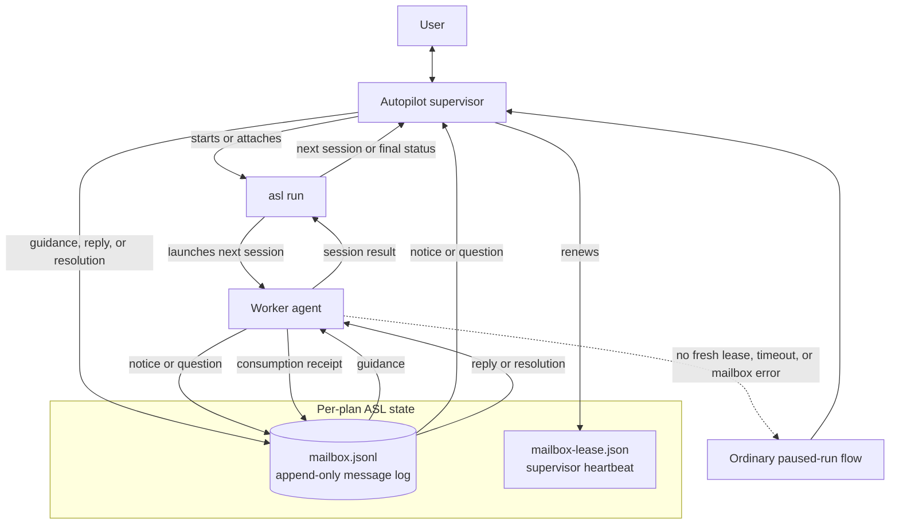

# Agent Session Loop (ASL)

ASL executes a prepared plan one session at a time. Its Autopilot supervisor starts or attaches to `asl run`, watches the active worker, and uses a per-plan mailbox to exchange live guidance, notices, questions, and answers without restarting the session.

The mailbox is a durable, append-only history; the first reply or resolution closes a question, and the worker records when it consumes that closure. Durable mailbox, event, and state-ledger writes use `fcntl(F_FULLFSYNC)` on Darwin to flush the device cache, falling back to `fsync` when the filesystem does not support that device barrier; other platforms use `fsync` directly. Atomic state replacement also syncs its parent directory. Plan publication and recovery share a marker-scoped plan transaction lock so readers never observe a partially published transaction. Plan reads wait at most five seconds for that lock; a timeout reports the holder's pid, hostname, and thread rather than hanging indefinitely. The separate lease proves that a supervisor is still watching; if supervision disappears or mailbox waiting fails, ASL falls back to its normal pause-and-resume path. When `asl outbox wait` actually surfaces an open question, it also persists that run's body-free question projection and makes a best-effort `AgentSessionLoopMailboxQuestion` handoff to AgentMux. Notification failure never changes the outbox result, and closed history does not alert.

ASL's workspace domain keeps ordered repository declarations separate from plan parsing and runner behavior. It normalizes aliases, relative paths, and credential-free origin identities, then resolves repositories only when each path remains beneath the workspace, is an exact Git top-level, and has the expected origin. Legacy single-repository plans retain version 1 `plan-metadata.json`; version 2 binds a multi-repository plan to a canonical `workspace_root` and registry digest.

Repository mutation evidence is provided by a reusable fail-closed engine rather than being embedded in the runner. Its single-repository payload preserves the review guard's HEAD, tracked and staged patches, untracked nodes, index flags, and ignore-source evidence. It can also inventory ordinary and linked Git worktrees recursively without following symlinks, capture a deterministic workspace vector, and compare vectors with changed, added, removed, unavailable, and repository-qualified path details. Inventory is capped explicitly to bound Git probe work over broad workspaces.

Multi-repository source plans declare one `## Repositories` Markdown table before the first session, with the exact ordered columns `Alias`, `Path`, and `Origin`. `asl split --check` validates the declaration without writing, and `asl split` moves its normalized ordered registry into `manifest.md`; `context.md` contains only the remaining shared source context. Registry details are additive in split JSON, while plans without a registry retain their historical files and response fields.

Every session in a registered plan also declares exact `**Reads repositories**:` and `**Writes repositories**:` fields. Reads are non-empty; writes may be `(none)` and must be a subset of reads. ASL renders those fields before the session instructions, preserves them in readiness identity, and rejects missing, duplicate, malformed, or unknown aliases. Completed handoffs qualify each modified path as `Alias:path`, and resplit children inherit the parent scope unchanged. Plans without a registry retain the legacy session, handoff, and resplit formats.

Completion-contract checks in a registered plan are repository-attributed with `"repo": "Alias"`. Every check needs an explicit alias when the registry has multiple entries; a one-entry registry supplies its sole alias when omitted. Registered contracts reject absolute or upward-traversing `path` and `cwd` values, while legacy plans retain their existing absolute-path behavior. `asl verify`, `asl contract-check`, and `asl baseline` interpret `--cwd` as the workspace root for registered plans, resolve every command/probe/path beneath its selected repository, and report both qualified and resolved locations. Registered baseline records carry the registry digest and an ordered aggregate fingerprint of every registered repository, so a change anywhere in the workspace invalidates prior evidence. Legacy single-root execution and v1 cache keys remain unchanged.

`asl preflight` and `asl doctor` also interpret `--cwd` as the workspace root for registered plans; that common parent does not need to be a Git repository. Preflight resolves the registry once, rejects declared paths that traverse symlinks, verifies every child checkout's exact root and origin, captures every registered repository fail-closed, and treats failures from its supplementary undeclared-repository inventory as non-blocking diagnostics. It dispatches command and baseline probes through repository roots and checks every registered tree for cleanliness in commit mode. Registered JSON and text output list repositories in declaration order. Stable workspace/registry/root/origin/overlap/scope/contract findings block loop-ready, while legacy preflight categories and single-root output remain unchanged.

The runner resolves that same prepared binding once at startup and never rewrites a mismatched `plan-metadata.json`. Registered dry-run and doctor invocations launch from the canonical workspace root, expose additive `workspace_root`, `registry_digest`, and ordered `repositories` data, and render the selected session's read/write aliases plus qualified-path rules without exposing resolved roots outside its read scope. State, status, event, tail, resume, and invocation projections preserve `cwd` as a compatibility alias while carrying the structured workspace fields. Every registered implementation or review turn snapshots all registered and unregistered worktrees before launch and rescans them before any timeout, transport, pause, verification, or commit branch. Implementation changes pass only in the active session's write aliases; generated reviews read every declared alias and have an empty write set. Read-only, out-of-read-scope, unregistered, added, removed, or unavailable evidence retains repository contents, returns the handoff to pending, and pauses with qualified evidence. Repo-relative `--review-guard-exclude` values apply to every discovered worktree, so an unsupported node inside an unregistered repository can be explicitly excluded. Registered generated reviews use session schema v4 and artifact schema v3, record each repository's HEAD and pre-existing dirty paths, present one ordered combined prompt with qualified delta evidence, and require repository-attributed findings, evidence, and checks. Their generated repair children read the entire registry but write only the aliases attributed by their grouped findings; child scopes activate the same workspace guard as authored sessions. Verification-check names remain unchanged unless the same name occurs in multiple repositories within one repair group, where the generated contract disambiguates only those collisions as `Alias:name`. Review-cycle and reopen records retain qualified findings, group scopes, and ordered repository bases, while eventless recovery reconstructs those facts from the generated review and repair session files before scheduling a rereview. Git-ignored output follows the declared review-guard policy, including `--review-guard-include-ignored`. Legacy implementation and single-repository review output remain unchanged.

Workbench and Autopilot consume that binding instead of inferring a parent from a child checkout. Workbench summaries, pins, launch results, state/recovery APIs, and final-review responses expose the workspace root and ordered repositories while retaining `cwd`; registered launches reject a conflicting profile root and point operators to atomic rebind. Recovery output keeps repository-qualified verification failures, scope/evidence violations, unresolved commit groups, and partial commit SHAs visible. Autopilot adopts the status-advertised workspace when `--cwd` was omitted, refuses mismatches without automatic rebind authority, and preserves the structured binding in supervision results. Text views bound long repository lists while JSON keeps the complete ordered vector.

The browser's `formatRepositoryAliases` formatter is authoritative for its 12-repository preview limit; machine-readable repository vectors are never truncated.

Auto-commit uses durable repository groups in both registered and legacy modes. Registered commit runs require every declared repository clean at startup, then `--commit-per-session` selects changed write aliases from the passing turn guard only while they remain dirty at commit time; a harness-created commit or a change that leaves the worktree clean needs no second commit. `--commit-at-end` selects every changed registered repository. ASL invokes `spec commit --yes --no-verify` serially in manifest order and checkpoints the group identity, successful repository SHAs, failed alias, and remaining aliases before advancing. A resumed run completes any unresolved group before launching another worker, never recommits a recorded success, and treats an unresolved repository that is already clean as recovered or skipped. Earlier successful commits are retained when a later repository fails.

Preparation uses validator output v2 for registered plans. Each packet carries the canonical workspace root, exact ordered resolved registry, and only the absolute roots named by each session's advisory read scope; validator findings and corrections are repository-attributed and checked against that scope before the atomic ingest transaction can bind metadata or mutate plan artifacts. Registry, workspace, session, or repository mismatches fail closed. Expansion notes render qualified locations, ambiguous unqualified multi-repository path claims block loop-ready, and baseline plus final preflight reuse the resolved workspace context. Validator v1 remains accepted only for legacy plans, whose preparation behavior and metadata stay unchanged.

An existing registered plan can move deliberately with `asl prepare PLAN_DIR --resume --cwd NEW_WORKSPACE --rebind-workspace`. Prepare verifies every replacement root and credential-free origin first, rejects active locks and unchanged or legacy bindings, then runs fresh validation, expansion/correction rendering, baselines, metadata generation, and final preflight against an isolated system-temporary plan copy that preserves symlinks. Only a completely loop-ready staged result is published to the bound plan through one rollback-capable transaction; ordinary publication failures restore the old bytes, while a durable journal lets the next authoritative plan read finish an interruption without exposing a mixed binding. Commit and recovery hold the same marker-scoped mutex, so ordinary readers wait briefly for a live publication instead of retiring its payloads; a stalled holder reaches a bounded timeout whose diagnostic identifies the lock and recorded holder. Any earlier stage failure leaves the old binding, readiness, validation aggregate, expansions, session text, and baseline cache byte-identical. Staged diagnostics are rebased to the durable plan directory. JSON reports credential-free `workspace_rebind.old` and `workspace_rebind.new` projections plus `failure_stage`, `error`, and the successfully `published_files`; lock and concurrency races use the distinct `workspace-rebind-failed` reason with the same rebind context.

> **Maintenance note:** Any work on ASL should include checking this README and updating it when behavior or architecture changes.
