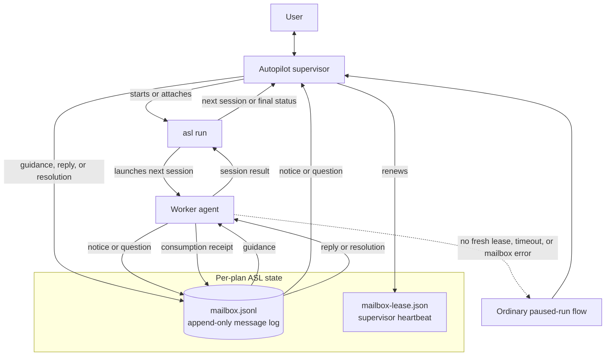

# Agent Session Loop (ASL)

ASL executes a prepared plan one session at a time. Its Autopilot supervisor starts or attaches to `asl run`, watches the active worker, and uses a per-plan mailbox to exchange live guidance, notices, questions, and answers without restarting the session.

The mailbox is a durable, append-only history; the first reply or resolution closes a question, and the worker records when it consumes that closure. The separate lease proves that a supervisor is still watching; if supervision disappears or mailbox waiting fails, ASL falls back to its normal pause-and-resume path. When `asl outbox wait` actually surfaces an open question, it also persists that run's body-free question projection and makes a best-effort `AgentSessionLoopMailboxQuestion` handoff to AgentMux. Notification failure never changes the outbox result, and closed history does not alert.

> **Maintenance note:** Any work on ASL should include checking this README and updating it when behavior or architecture changes.
