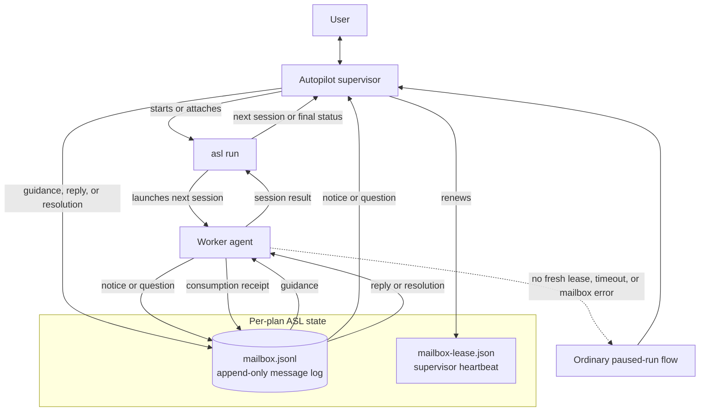

# Agent Session Loop (ASL)

ASL executes a prepared plan one session at a time. Its Autopilot supervisor starts or attaches to `asl run`, watches the active worker, and uses a per-plan mailbox to exchange live guidance, notices, questions, and answers without restarting the session.

The mailbox is a durable, append-only history; the first reply or resolution closes a question, and the worker records when it consumes that closure. Durable mailbox, event, and state-ledger writes use `fcntl(F_FULLFSYNC)` on Darwin to flush the device cache, falling back to `fsync` when the filesystem does not support that device barrier; other platforms use `fsync` directly. Atomic state replacement also syncs its parent directory. Plan publication and recovery share a marker-scoped plan transaction lock so readers never observe a partially published transaction. Plan reads wait at most five seconds for that lock; a timeout reports the holder's pid, hostname, and thread rather than hanging indefinitely. The separate lease proves that a supervisor is still watching; if supervision disappears or mailbox waiting fails, ASL falls back to its normal pause-and-resume path. When `asl outbox wait` actually surfaces an open question, it also persists that run's body-free question projection and makes a best-effort `AgentSessionLoopMailboxQuestion` handoff to AgentMux. Notification failure never changes the outbox result, and closed history does not alert. The end of supervision is itself a mailbox record: the Autopilot helper appends one terminal `supervision-end` message carrying its raw exit reason and a coarse outcome, and `asl outbox wait --include all` wakes on it and reports it through `supervision_ends` and `supervision_ended`. That record ends the helper's supervision lifetime and does not prove the supervised run is quiescent: a `worker_hung` stop leaves the `asl run` child alive holding the plan lock, so later worker questions and notices can still land after the terminal record. Every outcome except `error` is appended after the helper flushed its complete result, so stdout is parseable when the wait returns; `error` marks an abnormal exit whose stdout may be missing, truncated, or unproven and must be decided from the record alone. Because it is durable log content read through a sequence cursor rather than a live notification, a helper that already exited returns it on the next wait instead of burning the full timeout; a terminal-only wake makes no AgentMux handoff and writes no question projection. The runner emits no such record — only the helper's own exit ends supervision — and `--no-mailbox`, SIGKILL, or a crash leave none at all, so the stdout-tail fallback remains. Because two helper lifetimes can overlap on one plan, every launch carries a `supervision_id`: the launching agent passes `--supervision-id` to the helper and to `asl outbox wait`, which then reports `supervision_ended` only for that launch's own record while another launch's record still advances the cursor.

ASL's workspace domain keeps ordered repository declarations separate from plan parsing and runner behavior. It normalizes aliases, relative paths, and credential-free origin identities, then resolves repositories only when each path remains beneath the workspace, is an exact Git top-level, and has the expected origin. Legacy single-repository plans retain version 1 `plan-metadata.json`; version 3 binds a multi-repository plan to a canonical `workspace_root` and registry digest. Version 2 remains readable as the same binding, and a version 3 file left over from the retired workspace inventory policy still loads: a well-formed `workspace_inventory_excludes` array is accepted and discarded.

Repository mutation evidence is provided by a reusable fail-closed engine rather than being embedded in the runner. Its single-repository payload preserves the review guard's HEAD, tracked and staged patches, untracked nodes, index flags, and ignore-source evidence. Per-path patch evidence is attributed by walking the diff queue as `--name-status` reports it, because a change of type — regular file to symlink, symlink to gitlink — is one name entry that git can only render as two patch sections, the old type's deletion followed by the new type's creation. Both sections are hashed together as that path's evidence; pairing one section per entry would misalign every remaining path in the queue and, for a repository carrying any typechange at all, fail the capture outright. A queue that still does not add up remains fail-closed rather than pairing short. It can also inventory ordinary and linked Git worktrees recursively without following symlinks, capture a deterministic workspace vector, and compare vectors with changed, added, removed, unavailable, and repository-qualified path details. Inventory is capped explicitly to bound Git probe work over broad workspaces.

Multi-repository source plans declare one `## Repositories` Markdown table before the first session, with the exact ordered columns `Alias`, `Path`, and `Origin`. `asl split --check` validates the declaration without writing, and `asl split` moves its normalized ordered registry into `manifest.md`; `context.md` contains only the remaining shared source context. Registry details are additive in split JSON, while plans without a registry retain their historical files and response fields.

Split output ids are already the source content hash plus the canonical-path fingerprint, so a matching plan id means the same source has been split before. `asl split` and source-mode `asl prepare` now refuse when `<plan-id>` or `<plan-id>-N` already exists, reporting each existing directory with its readiness state instead of silently creating another duplicate plan tree. Intentional duplicates still opt in with `--force-new`, which preserves the numbered `-2`, `-3`, … suffix behavior, and `asl split --check` remains write-free.

Read-only surfacing for abandoned planning now lives in `asl plans`. It lists the same Workbench-discovered plan corpus, can filter to plans whose run-state file is absent with `--never-run`, and can filter by manifest readiness state with `--readiness STATE`. Its `--stale-days N` cutoff uses the Workbench summary's last-activity timestamp when one exists, and otherwise falls back to the manifest readiness check time so a split plan that was prepared or reviewed but never launched still appears as stale.

Declaring that registry is not optional once the plan needs it. A shared detector resolves a plan's absolute, `Alias:path`, and contract `path`/`cwd` targets against a root, keeping only paths that exist on disk and ignoring fenced content and system prefixes. When those targets reach a second Git repository, or escape the root into a path a Git repository still owns, an undeclared plan is refused: `asl split --check --cwd ROOT` reports `missing-repository-registry`, `asl split` fails the write path on the same evidence including its contracts file, and preflight raises a red `repository-footprint` finding. Every one of those surfaces emits the same `repository_footprint` JSON object, whose `suggested_registry_table` and `suggested_scopes` are derived from disk so a caller applies a discovered registry rather than an invented one. An absolute path that stays inside the bound root is still accepted. So is an escaping target that belongs to no Git worktree: it is classified as external evidence and never forces a registry, because a registry row can only describe a Git repository and refusing that plan would demand a declaration nobody could write. Both detectors agree on that rule, so an ASL plan-store artifact or any other non-Git path is never a reason to reword a plan.

That detector only counts a location the plan wrote down and that already exists, so a plan whose sessions create their files, or whose locations arrive through contracts, plan metadata, or a runner task packet, could still slip into legacy single-repository mode. A separate reusable repository-intent engine closes that gap. It extracts candidates from absolute prose paths, inline backtick spans, contract `path`/`cwd` fields, plan metadata and execution roots, and task-packet artifact paths; resolves symlinks; and walks to the nearest *existing* ancestor so a file a session has yet to create still names its owning Git top-level. Repositories are identified by resolved root and never by origin, so two clones of one upstream stay two repositories. A candidate resolving into no Git worktree is classified separately and never forces a registry, as are system prefixes and runner-owned plan artifacts. Its bounded, credential-redacted report names each candidate's declaring surface, resolved path, Git root, and exemption. `asl split` refuses a plan whose resolved locations span two repositories with the reason `repository-registry-required` before it resolves an output directory, and `asl split --check` reports the same reason when source-only evidence is already conclusive; otherwise the contract-aware write path, which also reads the contracts file, is the surface that decides.

The same intent report is an authoritative readiness blocker downstream of the split. Preflight reads it from the plan's own session files, `context.md`, `manifest.md`, parsed contracts, and stored plan metadata, anchored to the root the plan already recorded or to an explicit `--cwd`, and emits a red `repository-registry-required` finding whose repair guidance names `asl register-repositories` and the three things it derives for a legacy multi-repository plan: a top-level `## Repositories` table, per-session read and write repository scopes, and a repository alias plus repository-relative locations on every contract check. Preparation refuses the same plan at its validation-authority choke point, which covers validation ingest, baseline publication, readiness marking, and resume alike, so nothing is published before the refusal; `asl prepare` exits with the `repository-registry-required` reason and `asl expand-ingest` emits it with the bounded `repository_intent` payload naming the repositories to register. The invariant is non-bypassable in the same sense `repository-footprint` is: `--allow-not-loop-ready` does not waive it, `--mark-loop-ready` refuses outright while it is red rather than relying on each caller to consult the blocker list first, and the pause itself is never skipped. What it is not is unrepairable. Preflight's `auto_repair_plan` leads with the migration and the rebind whenever the same read-only derivation the migration runs returns a plan — a refusal withholds both steps and names its missing fact in `suggested_pause` instead of advertising a repair the command would decline — `asl run` applies the file migration itself on that same admissibility rule rather than one of its own, and the session-expand, session-split, and plan-preflight-iterate skills drive those commands instead of asking a human to hand-write the registry. What no surface does is resolve the ambiguity by selecting one child checkout as the root, or by inventing an alias or an origin the derivation refused to observe. Registered plans skip the check entirely, and a legacy plan that really is single-repository behaves exactly as before.

That refusal is derivable rather than a manual repair, so `asl register-repositories PLAN_DIR --cwd ROOT` writes the migration ASL already knows. It resolves the plan's repository intent, derives the workspace root, the ordered registry, one read/write scope per session, and a `repo` alias plus repository-relative `path`/`cwd` for every contract check, then rewrites `manifest.md` and every `session-N.md` through one plan transaction and refreshes the readiness hash while preserving the readiness state. Prose, handoffs, and `plan-metadata.json` stay byte-identical — replacing a legacy single-root binding belongs to the rebind — and re-running reports `already-registered` without writing. It fails closed on anything it cannot observe: a missing shared parent, an unobservable `origin`, a contract path under no registered repository, and a command check naming no repository each write zero bytes and exit naming that one missing fact, because a guessed registry row would only fail validation later. It fails closed on the part-way plan too: a registry makes a completed handoff's bare `Files modified` entries illegal, so a plan whose finished sessions recorded unqualified paths is refused with `completed-handoff-paths` instead of being migrated into a plan nothing can parse. Every surface asks that one rule — the command, the runner's own gate, and preflight's repair steps — so no surface advertises a migration another would refuse. A plan whose lock a live run holds is refused rather than rewritten underneath that run. Applying the registry is not the whole repair, so the result carries the remaining order authoritatively: `asl prepare PLAN_DIR --resume --rebind-workspace --cwd WORKSPACE_ROOT` first, because the new registry digest invalidates the prepared binding and its baseline evidence, then `asl run PLAN_DIR --cwd WORKSPACE_ROOT`, both against the derived workspace root rather than the root the plan was bound to.

The same refusal fires one stage earlier, in `asl split --check`, before a plan directory exists, so `asl register-repositories (--plan-file PATH | --inline-stdin) --cwd ROOT` runs the identical derivation over a source plan's markdown and emits the migrated plan rather than writing files. It inserts the registry above the first session heading, both scope lines under every session heading, and a rewritten contract in each session that has one, using the authoring parser's own section bounds so every other byte survives. The input is never written: without `--output` the migrated markdown is the whole of stdout and can be piped straight into `asl split`, with `--output PATH` it is written there, and `--output` naming the input is refused. Registry rows spell each origin as an absolute Git URL because that is what a source plan's table accepts, while a split plan's manifest records the transport-neutral identity. The derivation's missing facts refuse identically here — all but `completed-handoff-paths`, which needs a handoff a source plan does not have — and a refusal emits no markdown at all rather than a partial plan.

Readiness is not the last word, because a plan already marked `loop-ready` short-circuits core preflight and a legacy plan can skip preparation altogether. The runner therefore re-derives the same verdict itself, at the boundary where it still owns every decision. The run-entry gate runs after root and workspace resolution and before the lock is taken or any implementation, review, verification, or commit subprocess starts; reaching a second Git top-level pauses the run with `repository-registry-required` and the bounded, credential-redacted `repository_intent` report naming the conflicting roots. Each session task packet is rechecked the same way immediately before its turn launches, reading the rendered prompt and the contents of every artifact the packet tells the worker to open, because expansion notes, shared context, a predecessor handoff, live mailbox guidance, an operator reply, and repair references all reach the worker through surfaces the plan-level scan does not read — a redirect living only in `session-N.expand.md` is caught here and nowhere else. Both gates are structurally independent of `--allow-not-loop-ready`, which waives readiness and can never stand in for the registry that would have bound the second repository. Registered workspaces are exempt, as are the runner's own trees: the plan directory, the state root, and the run directory, which an operator may legitimately keep inside an unrelated checkout. The regression that pins this reproduces two clones of one remote side by side: a legacy plan bound to one of them and reaching the other launches no harness and mutates neither clone, while a registered plan naming both executes normally against the second. Identity is the resolved Git top-level, never the origin URL, so the refusal survives clones that no origin comparison can tell apart.

Every session in a registered plan also declares exact `**Reads repositories**:` and `**Writes repositories**:` fields. Reads are non-empty; writes may be `(none)` and must be a subset of reads. ASL renders those fields before the session instructions, preserves them in readiness identity, and rejects missing, duplicate, malformed, or unknown aliases. Completed handoffs qualify each modified path as `Alias:path`, and resplit children inherit the parent scope unchanged. Plans without a registry retain the legacy session, handoff, and resplit formats.

Completion-contract checks in a registered plan are repository-attributed with `"repo": "Alias"`. Every check needs an explicit alias when the registry has multiple entries; a one-entry registry supplies its sole alias when omitted. Registered contracts reject absolute or upward-traversing `path` and `cwd` values, while legacy plans retain their existing absolute-path behavior. `asl verify`, `asl contract-check`, and `asl baseline` interpret `--cwd` as the workspace root for registered plans, resolve every command/probe/path beneath its selected repository, and report both qualified and resolved locations. Registered baseline records carry the registry digest and an ordered aggregate fingerprint of every registered repository, so a change anywhere in the workspace invalidates prior evidence. Legacy single-root execution and v1 cache keys remain unchanged.

`asl preflight` and `asl doctor` also interpret `--cwd` as the workspace root for registered plans; that common parent does not need to be a Git repository. Preflight resolves the registry once, rejects declared paths that traverse symlinks, verifies every child checkout's exact root and origin, and captures every registered repository fail-closed; undeclared siblings are outside the plan's business and produce no finding at all. It dispatches command and baseline probes through repository roots and checks every registered tree for cleanliness in commit mode. Registered JSON and text output list repositories in declaration order. Stable workspace/registry/root/origin/overlap/scope/contract findings block loop-ready, while legacy preflight categories and single-root output remain unchanged. The `repository-footprint` and `repository-registry-required` categories are the findings no escape hatch waives: both are derived from the plan's stored `cwd` when no `--cwd` is given, both are rechecked on the resume path because the readiness hash covers plan content rather than the root a run binds it to, and `asl run --allow-not-loop-ready` still pauses on either with the blocking categories in `pause_details.blocker`. Verification enforces the same containment at run time, so a legacy check resolving outside its bound root fails even if the gate is skipped.

The runner resolves that same prepared binding once at startup and never rewrites a mismatched `plan-metadata.json`. Registered dry-run and doctor invocations launch from the canonical workspace root, expose additive `workspace_root`, `registry_digest`, and ordered `repositories` data, and render the selected session's read/write aliases plus qualified-path rules without exposing resolved roots outside its read scope. State, status, event, tail, resume, and invocation projections preserve `cwd` as a compatibility alias while carrying the structured workspace fields. Every registered implementation or review turn snapshots exactly the repositories the plan registered before launch and rescans them before any timeout, transport, pause, verification, or commit branch. Implementation changes pass only in the active session's write aliases; generated reviews read every declared alias and have an empty write set. Read-only, out-of-read-scope, added, removed, or unavailable evidence retains repository contents, returns the handoff to pending, and pauses with qualified evidence. A repository the plan never registered is outside the guard's domain, so a concurrent run writing in a sibling worktree is never evidence about this turn. Repo-relative `--review-guard-exclude` content paths apply to every registered repository. Registered generated reviews use session schema v4 and artifact schema v3, record each repository's HEAD and pre-existing dirty paths, present one ordered combined prompt with qualified delta evidence, and require repository-attributed findings, evidence, and checks. Their generated repair children read the entire registry but write only the aliases attributed by their grouped findings; child scopes activate the same workspace guard as authored sessions. Verification-check names remain unchanged unless the same name occurs in multiple repositories within one repair group, where the generated contract disambiguates only those collisions as `Alias:name`. Review-cycle and reopen records retain qualified findings, group scopes, and ordered repository bases, while eventless recovery reconstructs those facts from the generated review and repair session files before scheduling a rereview. Repair children also carry stable `repair_group` lines even without a repository registry, so the runner can stop before rematerializing a group that already exhausted its reopen budget and continuation can project the same terminal `repair-group-exhausted` disposition without trusting title fingerprints alone. The continuation payload now also carries per-group attempt counts, and the shared guidance surfaces switch from "raise `--max-review-fix-cycles`" to manual-fix-or-resplit instructions once the recurring group has already consumed its reopen budget. The run config now persists the default per-group reopen cap (`--max-repair-group-attempts`, default 2) and the absolute review-cycle ceiling (`--max-review-fix-cycles-ceiling`, default 8), so resume and Autopilot replay the same repair-loop bounds unless the operator explicitly overrides them. Git-ignored output follows the declared review-guard policy, including `--review-guard-include-ignored`. Legacy implementation and single-repository review output remain unchanged. A generated review's `final-review.md` and `final-review.json` are plan artifacts rather than repository modifications: if a completed review records only those names in its handoff, plan inspection treats the handoff as `(none)` and the next runner start restores that durable field automatically. Any other handoff path remains subject to the ordinary repository-qualified, write-scope validation.

Workbench and Autopilot consume that binding instead of inferring a parent from a child checkout. Workbench summaries, pins, launch results, state/recovery APIs, and final-review responses expose the workspace root and ordered repositories while retaining `cwd`; registered launches reject a conflicting profile root and point operators to atomic rebind. Recovery output keeps repository-qualified verification failures, scope/evidence violations, unresolved commit groups, and partial commit SHAs visible. Autopilot adopts the status-advertised workspace when `--cwd` was omitted, refuses mismatches without automatic rebind authority, and preserves the structured binding in supervision results. Text views bound long repository lists while JSON keeps the complete ordered vector.

The browser's `formatRepositoryAliases` formatter is authoritative for its 12-repository preview limit; machine-readable repository vectors are never truncated.

Auto-commit uses durable repository groups in both registered and legacy modes. Registered commit runs require every declared repository clean at startup, then `--commit-per-session` selects changed write aliases from the passing turn guard only while they remain dirty at commit time; a harness-created commit or a change that leaves the worktree clean needs no second commit. `--commit-at-end` selects every changed registered repository. ASL invokes `spec commit --yes --no-verify` serially in manifest order and checkpoints the group identity, successful repository SHAs, failed alias, and remaining aliases before advancing. A resumed run completes any unresolved group before launching another worker, never recommits a recorded success, and treats an unresolved repository that is already clean as recovered or skipped. Earlier successful commits are retained when a later repository fails.

Preparation uses validator output v2 for registered plans. Each packet carries the canonical workspace root, exact ordered resolved registry, and only the absolute roots named by each session's advisory read scope; validator findings and corrections are repository-attributed and checked against that scope before the atomic ingest transaction can bind metadata or mutate plan artifacts. Registry, workspace, session, or repository mismatches fail closed. Expansion notes render qualified locations, ambiguous unqualified multi-repository path claims block loop-ready, and baseline plus final preflight reuse the resolved workspace context. Validator v1 remains accepted only for legacy plans that really are single-repository: the v1 packet names its `codebase_root` as the sole bound root and asks for anything outside it as a `repository-ambiguous` issue, and prepare recomputes both the footprint and the repository intent before building the packet and before ingesting its output, refusing with the dedicated `repository-footprint` or `repository-registry-required` reason and the shared verdict payload. Otherwise legacy preparation behavior and metadata stay unchanged.

An existing registered plan can move deliberately with `asl prepare PLAN_DIR --resume --cwd NEW_WORKSPACE --rebind-workspace`. Prepare verifies every replacement root and credential-free origin first, rejects active locks and unchanged bindings, accepts a plan whose `manifest.md` grew a registry while `plan-metadata.json` is still v1 by discarding that stale single-root binding, then runs fresh validation, expansion/correction rendering, baselines, metadata generation, and final preflight against an isolated system-temporary plan copy that preserves symlinks. Only a completely loop-ready staged result is published to the bound plan through one rollback-capable transaction; ordinary publication failures restore the old bytes, while a durable journal lets the next authoritative plan read finish an interruption without exposing a mixed binding. Commit and recovery hold the same marker-scoped mutex, so ordinary readers wait briefly for a live publication instead of retiring its payloads; a stalled holder reaches a bounded timeout whose diagnostic identifies the lock and recorded holder. Any earlier stage failure leaves the old binding, readiness, validation aggregate, expansions, session text, and baseline cache byte-identical. Staged diagnostics are rebased to the durable plan directory. JSON reports credential-free `workspace_rebind.old` and `workspace_rebind.new` projections plus `failure_stage`, `error`, and the successfully `published_files`; lock and concurrency races use the distinct `workspace-rebind-failed` reason with the same rebind context.

ASL also audits its own control plane after a persisted loop ends, and the vocabulary that audit speaks is defined ahead of any storage or orchestration. A run's assurance state is exactly one of `all-clear`, `findings`, `unavailable`, `skipped`, or `pending`, and its rubric has eight lanes: identity/authority, task-packet coherence, lifecycle/retry/resume, verification/review independence, mutation/commit guards, truthfulness/observability, resources/stalls, and unknown anomalies. Strict versioned models cover deterministic check results, findings, issue observations, dispositions and merges, closeouts, and the bounded per-run summary; all of them round-trip through canonical sorted-key JSON so an artifact digest identifies content rather than a serialization run. A finding's fingerprint derives from its schema version, category, component, and stable invariant key and from nothing else, because folding in a run ID, timestamp, summary, severity, or evidence reference would make one recurring defect look new on every run and defeat the deduplication the inbox depends on. Issue references parse from `ASI-42` and from the bare shorthand `42`, never from a leading-zero or zero form that could name a different issue.

An audit that asserts a verdict must have looked. Both terminal states carry lane-by-lane evidence for all eight lanes, and `all-clear` additionally requires every lane to have passed on its own evidence, so an audit that simply failed to examine a lane is `unavailable` rather than clean; a lane whose status is `unavailable` still names the record proving it could not be judged. `skipped` and `pending` carry no analysis at all, an ineligible run can only be `skipped`, and neither skipping nor an all-clear ever creates an issue. Every reference a lane, finding, or deterministic check names must appear in the audit's own declared evidence index, and every locator is a canonical run-relative path — absolute, `~`-prefixed, backslashed, `./`, or upward-traversing forms are rejected rather than normalized. Text, collections, and serialized artifacts are all explicitly capped. The canonical per-run artifacts `supervisor-audit-input.json`, `supervisor-audit.json`, `supervisor-audit.md`, and each `supervisor-audit-attempt-N/` directory are created with `O_CREAT | O_EXCL` rather than the last-writer-wins atomic writer, because a second write means two audits disagreed about one run and overwriting one destroys the evidence of that conflict. Unsafe artifact names are refused outright instead of being sanitized into a different filename.

Those records accumulate in one append-only ledger, `assurance-inbox.jsonl`, beside the state root, and nothing in it is ever rewritten or removed. Writers hold an exclusive `flock` on the sibling `assurance-inbox.lock` — never on the data file, which is opened `O_APPEND` — and every append is followed by a platform durability barrier; a short or failed write truncates back to the size the file had before the attempt, so a failed append leaves no partial record and never touches earlier bytes. Sequence numbers are positional rather than stored, because a crash-truncated line cannot carry a field and it still deserves a number: malformed, unparseable, over-version, and unknown-kind lines are all preserved in place as rejected history with a sequence, a reason, and a bounded excerpt of their raw text. When the file's last line lost its newline to an interruption, the next append supplies that terminator as part of its own single write instead of rewriting the file, so the interrupted record survives exactly as it landed and is classified the same way before and after the repair. Human issue IDs are minted inside that same exclusive lock: the writer reads the ledger, reuses the ID already bound to a recurring finding's fingerprint or takes the next number above *every* issue reference present — not merely the ones a valid observation minted, so a corrupted line can never license reuse of its number — and writes the allocation and the record as one act. The generic writer refuses `issue_observed` outright and directs callers to the allocating entry point, so lock-scoped allocation is structural rather than a convention. `assurance-index.json` is a disposable cache checked against the ledger's exact size and SHA-256 and rebuilt whenever it is missing, stale, malformed, or of an unknown version; every cache write is best-effort, because failing to record truth would be worse than reading the ledger again. Only bounded metadata and artifact references are stored — prompts, logs, diffs, and harness responses stay in the run directory the record points at. That ledger and the per-plan mailbox are separate systems, and calling both of them an append-only JSONL inbox is where a reader goes wrong: `mailbox.jsonl` is a single plan's live supervision channel, scoped to a run still in progress and enabled per run, while `assurance-inbox.jsonl` is the corpus-wide permanent audit history written under its own `assurance-inbox.lock`. They share no file, no lock, no id space, and no lifetime, and neither one reads or writes the other.

The inbox a person reads is derived from that ledger rather than stored beside it: replaying the records in sequence order is the only way issue and run state is ever computed, so a copied ledger with no cache reconstructs identical state. Publishing an audit is idempotent under a key of the run ID, the record kind, and the audit-input digest taken from the run's own `supervisor-audit-input.json` artifact; the decision is made inside the append lock, so when two publishers race, the loser observes the key already present and writes nothing at all instead of adding a second occurrence. The kind belongs in that key because a `pending` and a later `skipped` record for one run both lack a digest and would otherwise be mistaken for each other. A finding whose fingerprint is already known joins the existing issue as another occurrence instead of minting a new ID, and observations recorded before a merge need no rewriting: replay in sequence order folds them into the target when it reaches the merge record.

Closing an issue is a claim about the future, not about the past, so the three closed states answer a recurrence differently: a finding that comes back after `resolve` reopens the issue, while `dismiss` and `accept-risk` keep it closed and still record the new occurrence, because someone who judged a defect acceptable deserves to see how often it happens. Later dispositions move the state again through new append records, never by editing an old one. Merging is irreversible and strictly forward — a source that names itself, an unknown source or target, an already-merged source or target, or a target that would close a cycle is all refused — and later observations of a merged fingerprint route through the end of the merge chain. Audits that could not run at all deduplicate on their reason class rather than the raw exception text, so a timeout that phrases itself differently on every run is still one issue, and skipping never creates an issue of any kind. Because the ledger cannot be edited, replay treats a hostile one as history to report instead of a crash: a disposition for an issue nobody observed, a closeout for an unaudited run, and even a cyclic merge pair already on disk each surface as a bounded anomaly with the sequence number that caused it, and the chain walk terminates.

`asl assurance list` and `asl assurance show` are how a person reads that inbox, and they read it the way every other consumer does: through the projection, under a shared lock, never appending a record, minting an ID, rebuilding the index cache, or repairing a malformed line. A missing ledger is an empty inbox rather than an error. `list` answers the default triage question by printing the 50 most recently observed open issues, newest sighting first; `--limit` and `--state`/`--severity` re-aim that view, and `--all` is the negation of the whole default — every state, no row cap — so it is refused alongside `--limit` or `--state` instead of silently picking a winner. `show` prints one issue's full record: state, the fingerprint metadata it deduplicates by, observation history with the run and artifact behind each sighting, dispositions, absorbed IDs, reopen count, improvement plan drafts, and the affected runs with their artifact references and closeouts. Occurrence history is capped the way rows are, newest kept, remainder counted, because a long-lived issue's occurrence list grows without bound. Showing a merged-away ID succeeds and names both the ID asked for and the one it landed on, since a merge redirects an ID rather than deleting it. Both commands accept the canonical and shorthand forms and always emit the canonical one, so any ID the loop prints pastes straight back in, and a single payload builder feeds the text and JSON renderers so the two surfaces cannot disagree. Unreadable ledger lines are reported as warnings rather than failures — on stderr in text form, in the payload under `--json` — because the rest of the file is still history a human needs and hiding the rejected lines would hide the only evidence that the ledger is damaged.

`asl assurance resolve`, `dismiss`, `accept-risk`, `merge`, and `closeout` are the surface a person acts through, and they change the inbox the only way it can be changed: by appending. Every decision that could refuse the write — whether an issue exists, whether a source or target has already been merged, whether a run was ever audited, whether that run already has a closeout — is made inside the append transaction under the exclusive lock, so two operators deciding at once cannot both pass a check that only one of them should. The dispositions accept a `--note` and report the consequence in the future tense the projection will actually honor, because "resolved" and "accepted risk" differ only in what happens the next time the finding comes back. `merge` is the one irreversible command, so it asks before writing when a human is actually watching — both stdin and stdout a TTY — and takes `--yes` for scripts; a declined prompt is reported as `cancelled` and writes nothing, while `--json` invocations never prompt, which is also why the loop's own harness can never hang on one. `closeout` names its run by bare run ID and finds the plan through the state corpus, so `--plan` is needed only to break a genuine tie between two plans that produced the same ID; the corpus supplies plan attribution only, and the ledger alone decides whether the run may be closed out, so a pruned run directory does not block a verdict on a run the inbox still remembers auditing. Unusable outcomes and negative or non-finite rework minutes are rejected before the ledger is opened at all. A second closeout for one run is refused unless `--replace` is given, and replacing appends rather than rewrites: the new record names the ledger line the superseded closeout occupies as `seq-N`, which is a durable name precisely because appends never renumber what came before, so both verdicts and the order they were reached in stay readable forever.

Whether a run is audited at all is decided before the loop starts, from `--supervisor-audit`/`--no-supervisor-audit`, `--audit-harness`, `--audit-harness-model`, `--audit-effort`, and `--audit-timeout`. These live in the shared run-flag spec, so the CLI, the Autopilot supervisor parser, and the resume parser agree on them by construction, and they persist in `run_config` like every other run flag: a `--resume` restores the audit configuration the run started with unless the operator passes a flag explicitly, and the reconstructed resume command re-emits only what a fresh invocation would need. Audits are on by default, and the timeout is a per-attempt budget rather than a total, so the second of the at most two attempts is never shortened by the first one burning its own.

Independence is structural rather than advisory. An `--audit-harness` equal to `--harness` is rejected at validation, because a harness cannot grade its own turns; equality with the review harness is fine, since that harness was already independent of the implementation. With no explicit audit harness the role is inherited from the effective review harness along with its model, and `--audit-harness-model` overrides that inherited model as well as the audit harness's own default, which is why it carries no `--audit-harness` requirement. Audit effort never inherits from `--effort`. When no independent role can be resolved at all, the configuration stays valid and enabled and the run ends `unavailable` — ASL declines to audit itself rather than quietly self-auditing or reporting a clean result it never earned. A starting run persists `pending` only once it is eligible, meaning it has a run ID and a run directory; an opted-out run persists `skipped` immediately, and a dry run persists `skipped` with reason `dry-run` while still reporting under `planned.audit` the role, timeout, and attempt budget a real run would have used.

An auditor that can resolve an independent role then runs under an access profile of its own rather than the worker's. The profile is a separate parameter from `unsafe_bypass` on purpose: bypass widens a worker turn, while the profile decides which access model the turn runs under at all, and folding one into the other would make "not bypassed" mean two different things and let a worker default leak into an audit. Each adapter expresses the audit profile in argv the way its own CLI actually enforces it — codex through its read-only sandbox, deliberately without `--add-dir`, because for codex that flag grants *write* access and the read-only sandbox already reads anywhere; claude through plan permission mode with only `Read`, `Glob`, and `Grep` available, editing, shell, web, subagent, MCP, and session persistence denied; copilot through a verified read/search tool list with `write`, `shell`, and `url` denied outright, built-in MCP servers, custom instructions, remote control, remote export, and temporary-directory access all off. Denials are spelled with `--deny-tool=` rather than a space, since the flag takes a variadic value and the space form can swallow the next argument. Audits run from a dedicated `audit-workdir` under the run directory and are handed read access to the evidence bundle and the read-only ASL and skill trees; no writable application root is ever among them, no `plan_dir` is passed, and building an audit invocation that carries either a writable plan directory or an inherited bypass raises rather than silently dropping the grant. An adapter that cannot express the profile leaves `enforces_audit_read_only` false and the audit is declared `unavailable` instead of degrading to worker access, as is a harness that is not installed.

Enforcement is then checked rather than trusted. Every audit turn fingerprints the workspace before and after itself and compares the two vectors; any changed, added, or removed repository makes the audit `unavailable` with outcome `mutation-detected` no matter what the auditor reported, because a read-only turn that mutated something has already disproved the boundary its verdict rests on. Unavailable repository evidence is not treated as a mutation — that is the absence of proof either way, and counting it would turn a transient git failure into a fabricated integrity issue. A detected mutation writes `supervisor-audit-mutation.json` into the run directory and appends a critical `mutation-commit-guards` issue to the assurance inbox citing that artifact, both best effort: a ledger or disk failure must not swallow the `unavailable` verdict the run already reached. That issue is opened while the attempt is still running, so the terminal publication links its ID into the run summary instead of observing the same mutation twice, counted new when this run opened it and recurring when an earlier one did; without that link the run's most severe issue would exist only in the inbox and be missing from every run-facing surface. A linked ID is resolved through the merge chain and checked against the issues the ledger actually allocated, inside the transaction that writes the summary, so a caller naming an issue nobody opened writes nothing at all rather than persisting a run summary pointing at a phantom.

What the auditor actually reads is a bounded operational evidence bundle collected from the run's persisted history and written once as `supervisor-audit-input.json`. It carries the plan and split identity, the repository registry and per-session scopes, the run configuration, each turn's packet, prompt, harness invocation metadata, and result, bounded previews of the captured streams and last message, the run's slice of the event log, verification and review and repair and commit outcomes, the status projection, ASL and skill version digests, and per-repository mutation fingerprints. It deliberately does not carry application source or semantic diffs: keys holding output, diffs, or patches are replaced by their size and digest, so an auditor reasons about paths, hashes, exit codes, timings, and guard results rather than about the code under test. Credentials are stripped on the way in — origins are canonicalized, environment blocks are withheld wholesale, argv values introduced by a secret-bearing flag are blanked, and recognizable token literals are removed from every preview.

Two properties make that bundle usable as evidence. It is bounded: the serialized payload is capped well under the artifact ceiling, and a run that overruns the cap sheds in a fixed order — heartbeat chatter first, then ordinary records, then old healthy turns, with terminal, failing, and guard evidence given up last — so a bundle that had to shed something still explains how the run ended. Every omission is represented by a section, a reason, a count, and a digest, because silently smaller evidence is worse than evidence that admits its own gaps. It is also deterministic: nothing is collected by wall clock, every reference is rendered as a symbolic locator under a declared approved root rather than as an absolute path, and anything that will not resolve inside those roots is withheld in favor of a stable stand-in. Equivalent histories therefore serialize to identical bytes, which is what lets the artifact's digest key the idempotent publication of the audit record.

Reading that bundle is a separate job from collecting it, and the reproducible half of it needs no agent at all. Twelve deterministic checks cover the eight rubric lanes and turn ASL's own known failure modes into evidence: whether the plan metadata, the repository registry, and every registered repository path resolve inside the workspace root the run actually used; whether the repository-intent gate still holds when replayed against the finished plan; whether each turn's recorded artifact paths name the directory it ran from and each working directory sits inside the workspace; whether the write guard kept every change inside the session's declared scope; whether the persisted retry classification is the one `pause_policy.classify_pause` gives for the recorded reason and whether relaunches stayed inside the budget the retry records themselves name; whether the review harness differs from the one that did the work and its verdict waited for the review to complete; whether a mutation artifact, a commit outside every declared write scope, or a completed turn with no guard result left a gap; whether the status projection and the terminal event records tell the same story; whether the run opened on `run_started`, closed on exactly one terminal record, and left a readable result file behind for every turn; whether a success claim is contradicted by anomalous turns, failed or skipped verification, or a recorded pause; whether anything stalled, timed out, or outlived its sweep; and finally whether any record reported a failure no other check accounts for, which is what keeps the unknown-anomalies lane from being decoration.

Each check answers `pass`, `fail`, or `unavailable` under a stable invariant key and names the evidence it read, and missing evidence is `unavailable` rather than `pass` — an event log the size cap shed, a turn that wrote no result file, and a pause with no recorded classification all read as gaps instead of as clean runs. Because containment and agreement are decided against symbolic locators the collector already produced, the checks compare strings rather than touching the filesystem, and the run directory is registered as the bundle's first evidence entry so a check that could read nothing else still says where it looked. A failing check becomes a finding whose category, component, and invariant key come from the check's own specification and from nothing about the run, so one recurring defect deduplicates into one inbox issue with many occurrences. Lane rollup keeps the least reassuring status a lane's checks returned, and a lane no check reported on rolls up `unavailable`.

The semantic half of the audit is an independent agent, and its prompt fixes the order of work rather than suggesting it: analyze the operational evidence first, on its own terms, and only after identifying a specific anomaly there may it read ASL or skill source to localize that anomaly, read-only. Reviewing the application the run produced is prohibited outright, as is editing anything and assigning an identifier of any kind — ASL computes fingerprints and mints issue IDs, and a finding that arrives carrying one is rejected rather than trusted. The answer must be a single JSON object with a known schema version and a closed key set, under a size cap, holding one record for every one of the eight rubric lanes; a lane the agent could not judge is `unavailable` and still names the evidence proving it, never `pass`. Every locator a lane or finding cites must already appear in the evidence index ASL built, and a localization must sit under the `package` or `skills` roots, which are exactly the read-only trees the audit profile granted — a pointer anywhere else describes something the auditor could not have read. Localization is deliberately not evidence: evidence is what the run recorded, a localization is where the behavior comes from, so it never joins the fingerprint and one recurring defect still deduplicates into one issue wherever it was traced to.

A rejected answer earns exactly one retry, in a fresh invocation, told only which validation rule it broke — the rejected text itself is withheld, so the second attempt re-derives its verdict from the evidence instead of laundering its own earlier mistake into a better-formed version of the same claim. Timeouts, transport failures, malformed output, missing lanes, and invalid references are what retry; a detected mutation, an unenforceable profile, and an interrupt are not, because none is a transient failure of the agent and neither a second turn under a boundary already known to be broken nor a second turn answering the Ctrl+C that stopped the first proves anything. The interrupt is classified ahead of the exit code it arrives with: the harness absorbs the Ctrl+C itself and reports it as a result carrying returncode 130 rather than by raising, so reading that return as a transport failure is exactly what would answer an operator's first interrupt with another full audit attempt. When neither attempt lands, the audit is `unavailable` under the outcome's own reason class rather than raw exception text, and it still carries the deterministic lanes, results, and findings: losing reproducible evidence because an agent misbehaved would be a second failure, not a consequence of the first. Where both sources speak, the less reassuring status wins, so an agent's `pass` never overrules a check that disproved the lane, and a deterministic finding owns a fingerprint an agent finding collides with. Both reports are rendered from the validated audit object alone — no byte of agent Markdown reaches an operator — and the audit's timestamp is injected rather than read from the clock, so identical inputs produce byte-identical artifacts. Each attempt is archived under its own `supervisor-audit-attempt-N/` directory with its prompt, the message it returned, and its outcome, with the inlined prompt replaced by its digest in the recorded argv; archiving is best effort, because losing the record of an attempt must not lose the verdict the attempt produced.

All of that is stitched into the loop by a single terminalization coordinator, which every ending goes through exactly once — not only the successful and intentional ones. A completed run, a run that found no pending work, a session-capped run, an operator's stop-after-current, and a dry run reach it, and so do the endings an operator cares about most: a persisted pause, a failed turn, an exhausted retry or review budget, a commit failure, a refusal raised before the loop ever starts, and a run interrupted mid-flight. That is structural rather than a list to keep in step, because finalizing a run has no other way in. The outcome and the exit code are decided before a run reaches the coordinator and it changes neither, because auditing is advisory — an audit that finds something, fails to run, or cannot be recorded never turns a successful run into a failed one, never rewrites the pause reason, readiness, or the failure artifacts the run recorded, and the interrupted exit code survives the same way. Interrupting the audit itself cancels the audit alone: the attempt is abandoned, the run's assurance becomes `unavailable` under an `interrupted` reason, terminalization still completes, and the exit code the run had already earned is what the operator gets. Auditing happens first, so the audit's artifacts and its ledger records are on disk before `run_finished` is appended; the terminal event then carries the same bounded assurance object the state projection does, issue IDs and counts rather than findings. Plan locks, progress reporting, readiness finalization, commits, review continuation, the AgentMux notification, and the final output all follow it unchanged.

Because the audit reads its own run's history before that history is finished, the two checks that read for a missing terminal record are told the record is still owed and stay silent rather than reporting the ordering the audit itself requires; every other check is unaffected, and an audit run after the fact judges the same evidence the same way. A dry run is audited by nobody, since it produced no run to audit, and a run whose audit already reached a verdict is never audited twice. Eligibility follows the run rather than its workload, so a persisted run that never took a worker turn is still audited — with no turn to read, two lanes are honestly unjudgeable and the audit lands `unavailable` instead of claiming a clean run. Opting out is the only way to run no checks at all: a run that stayed enabled but resolved no independent role still gets the reproducible half, publishing whatever the deterministic checks proved under an `unavailable` verdict for the missing agent rather than silently grading nothing. The same holds when both agent attempts fail, when the harness cannot enforce the read-only profile, and when the auditor mutated the workspace — the deterministic findings are published either way, and the run's state stays `unavailable` because the semantic half is what went missing. Each of those reasons also opens one deduplicated system issue, so a standing failure is one entry in the inbox rather than one per run. When evidence collection fails outright there is no bundle to name, so the failure itself is written as an artifact: an unavailable audit that points at nothing is an issue nobody can investigate. If the artifacts are complete but publication to the ledger fails, the run's assurance is `pending`, not all-clear: artifacts nobody can look up in the inbox are not the durable record an operator reads, and an audit still owed is the truthful thing to say.

A run whose own process was killed never reaches that coordinator, so the audit it owed is recorded rather than lost. When abandonment is proven, the terminal reconstruction writes `assurance-pending.json` into the dead run's directory and the reconstructed `run_finished` event and persisted state carry a bounded `assurance_pending` object pointing at it. Nothing is launched there: abandonment is detected inside `asl status` and inside lock acquisition, and neither may start a harness or wait on one. The record is self-contained — plan directory, workspace root, and the dead run's own harness and audit settings — because the next run of the same plan overwrites `state.json` and would otherwise take them with it. `asl assurance process-pending` pays those debts out of band, on demand. Only records this feature wrote are candidates, so a state root of history that predates auditing enumerates as empty rather than as a backlog: a run that wrote no assurance object at all is reported as `predates-assurance` and one already settled as `audit-already-settled`, and neither is processed in bulk, though naming `--run-id` processes it anyway. Each run is claimed with a nonblocking `flock` in its own run directory and the ledger is consulted inside that claim, so concurrent passes divide the backlog rather than double-publishing it and repeating the command is idempotent; a plan whose `state.json` has moved on to a later run is left alone, because the evidence an audit would read no longer describes the run it is owed for. `--limit` bounds the audits a pass launches rather than the records it reads, defaulting to 20, so skipped and already-published runs cannot crowd out real work. The abandoned run's own outcome is never rewritten by any of this.

`asl assurance plan ISSUE --harness NAME --output PATH` is where an accepted issue turns into a proposal, and it is deliberately where that chain stops. It produces exactly one artifact — a Markdown document at the path the operator named — and no plan, no session, no readiness, no commit, and no change to any repository. That is structural rather than a rule someone has to remember: the drafting module imports the ledger, the models, the projection, the harness layer, and the state layer and nothing else, so splitting, preparation, preflight, expansion ingest, and `asl run` are unreachable from it. The drafter is handed the canonical merged issue, its whole observation and disposition history, any proposal already drafted for it, and the run directories holding the evidence its findings cite, and it takes one turn under the same restricted read-only profile the audit uses — throwaway working directory, no `plan_dir`, no bypass, read access to the evidence plus the read-only ASL and skill trees. A harness that cannot enforce that profile is declared unavailable rather than run under a weaker one. Those roots are fingerprinted by content on both sides of the turn, and a change to any of them, or an output file the agent created itself, discards the reply as `mutation-detected` ahead of the exit code and the timeout, because a read-only turn that wrote something has already disproved the boundary the draft rests on. The reply must be a non-empty Markdown document carrying `Summary`, `Problem and Evidence`, `Proposed Changes`, `Test Plan`, and `Assumptions` once each, with heading detection ignoring anything inside a code fence and one outer fence around the whole answer unwrapped rather than rejected; anything else is refused and nothing is written. ASL writes the validated document itself, exclusively created and fullsynced with its parent directory, so an existing path is refused before a harness is launched at all and drafting twice never overwrites the proposal a human is reading. Only once the file is durable is `improvement_plan_drafted` appended, naming the issue, harness, model, path, and SHA-256; if that append fails the document is kept rather than deleted and the error names where it landed, since a validated proposal a human can read outranks a history that never mentions it.

Everything an operator reads about assurance is rendered from one launch-free projection, so `asl run`, `asl status`, `asl metrics`, `asl gc`, the Workbench queue, and the Autopilot supervision result cannot describe the same audit differently. Its only siblings are the ledger, the models, and the projection, which is what makes `asl status` structurally observational rather than merely well-behaved: nothing reachable from a status read can start a harness, and status keeps the abandonment reconstruction it already had. A terminated run and a status print the audit's one-line verdict and then an additive block naming the new and recurring counts, the copyable issue IDs, the report path under the run directory, the corpus-wide open count, and `asl assurance list`. Findings carried by an `unavailable` verdict are labelled partial, because those are the problems the audit managed to see rather than all of them. The block is a sibling key rather than a field inside the assurance object, since the persisted object is parsed with unknown keys refused, and an unreadable inbox states that the open count could not be read rather than guessing one or failing the command.

`asl metrics` aggregates that ledger once for the whole corpus rather than per plan, and reports coverage and correctness separately: how many eligible runs were graded at all, how the five audit states divide, what the graded runs were worth by severity and category, new versus recurring, dismissal and accepted-risk rates, time from first sighting to disposition, recurrence after resolution replayed over the window rather than read as a lifetime total, and closeout outcomes with escaped issues and rework minutes. Closeouts are counted per run through the projection, so a superseding verdict replaces the one it corrects instead of being counted twice. Everything is windowed except the open backlog, which is a fact about now. `asl gc` never collects the ledger — it sits under the state root and the sweep only removes run directories — and retains any run an open issue still points at under an `open-issue` reason, ahead of the age cutoff but behind the plan lock and the live-run check. Closing every issue that names a run releases the pin, and the ledger keeps the history after the artifacts are gone; references that no longer resolve anywhere under the state root are reported rather than hidden. A ledger that cannot be read fails closed rather than reading as an empty inbox: the report says `collection_blocked`, every run in scope is retained under `pin-unknown`, and `--apply` removes nothing until the ledger parses again, because an empty pin set read off a ledger nobody could parse states an absence of knowledge rather than an absence of pins. The Workbench and Autopilot carry the same verdict bounded — issue lists capped and truncation flagged — with no field through which either could configure, launch, retry, or dispose of an audit.

> **Maintenance note:** Any work on ASL should include checking this README and updating it when behavior or architecture changes.
