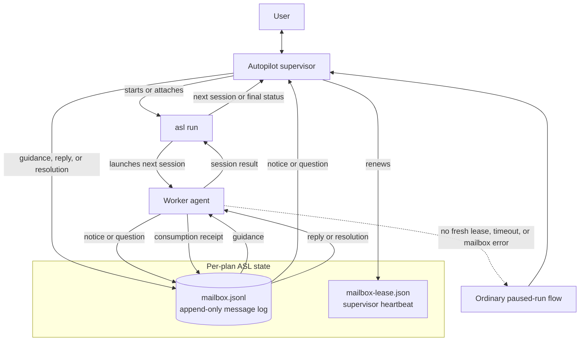

# Agent Session Loop (ASL)

`asl outbox supervise` recovers its launch's terminal record even after the
persisted cursor has advanced past it. If output is interrupted after saving
the cursor, retrying returns `DONE` immediately instead of reporting `IDLE` or
a false `LOST`. Terminal records from other launches remain cursor-scoped;
the general-purpose `asl outbox wait` retains its ordinary `--since` behavior.

Completion contracts keep their imports in `contracts`, with models, Markdown
sections, check validation, and recipe parsing in `contract_*`. The
`handoff_guard_*` modules separate session reopening, mailbox completion,
review mutation, plan artifacts, and snapshot capture. Prompt fragments live
in `run_prompt_*`; preparation models, review refresh, repair resumption, and
packet construction live in `turn_preparation_*`.

`redirect_control` preserves its public controller and records. The controller
handles acceptance and phase transitions; its `UrgentEscalation` base owns the
shared turn state, watchdog, termination evidence, and successor gate.
`workbench_operation_*` separates journal storage, evidence collection, and
mutation admission. The portable `asl_workbench.catalog_*` modules separate
vocabularies, safe labels, records, and paginated views. These public modules
use explicit imports to preserve existing callers.

Operation-journal compaction publishes an owner-only `operations.jsonl.compact`
recovery file before truncating `operations.jsonl`. Readers use that replacement
after an interrupted rewrite; the next writer restores and syncs the journal,
then durably removes the recovery file before appending. The journal keeps its
inode and `flock`, so recovery preserves both outstanding operations and
cross-process admission ordering. Torn-tail separators count toward the journal's
byte limit before an append is admitted.

Operation-journal replay skips JSON that exceeds the decoder's nesting limit,
just as it skips torn lines, preserving usable records and later writes. Remote
corrections that return without persisting are rejected inside the journal's
settlement context, so their retries report rejection and later corrections are
not blocked. Remote admission refusals retain the journal's reason and message,
including conflicting reuse of an operation id and uncertain prior outcomes.

Remote operation reports recheck transitions when another upload or recovery
sweep advances the journal concurrently. Refusal receipts only settle rows that
are still dispatched, and undelivered copies only expire rows that are still
pending. A stale status read cannot overwrite newer evidence or turn a late
report into an upload failure.

Local reply settlement also preserves a consumption receipt when a reconciliation
sweep observes the worker reading the reply before the delivery call returns.
Late acceptance returns that stronger receipt without rewriting it. Explicit
operation confirmation moves directly to `consumed`, allowing late evidence to
resolve `unconfirmed` operations; repeated confirmation preserves the original
receipt and settlement time.

Admission supersedes an uncertain operation only for a new operation id in the
same scope. Replaying an older request, refusing conflicting reuse of its id,
or submitting an unrelated action preserves the uncertain record so late
evidence can still settle it. Launch and resume share the run-start scope and
can replace one another when the plan is idle and the prior owner is gone.

The Workbench connector collects each completed observation, detail answer, or
mutation report before starting another worker in that lane. A worker finishing
between collection and scheduling cannot have its result overwritten. Passive
settlement checks rotate through accepted operations, so missing evidence or a
failed check for one operation does not prevent later operations from reporting
consumption.

The public imports for commit messages, conversation continuity, AgentMux
contracts, and overseer decisions, context, and CLI commands remain in their
original modules. Their implementations live in focused sibling modules:
`commit_message_*` separates diff processing, Git operations, formatting,
generation, and command handling; `conversation_*` separates references,
validation, capabilities, storage, selection, and relocation;
`agent_mux_contract_*` separates schema linting, validation, manifests, and
corpus checks. The `overseer_decision_*`, `overseer_context_*`, and
`overseer_cli_*` families separate evidence, models, policy, and command paths.
Workbench uses the same structure for `history_*`, `http_*`, `capabilities_*`,
and `lifecycle_*`. Internal calls use the owning modules; tests patch those
owners when substituting collaborators. Shared test fixtures live in dedicated
support modules, and each split test module is registered in the same suite
lanes as its original.

The overseer adapters retain their entry points in `overseer_resume`,
`overseer_checkpoint`, and `overseer_mailbox`. Their siblings separate launch
recovery and ownership, checkpoint evidence and Git reads, and mailbox posting
and authority checks. `assurance_ledger` owns transactions, with vocabulary,
records, parsing, file reads, and index rebuilding in `assurance_ledger_*`.
Workbench's `service` owns remote dispatch; `service_queries` and
`service_mutations` share the store and connector lanes in `service_models`.

Turn dispositions retain their entry points in `turn_dispositions.py`, with
continuation models, redirect settlement, mailbox waits, and failure handling in
`turn_disposition_*`. The tail keeps its CLI and follower in `tail.py`; its
`tail_*` siblings own records, control messages, event formatting, and log reads.
Process diagnostics keep their public entry points in `process_tree.py`, backed
by `process_sampling`, `process_recovery`, `process_sweep`, and
`process_termination`; sampler patches belong on `process_sampling`.
`CodexAppServerSession` remains in `codex_app_server.py`, inheriting protocol
handling from `codex_app_server_protocol` and locked state and transport
primitives from `codex_app_server_transport`. `codex_app_server_types` owns
shared protocol values. The inheritance chain uses one session object and the
same locks across reader, driver, and mailbox threads.

App-server teardown closes stdin and applies the shutdown grace period after
failed or cancelled handshakes as well as completed turns. A server that ignores
EOF is then sent SIGTERM; if it remains alive for another grace period, SIGKILL
ends it so a run without a harness timeout cannot wait indefinitely. This also
covers handshake timeouts, restore refusals, and submission cancellations. The
existing fallback rules still prevent replay after a turn has been dispatched.

Implementation runs can explicitly authorize an external data directory with
`--external-write-root /absolute/directory` (repeatable). Admission pins existing,
narrow canonical roots; `run_config` retains them for `--resume`. The external
write guard records their before/after digests as `authorized-external-data`,
including roots omitted from the worker's message. Other paths remain subject
to the existing guard; this grants no repository or review write authority.
Symlink escapes and redirected or unreadable roots fail closed. This option
does not waive a prior incident or mark a session complete.

The bridge's bounded snapshot reserves space for running and verifying work,
then the freshest dated blockers, before undated backlog. The selected rows
retain normal urgency order. The 200-row and frame-size ceilings still apply;
omitted rows leave the snapshot explicitly partial.

Bridge question snapshots, body retrieval, intervention facts, and action
validation select unanswered records owned by the displayed `run_id`. A live
wait's timestamp, session, and turn come from its exact waiting question;
missing metadata stays unknown. Historical questions remain in the append-only
mailbox and available to direct mailbox workflows. Paused-run activity uses the
latest valid finish or turn timestamp from that run, falling back to its start
only when no later activity is recorded.

ASL executes a prepared plan one session at a time. Its Autopilot supervisor starts or attaches to `asl run`, watches the active worker, and uses a per-plan mailbox to exchange live guidance, notices, questions, and answers without restarting the session.



A heartbeat that finds an active mailbox wait for that exact worker turn projects `input_wait_active` and suspends hang sampling until the wait closes, so intentional operator latency is never accumulated as zero-CPU evidence.

The mailbox is a durable, append-only history; the first reply or resolution closes a question, and the worker records when it consumes that closure. A runner's reply wait gives up as `mailbox-full` once no answer can land under the strict wait-closure cap, which still leaves its wait-end inside the wait-end reserve; a wait-end that cannot be written anyway, or a resumed wait start the mailbox refuses, becomes an ordinary pause rather than a crash, and a wait the run leaves by an interrupt or a failed state write is ended best-effort, without receipting an answer it never delivered. Durable mailbox, event, and state-ledger writes use `fcntl(F_FULLFSYNC)` on Darwin to flush the device cache, falling back to `fsync` when the filesystem does not support that device barrier; other platforms use `fsync` directly. Atomic state replacement also syncs its parent directory. During a harness turn, every stdout and stderr chunk updates the shared in-memory active-turn counters and preview immediately, while ordinary activity is coalesced into durable state by the existing 30-second heartbeat. Turn lifecycle changes, action-required and hang transitions, observed-model updates, control changes, and finalization remain immediately durable. Completed turn results and events include additive `stream_io` telemetry for chunk and character counts plus cumulative callback time. Plan publication and recovery share a marker-scoped plan transaction lock so readers never observe a partially published transaction. Plan reads wait at most five seconds for that lock; a timeout reports the holder's pid, hostname, and thread rather than hanging indefinitely. The separate lease proves that a supervisor is still watching; if supervision disappears or mailbox waiting fails, ASL falls back to its normal pause-and-resume path. When `asl outbox wait` actually surfaces an open question, it also persists that run's body-free question projection and makes a best-effort `AgentSessionLoopMailboxQuestion` handoff to AgentMux. Notification failure never changes the outbox result, and closed history does not alert. The end of supervision is itself a mailbox record: the Autopilot helper appends one terminal `supervision-end` message carrying its raw exit reason and a coarse outcome, and `asl outbox wait --include all` wakes on it and reports it through `supervision_ends` and `supervision_ended`. That record ends the helper's supervision lifetime and does not prove the supervised run is quiescent: a `worker_hung` stop leaves the `asl run` child alive holding the plan lock, so later worker questions and notices can still land after the terminal record. Before that unresolved stop, the runner gives only `result_received_process_alive` one automatic recovery attempt: after the existing result grace and two zero-CPU confirmations it re-samples the tree, identity-checks the harness root and deepest leaves by pid, birth time, command, and ancestry, and sends those leaves SIGTERM once. It never escalates to SIGKILL, never applies this policy to ordinary no-result stalls, and the process-sweep opt-out disables it. The live `hang_suspected.recovery` report records the policy, attempt time, signal, candidates, signalled and already-gone pids, identity mismatches, and signal failures; resumed output clears the episode and continues the same run, while a later `worker_hung` preserves the unresolved report under `result.hang`. Every outcome except `error` is appended after the helper flushed its complete result, so stdout is parseable when the wait returns; `error` marks an abnormal exit whose stdout may be missing, truncated, or unproven and must be decided from the record alone. Because it is durable log content read through a sequence cursor rather than a live notification, a helper that already exited returns it on the next wait instead of burning the full timeout; a terminal-only wake makes no AgentMux handoff and writes no question projection. The runner emits no such record — only the helper's own exit ends supervision — and `--no-mailbox`, SIGKILL, or a crash leave none at all, so the stdout-tail fallback remains. Because two helper lifetimes can overlap on one plan, every launch carries a `supervision_id`: the launching agent passes `--supervision-id` to the helper and to `asl outbox wait`, which then reports `supervision_ended` only for that launch's own record while another launch's record still advances the cursor. The supervision loop itself uses `asl outbox supervise`, which wakes only on questions and terminal records, keeps its own resumable cursor in `mailbox-supervision-<supervision-id>.json` so no `--since` is threaded by hand, absorbs another launch's terminal record and already-closed questions without printing anything, and reports one of `IDLE`, `ACTION questions=<n>`, `DONE outcome=<outcome> seq=<n>`, or `LOST reason=<reason>` at exit code 0; `asl outbox wait` is unchanged and stays the general-purpose reader. `LOST` closes the gap that made a mis-launched helper look healthy: the helper records its `(pid, process birth time)` identity before starting the child, and each supervise pass that reads no record probes that identity, so `helper-exited-without-record` reports a helper whose process is gone and `helper-never-started` reports one that never wrote an identity while no run holds the plan — the latter only after a 120-second grace window, and neither ever preempting `DONE` or `ACTION`. The token carries the run evidence that decides what to do next — lock, `run_id`, runner-state freshness, active turn, and session counts, exposed under `--json` as `lost_reason` and `run_evidence` — because a helper killed under a live lock means only supervision needs relaunching, while a helper that never started means nothing is running at all. Supervision is launched detached (`asl-autopilot.py --detach`), which forks the supervision away from the launching shell and prints one JSON launch handshake carrying `pid`, `result_path`, and `stderr_path`, so an hours-long run no longer depends on the lifetime of the shell that started it and the run's verdict is read from `result.json` rather than the launcher's stdout.

A failed process probe leaves helper liveness unverified: only an empty `ps`
selection (exit 1 without output) or a verified process identity mismatch proves
the helper is gone. After detecting that exit, supervision must successfully
read the mailbox again before reporting `LOST`, since the helper may have
published its terminal record during the probe. Transient failures of that
final read retry within the poll's remaining timeout; an unreadable mailbox at
the deadline reports `mailbox-read-error` instead of claiming the record is absent.

Spending a turn is one typed boundary rather than a stretch of the run loop. The `turn_execution_*` modules own launch (`turn_execution_executor`), the live turn and heartbeat (`turn_execution_live`), the hang sentinel (`turn_execution_hang_sentinel`, `turn_execution_hang_settings`), runner signals and argv sanitizing (`turn_execution_signals`, `turn_execution_argv`), artifact capture (`turn_execution_artifacts`), and publication and rejection (`turn_execution_commit`), over shared `turn_execution_constants` and `turn_execution_protocols`; `run_loop_turn_preparation.py` builds a `TurnExecutor` per turn and it is called exactly three times — `launch` starts the harness and returns the finished live record and `finalize` collects the exited process into `result.json` and a re-read plan, both from the loop itself, and `commit`, which `turn_settlement.py` calls to publish the accepted turn. Each returns a frozen record (`TurnExecution`, `TurnFinalization`, `TurnCommit`) instead of mutating a shared dictionary, so what a phase produced is fixed once it hands back. Everything the loop does between those calls is the guards, which the boundary deliberately knows nothing about: `finalize` cannot announce completion, and `commit` is still the only emitter of `turn_finished`. The module never imports the runner — the run's serialized state writer and its progress reporter reach it through the `TurnPersistence` and `TurnProgress` protocols, and the leaf helpers both sides need live in `clock.py`, `durability.py`, `agent_mux_delivery.py`, and the `plans_*.py` modules. Because the boundary is typed, it re-enables the `arg-type`, `union-attr`, and `index` checks the repository still suppresses elsewhere.

The shared services keep their public imports in `review_repair`,
`repository_evidence`, `harnesses`, `metrics`, and `assurance_projection`.
Their implementations are split by responsibility: repair planning, rendering,
validation, and publication; Git fingerprints, comparisons, and worktree
inventory; harness adapters, process control, conversation lifecycle, and stream
readers; metric collection, timing, and rendering; and assurance publication,
ledger replay, issue actions, and identity catalogs. Tests patch the module that
reads a collaborator, so an extracted implementation cannot silently bypass its
mock. The guard, overseer decision/resume, native restore, and commit-message
tests use focused shards with shared fixture modules; every shard is registered
in `tests/run_suite.py` under its existing test lane.

Verification and review are declared as state machines rather than executed as a chain of conditionals. `transitions.py` is the shared mechanism and carries no domain knowledge: a `StateMachine` validates its own table at construction, enumerates both halves of the state-by-event grid through `legal_transitions()` and `illegal_transitions()`, and raises `IllegalTransitionError` on any step it never declared, while a `MachineCursor` walks one instance and keeps the route it actually took rather than the route the table allows. `verification_transitions.py` declares the per-session lane — `scheduled` into `contract-ready`, `running`, and the settled `passed`, `deferred`, `failed`, `unenforced`, and `refused` — and declares Session 2's terminal required-check and final-review policy beside it, so success is still tested by exactly one adjudicator and that adjudicator now sits next to the states whose evidence it reads. `review_transitions.py` declares two: the verdict machine (`submitted`, `retrying`, and the settled `accepted`, `exhausted`, `declined`) and the cycle machine (`reviewed`, `materializing`, and the settled `settled`, `reopened`, `refused`), which is where finding recurrence, the per-group repair cap, broad-failure deferral, and rereview become named states instead of branch conditions. What the modules return are frozen decisions — schedules, refusals, adjudications, repair budgets, finding deltas, cycle and materialization classifications — and every effect belongs to a boundary the run loop drives: `run_termination.set_pause` pauses, `handoff_guards._revert_session_status_to_pending` reverts, `turn_execution_commit` writes `result.json`, and `run_persistence._append_event` appends durable events. Neither lane module imports the runner, and every reference — call site, patch target, or otherwise — names the lane module that owns the symbol, because the module-level aliases these two extractions originally left in `runner.py` were retired in Session 38. All three modules re-enable `arg-type`, `union-attr`, and `index`, and their tests are model tests: they walk the declared enumerations, so every legal transition is exercised and every illegal one is asserted to raise.

Everything that races the run loop from outside it is one typed boundary too. The `run_coordination_*.py` modules own the three durable slots a non-loop actor writes: `waiting_for_reply` belongs to a `WaitStateStore` (`run_coordination_wait_state.py`) whose every begin, lease stamp, deadline rebase, and clear is a compare-and-set against the question that opened the wait, so a probe for a wait the loop has already finished is dropped instead of resurrecting it; `control` is written only through `record_run_control_action`, so a durable event and the control payload can never disagree about what was requested; and `assurance` is published by a `TerminalAssuranceCoordinator` that closes its finalization phase whether the advisory audit rendered a verdict, was cancelled, or raised. A `MailboxWaitCoordinator` brackets one reply-capable pause end to end — announced before it can block, cleared after it stops, including when the poll raises — and a `SupervisionCursor` carries the lease-and-clock ratchet a bounded wait advances, where only a fresh lease rolls the unsupervised ceiling forward and a detected suspend restarts it at the wake instant. The exactly-once reply guarantee is stated in one place: the poll loop reads the mailbox without its lock, so `mailbox_waits.finish_wait` re-checks under it and whatever closure it finds there overrides the timeout the loop arrived with. The module never imports the runner — serialized persistence, the AgentMux notification seam, and the compacted state projection the audit reads enter through the `CoordinationPersistence`, `WaitNotifier`, and `state_snapshot` seams — and a caller that stubs one of its functions patches the `run_coordination_*` module that owns it, since the runner aliases this extraction left behind were retired in Session 38 along with the rest. It re-enables `arg-type`, `union-attr`, and `index`, and `tests/test_asl_typing_ratchet.py` keeps that opt-in from eroding: no code may join the repository-wide `disable_error_code` baseline, no per-module override may add a suppression of its own, no extracted module may leave the `enable_error_code` list, and every public signature in a ratcheted module stays annotated with no bare `dict`, `Mapping`, or `list` crossing the boundary. A future extraction adds its module to `pyproject.toml` and to `REQUIRED_RATCHETED_MODULES`; its test module joins the fast lane of `tests/run_suite.py` by being discovered.

Conversation continuity is its own typed boundary, and a deliberately narrow one. `conversations.py` owns the shared conversation reference, the continuation intent, the per-harness capability report, and the plan-owned `conversations.jsonl` ledger that stores them. The native harness conversation ID lives there rather than in `state.json` because the next run of the same plan replaces that file wholesale, and a reference kept inside it would be destroyed by the very restart it exists to survive. Opening, confirming, and retiring a conversation are three appended records taken under an exclusive `flock` on a sidecar lock and flushed through the platform durability barrier before that lock is released; sequences are positional, so a crash-truncated line keeps its place in history as rejected rather than being deleted to make the file parse. Lookup is keyed by `(session_id, harness)` and every other bound field — plan directory, workspace root, registry digest, access profile, repository scope — is checked against the stored record rather than used to widen the search, so a changed binding reports `incompatible` and names the differing fields instead of quietly opening a second conversation. There is no "latest conversation" lookup anywhere in the interface. A reference persisted before work was submitted but never confirmed reports `unconfirmed`, an unreadable line makes every selection report `corrupt` because it cannot be attributed and may be the retirement of the key being asked about, and completing a plan session retires its conversations by appending. Every non-resumable state requires user input; the way out is an explicit one-use operator authorization carried on a `ContinuationIntent`, which has no serialization at all, so the override cannot be persisted or rehydrated. Capability is reported per harness, and every shipped harness is now `available`, because each transport both captures and resumes a native conversation — codex learning its thread id from the app-server handshake, claude stating its session id on argv, copilot restoring its session with a capability-checked `session/load`. `staged` remains the state for a harness whose contracts exist but whose adapter is not wired, because an operator action backed by incomplete recovery must not be offered; `capability_report` derives that state from `harnesses.continues_conversations` rather than declaring it, so the report and the turn boundary that enforces it read the same two adapter flags and cannot drift apart. The module imports nothing that imports `state.py` and takes a plan *state directory* rather than a plan directory, which is what lets `migrate_plan_state` repoint the ledger when a plan moves — rewriting only readable records that name the old plan, preserving line order and unreadable lines byte-for-byte, and refusing `conversation-plan-mismatch` when the ledger belongs to some other plan.

Deciding *which* conversation a turn runs on is the layer above that ledger, and it is one function rather than four branches of the run loop, because a policy spread over four call sites acquires a fallback the first time one of them is patched in a hurry. `conversation_resume.py` turns a pending session plus a harness into exactly one of three outcomes — continue the saved conversation by naming its native identifier to the adapter, open one because this session has never had one, or stop with `conversation-recovery-required` — and there is no fourth, in particular no silent fresh start. `absent` and `resumable` proceed; `unconfirmed`, `incompatible`, `retired`, and `corrupt` do not, and the set is written as the complement of the two that may proceed so a selection state added later is refused by default rather than falling through. Every turn appends a `conversation_continuation` event before the harness starts, including the ones that open a new conversation, because a decision only recorded when it went wrong leaves no baseline to read that against. What the binding checks is what would invalidate the work — workspace root, registry digest, access profile, writable scope aliases — and what it deliberately omits is what an operator legitimately changes between attempts: model, effort, timeout, spark routing. A plan with no repository registry is bound by a digest synthesized from its canonical root, an identity rather than a registry, so a run pointed at a different `--cwd` reads as `incompatible` and stops. The way past a refusal is `--fresh-conversation`, and it is one-use in four places because each covers a replay the others do not: an in-run counter, so a later turn, the next session, or a generated repair child reads an exhausted authorization; the `--resume` overlay's excluded dests; the supervisor's child-argv skip list; and `run_config`, which persists no key for it at all. The pause is classified environment-blocked for the same reason — a supervisor retry that "recovered" it would be a retry that discarded an agent's accumulated context without anyone deciding to. After the turn, a conversation is confirmed only if work was actually submitted, so a turn abandoned at the capture seam or cancelled in the `unstarted` or `handshake` stage leaves it unconfirmed; an interrupted, timed-out, or failed turn is still confirmed and records the attempt it was. Those post-turn writes report their failures rather than raising, because the turn has already run and a bookkeeping error must not be what loses it — and a lost confirmation fails closed, since the next attempt reads `unconfirmed` and asks the operator. The one answer the ledger cannot supply is whether the provider still holds the history it recorded, which is why a refused restore is a structural field rather than a nonzero exit with a message in it: `HarnessResult.conversation_restore_refused` is set only when the provider itself rejected the restore *request* — the app-server answering `thread/resume` with an error, an ACP agent answering `session/load` with one, or claude complaining on argv about the very conversation `--resume` named while never announcing a session of its own — and never for a transport failure, settings drift, a substituted thread, a missing `loadSession` capability, or a stopped turn, each of which leaves a history that still exists. A rejected request is necessary but not sufficient, because a provider answers an outage through the same call it answers a deleted thread through: the rejection has to *diagnose a missing history*, and `restore_diagnosis.py` is the one vocabulary all three adapters ask, so an outage cannot be a refusal on codex and an error on copilot. It reads the error the provider actually sent rather than a rendered string — the transports carry the JSON-RPC code, message, and data through as a `ProviderRejection` instead of flattening them at the raise — and it judges in that order: a protocol-fixed code (`-32700`, `-32600`, `-32601`, `-32603`) decides nothing about history because it is about the *call*; a message or data blob that explains itself as temporary, overloaded, rate-limited, unauthenticated, forbidden, or malformed vetoes the reading outright; and only then may the missing-history wording carry it. The order is what makes "internal error: the conversation store is unavailable" a failed turn rather than a retired conversation. The veto is the second half of the rule and never the first: every phrasing on the positive side names a conversation, session, or thread as the subject of the absence, and the verdict has to attach to that subject within the identifier a provider may name it by. Naming it is not the same as appearing in the sentence, because English stacks nouns into compounds and these are ordinary words: "session file not found", "thread pool not found", "no such session/load method" and "unknown session storage backend" are about a config file, a worker pool, an RPC method, and a storage backend, so the noun has to hold the subject position — the verb attaches to it directly, or the clause ends where the noun and its identifier end. Code writes those compounds with punctuation rather than a space, which is the disguise that reads as the classifier's own vocabulary: a dot ends a sentence and also spells `session.load` and `session.json`, and a separator marks a minted identifier and also joins `storage-backend`. So a clause does not end at a dot or colon a word continues — "no such session." is a verdict and "no such session.load method" is not — and identifier recognition is limited to UUIDs and supported numeric history names, optionally quoted or introduced as an ID. Quoting or digits alone cannot turn a configuration filename or backend into native history; unknown forms preserve the binding on a failed turn. A leading word boundary also keeps `pthread` from becoming `thread`. For "no such …" and "unknown …", where the verb comes first, what may follow the noun is listed as predicates rather than excluded as nouns, because there is no end to the infrastructure a provider can put a history word in front of and a misconfigured install must not cost an operator the context a repaired install would hand straight back. A sentence that merely reports something missing is almost never about the history — "no such host", "no such model", "no such file or directory" — and none of those is temporary, so no vocabulary of transient words could have excused a subject-free match after the fact; it can only be refused up front. It is fail-closed in the direction that matters: an unrecognized sentence is not a refusal, so the turn still fails and the ledger entry survives, and a provider that starts phrasing its refusals differently costs a turn rather than an agent's history. The `data` member is read for the veto and never as positive evidence, since it is where providers put retry hints. Transport failures are kept out of the classifier entirely rather than talked out of it: a pending request records an *answered* rejection separately from a transport reason, so a broken pipe mid-`thread/resume` can no longer read as a provider disowning its history. `handoff_guards._terminating_result_disposition` names it `restore-refused`, after the three stopped-turn dispositions and ahead of the unreadable-plan one, and `turn_dispositions.settle_restore_refused` retires the record as `unusable` rather than `superseded`, because nothing replaced this conversation — it stopped being one. That single write is what makes both remaining behaviours fall out of machinery that already exists: an ordinary launch afterwards selects `retired` and stops for recovery, and a `--fresh-conversation` launch spends its one-use authorization, supersedes nothing, and opens a conversation with no resume identifier. The pause is the same `conversation-recovery-required`, its message names the fresh start as the way forward and says so explicitly when the ledger write itself failed, and the turn record carries that pause reason rather than a harness-failure classification, so the turn and the pause tell one story.

The harness registry and public imports live in `harnesses.py`. Shared contracts live in `harness_types.py`; `harness_process.py` owns abort deadlines and process cleanup; `harness_conversation.py` and `harness_lifecycle.py` coordinate capture, submission, and cancellation. `harness_adapter.py` constructs invocations and delegates execution to `harness_execution.py`, which uses `harness_streams.py` for synchronized pipe readers and `harness_transport.py` for common transport hooks. Each provider keeps its own adapter and transport: `harness_codex.py` uses `codex_app_server.py`, `harness_claude.py` uses `claude_stream.py`, and `harness_copilot.py` uses `copilot_acp.py`. Claude command and session selection live in `harness_claude_invocation.py`, while `harness_claude_stream.py` owns its stream renderer and transport handle. All three decode their JSON lines through `harness_json.py`, which turns lone surrogates into U+FFFD. `harness_claude.py` retains turn execution and conversation continuity. Provider adapters still import their shared base through `harnesses`; the registry loads them lazily inside `_adapter_classes()`. Skill prefixes are read from those adapter classes by `skill_prefixes()`. Patch a collaborator where it is read: `sweep_enabled` and `_kill_process_group` on `harness_process`, `_ABANDONED_READER_JOIN_SECONDS` on `harness_types`, process spawning on `harness_execution.subprocess`, provider-specific transports on their adapter modules, and `run_harness` on `harnesses`.

What a turn can say about its own conversation, and what can be said to a turn while it runs, is coordinated by `harness_conversation.py` and `harness_lifecycle.py`. These modules accept callbacks without importing `conversations.py`, so native capture does not depend on the ledger that records it. `TurnConversation` is the capture half: a transport reports the native identifier its handshake learned, the sink persists it, and the transport only submits work if that call returned, because a conversation recorded *after* submission is one a crash in between could lose while the work went ahead. It is turn-scoped exactly the way `LiveDeliveryEndpoint` is — the lock is held across the sink call, so `close` cannot return while a capture is in flight and no capture can begin after it returns — which is what stops a late protocol callback from recording a conversation against a turn that is already over. The same identifier named twice is idempotent, because a protocol may name its conversation more than once; a *different* identifier is refused, because one turn runs on one conversation. A failed sink raises `ConversationCaptureError` and leaves nothing captured, and the turn is abandoned with `conversation_error` set and no work submitted rather than run into a conversation nothing could find again. `TurnLifecycle` hands both halves to `open_transport`, and `HarnessInvocation.resume_conversation_id` carries intent in the other direction; `captures_conversations` and `resumes_conversations` are true on every shipped adapter, and `run` refuses a capture sink or a resume intent an adapter cannot honor, so an adapter can never silently start a fresh conversation while a caller believes it continued one. `TurnLifecycle.refuse_submission` is the second half of the same checkpoint on the capture side: a transport asks it immediately after the capture and submits only if it returns, so a cancellation that lands in the handshake window costs the spawn rather than the turn. `TurnSubmission` is the third seam, and it answers a different question from the other two: not whether a turn may submit, but whether it did. It is turn-scoped and locked the way the capture half is, idempotent for a protocol that can report the same submission twice, and closed with the turn so a straggling transport thread cannot report one afterwards — but a failing sink is *suppressed* there rather than raised, the exact opposite of the capture's, because by the time it fires the words are already with the worker and there is nothing left for a bookkeeping failure to stop. Each transport reports it from where its prompt actually goes out: at the spawn for a one-shot turn, whose prompt was on the argv the process was started with, and otherwise from the answered `turn/start`, the accepted `session/prompt`, or a stream-JSON message written to a CLI that has said it took the conversation up. A protocol transport has a boundary before that one, though, and the seam has a third state for it: `note_submission_in_flight` says the prompt is going out, and between that call and the answer the seam says neither `True` nor `False`. The app-server marks it in the instant before `turn/start` is written — before rather than after, so a write that broke partway still counts as a prompt that left — and settles to `True` only once the answer identifies the turn. Everything that can go wrong in between ends the turn inside that window: a server that read the prompt and died with the answer unsent, a socket that broke, a rejection, a reply the client cannot read. None of those is a statement that the words stayed home, because the provider may be holding them, and the seam refusing to answer is what says so. The same fact is stamped onto the result the turn returns, as `HarnessResult.prompt_submitted`, because a callback that never fires is ambiguous in a way the field is not: `True` submitted, `False` *declined* to submit, `None` no statement either way. That third value is the point of the field — reached both by a turn whose process died on the way to a result and by one that returned while its prompt was crossing the wire — and it is what lets a caller tell a provider that was merely unreachable, which refuses nothing about the conversation and so sets none of the refusal fields, from a transport whose reporting thread simply did not survive. `prompt_provably_unsubmitted` is the reader, and where the field speaks it is the whole answer: it knows a one-shot turn submitted on argv before the window its cancellation was later named for, which the `cancel_stage` proxy underneath it does not. A `None` there has spoken as well: the refusal fields underneath are each written on a path that has not sent a prompt, and so are unreachable once a transport has begun writing one out, which is what stops the fallthrough from resurrecting proof the seam withheld. What reads all of this is the redirect subsystem, which owes the operator an account of every correction and cannot settle one on the strength of a pid. On the codex adapter both halves are wired to both transports. The app-server captures the thread id `thread/start` or `thread/resume` returned and restores exactly the thread it was handed — a returned thread id that differs, a widened sandbox, or a `cwd` or `approvalPolicy` that came back from the restored thread instead of from this call is refused before any turn is sent. The window in which a protocol error may be answered by re-running the turn on `codex exec` closes when `turn/start` is *written*, and not only when it is accepted or when work has been seen: a server that took the prompt and then died leaves neither of those marks, so a rule read from them alone would re-run a turn the provider may well be running. A resume has no fallback window at all, because `codex exec` starts a fresh session and would answer "continue this conversation" with one that continues nothing; `build_exec_invocation` refuses a resume outright for the same reason. `codex exec` submits its prompt on argv, so it has no handshake to capture in: it reads the session id out of its own output afterwards, and because that work cannot be un-submitted a failed capture there reports `HarnessResult.continuity_unavailable` instead of abandoning the turn. Stopping a turn is likewise said to the conversation rather than only to the process: `HarnessTransport.interrupt` sends `turn/interrupt` naming the exact thread and turn just before the wait loop's forced kill and again from `shutdown` while a turn is still live, so the conversation records an `interrupted` turn — which is not a failed one and never becomes a protocol error — rather than one that stopped answering. The claude adapter wires the same two halves to its stream-JSON transport, and differs in where each fact comes from. Its conversation is *stated* rather than learned: `--session-id` assigns one and `--resume` restores exactly one (`--fork-session` is never passed, because it answers "continue conversation X" with a different one), so the identifier is known before the process is spawned and the capture runs before the prompt is written rather than after a handshake — an audit turn, running under `--no-session-persistence`, is assigned nothing and refuses a resume outright. The `system`/`init` record is re-checked against the stated session, and a disagreement reports `continuity_unavailable` with `conversation_id` cleared rather than killing a turn whose prompt is long gone. That record is also where a *resumed* turn reports its submission from — `on_session_observed`, fired once when the CLI first names a session — rather than from the write that put the prompt on the pipe. Claude has no restore handshake to refuse in: `--resume` rides on the argv, and a CLI that means to reject it exits without ever reading stdin, so the write succeeds against a pipe whose reader is already leaving. Reporting on that write is what let a known refusal spend an operator's correction: the loop persisted the carry as `delivered` a moment before the CLI said it had no such conversation, and a delivered carry can never be released, so the words were owed to a turn that never began. A fresh turn still reports at the write, because there is nothing there to refuse. The deferral is fail-closed in the other direction too — a CLI that failed after taking the conversation up, one that explained nothing, one whose announcement simply never arrived all settle as submitted when the turn ends, because ambiguity that reads as unsubmitted is how one correction becomes two. Only a diagnosed restore refusal withholds the report, and it stamps `prompt_submitted=False` rather than leaving the field silent, since the loop releases a carry on proof and never on absence. The report itself is made at most once however the turn ends, because the announcement and the end-of-turn settlement can both reach it, and the two orderings of a refusal — the pipe took the write, or the pipe was already broken — are one case rather than two. Its interrupt is the CLI's own raw control protocol read off `claude-agent-sdk` rather than its high-level method: a `control_request` naming a `request_id`, answered by a `control_response` carrying that identifier back, correlated by that identifier and nothing else, sent once per turn from the daemon thread beside the forced kill while the stdout readers can still answer, and bounded by five seconds or the process's own exit. Nothing is sent from `shutdown` there, unlike the app-server, because by then the process is reaped and the readers abandoned. Past the interrupt the session stops accepting evidence: the result that follows is drained rather than credited, a drained echo is consumed for accounting but confirms nothing, and further guidance defers as `stale-turn` — everything except a `PreToolUse` receipt already on disk, which the hook writes only after a tool call actually ran with the text.

The third harness transport is copilot's. `copilot_acp.py` speaks the Agent Client Protocol over stdio — a JSON-RPC handshake, one session, one prompt, streamed `session/update` notifications, and a shutdown that closes stdin, gives the agent a bounded grace before terminating it, and kills it after a second grace if it ignores termination, including after failed or cancelled handshakes — so a worker turn's prompt travels on the protocol instead of on `-p` and never reaches a process listing. What the turn may do is still decided entirely by the launch argv. The client advertises no filesystem and no terminal capability, refuses every other server-to-client request by method with `-32601` rather than by policy, and answers a `session/request_permission` by restating the grant it was launched with: `allow_once` when the bypass flags are on that argv, `reject_once` when they are not, and never either standing option, so no single request can widen the rest of the turn; a request offering only standing options gets the protocol's own `cancelled` outcome instead of an escalation. Guard rules are deliberately not re-derived here — they are `--deny-tool` command-text rules the CLI enforces itself, and a responder that second-guessed them would be a second, weaker enforcement lane. The audit profile does not move: it keeps its one-shot `-p` argv and its restricted tool set, because putting a permission responder in front of tools that currently cannot be asked for at all would be a widening dressed up as a transport change. There is no fallback to the one-shot form — same binary, same flags, so a failure after `session/prompt` has already spent the turn — and because an ACP agent exits 0 whether the turn it ran succeeded or failed, the adapter restates the outcome from the protocol's `stopReason`: only `end_turn` is success, and a refusal, a cancellation, either budget exhaustion, a missing stop reason, a protocol error, a rejected permission request, or a launch-control echo that disagrees with `--model` or `--effort` is said on the turn's stderr rather than absorbed. `TurnLifecycle.refuse_submission` runs immediately before `session/prompt`, which is the handshake-window checkpoint copilot previously had no way to offer. Both halves of continuity are wired to that same session. The conversation is *learned*, like codex's and unlike claude's: the session id comes back from `session/new` or is the one `session/load` restored, and it is captured between the session and the prompt, so it is durable before any work is submitted and a sink that fails abandons the turn with `conversation_error` rather than spending it into a conversation nothing could find again. A resume calls `session/load` and nothing else — a `session/new` standing in for a failed restore would be a fresh conversation wearing an old conversation's name — and it is refused before the prompt when the agent never advertised `loadSession` (read `is True` off `initialize`'s own answer, because a capability in any other shape is not an advertisement), when the load fails, when the answer names a different session, or when the replayed transcript could not be read. The restore restates this turn's `cwd` and empty `mcpServers` rather than inheriting whatever the session was last opened with. That replay is the one thing about this transport that has no analogue in the other two: `session/load` streams the entire prior conversation back as `session/update` notifications before it answers, and none of it is this turn — not its log, not its final message, not new activity, and not an acknowledgment. Replayed updates are counted apart from live ones and rendered as nothing at all, which is also what keeps a replayed prompt echo out of a persisted artifact; completion is structurally unreachable from a replay, because only the `session/prompt` response carries a stop reason. Stopping a turn is said to the conversation with `session/cancel` — a notification, because the protocol's acknowledgment is the pending prompt returning `cancelled` — sent once beside the wait loop's forced kill and never from `shutdown`, which follows claude rather than the app-server for the same reason: by then the process is reaped and the readers abandoned. A cancellation that cannot be written reports that it was not sent instead of recording a protocol error, since the turn is ending regardless. The audit profile keeps its one-shot form and therefore holds no conversation at all: it refuses a resume in `build_invocation` and again in `open_transport`, and a caller that asks it which conversation it ran on is told `continuity_unavailable` rather than handed a silent `None`. Ordinary guidance is unchanged and still defers as `unsupported-active-steer`.

Cancellation is two observations rather than one, and `AbortSignal` is where they separate. `arm` records the request and returns, taking only that signal's own leaf lock — never the live-delivery endpoint's — so a request cannot queue behind a guidance transport that is mid-delivery into the very turn being cancelled. Whether the worker actually stopped is read afterwards through `wait_completed`, which is satisfied only once the process is reaped and its transport is shut down, so completion means the turn is gone rather than that a signal was issued. `cancel_stage` names which of four windows the request was acted on in: `unstarted` (refused before the spawn, so nothing was started and nothing has to be killed), `handshake` (the transport stopped at its next checkpoint, so no work was submitted and the spawn alone is torn down), `execution` (the wait loop's kill, which is the expensive one), and `shutdown` (the turn was already past its wait loop). Every checkpoint asks `is_due` rather than `armed`, because a request carries a grace period and a turn that finishes inside its grace was never aborted. A request that arrives after the turn is over is completed on the spot and staged `shutdown` instead of leaving its caller waiting for a kill that will never be issued, which is the same "cannot revive a closed turn" rule the capture seam enforces; the lifecycle closes last on every path out of a turn, after the endpoint and the transport, so completion is never reported while any part of the turn is still live.

Every string a turn is launched with is assembled in one place that writes nothing. `run_prompts.py` owns the legacy `session-run` skill invocation, the bounded repository-authority block, the live mailbox protocol, and the two continuation blocks a resumed turn carries — an operator reply and an answerless supervisor resolution. Three properties are stated here rather than spread across the loop: the skill invocation stays line one, and both continuation builders reuse `build_session_prompt` byte-for-byte as their base instead of re-deriving it, so a resumed turn opens exactly like a fresh one on every harness adapter; untrusted text — pending guidance, an operator reply, a resolution note — is rendered as escaped ASCII JSON inside named `BEGIN`/`END` delimiters, so a body that looks like prompt markup cannot alter the packet around it; and the repository block publishes the whole ordered registry but resolves roots only for the aliases the selected session may read, so no prompt hands a worker a path outside its own scope. The module needs no persistence seam because it writes no durable record at all: the run loop still decides when a prompt is built, which one is persisted into a turn record, and what happens to the process it is handed to. It never imports the runner — plan directory, harness name, resolved workspace, session scope, verification context, and mailbox records all enter as parameters — and it re-enables `arg-type`, `union-attr`, and `index` on the Boundary table like the extractions before it.

The prompt an autonomous turn actually opens with is its own boundary. `task_packet.py` is the entry point (worker-mode switch and re-exports) over `task_packet_model.py`, `task_packet_render.py`, `task_packet_build.py`, `task_packet_lookups.py` and `task_packet_help.py`, which together own the compact session task packet that replaced the manual `session-run` skill invocation for `asl run`: the frozen `SessionTaskPacket` record and its `render`, the `build_task_packet` factory that validates them, the two plan lookups its callers need — the declared-order predecessor id and the `session-<id>.expand.md` probe — the `ASL_WORKER_MODE` switch that decides whether a run sends a packet at all, and the `interactive_help` payload a paused run hands an operator. Four properties are stated here rather than spread across the loop: every rendered packet opens with `TASK_PACKET_HEADING_PREFIX`, which is how a packet turn is told from the legacy skill invocation on sight; the worker-mode switch fails safe, resolving anything but a case-insensitive `skill` to packet mode so a mistyped override cannot silently disable the default; an operator reply and an answerless supervisor resolution are mutually exclusive, each demands its own context, and both are supplied only on the turn that resumes, so continuation context never leaks forward; and `_resolution_source_metadata` returns ids, sequence numbers, and the note's *length*, so a durable record can name a resolution without copying operator prose into it. The packet also carries the verification-ownership policy both worker roles share: the runner runs the completion recipe authoritatively after the turn, so the worker does not rerun it as a final gate, while `task_packet_render.justified_repeat_lines` names the three cases that do justify running a check again or running a broader one — an invalidated earlier result, a failure that needs diagnosis, or an uncovered correctness concern — caps neither the number of checks nor their runtime, and asks for the brief reason in the handoff. Implementation packets additionally direct workers to reuse valid evidence, diagnose the actual failure, and report an integration blocker through the existing handoff or mailbox rather than redesigning boundaries or removing required checks. `run_prompts.py`'s skill invocation, the `session-run` skill's shared execution path, and `review_repair.py`'s `## Child scope` state the same policy, so no surface can be read as "leave the checks passing" meaning "rerun every check yourself". Whether a live worker behaves that way is a separate question from whether the packet says so, and it is answered by an opt-in fixture rather than by the ordinary suite: `tests/fixtures/asl_worker_verification/evaluate.py` runs the candidate checkout's own wrapper against a disposable repository, plan, and state directory across three scenarios twice each, and its read-only `check` command re-derives every verdict from what the runs left behind — the invocations the check scripts recorded as they ran, the run's own `verification_check_finished` events, the handoff, and the repository's final state — so a receipt that says "passed" proves nothing. Worker and runner are told apart by stripping the harness's environment markers from the run and then reconciling that derivation against the run's own gate events, and the trial session files state the task and nothing about verification ownership, so what a worker knows about the final gate can only have come from the packet. Like `run_prompts.py` it needs no persistence seam because it writes no durable record — it returns a record, a string, or a payload the loop decides what to do with. It never imports the runner: harness name, plan directory, session id, workspace, scope, mailbox records, and the parsed argument namespace all enter as parameters, and every prompt fragment it composes comes from `run_prompts.py`, which is runner-free itself. It re-enables `arg-type`, `union-attr`, and `index` on the Boundary table like the extractions before it.

A generated review session is authored by the run itself, appended by `review_session_body.ensure_generated_review_session`, and reviewed by nobody before it runs, so what it must prove is stated in one place. `review_session_contract.py` owns both halves of that contract: recognizing a generated review session — `contains_review_session_marker`, `is_generated_review_session_file`, and the versioned `generated_review_session_version` — and authoring the gates that adjudicate one, from the two artifact validators through the replayed plan-wide recipe to the rendered `## Completion Contract` section and the in-place `refreshed_generated_review_contract`. Three properties are stated here rather than spread across the loop. The two verifier sources are executable text run as `python3 -c` inside the plan directory, where no package import exists, so they deliberately duplicate a structural subset of `review.py` instead of calling it; `tests/test_asl_review_session_contract.py` pins both against fixtures captured from the pre-extraction runner and pins the rendered recipe too, so neither the constants nor the path substitutions can drift. Every rejection leaves through one `fail` helper that writes a structured JSON line naming a `check` and a `reason` from a closed vocabulary, which `verification_diagnostics.GENERATED_GATE_REASONS` is held equal to by a test that extracts this module's source. And provenance is not authentication by marker: every field a rejection line carries is public, so `_authenticated_generated_review_contract` re-renders the recipe from the plan directory and stamps `generated_gate` on byte-identical checks only, which is what separates ASL's own gate from a hand-authored command that prints the same words. The module writes no durable record — it returns payloads, contract dataclasses, and Markdown, and the loop decides what reaches disk. It never imports the runner: plan directory, session id, and repository aliases all enter as parameters, and it reads `review.*` and `verification_transitions.*` at their owning modules rather than through the runner's alias names. It re-enables `arg-type`, `union-attr`, and `index` on the Boundary table like the extractions before it.

What that contract is attached to is the review session's body, and it is a separate boundary because it is the half that can be wrong without failing a gate. `review_session_body.py` owns the markdown the reviewer actually opens: `build_generated_review_session_body` renders the whole file — instructions, the ordered repository review base, the delta scope, the contract section authored next door, and the handoff stub — while `rescoped_review_session_body` and `refreshed_review_repository_base` rewrite exactly one of those sections against current evidence and carry the rest through verbatim, so a refresh can never rewrite the instructions or the contract. `find_pending_generated_review_session` and `ensure_generated_review_session` decide whether a review must be authored at all, and reuse is the default: a pending generated review keeps the body it was written with, so a `delta` narrows a newly written session only. Scope is fail-open by construction — `REVIEW_SCOPE_FULL` is what any delta Git could not prove degrades to, and the rendered prose says so in the reviewer's own words rather than leaving a narrow-looking section behind, because a review that silently read less than it claimed still passes every gate. Review instructions limit findings to unmet accepted requirements or concrete evidence-backed defects; optional improvements do not become acceptance criteria. The instructions state one rule about the checks a finding carries that no gate downstream can enforce: every check must be able to fail while the finding is still open. A repair child is handed its parent finding's `verification_checks` verbatim and closes the finding when they pass, so a gate satisfied by text *about* the required work — including a record that says the work was not performed — settles a finding nothing fixed, and the reviewer is told to gate on the state its own `done_criteria` name instead (ASI-136). It is stated to the author rather than checked afterwards because whether a pattern can only match after the work is done is a question about the finding's meaning, and rejecting text-matching gates as a class would refuse the legitimate ones too. `_DELTA_DIFF_FLAGS` is carried both by the delta selector's name probes and by the diff commands the rendered scope tells the reviewer to run, so the patch a reviewer reads covers exactly the changes the file list was derived from; it is shared with the selector rather than copied. Unlike the extractions before it this module owns one durable write — the `session-<id>.md` an appended review is materialized as, which is the point of the function, since a review session that is not on disk is not a session the loop can select — and `tests/test_asl_review_session_body.py` pins it to that single call. It never imports the runner: plan directory, harness name, delta, resolved workspace, and repository review bases all enter as parameters, and it reads `review.*` at its owning module rather than through the runner's alias names. It re-enables `arg-type`, `union-attr`, and `index` on the Boundary table like the extractions before it.

Before a turn is launched it has to be *selected*, and everything that decides what it will be is one boundary. `run_selection.py` owns the model and effort a particular turn asks its harness for, Spark routing, harness configuration and preflight, the ambient environment knobs, the approval and commit-scoping switches, and whether a supervisor's mailbox is live enough to carry guidance into the prompt. Nothing here launches, polls, or waits: every function projects the parsed arguments, the environment, and the plan directory into a value the loop then acts on. Six properties are stated here rather than spread across three hundred lines of the run loop. Resolution is not forwarding — `_requested_model` returns the raw request, which is `None` when the CLI named no model, while `_selected_model_effort_payload` resolves that same absence into the harness-native value *for reporting*, which is what stops a reporting default from being handed to a subprocess as an argument. A live implementation-harness switch deliberately does not inherit the declared implementation model, so the new harness starts at its own default. `_spark_turn_route` evaluates its suppressions in a fixed order — review turn, disabled, live override, non-codex harness, generated review repair, run-scoped suppression, unavailable model, ineligible session — and the route it returns always names the first cause, so a baseline decision is never unexplained. Eligibility fails to baseline: a preparation marker that is missing, stale, or unreadable returns ineligible with a reason rather than raising, because Spark is an optimization and nothing about it may block a run. Mailbox activation is never fatal for the same reason — an unreadable lease or mailbox degrades to an inactive state and an empty guidance snapshot, which is an ordinary paused-run flow. And validation is separate from projection: `_commit_mode` raises `RunError` on a mode nothing implements, while `_commit_mode_payload` degrades the same input to `None`, because the durable payload describing a run that was just refused still has to be writable. Unlike the prompt and packet modules this one owns a durable write — the guidance-delivery receipt appended when a next-turn prompt carrying guidance is accepted — but the matching event append arrives as the `GuidanceEventAppender` callback rather than as the run's persistence handle, so it never sees the type the run loop owns. That last seam is why the run's fatal-error type now lives in `run_errors.py`: an exception is the one collaborator a boundary cannot receive, since a module that refuses a bad run has to raise a type its caller already catches. `run_errors.py` imports nothing from the package and `runner.py` imports `RunError` back from it, so `runner.RunError` still resolves, the identity of the class is preserved rather than mirrored, and every extraction from here on may refuse a run without importing the loop. Both modules re-enable `arg-type`, `union-attr`, and `index` on the Boundary table like the extractions before them.

Before a turn can be selected the run itself has to be admitted, and admission is two questions rather than one. `run_inputs.py` owns both. The first is whether the arguments this process was launched with describe a run that can exist: a working directory that is a directory, flag values that do not contradict each other, a Spark baseline distinct from the Spark model, a review-guard allowlist that stays inside the repository, and a resume whose persisted workspace binding still matches the one on disk. The second is *where* the run would write — a plan reaching more than one git repository without a top-level `## Repositories` table is a plan whose destination nothing has bound. The module also owns the small resolutions the loop reads off the same namespace afterwards (the repair/rereview cycle cap, its absolute ceiling, and the per-group reopen cap) and the two plan-status projections that decide whether a run is finished or malformed. Five properties are stated here rather than spread across the loop. The registry gate is the final authority: `_run_repository_intent_report` re-derives the verdict at run time because every earlier gate can be skipped — preflight by a loop-ready short circuit, prepare by a legacy plan — and `--allow-not-loop-ready` waives readiness while deliberately not waiving this, since no readiness marking stands in for the registry that would have bound a second repository. A registry write never resumes the run: `_apply_repository_registry` writes when `repository_registration` says writing is still safe, and the caller pauses regardless, because the rebind that write implies re-runs the prepare pipeline — a validator harness and fresh baselines — which is too large a side effect to trigger silently from a gate. The task packet is judged on what it actually hands the worker, so `_task_packet_repository_intent_report` reads the rendered prompt and every artifact it points at: expansion notes, shared context, a predecessor handoff, live guidance, an operator reply, and repair references all reach the worker without appearing in any plan file the run-level scan read, and provenance is filtered exactly as the plan-level scan filters it so a turn quoting where the plan came from is not a turn that redirects anywhere. The runner's own trees are never the work — `_runner_owned_roots` exempts the plan directory, the state root, and the run directory, because an operator may legitimately keep ASL's bookkeeping inside an unrelated checkout. And binding is checked, never rewritten: `_resolve_run_verification_context` and `_validate_resume_workspace_binding` refuse a mismatch instead of re-deriving one, while `_ensure_legacy_run_metadata` first-binds only a plan that has no metadata at all, since a run that silently re-pointed a prepared workspace would pass every later gate while writing somewhere else. Nothing here launches, polls, or waits. The review guard's allowlist parser lives in `review_guard.py` rather than in this module, and it still arrives as the `ReviewGuardExcludeResolver` callback rather than as an import, because the seam is what fixes *when* that refusal runs: admission calls the resolver at its original position in the sequence — after the cross-field checks and the Spark baseline check — instead of hoisting it ahead of them. Like the extractions before it the module re-enables `arg-type`, `union-attr`, and `index` on the Boundary table.

Every claim the run loop makes about a repository it does not own bottoms out in a `git` subprocess, and that surface is its own boundary. `review_guard.py` owns four things: the git shell — `_run_git` and `_run_git_bytes` are the only two entry points through which the loop itself spawns `git`, and both convert a missing executable or an OS-level failure into `RunError`, so no caller above them ever handles a raw `OSError`; the spawn itself is `git_subprocess.run_git_or_raise`, the stdlib-only lowest-layer runner every module that shells out to `git` shares, parameterized by the error class, text or bytes, and `-C` versus in-directory invocation, and bounded by a default 300-second timeout (`GIT_TIMEOUT_SECONDS`) whose expiry is `GitTimeoutError`, an `OSError`, so a hung git takes the same unrunnable path a missing one does; and `repository_evidence.py` layers its context-variable test override over the same function — an override `review_guard` deliberately does not honor, since its own runners are what its fingerprint wrappers install as that override; the review mutation guard's repository fingerprinting, which wraps `repository_evidence.py` into the capture, comparison, and rendering a turn is judged by; the allowlist `_review_guard_excludes` resolves from `ASL_REVIEW_GUARD_EXCLUDE` and the CLI; and commit preflight, both the clean-worktree gates a run takes before auto-commit and the far narrower gate a generated repair child takes before its own owned commit. Four invariants are stated here rather than spread across the loop. The allowlist is a refusal and not a filter: an absolute path or a `..` segment raises rather than being dropped, so an allowlist can never reach outside the repository and a typo fails the run instead of silently widening the guard's blind spot. Fingerprint bytes are never decoded — `_run_git_bytes` exists because text mode translates `\r\n` and a lone `\r` to `\n`, which would collapse two distinct file contents onto one fingerprint value and report a rewrite as unchanged. A sanction requires proof: `_RetainedContentEvidence` reports itself unavailable whenever the retained turn's own after-state could not be compared against the worktree now, and preflight sanctions nothing on that path, because a pathname is not an origin — the bytes at a retained path now are whatever the last writer put there. And preflight is fail-closed and runs *before* the harness, so dirt the child did not author raises `RepairCommitPreflightError` before a turn is launched rather than riding along into a commit made under the repair's name. The module writes no durable record at all — every function is a projection of the filesystem, a parsed namespace, or a prior durable record into a value or an exception — and it never imports the runner: the one collaborator it does not own, the projection that classifies a workspace comparison against a session's write scope, enters through the `WorkspaceEvidenceProbe` seam, which `workspace_evidence._workspace_write_guard_evidence` satisfies at the single call site in `turn_preparation.py`, and which is what lets the retained-scope branch of preflight be typed without a cycle. Unlike the extractions before it the runner keeps no module-level alias for the moved symbols; `RepairCommitPreflightError` was imported back so `except RepairCommitPreflightError` still named the same class, and Session 32 moved that last handler into `turn_preparation.py`, so every reference now reads `review_guard.*` at the owning module. It re-enables `arg-type`, `union-attr`, and `index` on the Boundary table, and because it shells out to a real `git` its test module joins `FAST_MODULES` without joining `PORTABLE_MODULES`.

A run is written to by more threads than the loop that drives it, so the durable write core is its own boundary. `run_persistence.py` owns four things: the lock — `_RunPersistence` is the run's single reentrant mutex and the only sanctioned way to write, and `_run_persistence` resolves an absent handle into a real one so no caller branches on `None`; the two durable records, where `_append_event` is the one event append and `_write_state_payload` the one state write, with the thin sweep and harness-degradation helpers deciding whether a record is worth writing at all rather than how to write it; compaction, meaning `_compact_state_payload` and the snapshot, turn-summary, and verification-bounding helpers beneath it plus `_run_finished_event_payload` for the terminal event; and the AgentMux notify seam, every `_notify_agent_mux_loop*` entry point the loop announces its lifecycle through, the sequence allocation that keeps those announcements ordered, and the `_AgentMuxWaitNotifier` that binds a coordination wait to this run's projection. Four invariants are stated here rather than spread across the loop. Lock ownership is the first: `_RunPersistence.lock` is the outermost lock every durable write takes, and it is never held across a mailbox read, a lease read, a sleep, or a subprocess — the notification transport spawns its process *outside* the lock, and only the sequence allocation and the state write it implies happen inside it — while the mutex is reentrant because a write taken under it may legitimately reach another one, since allocation writes state, and must not self-deadlock; `tests/test_asl_run_persistence.py` asserts both halves, structurally and from a second thread that does not own the lock. Compaction bounds what it writes: a v2 state record stores only compact turn summaries and never embeds raw verification output, and stripping is metadata-preserving, so `*_artifact_path` / `*_byte_count` / `*_sha256` survive and full diagnostics stay recoverable from `result.json`. A record claims only what it contains — `_compact_state_payload` stamps v3 only when an `agent_mux` projection is already attached, because attaching one is a state transition's job and stamping v3 on a projection-free record would tell a reader to expect a block that is not there. And notification is never a run dependency: every notify path is fail-open, delivery errors are contained in `agent_mux_delivery` and returned as an outcome rather than raised, so no announcement can end a run or end a wait a supervisor is still answering. The module never imports the runner — transport, payload shape, and outcome recording belong to `agent_mux_delivery`, which types this module's handle structurally as `StatePersistence`, which is what lets the turn boundary emit through exactly the same seam the loop does without either side importing the other — and like `review_guard` before it the runner keeps no module-level alias for the moved symbols. It re-enables `arg-type`, `union-attr`, and `index` on the Boundary table, and because it spawns nothing itself its test module joins both `FAST_MODULES` and `PORTABLE_MODULES`.

A live run talks to exactly one terminal from more threads than the loop that drives it, so the terminal surface is its own boundary. `run_reporting.py` keeps the progress reporter and explicit compatibility imports for the terminal surface. `run_reporting_output.py` owns stderr coordination and inline tails; `run_reporting_status.py` owns the compact status projection. Together these modules own four things: the stderr handle — `_StderrOutputCoordinator` is the run's single output sink and the only holder of `sys.stderr` in the live output path, and `_CoordinatedStderrStream` is the file-like proxy it hands the control listener and the inline tail so they write through the same lock instead of reaching for the real stream; the progress voice, meaning `_ProgressReporter` and every run, turn, verification, commit and finish line an operator reads on a non-JSON run, which satisfies `turn_execution_protocols.TurnProgress` structurally so the turn boundary reports without importing the loop; the inline tail, where `_InlineTailController` owns the in-process follower the control plane starts and stops, including its bounded stop; and the compact status projection, `_compact_status_lines` and the `_compact_*` helpers that turn a live payload, its control block and a plan snapshot into the handful of lines the status key prints. Four invariants are stated here rather than spread across the loop. One sink, one lock: every write to the terminal takes the coordinator's single output lock, so a progress line, a control echo, a status snapshot and a tail line can never interleave inside one another, and the lock is held only across the write. Buffering is per-thread and line-oriented — `write_unprefixed` accumulates a partial line against the writing thread's own identity and takes the output lock only once a whole line exists, so one thread's half-written line cannot be split by another thread's flush. Output never ends a run: a `BrokenPipeError` or `OSError` on the sink, whether an escalating helper abandoned this run's pipe or the terminal simply closed, disables the sink for the rest of the run instead of raising, because the run's durable truth lives in `state.json`, the event log and the plan files and losing the terminal loses none of it. And projections never mutate — the `_compact_*` helpers read and return text, take no lock and write nothing, which is what makes the status key safe to press from the control-poller thread while the loop is mid-turn. This is the one boundary in the run whose entire output is ephemeral: unlike `run_persistence` it writes no durable record at all, and `tests/test_asl_run_reporting.py` asserts that, the single `sys.stderr` owner on both sides of the move, and the sink-failure containment. It never imports the runner: the two collaborators `commit_settlement` owns — the payload key terminalization writes still-owed commit groups under and the labeller that names one of those groups — are handed to `_ProgressReporter` by `run_loop` at construction as `unresolved_groups_key` and `commit_group_label`, which is what lets a commit failure be rendered without this module knowing the commit lifecycle's vocabulary, and the module's own defaults are pinned equal to `commit_settlement`'s constant and labeller, which is where that lifecycle now lives and which `run_reporting` may not import in the other direction. Like `review_guard` and `run_persistence` before it the runner keeps no module-level alias for the moved symbols. It re-enables `arg-type`, `union-attr`, and `index` on the Boundary table, and because it spawns nothing itself its test module joins both `FAST_MODULES` and `PORTABLE_MODULES`.

A run with no turn in flight is not necessarily idle, so the phases that hold the plan lock without one are their own boundary. `live_verification.py` owns the two live records that keep those phases visible: `_LiveVerification`, which publishes a running `Verify` recipe — its check transitions, its skips, and a background heartbeat while a single check shells out to a whole test suite — and `_LiveFinalization`, which publishes the terminal work after the last turn, where the supervisor audit is itself a harness turn with its own answer and delivery budgets. Both are per-run mutable holders rather than process globals, and both write only through the `_RunPersistence` handle the caller supplies, under that handle's lock: `state.json`'s `active_verification` and `active_finalization` keys, the five verification events plus their heartbeat, and the three finalization events. Five invariants are stated here rather than spread across the loop. The terminal transition is claimed before anything that blocks — `finish` sets `_finished` and clears the active checks under `_lock` *before* it stops and joins the heartbeat thread, because a parallel recipe abandoned mid-flight leaves command checks running and their late callbacks must not resurrect `active_verification` or append behind `verification_finished`. State and output take different locks: `_lock` guards the live state and the event append while `_progress_lock` orders terminal output only, so a slow stderr pipe can never stall a worker callback's state mutation, and the persistence handle's lock is always the innermost of the three. Notifications are ordered against the live record and taken outside every lock — verification-started is emitted before the heartbeat thread exists so it always carries a lower sequence than any heartbeat, and a heartbeat notification is skipped once `_stop` is set so a late one cannot outrace verification-finished. A published phase is closed exactly once, which is what lets a cancellable terminal phase be closed by whichever of the audit and the abort path reaches it first. And a parallel recipe always has something to display: the slot is drawn from the active set, a background check that finishes hands it to another live check, and the check timer clears only when the last one retires. It never imports the runner. `_RunPersistence` already entered at construction and still does; the AgentMux announcement is read off `run_persistence._notify_agent_mux_loop` at call time rather than bound at definition, so a patched loop seam is still the one this phase reaches, and `_LiveFinalization` publishes no notification at all — its whole audience is the state record an operator or a supervisor reads. Session 29 collapsed the `notify` construction parameter that used to carry it: it had one implementation, no production caller ever supplied one, and this module already imports the module that owns it, so the parameter was an indirection with a single caller rather than a seam holding a cycle apart. Like `review_guard`, `run_persistence` and `run_reporting` before it the runner keeps no module-level alias for the moved symbols; the loop reads `live_verification.*` at the owning module, and because the module name and the loop's own local holder would otherwise collide, that holder is now spelled `live`. It re-enables `arg-type`, `union-attr`, and `index` on the Boundary table, and because it spawns nothing itself its test module joins both `FAST_MODULES` and `PORTABLE_MODULES`.

What a run *says it ran*, and the commit it makes once a turn is accepted, are the same boundary: both are statements about work that already happened. `run_commit.py` owns three things, with the invocation payload and model projection in `run_commit_invocation.py`, the bounded subprocess helpers (`_run_bounded_asl_commit` and its descendant sweep) in `run_commit_process.py`, and the retained-work message in `run_commit_paused.py`. The invocation payload — `_build_invocation_payload` is the durable account of what a turn was launched as, its harness, its argv or its protocol transport and turn plan, the model and effort it asked for and the workspace it was allowed to touch; `_merged_model_projection` and `_resolved_model_record` fold each turn's observation into the per-role projection, where a *requested* model is the run's own answer and an observation may settle only an unresolved request, and only when every turn of that role agreed. Auto-commit — `_commit_generation` and `_asl_commit_argv` build the nested `asl commit` invocation, `_run_bounded_asl_commit` runs it under a wall-clock bound with the process-group kill, bounded drain and descendant sweep behind it, `_run_asl_commit` turns all of that into one commit record, `_commit_started_payload` is its announcement, and `_commit_status_result` decides what actually happened. And `_LiveTurn`, the loop's live turn holder, which is here rather than beside the turn boundary because the only thing it adds to `turn_execution_live.LiveTurn` is the run's own serialized persistence. Five invariants are stated here rather than spread across the loop. The commit re-enters this checkout and never PATH: `CHECKOUT_ROOT` is resolved from the module file at import and prepended to the child's `PYTHONPATH`, and the argv is `sys.executable -m agent_session_loop`, so a run commits with the `asl commit` it ships with — a resolution that holds only because this module sits directly under the package directory, which its test asserts rather than assumes. A commit turn is always bounded: `--timeout` is on the argv for every generation including the default one, because an unbounded message harness holds the whole session loop behind it, while the run's own `--timeout` is deliberately not forwarded since it bounds an implementation turn and is frequently unset. The outer bound is a backstop the nested one cannot outlive — `COMMIT_SUBPROCESS_GRACE_SECONDS` on top of the generation bound, enforced with a process-group kill, and expiry reported as exit 124 so it reads as a nonzero commit exit everywhere downstream and lands on the normal soft-failure path rather than raising. Descendants are snapshotted before the kill and never after, because one that called `setsid` never receives the group signal and is reparented to pid 1 once the group dies, after which no descendant walk can reach it; the child is reaped before the sweep so a pid the sweep might signal cannot be one this module is still holding. And success is a claim about the repository rather than about the exit code: the head before and after and the tree's cleanliness afterwards are all read, so a zero exit that moved no head, or moved one and left the tree dirty, is a named failure. The one thing this boundary writes is the commit's own artifact directory and its `stdout.log`, `stderr.log` and `result.json`, through the atomic writers in `durability`; the commit-started and commit-finished payloads are built and *returned* for the loop to append under the run's lock, because a subprocess that can take minutes must not be running while that lock is held, and `tests/test_asl_turn_commit_boundary.py` asserts that only the artifact writer reaches the filesystem at all. It never imports the runner. Like `review_guard`, `run_persistence`, `run_reporting` and `live_verification` before it the runner keeps no module-level alias for the moved symbols, and excising the region left the runner with no use for `signal`, `subprocess`, `commit_message` or `process_tree` at all. It re-enables `arg-type`, `union-attr`, and `index` on the Boundary table; its test module is already in `FAST_MODULES` and stays out of `PORTABLE_MODULES`, because spawning the nested `asl commit` is the whole point of the boundary.

A run commits more than once and may owe a commit it never made, so the commit ledger and the run's own ending are one boundary. `commit_settlement.py` owns three things: commit target resolution, where `_commit_targets` turns a verification context into the repository rows a group commits and the four resolvers above it decide which of those rows a boundary actually owes — `_dirty_commit_targets` for an unregistered workspace, `_registered_session_commit_targets` for a session commit scoped by whatever the workspace write guard authorized, `_registered_end_commit_targets` for the end-of-run sweep, and `_resolve_recovered_commit_targets` for a group a previous run left owed; the commit group lifecycle, where `_run_commit_group` builds or resumes a group, runs one `asl commit` per target through `run_commit`, and persists it at every phase, with `_commit_failure_record` and `_unresolved_commit_groups` telling the other half of the story — what the run admits it failed to commit; and run finish, where `_finish_run` stamps the finish time and duration, clears the live-action fields, appends `run_finished` and notifies the AgentMux loop. The durable records are the `commit_groups` list in `state.json`, the `commit_failures` and `unresolved_commit_groups` payload keys, the three commit-group events and the `run_finished` event; every one goes through the `_RunPersistence` handle the caller supplies and under that handle's lock, and the module opens no file of its own — the commit subprocess belongs to `run_commit` and deliberately runs outside the lock. Five invariants are stated here rather than spread across the loop. A commit is only launched against a repository that has something to commit: `asl commit` refuses an empty commit and exits nonzero, so every resolver filters on `_commit_target_is_clean` before it returns, which is what stops the next run reading a still-clean tree back as `skipped-clean` and finalizing a failed group as complete (ASI-19). The write guard's evidence is the session commit's scope and it is validated rather than trusted — a guard that did not pass, that carries added, removed, unavailable or violating evidence, or whose authorized aliases are malformed, duplicated, or disagree with its own change records is refused, only `STAGEABLE_CHANGE_CATEGORIES` become pathspecs, and a linked worktree falls back to a repository-wide stage because its paths are relative to that checkout rather than to the root the commit runs in. A commit failure is recorded, never silent: a group that ended `failed` or `pending` is named by its own durable row, and an attempt that failed before any group existed is summarized in place, so the one failure with no durable evidence is not also the only one a run could end silent about. Retries are bounded, and the run stops rather than working past the loss — `MAX_COMMIT_GROUP_RETRIES` caps them inside a single run because each attempt is a real harness call, past that the group is left owed for a later run to recover, and the loop pauses `commit-failed` at its next selection boundary instead of launching another session, because a session that runs over an uncommitted one builds on changes no commit describes and hands them to whichever message is written next (ASI-138, ASI-139). And a paused run does not announce that it finished: Finished would release the daemon's run lease and overwrite the paused attention icon. It never imports the runner; the one thing it still needs from the loop is the readiness lifecycle `_finish_run` closes, which enters as the `RunFinalizer` callback. Like `review_guard`, `run_persistence`, `run_reporting`, `live_verification` and `run_commit` before it the runner keeps no module-level alias for the moved symbols, and it is also where the commit vocabulary `run_reporting` renders now lives — `run_loop` hands the reporter `commit_settlement`'s key and labeller at construction, and `run_reporting`'s own defaults stay pinned equal to them because `run_reporting` may not import this module in the other direction. It re-enables `arg-type`, `union-attr`, and `index` on the Boundary table; its test module `tests/test_asl_commit_groups.py` is already in `FAST_MODULES` and `PORTABLE_MODULES`, and the boundary tests added there keep it portable by driving no subprocess.

Every run stops exactly once and there are only three ways it can, so how a run ends is one boundary. `run_termination.py` owns all three. The terminal verdict, where `_terminalize_run` runs a fixed order that *is* the contract — adjudicate, audit, finalize — with `_adjudicate_terminal_run` and `_TerminalAdjudication` re-deriving the run's claim from the durable evidence, `_terminal_outcome` and `_UNAUDITED_TERMINAL_OUTCOMES` naming which endings are worth grading at all, and `_audited_repositories` and `_attach_terminal_assurance` recording the advisory audit; the pause, where `set_pause` writes the whole block and `_pause_run` is that write plus the `run-paused` event and the AgentMux notification, with `_pause_remediation`, `_runtime_reason_remediation` and `_PAUSE_REMEDIATION_PATHS` resolving what an operator is told to do about it; and the honored stop, where `_honor_stop_after_current`, `_honor_abort_turn`, `_stop_before_review_work`, `_detach_turn_controls`, `_record_abort_satisfied_by_worker` and `_record_abort_preempted` turn a supervisor's control request into a clean early exit. The durable records are `payload["terminal_adjudication"]`, the whole pause block, `payload["readiness_state_final"]` written by `_finalize_readiness_lifecycle`, and the `reason = "stopped"` plus `final_snapshot` a stop earns; every one goes through the `_RunPersistence` handle the caller supplies, under that handle's lock, and the module opens no file of its own. Five invariants are stated here rather than spread across the loop. One definition of success: every terminal path — normal completion, review exhaustion, a resumed run, stop-after-current and the failure paths — closes through `_adjudicate_terminal_run`, which may pause a run that reports success it did not earn, while a run that already paused keeps the specific blocker an operator needs and a dry run is not adjudicated because it claimed nothing. Lock ownership: adjudication, the pause write and the honored stop each take the run's reentrant mutex around their whole read-decide-write sequence, so a concurrent control action cannot interleave between a decision and the record of it. The audit is advisory — one that fails, finds something, or is cancelled never changes the adjudicated verdict or the exit code. One pause writer: a pause is never assembled field by field at a call site, so `asl status`, the supervisor helper and `asl questions` read one pause vocabulary whichever refusal produced it, and the `tests/test_asl_run_termination_*.py` modules assert that structurally on both sides of the move. And consumption happens at the stop: a stop-after-current request is consumed only in `_honor_stop_after_current`, at the moment the loop actually stops, so a request is never recorded as consumed by a run that then keeps working. It never imports the runner. Four collaborators it does not own enter as seams rather than as imports, each a *required* argument so a terminal path cannot skip one by omission, and each satisfied at the module that owns the write rather than at the loop that binds it — the `ReadinessStateWriter` that closes the readiness lifecycle, satisfied by `readiness_gate.write_readiness_state` and bound once by the `readiness_finalizer` factory because `commit_settlement.RunFinalizer` takes only the payload; the `SessionStatusReverter` and `SnapshotReinspector` an aborted turn needs so it reports the snapshot taken *after* the revert rather than the completion the killed session no longer holds, satisfied by `handoff_guards.session_status_reverter` and `session_verification._reinspect_after_revert`; and the `ExistingReviewVerdictRecorder` a stop before review work projects first, satisfied by `review_cycle.existing_review_verdict_recorder`. The one moved symbol that changed name is `_set_pause`, published as `set_pause`: it is this boundary's primary public entry precisely because every later module pauses through it, and a private name invites reaching around it. Like the extractions before it the runner keeps no module-level alias for the moved symbols. It re-enables `arg-type`, `union-attr`, and `index` on the Boundary table, and because it spawns nothing itself its test module joins both `FAST_MODULES` and `PORTABLE_MODULES`.

Whether a plan may run at all, and the readiness state a run leaves behind, are one boundary. `readiness_gate.py` owns four things: the gate itself, where `_readiness_gate_payload` assembles the verdict an operator reads — every finding, its severity counts, and the substituted repair command each blocking finding resolves to through `_readiness_repair_hints` — and `_readiness_gate_failure_message` says in one sentence why a refusal happened; the three gates that are deliberately not one, where `_readiness_gate_passed` is the strict `loop-ready` test that authorizes a normal start, `_resume_gate_passed` is wider on purpose because what licenses a resumed run to skip the core preflight is the readiness SHA `run_resume_preflight` already verified rather than the lifecycle state, and `_review_only_complete_start` is narrower than either so `--review-harness` can enter a plan whose every session is already complete; the re-gate, where `_regate_reopened_plan` and `_reopened_plan_gate_payload` recompute the turn-budget and session-inventory findings a plan that grew mid-run invalidated; and the readiness lifecycle, where `write_readiness_state` rewrites the manifest marker, `_refresh_active_readiness_state` keeps a live run's recorded structural SHA current between turns, and `_repair_readiness_gate` rebuilds what is derivable before the loop gives up. The durable records are `payload["readiness_gate"]`, `readiness_gate_repair` and `readiness_gate_reopened`, the `readiness_state_current` / `readiness_state_refreshed_at` / `readiness_state_refresh_error` trio, and the plan manifest's own readiness metadata; every payload record goes through the `_RunPersistence` handle the caller supplied and under that handle's lock, and the manifest is the only file this boundary opens — through `plans_readiness`, which owns its format and its atomic replace. Five invariants are stated here rather than spread across the loop. A skip is never a merge: `_reduced_preflight_report` returns either a report the caller may adopt whole or `None`, so findings from a reduced run are never folded into a full one and the `not-loop-ready` pause message and the auto-repair always see every finding together. Auto-repair only rebuilds what is derivable — the progress journal from completed handoffs and the manifest readiness marker from authoritative state, and nothing else — and a review-only complete start rewrites `complete` rather than downgrading the lifecycle marker just to pass the gate. The escape hatch has a floor: `--allow-not-loop-ready` waves through findings an operator may reasonably accept but never `preflight_models.NON_BYPASSABLE_PREFLIGHT_CATEGORIES`, because a plan reaching beyond its bound root has no execution root the runner can honour and running it anyway would write somewhere nobody declared. Growth is re-gated rather than grandfathered, for both routes that grow a live plan — repair children materialized from a review, and the generated review session being appended — and each stamps which route asked, so an audit reading one gate payload can tell them apart. And the run's own lock is not a finding: `_strip_own_lock_findings` drops env-lock findings pointing at the lock this process is holding, so a run never refuses to start because it started. It never imports the runner; the plan snapshot, the preflight keyword arguments, the payload, the argparse namespace and the persistence handle all enter as parameters, and the pause a failed re-gate causes is taken through `run_termination` directly rather than through a callback, because that boundary left the runner first and the dependency has to run this way round. The one moved symbol that changed name is `_write_readiness_state`, published as `write_readiness_state`: it is what satisfies `run_termination.ReadinessStateWriter`, which is a structural Protocol, so `tests/test_asl_readiness_gate.py` asserts the two signatures still match rather than trusting that a drift would be caught somewhere. Like the extractions before it the runner keeps no module-level alias for the moved symbols, and excising the region left the runner with no use for `progress_repair` at all. It re-enables `arg-type`, `union-attr`, and `index` on the Boundary table, and because it spawns nothing itself its test module joins both `FAST_MODULES` and `PORTABLE_MODULES`.

How much of the tree a re-review must read, and what it re-reads it against, are one boundary. `review_delta.py` owns three things: the prior-cycle evidence, where `_last_repairs_materialized_cycle` finds the newest durable repair — a `review-cycle` event whose disposition is `repairs`, or a materialized `review-repair-reopened` event whose `current_*` fields supersede its own, and whose reviewed baseline `_recover_reopen_baseline` reads back in memory from the source cycle that event names when the record was written without one — and `_prior_review_findings`, `_review_artifact_digests`, `_read_prior_review_cycles`, `_review_cycle_state` and `_verification_repair_state` read what the last review and the last verification attempt left behind; the scope computation, where `_compute_review_delta_context` narrows a single repository against a recorded base and `_compute_registered_review_delta_context` does the same across the ordered registry and combines the result into one alias-qualified file list; and the refresh, where `_refresh_pending_review_scope` rebuilds a pending review session's file list from current evidence immediately before it executes, because a list authored by an earlier run cannot see a file created since. The durable records are that session's `## Delta Review Scope` section — the only file this boundary writes, and only that one section, so the session keeps its identity, its version marker and its pending handoff — and the `review-scope` event recording the mode, the base, the per-repository bases and the reason a narrower scope was refused, appended through the `_RunPersistence` handle the caller supplied and under that handle's lock. Five invariants are stated here rather than spread across the loop. Narrowing is only ever driven by Git: a base that is missing, unresolvable, no longer an ancestor or undiffable, an unlistable index, and a reviewed tree that was dirty with no recorded path evidence each drop the scope back to full under their own named reason rather than substituting a file list nothing can prove complete. The scope is a superset, never a sample — the changed set unions the base-to-worktree diff, the base-to-index diff, the unignored untracked files, every assume-unchanged or skip-worktree entry (which no diff compares against the working tree at all) and the paths the reviewed tree already held uncommitted, so it still covers a path a repair restored to its committed content and a staged edit whose working file was restored. A registered delta is all-or-nothing: one repository whose base cannot be proved degrades the whole workspace, because a scope that narrowed the repositories that happened to succeed would read like a complete file list while saying nothing about the one it could not examine. Every probe is repository-wide and root-relative, so neither a nested `cwd` nor a `diff.relative=true` config can drop a repository-root repair. A superseding reopen still has to name a base, so a reopen record written before the writer copied the reviewed tree has `repo_head`, `worktree_dirty`, `dirty_paths` and the registered base vector recovered from the source cycle's own durable event — in memory, never overwriting a field the record already carries, and never for a lineage whose identity or artifact digests cannot be attributed beyond doubt, which stays full scope exactly as it always did. And a missing digest is not a clean digest: `_review_artifact_digests` turns an unreadable artifact into `None` rather than letting a read failure mask a cycle result. It never imports the runner; the event path, the plan directory, the working directory, the resolved workspace and the persistence handle all enter as parameters, and the one thing it needs that it does not own — the review verdict the broad-failure deferral reads — enters through the `ReviewVerdictReader` seam, which `handoff_guards._read_review_verdict` satisfies as the module that owns the read, with `tests/test_asl_review_delta.py` asserting the two signatures still match rather than trusting that a drift would be caught somewhere. Like the extractions before it the runner keeps no module-level alias for the moved symbols. It re-enables `arg-type`, `union-attr`, and `index` on the Boundary table, and because its delta probes spawn `git` its test module joins `FAST_MODULES` alone, not `PORTABLE_MODULES`.

What happens to a run *after* a review hands back a verdict is its own boundary, because a review is not an ending — its verdict either settles the run or opens a repair, the repair opens another review, and the whole sequence has to be reconstructible from the event log alone. `review_cycle.py` owns that sequence in four parts: the reopen lineage, where `_review_reopen_record` builds the durable account of one reopen attempt, `_record_review_reopen` persists it, `_has_successful_review_reopen` asks whether a source already succeeded, and `_prior_review_cap` recovers the budget the source cycle actually recorded; the continuation projection, where `_set_review_resume` refreshes the shared `review_resume` record at every point the plan could have moved; the verdict attestation, where `_terminal_review_reason` applies the review lane's terminal verdict, `_set_existing_review_verdict` projects a persisted verdict for a continuation that stops before a turn, and `_attest_executed_review` keeps a review that ran but never reached the commit that records it attestable from its own output; and the cycle advance, where `_record_review_cycle` writes one cycle record and `_advance_review_cycle` turns one verdict into one of three answers — stop, keep going, or pause. The policy itself is not here: classifying a verdict against the previous cycle's fingerprints, deciding whether a cap is exhausted and naming the resulting disposition stay in `review_transitions` and `review_continuation`, and what lives here is the half that touches the world. The durable records are `payload["review_reopen"]` plus one append-only `review-repair-reopened` event per attempt, `payload["review_resume"]`, `payload["review_cycles"]` and `review_fix_disposition` plus one `review-cycle` event, the `review_verdict` / `review_output_sha256` / `review_artifact_sha256` trio, and `final_snapshot` with the `readiness_state_*` trio; every one goes through the `_RunPersistence` handle the caller supplied and under that handle's lock, and the module opens no file of its own — the plan directory is mutated on one path only, by materializing repair children through `review_repair` and then marking the plan `running` through `readiness_gate`. Five invariants are stated here rather than spread across the loop. A cycle is recorded before every exit: every route out of `_advance_review_cycle` — settled, paused, or continuing — appends its `review_cycle` record first, because a run that ended without one would leave the next run's continuation projection reading a history with a hole in it. Every projection after a plan mutation is built from the re-read, since materialization writes pending children into the durable plan even on the paths that go on to pause, so the pre-mutation snapshot describes a plan that no longer exists and is never what gets published. Reopen lineage is append-only and counts its source once — a recovered crash-window backfill reconstructs the pre-materialization count rather than counting children the evaluator has already reconciled, so the historical total stays the number of times repairs were actually opened. A reopen also names the tree its source review read, copying that cycle's `repo_head`, `worktree_dirty`, `dirty_paths` and registered base vector through `review_continuation.find_source_review_cycle`, because the record supersedes the cycle as the evidence a later rereview scopes against; attribution is proof rather than preference, so a reopen whose identity or artifact digests cannot be matched to exactly one agreeing cycle names no baseline at all rather than borrowing a convenient earlier one's. A missing cap is not a zero cap: `_prior_review_cap` returns `None` for a source cycle that recorded no budget, including legacy events predating the field, rather than reporting a cap of zero that would read as a deliberate refusal to repair. And the terminal reason is the adjudicator's, not this module's — `_terminal_review_reason` asks the same cleared-review predicate the terminal blocker asks and only records the answer, so the two cannot disagree about whether a review cleared. It never imports the runner; the event path, the payload, the argparse namespace, the plan snapshot, the snapshot cache and the persistence handle all enter as parameters, and the two things it needs from the loop enter as seams, each satisfied at its true owner — the review verdict reader `handoff_guards._read_review_verdict`, through the same `review_delta.ReviewVerdictReader` Protocol Session 17 declared, bound once by the `existing_review_verdict_recorder` factory because `run_termination.ExistingReviewVerdictRecorder` is two-positional and has no room for it, and the post-mutation plan re-read, through `PlanMutationReinspector`, named apart from `run_termination.SnapshotReinspector` because it is the same primitive narrowed to the two arguments this path has to hand. `tests/test_asl_review_cycle.py` asserts both signatures still match rather than trusting that a drift would be caught somewhere. Like the extractions before it the runner keeps no module-level alias for the moved symbols, though the Session 38 retired the `REVIEW_CYCLE_DISPOSITION_*` alias lines with the rest — their *readers* had already moved to `review_continuation`, their true owner. It re-enables `arg-type`, `union-attr`, and `index` on the Boundary table, and because materialization reaches `preflight` and therefore `git` its test module joins `FAST_MODULES` alone, not `PORTABLE_MODULES`.

A worker ends its turn by claiming something — this session is complete, here is the handoff — and what stands between that claim and the run believing it is one boundary. `handoff_guards.py` owns that stretch of the turn in three parts: the three guards, where `_enforce_mailbox_completion_guard` refuses a completion that walked past a blocking question (`_mailbox_completion_guard_evidence` builds the body-free account of which question was unanswered, unconsumed, or resolved with pause), `_enforce_review_mutation_guard` refuses a review session that changed repository content outside the plan directory, and `_enforce_plan_artifact_guard` refuses a turn that rewrote a session artifact its packet never gave it — with `_terminating_result_disposition` naming the result branch that would otherwise have ended the turn first; the evidence those guards compare against, where `_capture_workspace_write_guard_snapshot` fingerprints the registered repositories, `_capture_legacy_implementation_snapshot` fingerprints the single repository a legacy run is bound to, and `_legacy_unobserved_repositories` names every other repository the turn reached; and the two writes at either end, where `_append_progress_entry` makes the one durable append to the plan's `progress.md` and `_revert_session_status_to_pending` is the one way a `complete` claim is taken back, putting the status line back to `pending` and saying under `- **Notes**` which guard refused it. The durable records are that journal row, that rewritten `session-<id>.md`, the `mailbox_completion_guard` / `review_mutation_guard` / `review_repo_state` / `plan_artifact_guard` verdicts written to the turn result under the run's mutex, the `final_snapshot` refreshed from the re-read plan after every revert, and one `turn-rejected` plus one `run-paused` event per refusal. Five invariants are stated here rather than spread across the loop. Verify, then progress, then ledgers: `_append_progress_entry` is the middle step, so only a verified-complete handoff reaches the journal and the row lands before the derived ledgers are re-synced, and `tests/test_asl_handoff_guards.py` pins that ordering against the loop that implements it rather than restating it. A failed guard always reverts, because leaving a session `complete` after a refusal would make the unguarded work permanent across a resume — and always re-reads the plan afterwards, so the published snapshot is never the pre-revert one. The guard runs before the branch that would end the turn, since a retryable pause or a mid-turn `continue` would otherwise relaunch against the tampered packet and adopt it as the new baseline. A place you did not look is not evidence of no change: the legacy snapshot fingerprints exactly one repository, so every other repository the turn reached is re-derived from the same intent machinery the `identity.repository-intent` check reads and reported through the guard's fail-closed `unavailable` lane. And registered repositories only — a concurrent run in a sibling worktree is not evidence about this turn. It never imports the runner; the event path, the payload, the persistence handle, the plan snapshots, the snapshot cache and the resolved workspace all enter as parameters, and the two collaborators it does not own enter as required keyword-only seams — the handoff-note appender, through the `HandoffNoteAppender` Protocol `handoff_correction` satisfies (a Protocol rather than an import because `handoff_correction` imports this module for the revert, so the edge only runs one way), bound once by the `session_status_reverter` factory because `run_termination.SessionStatusReverter` fixes its argument list and has no room for it, and the post-revert plan re-read, through the `run_termination.SnapshotReinspector` alias Session 15 declared for exactly this shape and `session_verification` now satisfies. Neither is ever defaulted, so no path can silently skip the note or the re-read. Like the extractions before it the runner keeps no module-level alias for the moved symbols. It re-enables `arg-type`, `union-attr`, and `index` on the Boundary table, and because its fingerprint captures reach `review_guard` and therefore `git` its test module joins `FAST_MODULES` alone, not `PORTABLE_MODULES`.

Asking whether a registered checkout changed answers one question and reports silence about everywhere else as cleanliness — which is how a session edited an external audit store and still passed as workspace-clean (ASI-19). `external_write_evidence.py` owns the pass that judges *paths* instead of repositories, in three parts: the taxonomy, where `_classify_external_path` names the authority a path answers to and `EXTERNAL_WRITE_CLASSES` enumerates every bucket it can return; the digests, where `_external_path_digest` reads one path cheaply enough to run on every turn, `_external_control_plane_paths` and `_capture_external_write_digests` build the bounded pre-turn digest set, and `_control_plane_digest_roots` and `_control_plane_shallow_digest_roots` decide which roots are expanded entry by entry and which are digested by shape alone; and the verdict, where `_external_write_evidence` classifies every location a turn's artifacts and sign-off message named, `_turn_external_write_evidence` builds it for either guard mode, and `_external_write_unavailable` projects what is left into the guard's fail-closed lane, with `_ephemeral_roots` naming the temporary directories that are not workspace writes. The durable records are none: every function here reads — `lstat`, `scandir`, and bounded content hashes — and returns a payload for the write guards to persist, and `tests/test_asl_external_write_evidence.py` asserts that flatly rather than allowing a write site per function, because a digest pass that learned to write would mutate the very control plane it exists to prove was untouched. Six invariants are stated here rather than spread across the guards. Unclassified fails closed into `unavailable`, never into `violations`, because a write the guard could not judge is not a write it judged and rejected. The control plane outranks a repository containing it, since a plan directory or state root may legitimately sit inside a checkout and the runner's own bookkeeping is never the work under judgement. Ephemeral is matched last, because under test the plan directory, the workspace and every repository live inside `TMPDIR` — as they do for an operator who keeps a checkout there — and an early match would collapse the whole taxonomy into one bucket. Named is not written: `turn_started_ns` bounds the unclassified lane to writes that actually landed during the turn, so a path merely mentioned is classified and counted but never charged — and still named, under `unclassified_unwritten`, because a nonzero `classified.unclassified` count beside an empty `unclassified` lane reads as a guard that observed something it then declined to say anything about (ASI-120). A root the turn never named is still compared, because the whole point is that a control-plane write leaves no trace in the paths a turn declares. And the cost stays bounded on every turn — directories are digested by a sorted, capped listing of their direct entries rather than recursively, and files by content only up to `EXTERNAL_WRITE_DIGEST_MAX_BYTES` — because the live state root measures in gigabytes. It never imports the runner, and unlike the extractions before it needs no seam at all: the plan directory, the state-dir argument, the run directory, the workspace root, the registered repository roots, the pre-turn digests and the turn's start time all enter as parameters, and its two collaborators are read at their owning modules as `run_inputs._runner_owned_roots` and `preflight_footprint.plan_provenance_exempt_roots`. Like the extractions before it the runner keeps no module-level alias for the moved symbols. It re-enables `arg-type`, `union-attr`, and `index` on the Boundary table, and because it spawns no external process its test module joins both `FAST_MODULES` and `PORTABLE_MODULES` — the first extraction in this program whose Linux lane covers a guard that fails turns closed.

A session declares which repository aliases it may read and which it may write, and turning two snapshots of the registered checkouts into a verdict about whether the turn stayed inside that declaration is its own boundary. `workspace_evidence.py` owns it in four parts: the bases and the fail-closed lane, where `_workspace_review_bases` projects the ordered per-repository HEAD and pre-existing dirty paths a review is judged against and `_workspace_snapshot_unavailable` names every registered repository a snapshot could not fingerprint; the two guard projections, where `_workspace_write_guard_evidence` classifies a workspace-vector comparison against one session's `plans_session_scope.SessionScope` and `_legacy_implementation_write_guard_evidence` projects the single-repository comparison a legacy run produces into the same schema, with `_annotate_history_transitions` attaching the ancestry-backed HEAD telemetry both read; the two bounded pause suffixes, where `_workspace_unavailable_summary` and `_workspace_guard_violation_summary` each name at most three subjects and a count so a pause reason stays a sentence rather than a payload dump; and scope-repair freshness, where `_session_expansion_evidence` fingerprints an expansion file, `_latest_workspace_scope_repair_requirement` recovers the latest uncleared scope violation for a session from the event log, `_workspace_scope_repair_is_fresh` decides whether the operator actually re-expanded since that violation, `_workspace_scope_repair_still_unauthorized` decides whether the aliases that violation named are still outside the scope now on disk, and `_workspace_scope_repair_comparison` acknowledges the topology a registry repair legitimately moved. The durable record is exactly one: `_regenerated_repair_child_write_scope` rewrites a materialized repair child's `session-<id>.md` in place to widen its persisted write scope, and `tests/test_asl_workspace_evidence_boundary.py` pins that as a one-entry map rather than a flat prohibition, so a second writer appearing here is a test failure rather than a review catch. Seven invariants are stated here rather than spread across the loop. Unobservable is not innocent and is not a breach either: a repository the snapshot could not fingerprint, a path the external-write pass could not classify, and a registered repository missing from the snapshot all land in `unavailable`, and `passed` requires both that lane and `violations` to be empty. A linked worktree answers to its owner's alias, because another checkout of a repository the session may write is not an unregistered repository — so adding or removing one is authorized work rather than topology breach. The more specific reason wins a key collision, so a repository the comparison itself could not read outranks a path-level verdict about it and a repository that failed to fingerprint outranks one that was never fingerprinted. Every change is qualified by alias, which is what makes the drifted paths a commit preflight subtracts qualified the same way as the retained paths it subtracts them from. Widening only, and only for generated children: a human-authored session's scope is its author's statement of intent and is never rewritten, and every fail-open branch returns `None` rather than persisting a scope it could not fully derive. A retained violation describes only the past: the record froze the aliases the session held when the guard rejected the turn, so a caller asking whether it is still unauthorized is answered per violation against the scope on disk now — every alias the session may write by now reads as reconciled, because otherwise widening the scope, which is the remedy the refusal itself prescribes, could never clear a refusal whose own retained changes are what keep the readiness gate red (ASI-134) — while an unregistered repository, an incomplete observation, an unreadable scope and a record with no violations to judge all stay unauthorized. Restoration is a separate recovery (ASI-150): startup captures fresh registered repository evidence before repeating a retained refusal, and `_workspace_scope_repair_restored` requires the original registry, complete matching topology, unchanged scope and observation policy, and exact pre-turn fingerprints for every repository the violations name, including refs and index state. The full fresh vector must also pass the current scope guard. Authorized work may remain in writable repositories. The turn-level check repeats the proof and records `restored: true` in `workspace_write_scope_repair`; this route needs no fresh expansion because no authority changed. Missing evidence, a remaining branch or file change, or a new unauthorized write still blocks. Recovery messages offer restoration to the recorded pre-turn state or an explicitly authorized scope change followed by expansion and preflight. And a missing review base is an error rather than an empty base, since projecting one would silently exempt a registered repository from the review. It never imports the runner and, like `external_write_evidence`, needs no seam of its own: the resolved workspace, the session scope, the comparison, the plan directory, the event path and the session status all enter as parameters, and every collaborator it reaches is already runner-free and imported at its true owner. It is instead what finally *satisfies* a seam — the `review_guard.WorkspaceEvidenceProbe` callback Session 9 declared for `_repair_commit_preflight` now receives `_workspace_write_guard_evidence` itself. Like the extractions before it the runner keeps no module-level alias for the moved symbols. It re-enables `arg-type`, `union-attr`, and `index` on the Boundary table, and because its own tests build a `workspaces.ResolvedWorkspace` from names rather than from checkouts and so spawn no external process, its test module joins both `FAST_MODULES` and `PORTABLE_MODULES`.

Every function that judges a turn's evidence lives in a module of its own, which leaves one question none of them answers: whether the turn is allowed to stand, and what happens when it is not. `write_guards.py` owns that layer in three parts: the two write guards, where `_enforce_workspace_write_guard` refuses a registered implementation turn that changed a repository outside its declared write aliases and `_enforce_legacy_implementation_write_guard` refuses a legacy single-repository turn whose scope or history evidence could not be captured safely, both reading their verdict out of `workspace_evidence` and differing only in which snapshot they compare and which lane can convict; the protected-path guard, where `_enforce_protected_path_guard` refuses a turn that moved a path an operator froze mid-run, with `_protected_path_changed_paths` reading the changed set out of the write guard's own recorded evidence and `_protected_path_review_changed_paths` recapturing it for a legacy review turn that crashed before producing any; and the repair-continuation gate, where `_pending_repair_child_continuation` projects the repair resume and, when `REPAIR_SCOPE_STALE_BLOCKER` is the only thing standing in its way, has `_regenerate_stale_repair_child_scopes` widen every pending child the projection named before reprojecting. The durable records are the `workspace_write_guard` and `protected_path_guard` verdicts written to the turn result under the run's mutex, the `final_snapshot` refreshed from the re-read plan after every revert, and one `turn-rejected` plus one `run-paused` event per refusal; it rewrites no session file itself, delegating the revert to `handoff_guards` and the scope widening to `workspace_evidence`, and `tests/test_asl_write_guards.py` pins the result-write sites per function so a fourth writer appearing here is a test failure rather than a review catch. Six invariants are stated here rather than spread across the loop. A refusal is five steps in one order — revert the session to `pending` with a note naming the guard, re-read the plan, write the guard record and the refreshed `final_snapshot` under the lock, record `turn-rejected`, then pause — because a refusal that stopped short of any of them would leave a turn the run refused looking like one it accepted. Filesystem changes are always retained, since the run cannot know whether the change was the valuable part of the turn, so a violation withdraws the *claim* and never the work. A guard that cannot see is not a guard that saw nothing: an unreadable comparison, an unavailable snapshot lane, and `changed_paths` of `None` all refuse the turn through the guard's own unavailable reason rather than clearing it. One capture answers both questions, so the protected-path guard reads the write guard's recorded evidence instead of recapturing — a second snapshot taken at a different instant could convict a path the first cleared. Adjudicate-only never displaces a decided outcome: a turn already ending for another reason still reaches and records the protected-path verdict and amends the live pause details in place, but performs no second revert and publishes no pause that would overwrite the first one's reason. And the scope-stale rewrite is widening-only and revalidated, plan-wide so a single stale sibling cannot deadlock the continuation and reprojected afterwards rather than assumed to have closed the gap. It never imports the runner; the event path, the payload, the persistence handle, the plan snapshots, the snapshot cache, the resolved workspace, the guard controller and the turn-start evidence all enter as parameters, and the two collaborators it does not own enter as required keyword-only seams — the handoff-note appender through the `handoff_guards.HandoffNoteAppender` Protocol `handoff_correction` satisfies, and the post-revert plan re-read through the `run_termination.SnapshotReinspector` alias `session_verification` now satisfies — neither ever defaulted, so no refusal path can silently skip the note or the re-read. Like the extractions before it the runner keeps no module-level alias for the moved symbols. It re-enables `arg-type`, `union-attr`, and `index` on the Boundary table, and because its own tests reach the guards' collaborators through their seams rather than through checkouts and so spawn no external process, its test module joins both `FAST_MODULES` and `PORTABLE_MODULES`.

A turn ends with a session file claiming `complete`, and nothing about that claim is trustworthy until one boundary has tested it. `session_verification.py` owns that gate in three parts: the review verdict gate, where `_enforce_review_verdict` reads the review session's verdict and — at or above `STRUCTURED_REVIEW_MIN_VERSION` — its `final-review.json` artifact, hands both to `review_transitions.adjudicate_review_verdict`, and returns `pass`, `retry` so the loop re-selects and re-runs the same review session, or `pause` once the repair budget is spent or an operator stop must win; the verification gate, where `_enforce_session_verification` drives the `verification_transitions.VERIFICATION_MACHINE` states beside the effects each one earns — schedule the contract, open the live record, run the checks through an observer, grade the result, and either continue or refuse — with the repair budget adjudicated from the run's own prior `verify-failed` events so an identical failure cannot loop and a changed one stays eligible under the cap; and the post-mutation plan re-read, where `_reinspect_after_plan_mutation` re-reads a plan the runner itself just rewrote and `_reinspect_after_revert` is the revert-aware wrapper over it that every guard in the package reaches through the `run_termination.SnapshotReinspector` and `review_cycle.PlanMutationReinspector` seams. The durable records are the `review_verdict` and `verification` blocks of the turn result, every one of them written under the run's mutex, the `final_snapshot` refreshed from the re-read plan after each revert, one `review-verdict-retry` event per accepted retry, one process-sweep event per verification check, and on refusal one `turn-rejected` plus one `run-paused`; it rewrites no session file itself, delegating the revert to `handoff_guards`, and `tests/test_asl_session_verification.py` pins the result-write sites per function so a fourth writer appearing here is a test failure rather than a review catch. Six invariants are stated here rather than spread across the loop. Verify, then journal, then ledgers — the loop calls `_enforce_session_verification` strictly before `handoff_guards._append_progress_entry` and before `plans_status_tables.sync_derived_status_ledgers`, and because both halves fail silently the ordering is asserted against the loop's own source rather than assumed. A refusal reverts, re-reads, records, and pauses in that order, because a refusal that stopped short of any of them would leave a turn the run refused looking like one it accepted. The state machine runs even on the paths that refuse, so an out-of-order step raises here rather than writing a durable record describing a lifecycle the session never had. A repair budget is read before its own failure is appended, so the attempt count describes the history the failure is judged against rather than including itself. Waived is not passed: a loop-ready run that accepts a session with no contract records that nothing was enforced and continues, and never writes a verification block claiming checks ran. And the pre-verification snapshot is published, so operator tools see the in-flight phase as verifying rather than idle while completion bookkeeping still waits for the pass. It never imports the runner; the event path, the payload, the persistence handle, the progress reporter, the plan snapshots, the snapshot cache, the verification context and the turn's paths all enter as parameters, and the one collaborator it does not own enters as a required keyword-only seam — the handoff-note appender through the `handoff_guards.HandoffNoteAppender` Protocol `handoff_correction` satisfies, and it stays a seam because `handoff_correction` imports this module for the post-revert re-read so the edge only runs one way; never defaulted, so no refusal path can silently skip the note that tells the next turn why its predecessor was reopened. Like the extractions before it the runner keeps no module-level alias for the moved symbols. It re-enables `arg-type`, `union-attr`, and `index` on the Boundary table, and because its own tests drive the gates through in-process fakes rather than through real checks and so spawn no external process, its test module joins both `FAST_MODULES` and `PORTABLE_MODULES`.

The gate above refuses a turn that did not earn its claim. The opposite failure is a turn that earned it and still leaves a plan nobody can read, because the `Files modified` line is the only part of a handoff whose grammar the plan parser enforces — the work is on disk, the claim is unwithdrawn, and the run ends as `malformed-plan` on a plan a relaunch cannot select from. `handoff_correction.py` owns the three repairs for that shape. The bounded correction turn, where `_correct_malformed_handoff` fires only when the parse failure names this session's own file, `_classify_mechanical_handoff_defect` re-reads the handoff with registry validation switched off (the defect being classified is exactly what that validation refuses) and returns a `_HandoffDefect` for the three shapes a worker can fix inside its own Handoff block — `HANDOFF_DEFECT_MISSING_FILES`, `HANDOFF_DEFECT_PENDING_PLACEHOLDER` and `HANDOFF_DEFECT_UNQUALIFIED_ENTRY` — `_handoff_correction_attempt` counts the run's own prior corrections for that session out of the event log so `MAX_HANDOFF_CORRECTION_ATTEMPTS` is a per-session per-run budget rather than a per-process one, and `_handoff_correction_note` renders the instruction the reverted session file carries into the next turn. The uninspectable-handoff reopen, where `_reopen_uninspectable_handoff` covers everything the bounded correction does not: a defect with no mechanical classification used to pause on a plan that still said `complete`, and is now returned to `pending` with `_uninspectable_handoff_note` recording the parse failure, so the pause reports a plan that parses again and says whether the defect is repairable. And the paused-status repair, where `_repair_paused_handoff_status` handles the worker that emits a structured `RUNNER_PAUSE` *and* writes `paused` as its status — a value the plan vocabulary does not have, which the generic invalid-status branch would otherwise terminate as `unknown-status`, discarding the reason the worker gave; only the status line is wrong, so `_paused_handoff_status_note` returns it to `pending` and the structured pause keeps the run's cause, with `unknown-status` left as the fallback for a pause naming no known reason and for any invalid status outside the selected session. `_append_handoff_note` is the note-insertion primitive all three render through and the concrete implementation behind the `handoff_guards.HandoffNoteAppender` Protocol every other guard takes as a seam; it is a pure line-list transform that finds or creates the `- **Notes**` bullet inside the handoff section's bounds and never touches the filesystem, which is what keeps `handoff_guards._revert_session_status_to_pending` the single writer of a session file. The durable records are the `handoff_correction` block of the turn result and the refreshed `final_snapshot` under the run's mutex, one `turn-handoff-correction` event per armed correction turn, and one `session-reopened` event per paused-status repair; it rewrites no session file itself, and `tests/test_asl_handoff_correction.py` pins the write sites per function so a fourth writer appearing here is a test failure rather than a review catch. Six invariants are stated here rather than spread across the loop. The work is never discarded, only the claim: all three repairs rewrite the status line and append a note, none of them touches the files the turn produced, and the correction note says so in as many words so the next turn fixes one line instead of redoing the session. The correction is bounded and the exhausted case still reports, so the pause that follows says what was tried rather than only that the plan would not parse. A revert that does not restore a readable plan arms nothing — the correction re-reads afterwards and, if that read still fails, records `revert_plan_error` and launches no turn, because something other than this handoff is broken and a second turn would not converge. Review artifacts outlive a malformed handoff: `final-review.md` and `final-review.json` have their own validator, so `_preserved_review_artifact_evidence` digests them and records the verdict before the session is re-run, which is what makes the correction turn accountable for leaving them intact. A repair only fires on its own session's defect — both the correction and the reopen require the plan error to name the selected session's file, and the paused-status repair requires the invalid-status pause to name exactly that one session. And a repairable defect is not a promise: the reopen reports `repairable` as false once the bounded correction has already failed once, since reopening past that point is for the operator's benefit rather than a claim that a rerun would converge. It never imports the runner; the event path, the payload, the persistence handle, the plan snapshots, the snapshot cache, the resolved workspace, the run id, the turn index and the turn's paths all enter as parameters, and it needs no Protocol seam of its own because it is the last reader in the chain — it imports `handoff_guards` for the revert and `session_verification` for the post-revert re-read rather than being imported by either, which is also why `handoff_guards.HandoffNoteAppender` stays a Protocol after this extraction. Like the extractions before it the runner keeps no module-level alias for the moved symbols. It re-enables `arg-type`, `union-attr`, and `index` on the Boundary table, and because its own tests drive the repairs through real plan directories with no checkout behind them and so spawn no external process, its test module joins both `FAST_MODULES` and `PORTABLE_MODULES`.

Every guard, writer and printer above mutates one dictionary, and that dictionary is not assembled at the end of a run -- it is seeded once, before the first turn, and mutated in place for the rest of it. `run_payloads.py` owns that seeding, which is why the key set `_initial_payload` declares *is* the schema of `state.json` and of the `run` command's response. Three pure builders live here. `_initial_payload` builds the run's state document, once, under the run's lock and before any turn executes. `_run_config_payload` builds the `run_config` block nested inside it -- a snapshot of the *resolved* run flags, spelled as `run_flags.RUN_FLAG_SPEC` dests so `asl run --resume` can `setattr` a namespace by attribute name with no translation table in between. And `_dry_run_payload` builds the `planned` block for `--dry-run`: the prompt, the harness invocation and the selection the next turn *would* use, rendered through exactly the builders a real turn would call so the preview cannot drift from the thing it previews. The durable records are **none** -- all three return a dictionary and the `state.json` write belongs to `run_persistence`, which `tests/test_asl_run_payloads.py` pins as a flat prohibition so a first writer appearing here is a test failure rather than a review catch. Four invariants are stated here rather than left to the writers downstream. Every key a later writer indexes is already there with its empty value of the right type, which is what lets `turn_execution_commit` say `payload["turns"].append(...)` and `commit_settlement` say `payload["commits"].append(...)` without a presence check; the only run-state keys deliberately left unseeded are `repair_commit_preflights` and `commit_settlement.COMMIT_FAILURES_KEY`, which is why the package reaches those two through `setdefault` and nothing else. The resume block covers the flag spec, because `_apply_resume_config` skips a dest it does not find here silently rather than failing, so a flag missing from this block is a flag quietly reset to its default on resume. A dry run is never audit-eligible, since eligibility begins with the run id and run directory of a loop that actually executes. And the two counters seeded side by side are not interchangeable -- `agent_mux_sequence` counts notifications while the projection generation counts durable transitions -- any more than `event_path` and `events_path`, written to the same value, are one key. It never imports the runner and needs no Protocol seam of its own: the parsed arguments, the plan snapshot, the resolved paths, the lock info, the run id, the commit mode, the mailbox activation and the verification context all enter as parameters, and every collaborator is read at its true owner. Like the extractions before it the runner keeps no module-level alias for the moved symbols. It re-enables `arg-type`, `union-attr`, and `index` on the Boundary table, and because its own tests build every payload against a plan directory with no checkout behind it and so spawn no external process, its test module joins both `FAST_MODULES` and `PORTABLE_MODULES`.

Every boundary above writes something durable; this one writes nothing at all. `run_outcome.py` owns the run's *final emission* -- the JSON document or the block of text a caller reads once the loop has already stopped -- plus the payload a run builds when it never got far enough to have a loop. Two halves meet at `_emit_run_payload`. The payload of last resort: `_error_payload` builds a complete run response for a run that failed or paused before `run_payloads` seeded one -- a bad flag, a locked plan, an unreadable snapshot -- deliberately shaped like the payload `_initial_payload` seeds, with the same empty lists and the same `None` scalars, so the printer cannot tell which of the two it was handed; `_state_error_reason` is the classifier in front of it that reads a `state.StateError` as either a transient lock contention (a pause) or an unrecoverable state error (a failure). And the text voice: `_print_text_outcome` renders that payload for a human on a non-JSON run, with `_print_model_effort_lines`, `_print_commit_outcome_lines`, `_commit_scope_label` and `_last_commit` as its parts, while `_emit_run_payload` is the single exit that attaches the interactive-help block and then routes to `responses.print_json` or to the printer depending on `--json`. The durable records are **none** -- `_error_payload` returns a dictionary its caller persists and the printers write only to the terminal, which `tests/test_asl_run_outcome.py` pins as a flat prohibition so a first writer appearing here is a test failure rather than a review catch. Four invariants are stated here rather than left to the loop. The final emission never kills the run: a `BrokenPipeError` or `OSError` from the write is swallowed, because a recovered run whose original pipe reader has exited must not crash on the way out when the same payload is already durable in `state.json` and `result.json` -- the terminal is the only copy that was ever expendable. The printer reads the seeded keys directly and everything else through `.get`, so `plan_dir`, `ok`, `turns`, `completed_sessions` and `final_snapshot` are indexed without a presence check on the strength of `run_payloads._initial_payload` seeding every one of them; the key list is derived from this module's own source by AST and checked against both payloads, so a field this printer must reach through `.get` is a field to seed there rather than a reason to make this reader defensive. A dry run returns early, before the completed-session, commit and failure sections, so a preview can never render as an outcome. And stderr carries the failure while stdout carries the result -- this is one of only three places in the package that resolve `sys.stderr` outside `run_reporting`'s coordinator, allowed to because it runs after the run has ended, when no coordinator exists to race. It never imports the runner and needs no Protocol seam of its own: the parsed arguments and the payload enter as parameters, and every collaborator is read at its true owner -- the commit-mode, model/effort and spark blocks at `run_selection`, the review output path at `review_session_contract`, the pause classification at `pause_policy`, the snapshot projection at `plans_payloads`, the note lines at `run_reporting`, the audit status line at `supervisor_audit`, the assurance report lines at `assurance_report`, the bounded repository rows at `workspaces` and the interactive-help attachment at `task_packet`. Like the extractions before it the runner keeps no module-level alias for the moved symbols. It re-enables `arg-type`, `union-attr`, and `index` on the Boundary table, and because its own tests print every outcome against a plan directory with no checkout behind it and so spawn no external process, its test module joins both `FAST_MODULES` and `PORTABLE_MODULES`.

Every boundary above runs *inside* a run. `run_entry.py` owns the outside of one -- the stretch between the CLI handing over a parsed namespace and the loop taking the plan's lock, plus the single line that returns its exit code. Two halves live here. Resume rehydration, where `asl run --resume` restores the flags of the plan's last run instead of asking the operator to retype them: `_load_resume_state` reads the persisted `state.json`, `_apply_resume_config` overlays its `run_config` block onto the namespace for every dest in `_RESUME_OVERLAY_DESTS` (derived from `run_flags.RUN_FLAG_SPEC` by `_resume_overlay_dests`, minus the positional, helper-owned and differently-keyed dests in `_RESUME_OVERLAY_EXCLUDED_DESTS`), and `_explicit_resume_dests` re-parses the argv with `argparse.SUPPRESS` defaults so the flags the operator passed *this* time are exactly the ones that win; when no usable config exists, `_ResumeUnavailable` carries a best-effort `asl run` command that `_reconstruct_resume_command` and `_reconstructed_audit_flags` rebuild from the top-level fields the state document has always written, so the refusal hands the operator something to run rather than only a reason. And the admission sequence, where `run_from_args` is the ordered gate a run passes before the loop exists: validate the flags, resolve the reply, inspect the plan, resolve the workspace and the repository intent, mint the run id, open the wakeup endpoint, take the lock, check for a contending run under that claim, and only then call the locked run -- every refusal on that path building a `run_outcome._error_payload` and emitting it, because before the lock there is no `state.json` to write the failure into. The durable records are **the plan's run lock and the wakeup endpoint**, and nothing else: `state_locks.acquire_lock` publishes this process's claim on the plan and its repository roots, and everything the run itself records belongs to the locked run, which `tests/test_asl_run_entry.py` pins by allowing exactly one acquire and one release and prohibiting every other durable call. Five invariants are stated here rather than left to the loop. An explicit flag always beats a persisted one, and the deprecated `--max-review-fix-plans` alias marks its canonical dest explicit too, so passing either on a resume is never clobbered. A dest missing from the persisted block is skipped silently rather than refused, which is why `run_payloads._run_config_payload` must seed every overlay dest -- a flag missing there is a flag quietly reset to its default on resume. The registry gate is independent of `--allow-not-loop-ready`, since the flag waives readiness and no readiness marking can stand in for the registry that would have bound a second repository in the first place. Contention is checked after acquiring and never before, because a check before the acquire leaves two racing starters blind to each other and both proceed, whereas checking under our own published claim means the worst case is both refusing. And the lock is released in a `finally` inside the endpoint, so a run that dies before its loop leaves no lock behind and still says why. This is the first extraction in the program whose module keeps a Protocol seam for a symbol it may not import: `run_locked` reached `run_loop.py` in Session 37 and the seam stayed, because importing the run this module admits would put the admission gate and the loop back in one cycle. It enters `run_from_args` as a required keyword-only `LockedRun` -- required rather than defaulted because it is called only once the lock is held. `runner.run_from_args` stays as the two-line shim that supplies it, keeping the name `cli.py` reaches through `handler_ref="runner:run_from_args"`, its only caller: `workbench_launch.py` and `skills/asl/scripts/asl_autopilot.py` start a run as an `asl run` child process that arrives through that same `handler_ref`, and `asl maintenance run` dispatches to `maintenance_cli.run_from_args`, a different function. Every other collaborator is read at its true owner: admission at `run_inputs`, the review-guard allowlist at `review_guard`, the reply at `run_prompts`, the final emission at `run_outcome`, the flag spec at `run_flags`, the run id at `clock`, the interrupted exit code at `turn_execution_constants`, and the lock, endpoint and contention checks at `state`, `control_signal` and `run_contention`. Like the extractions before it the runner keeps no module-level alias for the moved symbols. It re-enables `arg-type`, `union-attr`, and `index` on the Boundary table, and because its own tests drive whole entries against a plan directory with a fake locked run and no checkout behind it and so spawn no external process, its test module joins both `FAST_MODULES` and `PORTABLE_MODULES`.

Every boundary above acts; this one only resolves. `run_doctor.py` owns `asl doctor` -- the rehearsal an operator runs before committing a plan to a run, which canonicalizes the working directory, inspects the plan, binds the workspace, picks the next pending session, renders the prompt that session would receive and builds the harness invocation that would carry it, then prints all of it and returns. Two halves live here. The report, where `doctor_from_args` is a staged resolution whose stages are ordered by what has been established -- the working directory, then the plan snapshot, then the workspace binding, then the prompt, then the harness invocation -- so a refusal carries exactly what the stages before it resolved, which is why `cwd` and `plan_dir` appear on the later error payloads and not on the first. And the refusals, where `_print_doctor_error` is the single printer every stage returns through, so a caller parsing `--json` sees one failure shape regardless of which stage refused, always with the selected model and effort attached. The durable records are **none** -- the harness is located but never launched, `state.plan_state_dir(...) / "last-message-doctor.txt"` is resolved but never written, and the plan's lock is never touched, because the whole value of the report is that reading it costs nothing; `tests/test_asl_run_doctor.py` pins that as a flat prohibition so a first writer appearing here is a test failure rather than a review catch. `_print_doctor_error` resolves `sys.stderr` directly, which few surfaces in the package may do: like `run_outcome`'s text printer it runs where no `run_reporting` coordinator exists to race, because no run is live -- and with it gone the runner itself now has none, which `tests/test_asl_run_reporting.py` records as an empty set. Four invariants are stated here rather than left to the caller. A doctor that cannot bind the prepared workspace refuses rather than reports, because a registered plan whose recorded metadata names a different workspace root or registry digest would otherwise be a green light for a run that cannot start, and the digest travels on the refusal so the operator can see which binding they have. The preview goes through the builders a turn uses -- the task packet when `task_packet._worker_mode()` selects packet mode and `run_prompts.build_session_prompt` otherwise, and `run_prompts.build_harness_invocation` with the same resolved root, model, effort and unsafe-bypass a turn would pass -- since a preview built any other way could drift from the thing it previews. No pending session means no scope rather than a failure, so a plan with nothing left to run still reports its harness, its executable and its workspace. And the turn plan is printed whenever the transport carries one, because under a transport whose argv no longer states the access profile a report that printed only argv would no longer show what the turn is allowed to do. It never imports the runner and needs no Protocol seam of its own: the parsed namespace is the only thing that enters, and every collaborator is read at its true owner -- the snapshot, registry and session-kind constants at `plans_snapshot`, `plans_registry` and `plans_payloads`, the workspace binding and its bounded rows at `workspaces`, the verification context at `verification`, the worker mode and the packet at `task_packet`, the review-session test at `review_session_contract`, the prompt and invocation at `run_prompts`, the model, effort and unsafe-bypass selection at `run_selection`, the invocation payload at `run_commit`, the model/effort lines at `run_outcome`, the harness config at `config`, the adapter at `harnesses`, the state directory at `state` and the response envelopes at `responses`. `runner.doctor_from_args` stays as the one-line shim that keeps the name `cli.py` reaches through `handler_ref="runner:doctor_from_args"`, and like the extractions before it the runner keeps no module-level alias for the moved symbols. It re-enables `arg-type`, `union-attr`, and `index` on the Boundary table, and because its own tests drive whole reports against a plan directory with no checkout behind it and so spawn no external process, its test module joins both `FAST_MODULES` and `PORTABLE_MODULES`.

Every boundary above answers a question about *a session*; this one answers for the pass where there is no session left to answer for. `run_completion.py` owns the branch the run loop takes when selection finds nothing pending, and that branch is the ordered decision between three things that can be true of such a plan. The plan is inconsistent -- nothing is pending and not every session is complete -- so `complete_plan` pauses on `no-pending-but-incomplete` before evaluating anything below it, since no other obligation is meaningful on a plan whose status and selection disagree. The plan has work left that is not a session: under `--commit-at-end` it still owes one commit, settled by `commit_settlement._run_commit_group` against the registered end targets, and under `--review-harness` it still owes one generated review session, appended by `review_session_body.ensure_generated_review_session` -- and a review that found something owes repair children, materialized by `review_repair.materialize_review_repair_sessions` and accounted for by `review_cycle._record_review_reopen`, which is pending work put back on a plan that had none. Or the plan is finished, `reason` becomes `all-complete`, and terminal adjudication downstream decides whether that success stands. The durable records are **the end-of-run commit group**, **the generated review session file** with its `review-scope` and `review-session-created` events, **the review repair children** and the reopen record that accounts for them, and **the plan's readiness state**, every one of them written through the collaborator that already owns it, so this module creates no record of its own. `CompletionOutcome` is what the loop's `break` and `continue` became: every exit from `complete_plan` returns one and each carries the plan image the pass ended on, which `tests/test_asl_run_completion.py` pins structurally, because a fall-through would hand the loop a next move with no snapshot behind it. Five invariants are stated here rather than spread across the loop. The end commit is attempted once -- `commit_at_end_attempted` is set before the attempt, not after it, so a commit that fails still spends the attempt and the next pass moves on to the review, leaving the retry with the owed-group settlement at the top of the loop. A commit failure never ends the run, because it soft-fails through the same recorder every other commit boundary uses and the pass returns "go round again" rather than a verdict. A stop is observed before review work begins: the external control queue is drained and `stop_after_current` is read *before* the review resume is computed, because the review and its repair children are work that starts after the session the operator asked to stop after. Plan growth is re-gated before it runs, so materialized repair children and a freshly appended review session each re-gate the grown plan through `readiness_gate_reopen._regate_reopened_plan` and rewrite `running` instead of proceeding under the readiness report that said no turns were required -- a *reused* pending review session is not re-gated, having been authorized when it was created. And the image the loop keeps is the one this pass ended on, since every mutation that grows the plan is followed by a fresh inspection whose snapshot travels back on the outcome. It never imports the runner. `RunContext` lives in `run_loop.py` since Session 37 and is still not imported here, so it enters as a structural `RunContext` Protocol -- the `CoordinationPersistence`/`LockedRun` pattern applied to the loop's own context object -- and the two collaborators that context does not carry enter beside it: the run-control listener, non-optional here because a completion pass only happens once the loop has bound one, and `soft_fail_commit`, which stays in `run_loop` because the owed-group recovery above the loop shares it. Like the extractions before it the runner keeps no module-level alias for the moved symbols. It re-enables `arg-type`, `union-attr`, and `index` on the Boundary table, and because its own tests drive whole completion passes through a hand-built context with no checkout behind it and so spawn no external process, its test module joins both `FAST_MODULES` and `PORTABLE_MODULES`.

Every boundary above answers for the pass as a whole; this one answers the four questions a *selected* session raises before a harness process exists. `turn_preparation.py` owns them and stops where the turn's own payload begins. What kind of session is this -- a generated review session, a generated review repair child, or ordinary implementation work -- resolved once by `classify_session` rather than re-derived from the file path at each site that branches on it. Is a pending review still describing the truth: its contract, the file list it says it read and its per-repository bases are all static claims an earlier run authored, so `prepare_review_session` re-derives all three from current Git evidence -- the contract through `review_session_contract`, the scope through `review_delta._refresh_pending_review_scope`, the bases through `review_session_body.refreshed_review_repository_base` -- and rewrites the session file when any of them moved. May this repair child run at all: `resume_repair_session` widens its durable write scope through `workspace_evidence`, asks `write_guards_repair._pending_repair_child_continuation` whether the child is eligible, and proves its writable set clean through `review_guard._repair_commit_preflight`. And what does the worker actually receive: `collect_packet_inputs` reads the session-shaped facts every prompt shape needs, and `prepare_turn_prompt` renders one of three shapes -- a reply continuation, a resolution continuation, or a fresh session start -- as a task packet by default and through the legacy `session-run` skill under `ASL_WORKER_MODE=skill`, then judges the rendered text against the repository-intent gate. The durable records are **the pending review session file**, **the repair child's write scope**, **the plan's active readiness state** after either rewrite, and **the repair commit preflight** and its event -- every one written through the collaborator that already owns it, so this module creates no record of its own, and the prompt itself is not durable here because the loop persists it on the active turn. Each step hands back a frozen result whose `paused` field is the loop `break` the moved branches ended in, since a boundary cannot break a loop it does not own; `tests/test_asl_turn_preparation.py` pins structurally that every `ctx.pause` here is immediately followed by the return that carries it, so a refusal can never fall through into the turn it refused. Six invariants are stated here rather than spread across the loop. A review turn reads the scope it will be judged against, because any of the three refreshes moving forces a readiness refresh and a fresh inspection, so the loop selects against the file it just rewrote. The review base is captured once and carried forward as the turn's own before-image, so the guard measures against exactly the base the session file names, and a base that cannot be captured or is unavailable for a required repository is a refusal rather than a narrower review. A repair child's scope is widened before anything reads it -- ahead of commit preflight, the packet, the persisted prompt and the guard -- so all four read one scope. An ineligible child never spends a turn. A reply and a resolution are mutually exclusive, and both pending at once is a programming error here rather than a silent preference for one of them. And the intent gate judges the prompt rather than the plan, re-derived from the rendered text the worker will receive and only for a run with no registered workspace, since a registered run states its repositories in the registry instead. It never imports the runner: `RunContext` lives in `run_loop.py` since Session 37 and is still not imported here, so it enters as a structural `RunContext` Protocol naming only the members these four steps reach, and every other collaborator is read at its true owner -- the session-kind constants and the identity payloads at `plans_payloads`, the argv placeholders at `turn_execution_argv`, the verdict repair references at `review_transitions`. Like the extractions before it the runner keeps no module-level alias for the moved symbols, and with the last `except RepairCommitPreflightError` gone from the loop the runner no longer imports that class either. It re-enables `arg-type`, `union-attr`, and `index` on the Boundary table, and because its own tests drive preparation steps through a hand-built context with no checkout behind it and so spawn no external process, its test module joins both `FAST_MODULES` and `PORTABLE_MODULES`.

`turn_preflight.py` picks up where preparation stops, and owns the last window before a harness process exists -- the point where a refusal still costs the run nothing. Startup restoration is also checked here: `retained_scope_restored` captures fresh evidence before a retained violation can block readiness repair. Three turn steps follow, in the order the loop takes them. What did this child retain: a repair child resumed after a scope-repair pause carries a durable requirement from the turn whose changes were kept, and `resolve_retained_scope_repair` finds it but refuses one recorded for a different session, because the lookup also matches on the pause envelope's session and the guard record's own identity is the narrower proof. What is this turn: `build_active_turn` builds the payload that *is* the turn for every reader downstream -- the live tail, the mailbox poll's context, the control-status projection, the persisted turn record and the crash path's identity -- reading the turn's clocks once here rather than re-deriving them at each of those sites, and carrying the plan size beside it because verification reports it again against a plan image that has since moved. And what will the turn be measured against: `capture_turn_baselines`, owned by the sibling `turn_baselines.py` (which imports the `RunContext` Protocol from `turn_preflight.py`), captures the workspace write-guard snapshot or the legacy single-repository one, the review fingerprint and the control-plane digests, checks each for usability, spends the retained repair's one chance to clear itself, and arms the exception guard that lets a crashed turn still reach a verdict. The durable record is **one**, the `workspace-write-scope-repair` event recording a retained repair clearing its scope check; every refusal is recorded by `run_termination` through `ctx.pause`, and every snapshot captured here is an in-memory value handed back to the loop. Each step hands back a frozen result whose `paused` field is the loop `break` the moved branches ended in, and `tests/test_asl_turn_preflight.py` pins structurally, across both modules, that every `ctx.pause` is immediately followed by the return that carries it. Six invariants are stated here rather than spread across the loop. A baseline that cannot be captured is a refusal rather than a narrower turn, so an unavailable repository, a failed inventory or an unreadable review fingerprint each end the run instead of letting a turn run behind a guard that can only report "unknown". The review base is captured once per turn, not twice: a prepared review session already captured the base its file names, and that exact object is carried in and reused. A retained repair is judged against the scope every other reader read -- the durable child file was widened before preflight, the packet and the prompt -- and a changed scope must also be backed by a *fresh* expansion. Exact restoration under the original scope and observation policy needs no new expansion. The exception guard is armed before the harness exists, since it is the only thing that lets a crash reach a write-guard verdict; a legacy review turn captures no write-guard snapshot and gets the review-fingerprint arming instead, rather than entering the harness with no context at all. The control plane is digested unconditionally for both modes, because the repository snapshot is silent about the plan directory, the state root and the run directory by construction. And a review fingerprint counts as a protected-path baseline, since proving the whole worktree unchanged clears every path rule at once. It never imports the runner: `RunContext` lives in `run_loop.py` since Session 37 and is still not imported here, so it enters as a structural `RunContext` Protocol naming only the members these three steps reach, and every other collaborator is read at its true owner -- the turn clocks at `clock`, the plan counts at `plans_payloads`, the workspace payload fields at `run_prompts`, the repair commit mode at `run_selection`, the live-turn type at `turn_execution_live`, and the classification and prompt records at `turn_preparation`. Like the extractions before it the runner keeps no module-level alias for the moved symbols, and with the turn-start captures gone the loop no longer imports `time`, `external_write_evidence` or `repository_evidence` at all. It re-enables `arg-type`, `union-attr`, and `index` on the Boundary table, and because its own tests drive preflight steps through a hand-built context with no checkout behind it and so spawn no external process, its test module joins both `FAST_MODULES` and `PORTABLE_MODULES`.

`turn_postflight.py` is the other side of preflight: preflight settles what the turn will be judged against, and this boundary is the judging. It owns the window between the harness process ending and the run loop's first result branch -- the last point at which a turn's work can still be refused, reverted, or amended before a pause, a stop, or another turn adopts it as the new baseline. `enforce_post_turn_guards` runs five guards in one fixed order, and the ordering *is* what this module owns; the guards themselves stayed where the earlier extractions put them. Did the session stay inside its declared write scope -- `write_guards._enforce_workspace_write_guard` for a registered workspace, `write_guards_legacy._enforce_legacy_implementation_write_guard` for a run with none, exactly one of the two, chosen by the same turn-start capture that decided the crash path's guard mode. Did a legacy review turn leave the worktree exactly as it found it: `handoff_guards._enforce_review_mutation_guard`. Did the run honour a standing instruction an operator gave it mid-flight, which is a different question a perfectly in-scope path can still fail: `write_guards_protected._enforce_protected_path_guard`. And did the turn change a session artifact it did not select: `handoff_guards._enforce_plan_artifact_guard`, gated on `handoff_guards._terminating_result_disposition` having named the result branch that would otherwise end the turn. The durable records it writes on its own are **two**, both the turn's result artifact rewritten: once with the per-repository review bases a passing workspace review turn projects, and once with the write-guard record made cumulative across this session's earlier attempts in this run by `continuation_guards.merge_session_write_evidence`, which happens after the review mutation guard and before the protected-path guard precisely so the first consumer of that record already reads the merged one; every other write here belongs to the guard that makes it, and every refusal is recorded by `run_termination` through `ctx.pause`. The step hands back a frozen `PostTurnGuards` whose `stopped` field is the loop `break` the refusal paths ended in, since a boundary cannot break a loop it does not own. Five invariants are stated here rather than spread across the loop. The write guard runs ahead of every result branch, because a retryable pause -- a timeout, a transport failure -- relaunches the same session and would otherwise adopt the turn's own mutation as its new baseline. A guard that pauses still reaches the guards after it: each asks a different question -- did the session stay in scope, did the run honour the operator's standing instruction, did the turn rewrite a packet it was never given -- and a turn can breach several at once, so one that breached several has to report all of them, which is why the pause is carried in a flag and the stop is taken after the protected-path and plan artifact steps rather than where the pause is decided. Both run there in adjudicate-only mode: the verdict is recorded beside the pause that already happened, marked `adjudicated_only` and naming that pause in `deferred_to_pause_reason`, and neither reverts a second time nor publishes a reason that would displace the one an operator has to act on. Leaving the plan artifact guard out of that fall-through left a turn that both breached its write scope and rewrote another session's packet with no verdict on the packet at all (ASI-119). A turn records its write verdict once -- each write-mode branch disarms the crash-path copy of the guard before enforcing the live one, and that disarming enters as a callback rather than leaving as a returned value precisely because it has to have happened before the guard runs, and so must survive the guard raising. "No baseline" and "proven clean" stay distinct answers: the protected-path guard reads its changed paths from the write guard's own evidence, and a legacy review turn whose mutation guard passed is handed an empty tuple -- proof the whole worktree is unchanged -- while one that paused names no paths and clears nothing. And every terminating branch is named before any of them runs, so a branch the disposition cannot name is unreachable and none can be added without this guard having run for it. It never imports the runner: `RunContext` lives in `run_loop.py` since Session 37 and is still not imported here, so it enters as a structural `RunContext` Protocol naming only the members the five guards reach. Like the extractions before it the runner keeps no module-level alias for the moved symbols, and the loop's own body no longer names the review mutation guard, the terminating disposition, or the review-base projection at all -- the two write guards and the protected-path guard survive there only in the `except BaseException` handler, which re-runs them from the armed crash-path context. It re-enables `arg-type`, `union-attr`, and `index` on the Boundary table, and because its own tests drive the sequence through a hand-built context with every guard replaced by a recorder and so spawn no external process, its test module joins both `FAST_MODULES` and `PORTABLE_MODULES`.

`turn_dispositions.py` is what that name selects. Postflight names the terminating disposition; this boundary owns the six branches the loop dispatches on it -- the ways a turn can end that are not "the session advanced" -- and the one retry path hidden among them. `pause_interrupted_run` and `pause_timed_out_turn` end a turn the plan could not be re-inspected after, publishing the newest plan image the run actually holds (the after-image when one was read, the before-image otherwise) and pausing. `record_aborted_turn` sits beside them and is deliberately *not* a pause: an operator asked for the stop, so `run_termination._honor_abort_turn` records it as one, under the control lock the poller also writes through. `settle_malformed_plan` is the only branch that may retry, and the sole owner of the `after is None` turn, which is why it runs ahead of the status guards the rest of the loop depends on an after-image for; it tries `handoff_correction._correct_malformed_handoff` first and only reaches `_reopen_uninspectable_handoff` once correcting is exhausted, because a rewritten handoff keeps the session's work while a reopen hands it back as pending. `settle_runner_pause` carries the reply wait: a resolution already recorded against this turn short-circuits it -- the answer beat the pause into the mailbox -- and only a pause the worker could still be answered out of enters the live `run_coordination_mailbox_wait.MailboxWaitCoordinator`. `settle_nonzero_exit` carries the spark retry: a Spark turn that died on an exhausted quota or a rejected model falls back to the baseline model only when it left no trace, the session still pending and the plan byte-identical to the before-image; anything else may have half-completed, so it pauses and says `spark_fallback_unsafe`. That pause reconciles the session's status before it publishes anything: this branch ends the turn ahead of verification and the handoff guards, so a session the after-image still shows as `complete` holds a claim nothing adjudicated, and `_reconcile_unsettled_completion` withdraws it through the same `handoff_guards._revert_session_status_to_pending` every guard refusal uses, re-reads the plan, and publishes that image instead — otherwise the unverified completion would survive a resume and advance the plan's next pending session past work no check ever passed. The durable records are the run's final snapshot on every path that ends the run, the rejection event for a refused turn, the spark fallback event and rewritten result artifact for a retry, the `session_reopened` event and `completion_reconciliation` result block for a withdrawn completion claim, and the mailbox wait's own lifecycle; every pause is recorded by `run_termination` through `ctx.pause`. Each of the three branches a run can survive returns `None` when it ended the run and a continuation -- `MailboxContinuation` or `SparkRetry` -- when it did not, rather than performing the loop's `break`, because "no continuation" is a more honest name for a run that stopped than an action enum whose other half would carry a snapshot nobody reads. Four invariants are stated here rather than spread across the loop. A session advances to `complete` only through a settled turn, and a nonzero exit is not one, so the claim is taken back while the work the session already wrote is left in place. The loop still names its own branch: the six `if terminating_disposition == ...` tests stay there, each delegating its body here and then taking its own edge, because the dispatch is the loop's contract with the disposition and only the work behind it moved. A retried turn re-enters the loop with the plan image the retry was decided against, since a pass that re-read the plan instead could adopt a change made after the decision. And the reply wait pins the idle baseline itself -- the wait is genuine idle time and the pin is that path's explicit opt-out from the structural refresh at the top of the loop, so both the stamp and the pin happen where the wait is entered rather than at the call site. It never imports the runner: `RunContext` lives in `run_loop.py` since Session 37 and is still not imported here, so it enters as a structural `RunContext` Protocol naming only the members these branches reach, with the two idle-clock fields declared as plain attributes because the reply wait assigns both. The three mailbox wait functions enter as callbacks for the reason `MailboxWaitCoordinator` already states -- callers patch `run_coordination_mailbox_wait.prepare_mailbox_reply_wait`, `run_coordination_mailbox_wait.wait_for_mailbox_reply` and `run_coordination_mailbox_wait.finish_mailbox_reply_wait_lifecycle` to assert a wait was or was not entered, and a branch that bound them at import would silently ignore the patch. Session 37 repointed those patches from the runner's retired aliases to the owning module when the loop itself left `runner.py`. Like the extractions before it the runner keeps no module-level alias for the moved symbols, and Session 38 repointed the last callers that stubbed `runner.mailbox` at `mailbox` itself, so the runner no longer imports it either. It re-enables `arg-type`, `union-attr`, and `index` on the Boundary table, and because its own tests drive each branch through a hand-built context with the collaborators replaced by recorders and so spawn no external process, its test module joins both `FAST_MODULES` and `PORTABLE_MODULES`.

`turn_settlement.py` owns the other half of the same dispatch: `turn_dispositions` settles the turns that are not progress, and this boundary settles the one that is. `settle_turn` is a single sequence because the order *is* the guarantee -- nothing is committed before every guard that could refuse it has run -- and a second entry point would be a seam through which that order could be reassembled differently. It runs, in the one order it may: the three status-change refusals (`no-status-change`, `multiple-status-changes`, `unexpected-status-change`), which sit behind the terminating dispositions on purpose, since a turn that timed out has a sharper diagnosis than "the status did not move" and this is what is left once those are ruled out; `handoff_guards._enforce_plan_artifact_guard` again, unconditionally this time, catching the tampering the status guards cannot see -- an edit to another session's packet that moves no status at all; `session_verification._enforce_session_verification` for the completion contract's own checks, the repair budget they spend and the artifact a review had to produce; then on the review lane only, a drain of the external control queue followed by `session_verification._enforce_review_verdict`, drained first so an `asl control stop-after-current` is observed before a verdict retry short-circuits the rest of the pass; `handoff_guards._append_progress_entry` and then `plans_status_tables.sync_derived_status_ledgers`, in that order and no other, so only verified work reaches `progress.md` and the journal row lands before the ledgers it describes are re-synced; the per-session commit under `--commit-per-session` or owed by a repair child; `turn_executor.commit`, the publication that turns an executed turn into an accepted one; and last, `review_cycle._advance_review_cycle`. The durable records are the rejection event and final snapshot of every refusal, the turn result artifact at each amendment, the `progress.md` row, the derived status ledgers, the readiness refresh, the per-session commit group, the published turn record and the review cycle's own events. It hands back a frozen `TurnSettlement` whose `action` is the loop's `break`, `continue` or fall-through, since a boundary cannot break a loop it does not own. Three invariants are stated here rather than spread across the loop. Every refusal ends the pass: a guard that pauses returns immediately, so there is no path where a refusal is recorded and the turn is then committed anyway. A commit failure is not a refusal -- the turn executed, it verified, and the session it completed is still complete, so only the commit is recorded as failed and soft-failed onto the run's owed group, because recording a `turn_rejected` there would say a guard refused a turn the very next call accepts. And the image the loop keeps is the one this pass ended on: retry, refusal and completion all hand back the snapshot the next pass must start from, so the loop never re-reads the plan behind a decision already made against it. It never imports the runner: `RunContext` lives in `run_loop.py` since Session 37 and is still not imported here, so it enters as a structural `RunContext` Protocol naming only the members this pass reaches, with `completed_count` and `review_appended` declared as plain attributes because this is the boundary that advances them. `run_controls` is a parameter rather than a context member for the reason `run_completion` already states -- it is `RunControlListener | None` on the dataclass and the loop's narrowing does not travel across a call -- and the commit soft-fail enters as a `SoftFailCommit` seam because `run_loop` shares that implementation with the owed-group settlement above the loop. Like the extractions before it the runner keeps no module-level alias for the moved symbols, and what is left of the loop's tail is the control drain and the stop-after-current check, both attributing themselves to the turn record this boundary returns. It re-enables `arg-type`, `union-attr`, and `index` on the Boundary table, and because its own tests drive the sequence through a hand-built context with every collaborator replaced by a recorder and so spawn no external process, its test module joins both `FAST_MODULES` and `PORTABLE_MODULES`.

Continuing a session is more than continuing its conversation, and `continuation_guards.py` owns the other half. A session that pauses recoverably is relaunched inside the same run through four `continue` paths, and since Session 7 the relaunch resumes the same conversation -- so the attempts are one piece of work, while `turn_baselines.capture_turn_baselines` recaptures a fresh before-image per turn and the second attempt's `workspace_write_guard` names only the second attempt's paths. Three consumers read that one record -- the per-session commit's staging, the paused-work settlement's staging, and the protected-path guard's changed-path set -- so the record is what gets fixed, once, rather than the three of them. `merge_session_write_evidence` folds the previous attempt's record into the current one under four rules that are the whole of its contract. Deltas accumulate: `changed` is unioned per repository across the six path categories, earlier attempt first, deduplicated, and its keys sorted the way the producer sorts them. State refreshes: `violations`, `unavailable`, `added`, `removed`, `external_writes`, and every scope field are the current attempt's alone, because they are claims about the workspace *now* and a stale copy of any of them would be a claim nobody re-observed. The newest observation wins where an observation is per-repository: the earliest `head_before`, the latest `head_after`, and ref transitions *composed* rather than concatenated, so a ref added by one attempt and removed by the next reads as neither, and the untracked lanes follow the newer attempt per path, so a file one attempt created and the next deleted is no longer handed to `git add`. And a merge never upgrades a verdict -- it happens only when both records passed with no violations and no unavailable repository, so a failing attempt neither inherits a clean record nor lends its paths to one -- while a merge that would carry nothing returns `None` and the consumers keep the record the guard wrote, which is why the ref keys are merged only when one side already had them rather than invented on both. Nothing verification-related crosses an attempt: accumulating write evidence must not become an argument that an earlier check covers files a later attempt changed. `SessionAttempts` is the ledger the merge reads, and it is deliberately run-scoped, in-memory, and mirrored into the run payload as `session_attempts` for audit only -- never rehydrated. A new run re-reads the tree it finds, and a prior run's retained bytes are already dirt the startup commit gate and the dirty-target sweep see; a path list restored across runs would be the one input that could drive a commit in a tree nothing in this run had observed. There is exactly one recording site, in `run_loop` beside the single place retained work is armed, so a turn any post-turn guard refused structurally never joins the ledger; exactly one merge site, in `turn_postflight` between the guard that produces the record and the first guard that consumes it; and exactly one retirement, in `turn_settlement` beside the conversation retirement it mirrors. The module opens no file of its own -- both durable writes belong to the boundaries that call it, under the persistence lock they already hold -- and it introduces no event constant, because interruption earning nothing needs no new accounting: `interrupted` is already outside `RECOVERABLE_PAUSE_REASONS` so no settlement commits for it, and the repair and review budgets are derived from the events the run recorded, so an attempt that never verified spends neither. It re-enables `arg-type`, `union-attr`, and `index` on the Boundary table, and its test module joins `FAST_MODULES` only: proving that a merged record stages what two attempts wrote takes real repositories and real commits, so it needs git and cannot be portable.

Every boundary above is reached *by* the run loop; this is the run loop. `run_loop.py` owns the locked run itself -- one plan, one lock, one loop, one exit code -- and Session 37 moved it out of `runner.py` whole rather than in pieces, because what is left after Sessions 31-36 is no longer separable work: it is the sequence. Four stretches live here. The setup a run cannot start without: the plan snapshot cache, repair-publication recovery, the guard controller, the owed commit group, mailbox activation, the terminal audit context, the orphan scan, the reply context, and the initial payload -- after which `RunContext` exists and the rest of the run reads its state through it rather than through eighty closure captures. The refusals and the readiness gate sequence, which are the last points a run can be turned away before a turn is attempted. The `while True` skeleton, whose body is now almost entirely delegation -- `turn_preparation`, `turn_preflight`, `turn_execution_executor`, `turn_postflight`, `turn_dispositions`, `turn_settlement` and `run_completion`, in that order -- plus the loop tail that drains the control queue and honours `stop_after_current`. And the finalization block: the `except BaseException` crash path that is the only writer of a terminal record for an unplanned exit, the post-loop review resume and attestation, the exit-code computation, and the `finally` that stops the mailbox poll, expires the run guards, and shuts down the control listener and the inline tail. `RunContext` moves here with the loop, and it stays a plain dataclass rather than becoming a Protocol: the six delegate modules each redeclare the narrow structural view they need, so this is the one place the union of every field is written down, grouped by lifetime -- run-start collaborators that never change, loop-pass bookkeeping, and the per-turn slots the delegates read and write through the context instead of through twenty more keyword arguments. Three properties are load-bearing and easy to break by accident: the run lock is already held when `run_locked` is called, so nothing here acquires it and every durable write below assumes it; the pending exception guard is armed before the first pass and disarmed only on a clean terminalization, so a `BaseException` escaping the loop body must reach the crash-path handler rather than be swallowed into a hung, non-terminal run; and the `finally` block is the only shutdown, so an early return that skips it leaks the poll thread and the control listener into the caller's process. Nothing here imports the runner, which is a cycle by construction rather than a layering slip -- this module *is* the run loop, and what the runner has left is two argv entry points, `run_from_args` supplying `run_loop.run_locked` as `run_entry`'s `LockedRun` seam and `doctor_from_args` forwarding to `run_doctor`. Unlike every extraction before it this one had to move the *patch targets* too: `LIVE_CONTROL_POLL_INTERVAL_SECONDS`, `_turn_paths`, `_prepare_mailbox_reply_wait` and `_wait_for_mailbox_reply` were patched on the runner module object by six test modules, and a loop that reads them at `turn_execution_constants`, `turn_execution_artifacts` and the `run_coordination_*` modules instead would have ignored those patches silently rather than failing, so each was repointed at its owner in the same change. It re-enables `arg-type`, `union-attr`, and `index` on the Boundary table, and because its own test module asserts the module's shape by parsing it rather than by driving a run and so spawns no external process, that module joins both `FAST_MODULES` and `PORTABLE_MODULES`.

The large modules were later split by responsibility, with callers importing each symbol from its owner and no re-exports. `run_loop.py` keeps `run_locked` as a short driver over phase functions that share one `run_loop_frame.RunFrame`: setup lives in `run_loop_setup_state` and `run_loop_setup_gates`, one loop pass in `run_loop_turn_selection`, `run_loop_turn_preparation`, `run_loop_turn_execution` and `run_loop_turn_outcome`, and the crash handler and final settlement in `run_loop_finalization`; `run_loop_context`, `run_loop_terminal`, `run_loop_commit_settlement`, `run_loop_control_redirects` and `run_loop_carried_corrections` hold the context and helpers. An exception that escapes setup, the loop or the settlement still leaves a finished `state.json` record, written best-effort by `run_loop_finalization._record_run_crash` (`run-error`, keeping a pause the run had already taken, or the `interrupted` pause for Ctrl-C, and for the SIGTERM or SIGHUP that `run_entry` turns into the same interrupt while it holds the plan lock, unless the signal was already ignored), and `run_locked`'s outer `finally` stops the keyboard listener and inline tail on every exit. `tests/support_asl_run_loop_view.py` reassembles those phases into one `run_locked` for the tests that assert where in the sequence something happens. Likewise `state.py` keeps the shared records, errors and paths while `state_*.py` modules own locks, payloads, status, migration and the state CLI handlers; `cli.py` keeps `build_parser`, `resolve_handler` and `main` over `cli_parser_*` modules and `cli_defaults`; and `supervisor_audit_checks.py` keeps the check registry and runners over `supervisor_audit_checks_*` modules, `supervisor_audit_models`, `supervisor_audit_vocabulary`, `supervisor_audit_commit_records` and `supervisor_audit_write_scope`.

What is left of `runner.py` is a facade, and that is the whole of it. Sixty-eight lines: a docstring, its imports, and two one-line delegations -- `run_from_args`, which supplies `run_loop.run_locked` as `run_entry`'s `LockedRun` seam, and `doctor_from_args`, which forwards to `run_doctor`. They stay at this spelling because `cli.py` reaches them through `handler_ref` strings rather than through an import, so the two argv entry points are the only part of the runner's old surface with an address outside the package. Nothing else here runs, and nothing else here is a boundary: the boundaries are the modules above, each owning its own behaviour, its own tests, and its own patch targets. The alias convention is retired with the bulk. Every extraction from Session 2 onward left a module-level `X = <module>.Y` re-export behind so that a `runner.X` spelling predating the move -- in a call site, in a skill, in a `mock.patch.object(runner, "X")` target -- kept resolving; by Session 37 there were 226 of them, and they were the reason a runner holding no logic at all was still 516 lines. Three costs outgrew the compatibility they bought: a re-export table is bulk no boundary owns, a name reachable at two spellings is a name whose owner a reader has to go and look up, and -- the failure mode nothing detects -- `mock.patch.object(runner, "X")` degrades into a silent no-op the moment no code reads `runner.X`, so a test can keep passing while asserting nothing. Session 38 deleted all 226 and rewrote every reference to name the module that owns the symbol. `RunError` is the single deliberate exception and it is an `import` rather than an alias: an exception class's seam is its class identity, so `runner.RunError` has to stay the *same class object* `run_errors.RunError` raises for an `except runner.RunError` anywhere in the tree to keep catching it. `tests/test_asl_runner_shrink.py` holds the end state rather than trusting it -- the last history row is asserted by equality against the live file, and `RUNNER_ALIAS_FLOOR` is kept empty rather than deleted so its two rules read as a permanent no-new-aliases gate in both directions.

Live guidance delivery is a claim about a specific process, so it is made only from evidence. `guidance_delivery.py` owns the harness-neutral seam: a `LiveDeliveryEndpoint` is constructed for one `TurnIdentity`, opened by the code that owns the harness process and closed once that process is gone, refuses any request whose turn identity is not its own, and holds its leaf lock across the transport call so a close cannot return while a delivery is still in flight. Each adapter answers through a `HarnessTransport` opened immediately after `Popen`. Codex is steered over its app-server's `turn/steer`, whose acknowledgement is the protocol's own receipt. Claude runs `--input-format stream-json`: the prompt is the conversation's first stdin message rather than an argv argument, written from a thread of its own so a CLI not yet reading stdin cannot hold the turn past its timeout or abort, and guidance is a later one — but a successful pipe write proves nothing about a model reading it, so `claude_stream.py` reports `deferred`/`awaiting-confirmation` until either the CLI echoes that exact message back as a `{"type": "user"}` record — matched against the messages ASL wrote by whitespace-normalized body equality, in write order, one expectation spent per echo, so the prompt claims its own late echo and no overlapping text can acknowledge guidance for the model, and published before the bytes move (then withdrawn if the write fails) so an echo the output thread sees mid-flush still lands on its own message — or an ASL-owned `PreToolUse` hook leaves a receipt saying it injected the guidance as `additionalContext`. That hook is armed by an ephemeral `--settings` overlay created per turn and deleted in the turn's `finally`, never by touching user configuration, and never for an audit turn; its spool claims each record with a single `os.replace`, so the stdin queue and the hook cannot both deliver the same guidance. Copilot has no mid-turn steer at all and its only in-turn control is cancellation, which would destroy the work the guidance meant to redirect — so it declines with `unsupported-active-steer` and the record rides the next turn's prompt, recorded as `delivered-next-turn` only once that prompt is accepted. An explicit `asl inbox read` is `delivered-by-read`. `awaiting-confirmation` is the one deferral the poller retries inside a turn: the ledger records at most one attempt per `(guidance, state, reason)` per turn, and the endpoint's own close turns the last retry into `stale-turn`. Bodies never reach an event, the ledger, or `asl status --json`, whose `mailbox.guidance` projection carries each recent record's state and latest attempt — channel, harness, turn identity, reason, and receipt time — and nothing else.

Claude is launched with `--replay-user-messages` so those acknowledgments are actually emitted. A completion result covers every input message acknowledged before it: guidance consumed inside an active tool loop can share the prompt's result instead of producing a second one. Unacknowledged queued messages still keep stdin open; a hook receipt alone does not settle their stdin consumption. Result accounting and closing stdin are serialized with guidance writes, so a concurrent write is either counted before the close or refused afterwards. This lets a completed Claude process receive EOF and exit normally without a signal or a withdrawn session completion.

Guidance is the advisory half of mid-run control; `guards.py` is the enforcing half, and the two are deliberately separate because they answer different questions. An operator who wants a *direction* changed sends guidance and accepts that a model may ignore it. An operator who wants an *action* not to happen, or a *file* not to move, queues a run-scoped guard through `asl control guard add` — the only supported mutation surface, since a guard is an operator instruction and the CLI is where an operator already proves which run they mean. A guard is exactly one of two kinds. A **command rule** is an argv prefix matched case-sensitively and exactly, enforced by a per-run `PATH` shim: `guard-bin` is prepended to every turn's environment, applying a guard resolves the real executable outside it once and writes the derived policy atomically before installing a dispatcher, and a matching invocation exits `126` with two stable stderr lines while a non-matching one `execv`s the executable recorded at activation. A **protected-path rule** is an `Alias:glob` validated against the *active plan* — a registered plan requires one of its own aliases, a legacy plan the literal `.` — and is enforced by comparison, not by interception. Both kinds live in one active set, expire with the run, and refuse to be queued for a run that does not exist, because a guard inherited by an unrelated later run is worse than no guard.

What a protected path is compared against is the turn-start workspace snapshot the write guard already captures, and never an activation-time baseline of its own. That single choice settles three behaviors at once: a guard added mid-turn convicts a change the turn had already made, which is the intended reading of an operator freezing a file they are watching; a file changed and restored to its exact turn-start content passes, because the question is about state rather than activity; and an operator's own uncommitted edits made before the turn are part of the baseline rather than something the worker is charged with. Reusing that one capture also means the two guards can never disagree about what moved. Enforcement runs at finalization, after the general write guard and before every result and commit branch, so no violating turn is published or committed — and it retains every filesystem change, records the matched guard IDs, qualified paths, before/after evidence and per-guard coverage, appends `turn_rejected`, returns the session to `pending`, and pauses with `guard-protected-path-changed`. A turn whose comparison it cannot read pauses with `guard-protected-path-unavailable` instead, fail-closed for the same reason the write guard is: a guard that cannot see is not a guard that saw nothing. Neither reason is a mailbox-reply pause, because no worker answer resolves them; both route to inspect-and-repair. Nothing here cancels a turn, rolls anything back, or restarts anything — a guard decides what gets published, not what gets destroyed.

Coverage is then reported per guard rather than implied, in three lanes: `command-gate` (the `PATH` shim), `pretool` (the harness's own pre-tool hook), and `postflight` (the snapshot comparison), each `active`, `degraded`, or `unsupported` with a stable reason. The `pretool` lane is a *narrowing* of enforcement and never a replacement: `guard_pretool_hook.py` is a stdlib-only script armed through the same ASL-owned overlay that carries guidance, denies a write tool call naming a protected path or a shell call whose command is one unambiguous simple invocation — catching the `/usr/bin/git push` basename bypass the shim structurally cannot see — and passes anything containing a shell operator straight through rather than pretending to predict what a script will do. It never denies a read, because a guard freezes content and not attention, and every failure path inside it allows the call, since the guarantees live in the other two lanes and a hook that blocked on its own bugs would convert them into stalled runs. Codex reports `pretool` as `unsupported` with `codex-hook-trust-requires-user-config-mutation`: its hooks require a trusted `CODEX_HOME` that `app-server` will not accept from an ephemeral overlay, and ASL does not edit an operator's configuration to obtain one. Copilot has no hook at all, only its command line, so command rules present at process start compile into `--deny-tool` and report `degraded` under `copilot-deny-tool-fixed-at-process-start`; a guard added later is `guard-added-after-process-start`, a path rule is `copilot-deny-tool-cannot-express-paths`, and a rule whose tokens `--deny-tool` has no syntax for is `copilot-deny-tool-cannot-express-rule` and compiles to nothing rather than to something narrower than it reads. Reporting the gap is the point: the guarantee is operational, not adversarial, and a lane that says `degraded` is worth more than one that quietly implies double enforcement.

Guidance and guards are the two mid-run controls a turn can absorb at its own pace -- one advisory, one enforced at finalization. A *redirect* is the third, and it is the one that cannot wait: a correction aimed at the turn running right now, which is worthless if it arrives after that turn ends. The `redirect_store_*.py` modules own the durable half (`redirect_store_vocab.py` holds the design notes, record kinds, and stable refusal reasons; `redirect_store_models.py`, `redirect_store_validation.py`, `redirect_store_replay.py`, `redirect_store_journal.py`, `redirect_store_requests.py`, `redirect_store_carry.py`, and `redirect_store_delivery.py` hold the rest). One append-only `redirect-journal.jsonl` per plan lives in the plan's state hash directory, capped at 4 MiB with a 512 KiB tail reserved for settlement records, so a journal too full to accept a new submission is never too full to record the settlement that closes an existing one. Every physical line is a versioned record of one of nine kinds: four settlements -- `submitted`, `accepted`, `rejected`, `expired` -- and five annotations -- `continued`, `launching`, `delivered`, `released`, `acknowledged` -- which record what became of an already-accepted request without changing what it settled as, so `state` still ends at `accepted` and a request is still settled exactly once. Four of those annotations exist because *planned* delivery and *actual* delivery are different facts and a correction can be lost in the gap between them: `continued` says an attempt bound the words into the prompt it was assembling, `launching` says that prompt is about to leave the process, `delivered` says that attempt's worker was actually launched holding them, and `released` is the undo an attempt owes the operator when it gives up in between -- a prompt build that refuses, a conversation it cannot prove usable, an authorized pause. `launching` is there because the gap has two halves and only one of them is recoverable: a carry with no launch mark is one this run can still *prove* it never sent, while a carry whose launch was declared and whose outcome never arrived is `launch_ambiguous`, excluded from `strandable_by`, and never released by anything automatic -- which is what stops a crash between submitting a prompt and recording that fact from reading as a licence to submit it again. A released request is accepted and uncarried again, so the next attempt that names it may take it; a delivered one may never be released, because `reached_a_worker` -- delivered or acknowledged -- is what separates re-offering words nobody saw from showing one worker's correction to a second worker as if it were new. Release after `launching` is still permitted, and is the only way that window closes without a delivery: it is a live attempt reporting a refusal it observed, which is evidence, where a dead attempt's silence is not. Both splits changed what a line already on disk asserts, so the version was raised each time -- `version: 2` for the carry, `version: 3` for the launch -- and replay reads each line at the version its own writer stamped on it. Version 1 appended `continued` after the worker was up, so such a line records the delivery it meant and `delivered_legacy` marks that the evidence is the old format's single mark rather than an observed launch; version 2 could distinguish a carry from a delivery but had no way to declare a prompt outbound, so its carries are marked `launch_unrecorded` and read as ambiguous rather than as proof of non-delivery. All three versions stay readable, since an upgrade caught mid-run leaves a journal holding some of each, and the point of honouring the old ones is that a pre-upgrade correction no worker receipted stays uncertain instead of being replayed as words nobody saw. A request's state is a reduction over those records rather than a field anything rewrites, so no line is edited in place, the file is never truncated, and replay is the only reader. Annotations are charged against the settlement reserve rather than the general budget, for the reason settlements are: a journal too full to admit a new correction still has to be able to say that the corrections it already accepted were delivered and received. Identity is the producer's `operation_id`: resubmitting it with the same target and the same feedback digest returns the existing request instead of appending a second one, while resubmitting it with a *different* target or digest is `invalid-redirect-operation-id` rather than a silent overwrite, because two distinct corrections sharing one id is a producer bug and the first one is what was already promised. A request names the turn it is for as a `RedirectTarget` of run id, session id and turn index; the harness is carried for diagnosis and deliberately excluded from the comparison, since turn identity is what makes a correction applicable and the harness is only how it would be delivered. Feedback text lives in the journal and nowhere else, reachable only through `read_feedback`: `RedirectRequest`, `RedirectJournalView`, `RejectedRecord` and `SubmissionOutcome` each name its byte count and its digest and none of them carries its bytes, so an operator's correction cannot leak into an event, a status payload, or a log line meant only to say a redirect exists. The whole read-decide-append sequence holds `flock` on the journal with a `durability.fullsync` before the lock drops, and a short write is rolled back with `ftruncate` to the size the file had before it, so a concurrent producer sees a whole record or none of one. The first terminal record for a request wins and every later one is refused as `already-settled`, which is what makes a retry racing its own settlement safe rather than lucky.

`redirect_admission.py` owns the other half, and its entire contract is that **submission is not acceptance**. A persisted correction has been written down; an accepted one has reached a live process that will act on it, and reporting the first as though it were the second is the single failure this boundary exists to prevent. `inspect_target` reads run facts through `intervention.inspect_run` and then the plan's lock through `state_locks.inspect_lock_info`, refusing with *nothing persisted at all* when the plan is invalid, no run is active, the run is paused, there is no active turn, the target names a different turn than the one in flight, the active turn is a terminal audit, the lock is owned by another host, the lock is stale, or the lock names no urgent endpoint -- a correction refused this early stays with the author, who still has it to resend. The lock checks are ordered most-specific-first deliberately: `LockInfo.active` is defined as `not stale` and both a foreign host and a dead PID set `stale`, so testing activity first would collapse `remote-owner` and `stale-lock` into an unhelpful `no-active-run`. The two reads are not atomic and fail closed for that reason, because a correction admitted against a lock that went stale or foreign between them would have no reachable reader at all. Past the refusals, `submit_redirect` runs four steps in one order -- append the `submitted` record, send the urgent wakeup, wait a bounded `2.0` seconds for a terminal record, report -- and each of its three non-accepting answers says something different and true. `unavailable` means the wakeup did not land, and the request is durably settled as `rejected` with reason `urgent-channel-unavailable` *before* the answer returns, so no later run can accept a correction bound to a channel already known to be dead; the operation id comes back regardless, since the producer needs to know what was written. `uncertain` means the wait elapsed with the request deliberately left unsettled, because settling it there would race an acceptance already in flight -- naming the operation id and letting the journal be re-read is the only answer that is not a lie in one direction or the other.

The wakeup that carries a redirect is its own endpoint rather than a second use of the control queue's, and that separation inverts the relationship the control wakeup rests on. There, the FIFO is a latency optimization over a durable queue that would apply the command one `5.0`-second poll later anyway; here, a poll later is already after the turn, so the urgent endpoint **is** the correctness path and ordinary draining is not a fallback for it. `control_signal.open_redirect_endpoint` creates a run-unique `redirect-wakeup.<pid>-<token>.fifo` beside the control FIFO (unique so a refused second starter cannot replace a live run's node) and opens its read end before `state_locks.acquire_lock` publishes the `lock.json` that names it as `redirect_endpoint`, so the endpoint is owned by whoever holds the read end rather than addressed by a PID a producer looks up afterwards -- the same ownership argument the control wakeup already makes, and the reason a redirect producer authenticates nothing either. It is unlinked first on teardown. `notify_redirect` reports the same seven reasons the control wakeup reports, because the transport is byte-for-byte identical and a parallel vocabulary for the same seven facts would only be a second thing to keep in sync. The lock payload moved to `version: 4` to carry the new field; like `wakeup_endpoint` before it nothing validates it, and a lock carrying none -- written before the field existed, or by a filesystem that cannot host a FIFO -- makes the plan refuse redirects with `urgent-channel-unavailable` rather than defer them to a poll that would deliver them too late to matter. Both modules sit on the Boundary table and both test modules join `FAST_MODULES` and `PORTABLE_MODULES`, which is why their lock fixtures omit `process_start`: writing it would spawn `ps`, and so would reading it back, since the staleness path compares a recorded `process_start` against the live pid's to catch pid reuse.

`redirect_control.py` is what makes an accepted correction mean a stopped worker. The turn's own wait loop already has a cooperative route to that outcome — armed abort signal, named cancellation window, group kill, descendant sweep, an `aborted` result the run loop accounts for — and every part of it can be blocked by exactly the failure a redirect is usually sent about: it runs only after `open_transport` returns, so a wedged handshake never reaches it, and it samples the process table before it kills on the sweep's `5.0`-second bound, which is longer than the whole escalation window. `UrgentController` is therefore a dedicated path, on its own thread, against `time.monotonic`, holding no lock but its own leaf lock. `arm` starts the deadline and a background evidence sample and is deliberately unobservable outside the process — no signal, no protocol call, no journal record — which is what lets it run *before* the acceptance append rather than after it, and lets `abandon` take it back when the store refuses; `accept` runs arm, append, confirm in that order, so there is no window where a producer has been told its correction landed while nothing counts down. `ESCALATION_WINDOW_SECONDS` is `redirect_admission.URGENT_WINDOW_SECONDS` rather than a second constant beside it, since the producer's bounded wait and the runner's deadline are two halves of one promise and drift between them would let the producer give up before the runner escalates. A slow append eats into that window instead of extending it; an acceptance that lands after the watchdog gave up waiting escalates immediately rather than not at all; a second correction rides the deadline already running. Revocable also means repeatable, and the two rules are complements: an arming that was *confirmed* never re-bases, because the operator it was confirmed for was promised that deadline, while an arming that was *abandoned* is armed again by the next correction against the same live turn, because a refusal is a fact about one request and disabling the channel on it would let the journal accept the next correction with nothing counting down. Each arming carries its own escalation epoch, so the stood-down watchdog that wakes into the replacement's deadline records nothing and escalates nothing; `release` is what ends a controller for good, including an abandoned one, since the pid a rearming would aim at stops being this turn's when the turn ends. The rearming keeps the first arming's descendant sample rather than starting another, because that sample can only be taken while the worker is alive and discarding one already in hand could leave the escalation with no evidence at its deadline. `confirm` initiates native cancellation twice and waits for neither — `AbortSignal.arm` with the escalation's remaining grace, and `transport.interrupt()` on a daemon thread nothing joins, because `interrupt` on a wedged transport is the call that can block forever. At the deadline the watchdog calls `process_tree.force_stop_process_group` on the pgid the caller stated at spawn time and nothing else: no `ps`, no journal read, no transport call, no lock shared with guidance delivery or a protocol request. Ownership is stated rather than resolved, because looking a pgid up at the deadline would read the process table on the one path that must not read it, and `OwnedWorker.session_leader` names why pgid equals pid for a turn spawned with `start_new_session=True`. The four urgent `process_tree` functions exist as their own entry points rather than as options on the sweep's, because their *order* is the design: `collect_descendant_evidence` samples on a `1.0`-second bound while the worker is still alive, which is the only moment a descendant that left the process group is reachable by a walk at all; `force_stop_process_group` spawns nothing; `terminate_escaped_descendants` and `confirm_termination` run after the kill, re-authenticating every pid against the `ps -o lstart=` birth the evidence recorded (every `ps` call runs under `TZ=UTC0 LC_ALL=C` via `process_sampling.ps_environment`, so a birth reads the same whatever the reader's timezone or locale), since the moment right after a kill is the most likely moment for that number to be reused. Only a `match` is signalled — a mismatch is someone else's process and an unverified pid is reported so the caller can refuse to continue, which beats killing a stranger. Continuation is gated on `TerminationReport.permits_continuation`, never on the kill having been issued: it requires collected evidence, a group that answers signal 0 with `ESRCH`, no tracked descendant alive under its recorded identity, no permission error anywhere, *and* the turn's owner having reported the worker reaped. That last condition is separate because a killed-but-unreaped leader keeps its group answering signal 0 and its pid, pipes and transport still belong to the previous turn, so `SuccessorBlockedError` names `predecessor-uncollected` as readily as it names a live descendant. An *absent* report is refused on the same principle rather than passed: cleanup and confirmation probe every descendant pid after the kill while the turn's teardown waits for the report on a fixed bound, so a slow cleanup, a wedged one and a watchdog thread that raised all present as an acceptance with nothing published behind it, and none of them is evidence that anything stopped — so `confirm` latches `acceptance_durable`, and from there a missing report is `termination-unreported`, or `termination-failed` when the escalation is known to have raised. Only a turn that accepted nothing keeps the no-report pass, which is every ordinary turn and also one whose arming the store refused, since that turn interrupted nothing. The gate does not wait for a late report — the teardown already spent its bound and a second wait would push an unbounded cleanup into the disposition — but it re-reads the machine every call, so a report that lands later clears the block rather than going stale. `ASL_PROCESS_SWEEP_DISABLED` withholds the evidence and therefore the proof, which blocks continuation with `process-sweep-opt-out`; it does not stop the run's own worker group from being killed, which was never what the opt-out was about. The module sits on the Boundary table, and its test module joins `FAST_MODULES` only — its live-worker cases spawn real processes and shell out to `ps`, which is exactly what `PORTABLE_MODULES` promises not to do.

`redirect_continuation.py` is where a stopped worker becomes another attempt, and it exists because completion and acceptance are two threads racing for one turn. `TurnRedirect` is the latch, held across the journal append rather than around it: an acceptance that wins denies that attempt its completion, and a settlement that wins refuses every later correction with `turn-already-settled` while deliberately *not* settling it in the journal, so the request expires on the deadline its producer was already told about instead of being answered by a turn that is over. A correction arriving before a worker is bound is refused as `worker-unbound` and an unreadable journal as `redirect-channel-unreadable`, because a gate that silently swallowed either would look identical to one that was never corrected. The watch drains once unconditionally — a submission can land between the endpoint opening and the turn starting — and after that only on the wakeup the endpoint's reader sets, so a run whose lock names no `redirect_endpoint` starts no thread at all, which is consistent rather than lax: admission refuses those runs outright. `turn_was_redirected` reads the acceptance out of the turn payload, and `handoff_guards._terminating_result_disposition` places `redirected` after `interrupted` and ahead of `timeout` and `aborted`: a redirect arms the same abort signal an `abort-turn` does, and a worker that finished inside the grace window sets no flag at all, so the result cannot tell the three apart and only the record can. What survives the turn is a `PendingRedirect` — session, harness, conversation, attempt number, operation ids, digests and byte counts, never bytes — which extends across attempts for one session and is replaced rather than merged when a correction names a different one. `resumable_operation_ids` narrows that list to what the conversation ledger will actually store, dropping an id `conversations.validate_operation_id` refuses and truncating at `MAX_INTERRUPTED_OPERATIONS` rather than raising: the correction is carried by the journal either way, and failing the turn over the shape of an identifier would spend the operator's correction on an exception. The full list stays in the `redirect_continuation` event, so what was narrowed is visible rather than silent. `turn_dispositions.settle_redirected_turn` is the branch: it folds the acceptance into the lineage, then asks `require_successor_allowed` *before* touching the plan — nothing may run beside a live predecessor, the reverter included — pausing with `redirect-successor-blocked` (non-recoverable, so the retained work earns no automatic commit) when the predecessor could not be shown gone; and "could not be shown" includes "was never reported on": `close` records the exhausted report wait as `report_wait_exhausted` rather than dropping it, and the gate refuses a turn that accepted a correction and holds no report on its own latch as well as through the controller, because only the latch knows which corrections this turn was interrupted for and a disagreement between the two is not resolvable in favour of running a second worker; then takes back an unsettled completion claim as `unsettled-completion-after-redirect` and publishes the reconciled image rather than the claimed one; and only then yields to an abort or a stop queued after the correction, which still stops the run but with the claim already withdrawn. The loop pins the retried attempt to its predecessor's harness through `_redirected_turn_harness`, recording `harness-deferred`, because a future-harness selection is a statement about the next session and applying it here would either strand the conversation the correction was written against or fail the resume on `SELECTION_INCOMPATIBLE`. The resumed turn is the one caller of the `interrupted_operations` seam `conversation_resume.plan_turn_continuation` reserved for exactly this. The module sits on the Boundary table and declares its own structural `RunContext`, importing neither `run_loop` nor `runner`.

`redirect_ack.py` closes the loop the continuation opens: a correction that stopped a worker and rode into the next prompt is still only *delivered*, and the only thing that can say it was *received* is the worker saying so. Two facts have to be pinned for that sentence to mean anything, and both are one string. `attempt_token` renders `run_id/session_id/turn_index` and `token_identifies` compares it by equality, never by parsing -- the harness is excluded exactly as it is from `RedirectTarget`, so pinning the retry to its predecessor's harness cannot invalidate a receipt the operator is waiting on. `carry_corrections` writes the `continued` annotation that binds each accepted request to that attempt, and that annotation **is** the coalescing boundary: every correction accepted before the continuation prompt is finalized is carried into the same batch in submission order, and one arriving after it is another redirect against the attempt now running rather than a late addition to a prompt already sent. Carrying is idempotent -- re-carrying the same request against the same attempt appends nothing and returns the sequence it already has -- so a retried prepare cannot double-render a correction. `launch_corrections`, `deliver_corrections` and `release_corrections` close the far end of that boundary, and they are the three answers to one question: did the attempt that bound these corrections into a prompt actually put them in front of a worker. The delivery is written from the turn's *submission* callback and not from its spawn, because a spawn is not a delivery: on every protocol transport a handshake stands between the process and the prompt, and `thread/resume` or `session/load` can refuse there -- leaving a live worker that was never given the turn and never read a word of the correction it was spawned to carry. A transport with no handshake to refuse in refuses *after* the write instead, which is the same loss reached the other way round: a pipe accepts what is written to it whether or not anything on the far side will ever read, so on claude the words actually going out is the CLI announcing the conversation it took up, not the prompt landing in its stdin. `TurnLaunch.on_prompt_submitted` therefore fires from wherever the transport's words actually go out, while `on_spawned` keeps the guidance ledger on the older boundary, which is about the channel a pid has rather than about anything a worker read. The launch declaration is the run loop's own, appended immediately before the executor is handed the prompt, and it is the one piece of redirect bookkeeping the loop may not shrug off: `_launch_carried_corrections` returning false abandons the turn entirely and pauses on `redirect-delivery-unrecordable`, because a journal that cannot record the undertaking cannot record its outcome either, and submitting anyway would put the operator's words in a worker's hands with nothing on disk to say so. `_TurnDelivery` settles the attempt's carry exactly once, and now from three states rather than two: delivered if the prompt went out, released if the turn's own result *proves* it did not -- a cancellation caught unstarted or mid-handshake, a conversation it could not record, a restore the provider declined -- and nothing at all if neither was established. That last case is the correction: the absence of a submission callback is a silence, not a refusal, and releasing on it is how a dead reporting thread turns one delivery into two. A lost answer to `turn/start` is the same silence reached from the far side — the provider read the prompt and the reply never came back, or came back as a rejection or as something unreadable — so it leaves the carry standing too, and only a refusal the turn observed *before* its prompt went out still hands the words back. `prompt_provably_unsubmitted` is where that proof lives, deliberately not the negation of `TurnSubmission.submitted`, which is what leaves a refused restore recoverable rather than uncertain while a correction a worker genuinely read stays spent however badly its turn then ended. Either way the write names the attempt rather than the ids -- a callback that knows which turn started and nothing about which corrections were swept into its prompt should not be asked to repeat them -- and the release is still called on every path that breaks between the carry and the launch. Both collect per-id refusals instead of raising, for the reason `carry_corrections` does: by the time either runs the turn is either already alive or already being unwound, and an exception thrown there would cost a turn over a bookkeeping line. A request an *earlier* continuation carried drops out of `coalesced_candidates` instead of being re-offered, because `PendingRedirect` accumulates ids across attempts for one session and the delivered ones are already in the pinned conversation's own history: re-rendering them would tell a worker its first correction is new, and reporting them as refused would report a delivered correction as lost. `acknowledge_correction` then demands both identities at once, and the two checks are deliberately not the same check -- the token must identify the attempt that is *live*, which is what refuses a stale worker resuming against an attempt that has moved on, and the journal must already record that attempt as the request's carrier, which is what refuses a transcript echo replaying the acknowledge line from an earlier attempt whose token it still quotes verbatim. A missing live attempt refuses with `redirect-no-live-attempt` rather than trusting the receipt, since a receipt nothing can be checked against is exactly the one worth doubting. `run_prompts` and `task_packet` render the batch identically in both modes -- each message framed as escaped ASCII JSON between its own BEGIN/END delimiters, so a correction cannot close its own framing or forge a heading, and the `asl inbox acknowledge` command printed with the attempt token already filled in -- while writing no durable record themselves, which is what keeps the acknowledgment a statement by the worker rather than by the prompt that asked for it. `wait_for_acknowledgment` is observational and says so in its own payload: its timeout neither cancels the redirect nor triggers another interruption, because the correction was already accepted and escalated once, and escalating again on silence would punish a worker for working. Like the rest of the subsystem the module sits on the Boundary table -- it imports `clock` and `redirect_store` and nothing else -- and its test module joins both `FAST_MODULES` and `PORTABLE_MODULES`, since every case is a journal, a temporary directory, and a clock.

`redirect_recovery.py` answers the question the previous five modules all defer: what a correction means once the process holding it no longer exists. Every boundary the subsystem persists across is a boundary a crash can land on -- before acceptance, after acceptance and before the carry, after the carry and before the launch declaration, inside the launch window itself, after the launch and before the receipt, after the receipt, and mid-append on the journal's own last line -- and the module is split so that *reading* one of those states can never change it. `inspect_plan_recovery` replays the journal shared, reads the conversation ledger, and classifies the lock through `state_locks.inspect_lock_info` rather than `read_lock_info`, so asking what happened neither reclaims a dead owner's lock nor deletes the evidence that would explain it; it opens no FIFO, consults no process table, and starts nothing. That inertness is the point: a status command that could start a worker would make "check before acting" the dangerous option. `operation_status` projects each request from durable evidence alone, and the same journal line legitimately reads as `submitted` while some run can still answer it and `unanswered` once none can -- the difference is a fact about locks, not about the file. `reconcile_startup` is the mutating half and follows the refusal-gate shape `state_migration.migrate_plan_state` established: a plan owned by another live process, or by a host this machine cannot evaluate, is left exactly as it is, because a second reconciler settling requests the first is still answering is how one correction acquires two outcomes. Past the gate it expires what is due, settles a dead run's *unanswered* requests whose sessions will not run again as `rejected`/`run-ended` -- the first production writer of that reason, which says the process that owed an answer ended rather than that a deadline passed -- and reports rather than rewrites an already-*accepted* one, since first terminal wins and recording a rejection over an acceptance would reverse a decision about a turn nobody living saw. Carrying a correction across a crash needs a rule the ordinary one cannot supply: every run mints a fresh `run_id` and numbers its turns from one, so the successor attempt differs from the target in both fields and `_precedes_continuation` refuses it. `validate_continuation(..., allow_recovery=True)` admits exactly the cross-run, same-session case, `carry_request` marks that line `recovered` and `RedirectRequest.continuation_recovered` carries it back out -- an opt-in per operation id rather than per batch, so naming one genuine recovery cannot widen the rule for its neighbours, and replay grants the latitude only to a line that asked for it, which is what stops a hand-written annotation from forging a delivery. A carry a dead run never launched with is the one leftover `reconcile_startup` hands *back*: `_release_unlaunched_carries` runs before anything else it does, releases every other run's accepted, carried, never-declared-outbound, never-reached-a-worker request, and swallows a refusal rather than failing the whole reconciliation over one line -- which turns the crash inside that window from a correction nobody may touch again into one the next authorized attempt simply picks up. The `launch_ambiguous` exclusion is what keeps that step honest, and it is the difference between reading an absence as evidence and reading it as permission: only a carry whose journal never said the prompt was going out is provably unsent, so a declared launch with no outcome is skipped here exactly as a delivery would be. That window exists only from journal version 3 onward: a version-1 carry was written after the launch, so replay reads it as delivered, and a version-2 carry could not declare one at all, so replay marks it `launch_unrecorded` -- either way the release step passes it by, which is what stops an upgrade from turning corrections a previous run may already have handed over into an automatic replay. It is restricted to other runs on purpose: a carry belonging to the starting run is impossible, since its id was minted for this process, and a rule that did not say so would become a live run releasing its own in-flight prompt the first time reconciliation was called from somewhere else. The one thing the module refuses to decide is delivery that was launched, or may have been, without a receipt. Re-handing that correction would tell a worker its first correction is new; dropping it would discard one that may never have been read; so it comes back as `uncertain` and nothing acts on it -- not by default and not under a flag, because the coalescing boundary would refuse a second delivery anyway and the operator who decides it went unread says so by submitting it again, in words chosen knowing what happened. `state_migration.migrate_plan_state` surveys the journal on the same terms: counts, an unfinished tally, a `redirect-journal-error` refusal before the rename, and never a word of the feedback itself, since relocation moves the file unedited -- a request names a run, a session and a turn, none of which is a path. The module sits on the Boundary table and its test module joins both `FAST_MODULES` and `PORTABLE_MODULES`: owner liveness is derived from `LockInfo` alone, so nothing in it spawns a process.

`redirect_cli.py` is the operator's end of all six modules above, and it is built around one asymmetry: of its three commands only `control redirect` writes, and the other two are inert by construction. `control_redirect_from_args` takes exactly one correction -- `--text` or `--text-stdin`, through the same strict-UTF-8 `cli_common.read_stdin_text` that the `mailbox_cli_*` command modules use, kept a separate command from `inbox reply` because a correction aimed at a running worker and an answer to a question that worker asked are different acts with different targets -- fills every unsupplied `--session`/`--turn`/`--run-id` field from the live turn so a partial target still refuses a run that has moved on, and reports `outcome`, `reason`, `operation_id`, `target`, `delivery`, the `feedback_digest` and byte count but never the words themselves, since feedback text stays out of general output the same way it stays out of logs and projections. `control_redirect_status_from_args` and `control_recover_conversation_from_args` replay through `redirect_recovery.inspect_plan_recovery`, which classifies the lock without reclaiming it and opens no FIFO, so asking what happened cannot change it; the acknowledgment wait is the one exception and is marked `observational` because a wait that expires has settled nothing -- the correction is still carried and still in the prompt. Every operation is reported twice over. `status` is `redirect_recovery`'s durable projection copied verbatim, so the CLI never becomes a second source of truth, and `stage` is a presentation-only vocabulary computed fresh on every read and persisted nowhere: `submitted` and `unaccepted` are the same journal line seen with and without a run that could still answer it, `interrupting` and `stopped` split an acceptance by whether the turn it named is still being stopped, `resuming` is a correction carried into the live attempt without a receipt yet -- read off the continuation rather than off the status, so an attempt holding words it has not yet launched with reads `resuming` rather than `stopped`, which is what it looks like to the operator watching it -- and `blocked` separates a settlement caused by an unavailable urgent channel from an ordinary `rejected`, because the first is worth resubmitting once a run holds the plan again and the second is not. That distinction is what the exit codes encode for the caller that reads nothing else -- `0` done, `1` refused, `2` durably settled and safe to retry later, `3` unresolved -- and `3` is the one that matters: an uncertain operation or an outstanding receipt is answered by reconciling its `operation_id`, or by resubmitting under the same `--operation-id` so the journal recognises it as the same request, never by sending the correction again as new work. `control recover-conversation` covers the pause that has no question in it: when a conversation can no longer be selected there is nothing to answer, so the command reports the pause, the ledger's health and the corrections a fresh start would still carry, and *prints* `asl run PLAN_DIR --resume --fresh-conversation` rather than running it -- performing the one-use authorization on the operator's behalf would be a way of persisting the decision the override exists to keep with a person. `qna.py` and `task_packet.py` follow the same rule for the same pause, rendering a recovery prompt instead of a resolver prompt and nulling `resume_command`, `reply_stdin_command` and `reply_command` beside `recovery_required` and `recovery_command`, so a consumer that ignores the flag prints nothing rather than a reply to a question nobody asked. The module registers on the Boundary table, its defaults are mirrored as literals in `cli.py` under the pinning test that guards that convention, and its test module drives real journals and locks with no subprocess, so it joins both `FAST_MODULES` and `PORTABLE_MODULES`.

That workflow also has one canonical machine-readable source. `asl supervisor-guide [--harness auto|codex|claude|copilot] [--json]` renders text and JSON from a single model, so both carry equivalent commands: the `$asl` / `/asl` skill invocation carrying the user's exact `asl run` command, the detached helper launch and its `--reply-stdin` resume, the `asl outbox supervise`, `asl inbox reply`, `asl inbox resolve`, `asl inbox guidance`, and `asl status` operations, and reading the helper's verdict from the handshake's `result_path`. Skill prefixes are derived from the harness adapters rather than restated, `--harness auto` reuses the existing invoking-harness detection and offers every candidate when detection is absent or ambiguous, and the command is registered through the lazy `handler_ref` mechanism so building the parser never imports it. The same discoverability gap is closed on nested groups: `bridge`, `workbench`, `control`, `inbox`, `outbox`, and `assurance` each carry an epilogue saying their help lists leaves only and naming the leaf help that owns the flags, such as `asl outbox supervise --help`.

`startup_context.py` distributes that same model to session startup so an agent learns the route before it decides whether to load the skill. It renders a compact card — the `asl supervisor-guide` entry point, the harness-specific skill invocation, the generated reference path, and the `supervise`, `reply`, `guidance`, and `status` commands lifted straight from `supervisor_guide.guide_payload` — and maintains it as one `<!-- ASL_CONTEXT_START <digest> -->` / `<!-- ASL_CONTEXT_END -->` block in the installed Codex and Claude context files under `$HOME` (`~/.codex/AGENTS.md`, `~/.claude/CLAUDE.md`, and `CLAUDE.md` in each extra Claude profile) plus the fully generated `skills/asl/references/supervisor-context.md`. Rendering is a pure function of the guide model, never of the ambient environment, so `just sync-skills` is idempotent and everything outside the markers survives byte for byte; the digest in the start marker is what `--check` and `just verify-asl-install` use to detect a stale block without rewriting it. A context file that is not valid UTF-8 is never rendered over: sync and `--check` both report it as `unreadable`, leave it byte for byte, and exit non-zero, and `just verify-asl-install` fails its startup-context check naming the file. `install_verify` (the entry point and `verify_install` composition, with its checks in the `install_verify_skills`, `install_verify_smoke`, `install_verify_agent_mux`, `install_verify_maintenance` and `install_verify_common` siblings) extends that to the live install: the context file of every discovered harness root (`~/.codex/AGENTS.md`, `~/.claude/CLAUDE.md` and every extra Claude profile's `CLAUDE.md`, and `~/.copilot/copilot-instructions.md`) must exist (a missing one is reported as missing, naming `just sync-skills` as the remedy) and carry the current marker, each installed ASL skill must retain its reference-loading instruction, and its bundled `asl-autopilot.py` must resolve to this checkout.

`install_verify` also reports the health of a paired Agent Mux cockpit, and reports it *advisorily*: a check may be `ok`, `FAIL`, or `warn`, and only a non-advisory failure makes `just verify-asl-install` exit nonzero. Every cockpit finding is advisory, because Agent Mux is an optional consumer of ASL's projection and never a dependency of it — ASL must install, verify, and run with no cockpit present at all, and a missing `amx` is reported as a passing advisory rather than as an absence to explain. `--require-agent-mux` promotes the whole advisory set to failures for an operator who has decided the pairing is load-bearing on their machine. What the check exists for is the one failure neither side can see alone: a daemon that resolved a *different* `asl` than the one on the operator's PATH keeps working and keeps being wrong, so its `executable` is compared against the verified wrapper and a mismatch names both paths and points at `amx config asl-sync`. Contract-set drift and an unreachable bridge are reported the same way, with the daemon's own reason quoted rather than re-derived.

ASL's workspace domain keeps ordered repository declarations separate from plan parsing and runner behavior. It normalizes aliases, relative paths, and credential-free origin identities, then resolves repositories only when each path remains beneath the workspace, is an exact Git top-level, and has the expected origin. Legacy single-repository plans retain version 1 `plan-metadata.json`; version 3 binds a multi-repository plan to a canonical `workspace_root` and registry digest. Version 2 remains readable as the same binding, and a version 3 file left over from the retired workspace inventory policy still loads: a well-formed `workspace_inventory_excludes` array is accepted and discarded.

Repository mutation evidence is provided by a reusable fail-closed engine rather than being embedded in the runner. Its single-repository payload preserves the review guard's HEAD, every durable Git ref tip, tracked and staged patches, untracked nodes, index flags, and ignore-source evidence. Comparisons retain the exact HEAD tips and added, removed, or moved refs; when HEAD changes, an ancestry probe classifies the move as creation, fast-forward, rewind, deletion, or rewrite and records bounded added/removed commit counts while the old objects are still available. Per-path patch evidence is attributed by walking the diff queue as its NUL-terminated `--raw` records report it — `-z` keeps a path holding a quote, a tab, a newline or a non-ASCII byte verbatim rather than C-quoted, so the recorded path names the file on disk — because a change of type — regular file to symlink, symlink to gitlink — is one name entry that git can only render as two patch sections, the old type's deletion followed by the new type's creation. Both sections are hashed together as that path's evidence; pairing one section per entry would misalign every remaining path in the queue and, for a repository carrying any typechange at all, fail the capture outright. An unresolved merge conflict is the opposite case: git names the path `U` in the index diff and renders no section for it, so it claims none and its conflict stages from `git ls-files --unmerged` are its evidence instead of pausing every guarded turn as `index-patch-missing`. A queue that still does not add up remains fail-closed rather than pairing short. An untracked embedded repository, which `git ls-files --others` lists once as `<path>/` and never descends into, is recorded as a `nested-repo` node hashed over that repository's own fingerprint, so a write inside it moves the evidence instead of making the capture unavailable. A checked-out submodule in the tracked diff folds the same digest of its own repository into its patch evidence, because once it is dirty git renders only `Subproject commit <sha>-dirty` however much more is written inside it. It can also inventory ordinary and linked Git worktrees recursively without following symlinks, capture a deterministic workspace vector, and compare vectors with changed, added, removed, unavailable, and repository-qualified path details. Recursive inventory always inspects the supplied root, then prunes hidden descendant directories before Git probes; its additive `discover_git_worktree_inventory` result reports the discovered roots and the count of pruned hidden workspace subtrees. Git metadata directories are pruned separately and are not counted. An invalid marker in a visible subtree remains fail-closed, while registered repositories are resolved directly and never depend on recursive inventory. Inventory is capped explicitly to bound Git probe work over broad workspaces.

Multi-repository source plans declare one `## Repositories` Markdown table before the first session, with the exact ordered columns `Alias`, `Path`, and `Origin`. `asl split --check` validates the declaration without writing, and `asl split` moves its normalized ordered registry into `manifest.md`; `context.md` contains only the remaining shared source context. Registry details are additive in split JSON, while plans without a registry retain their historical files and response fields.

Split output ids are already the source content hash plus the canonical-path fingerprint, so a matching plan id means the same source has been split before. `asl split` and source-mode `asl prepare` now refuse when `<plan-id>` or `<plan-id>-N` already exists, reporting each existing directory with its readiness state instead of silently creating another duplicate plan tree. Intentional duplicates still opt in with `--force-new`, which preserves the numbered `-2`, `-3`, … suffix behavior, and `asl split --check` remains write-free.

Read-only surfacing for abandoned planning now lives in `asl plans`. It lists the same Workbench-discovered plan corpus, can filter to plans whose run-state file is absent with `--never-run`, and can filter by manifest readiness state with `--readiness STATE`. Its `--stale-days N` cutoff uses the Workbench summary's last-activity timestamp when one exists, and otherwise falls back to the manifest readiness check time so a split plan that was prepared or reviewed but never launched still appears as stale.

`asl bridge serve --stdio --protocol 2` is the boundary an external supervision client speaks to: it observes the active and actionable run corpus and performs every V1 intervention over it. The server writes its `hello` before reading a byte, so a client learns the protocol version, the ASL version, the contract-set ID, the ordered method list, the event list, the mutating subset of the methods, and the 1 MiB frame ceiling without having to guess or probe; capabilities are additive and ordered, so a client may feature-detect by membership and never by position. Protocol 2 splits what protocol 1 published as a single mixed list, because one array of methods and events left "can I call this?" and "will I be sent this?" indistinguishable and the mutating subset — the one that needs a handshake — implicit. The advertised methods are derived from the handlers actually registered in the process rather than written down twice, so the bridge cannot claim a method it does not serve. Framing is NDJSON on stdout with diagnostics kept on stderr, one JSON object per line, requests correlated by a non-empty client-chosen `id` that the matching response echoes. Every response carries `ok` plus exactly one of `result` or an error object of `{code, message, retryable, details}`, and the code vocabulary is closed — `malformed-json`, `invalid-request`, `unsupported-protocol`, `unknown-method`, `frame-too-large`, `internal-error`, `mutation-failed`, `workbench-unavailable`, `contract-set-mismatch`, `stale-snapshot`, plus the service layer's own refusal reasons — so a client branches on codes rather than parsing prose. None of those conditions ends the server loop: an unknown method, an unsupported protocol version, a malformed line, an oversize frame whose remainder is drained, a plan that disappeared mid-scan, a refused mutation, and a projection that raised are each answered and survived, and only end-of-stream or a broken pipe returns cleanly.

The version is not negotiated. `--protocol 1` fails before a byte of protocol is written and there is no protocol-1 parser left on either side, because a compatibility path kept "just in case" is a path nothing exercises and everything must keep working. What replaces negotiation is identity: the hello names one contract-set ID, and a client that does not implement exactly that ID has no compatible way to continue. Reads stay available across a mismatch so a stale cockpit can still render what it has and explain itself, but every mutating method is gated behind `session.handshake`, which accepts only an exact contract-set match together with a snapshot digest the bridge still holds. A foreign contract set is refused once as `contract-set-mismatch` with `retryable` false and a message that is a fixed string rather than an interpolation of whatever the client sent — a compatibility reason reaches an operator's screen verbatim, so echoing an unvalidated identifier into it would turn a diagnostic into an injection surface. A handshake against a projection that has since moved is answered, not refused: the response reports `mutations_enabled` false and names the digest to refresh to, and a mutation attempted against it fails as `stale-snapshot`, which is retryable in the narrow sense that refreshing and handshaking again is the fix. The gate runs before the request is parsed, so an unauthorized client is refused rather than coached on its parameters, and it is enforced from the declared mutating-method list rather than inside each handler, so a method added to that list is gated by construction.

The projection itself is built from the existing Workbench discovery and summary classification rather than from a second state reader, so the bridge can never disagree with the queue an operator is already looking at. Rows cover only the fixed active and actionable states — `paused-for-reply`, `failed`, `stale`, `invalid`, `verifying`, `running` — and healthy `ready`, `recent`, and `complete` plans are structurally absent rather than filtered by the client. Ordering is Workbench's own urgency order, identity is the stable `(plan_dir, run_id)` pair hashed into a `row_id` so a client can diff snapshots across restarts, and paths are normalized. Observation is explicit: summary, Q&A, lock, and waiting-for-reply reads all pass `reclaim=False`, so the bridge classifies a dead local lock as `stale` without removing it and a snapshot is a function of the corpus rather than of its own read order. `runs.snapshot` answers on demand and a one-second digest poll emits `runs.changed` with a monotonic `seq` only when the digest actually moved, so an idle corpus produces no traffic. Question content never reaches a snapshot: rows carry question IDs, an unanswered count, the context kind, and body-free timing and status metadata, and the projection deliberately reads persisted runner state and mailbox records instead of the Q&A context loader, because the cheapest guarantee that a body is never serialized by accident is never to load one. A body is fetched only when a client deliberately asks for one through `question.get`, which bounds it to 256 KiB and refuses larger with an explicit Workbench fallback rather than truncating a question into something misleading. For the same reason no free-form summary prose is copied — every human-readable string on a row comes from ASL's fixed activity vocabulary. Per-field and aggregate bounds cap text, identifiers, paths, warnings, question IDs, and row counts, and the snapshot is shrunk until it fits, so corrupt state cannot breach the frame limit.

Mutation is the same projection read backwards. Every row carries the actions currently permitted on it, a reason for each action that is not, and an `action_token` fingerprinting the plan identity together with the run, paused, turn, context, and open-question facts that made those actions legal — never the wall clock, so an unchanged run yields an unchanged token. A client returns that token with `question.reply`, `question.resolve`, `run.resume`, `run.stop_after_current`, `run.abort`, or `workbench.ensure`, and the handler re-reads the run and re-derives the token immediately before touching anything. A stale or mismatched token performs zero writes and never spawns a process, because the check precedes the mailbox lease, the control-queue append, and the resume spawn alike. What is legal lives in one shared service layer that the mailbox CLI, the control CLI, the Workbench reply handlers, and the bridge all call, so the bridge cannot drift from the surfaces an operator already uses; where it differs deliberately it is stricter, requiring an active run and an exact `run_id` match even for commands the CLI accepts on behalf of a future runner.

Because a durable intervention outlives the request that started it, mutating methods answer `accepted` with an operation ID rather than blocking on the outcome, and later outcomes arrive as body-free `operation.updated` events reporting `consumed`, `rejected`, `expired`, or `superseded`. The receipt window is bounded and in-memory: count-based eviction only ever drops settled operations, so a burst of requests can never evict an in-flight resume and let it spawn twice, and anything still awaiting an outcome leaves only through the TTL, which is itself reported as an `expired` event rather than vanishing. Reply text is passed straight to ASL's durable mailbox records and appears in no response, event, operation receipt, snapshot, or stderr line the bridge can emit. `workbench.ensure` lazily starts one Workbench HTTP server on `127.0.0.1` with an ephemeral port and a generated token, returns a deep link into the plan, reuses that server for every later request, and stops it when the bridge process exits, so the listener never outlives the client that asked for it.

The bridge is a family of `bridge_*` modules layered so none imports upward: `bridge_protocol` (constants, `BridgeError`, bounding helpers, framing), `bridge_errors`, `bridge_workers` (the Workbench lifecycle and projection worker), `bridge_projection` (rows and snapshots), the `BridgeSession` stack `bridge_session_state` → `bridge_ledger` → `bridge_handlers` → `bridge_redirect` → `bridge_session` (which owns frame dispatch and the method registry), and `bridge_server` (the stdio loop behind `asl bridge serve`). A `mock.patch` must target the module that looks the name up: `bridge_server` for `ProjectionWorker`, `build_runs_snapshot`, and `select`.

The protocol has a second implementation in another language, so the wire shape is a checked-in corpus rather than a description repeated twice. Protocol 2 retired the bridge's own fixture directory into the contract corpus described below, because two corpora describing the same wire is exactly the drift the corpus exists to prevent: `tests/fixtures/agent_mux_contract/fixtures/bridge-protocol-v2/` now holds one canonical document per message — hello, handshake accepted and read-only, snapshot, `runs.changed`, question body, operation receipt, `operation.updated`, error response, Workbench link — beside fixtures the schema must reject for a named reason at a named JSON pointer, and the manifest pins the method list, the mutating subset, the event list, and the closed error-code vocabulary. This repository is the source of truth; Agent Mux vendors a byte-identical copy and validates the same documents in Go with unknown fields rejected. Both sides recompute the corpus digest, so a one-sided edit fails on whichever side drifted rather than surfacing as a runtime mismatch against an installed pair. `tests/test_asl_bridge_fixtures.py` additionally validates what the `bridge_*` modules actually produce — its hello, its snapshot, its handshake, and both new refusals — against those schemas, which is what keeps the corpus from becoming self-consistent fiction: it caught two real drifts, a stale-token refusal the fixture had marked non-retryable and a Workbench deep-link fragment written in the wrong shape. The documents cannot name the live contract set, because a digest computed over corpus bytes cannot appear in those bytes, so they carry a placeholder the test substitutes; a fixture containing the real identifier is itself a failure. Because the fixtures are the contract, they are also where the body-free guarantee is enforced structurally — the snapshot and event documents are asserted to carry no question body at all, so a field that would leak one cannot be added on either side without failing both suites.

That corpus pins one protocol version of one surface. The compatibility contract between ASL and AgentMux as a whole — projection v1 in `state.json`, lifecycle hook v2 on `amx hook-indicator`'s stdin, bridge protocol v2 on the wire — lives in `tests/fixtures/agent_mux_contract/`, and ASL owns it because ASL is the sole run authority: the component that owns the runs owns the description of them. Each of the three carries a canonical schema plus fixtures the schema must accept and fixtures it must reject for a named reason at a named JSON pointer, so "closed fields, bounded values, body-free" is a property the corpus enforces rather than a convention it documents. Objects are closed, every string carries an enum, const, format, or ceiling, every array a `maxItems`; absence is spelled `null` so a consumer never separates missing from not-applicable; timestamps have one UTC spelling and paths one canonical form, so the same instant and the same plan compare byte for byte across all three surfaces. Question and reply prose is refused by name at every depth before any schema-guided walk runs, which is what makes a leak diagnose as `body-not-allowed` where it actually sits instead of as an unknown field, and the single body-bearing frame declares its exemption as an explicit pointer that the linter reconciles in both directions — an exemption outliving its field is as much a defect as a field without one. Identity is derived rather than declared: the contract-set ID is a digest over the canonical corpus bytes in sorted order, so editing any schema or fixture moves it and nothing else can, and `manifest.json` maps that ID to component versions, digests, and the capability lists a consumer feature-detects against. `asl contract-check PLAN_DIR --agent-mux --json` reports the whole of it beside the plan's own contract rows. Publishing is not adopting, and the three halves were adopted separately: the projection and the lifecycle hook emitted from the corpus first, and the bridge followed by cutting to protocol 2 and retiring its own parallel fixture set. All three now derive from the one identifier, which is why the hello carries the contract-set ID rather than a version per component — listing them separately is what would let them drift, and the frame is closed against unknown properties precisely so a fourth cannot be added without moving the identifier.

A shared identifier only settles which pair *should* ship together; what actually ships together is decided by a gate that lives on the client side, because the client is the half that installs a binary and restarts a daemon. `just paired-release-gate asl_root=… signing_key=…` in the AgentMux checkout refuses two dirty working trees, then runs this repository's `just test-all`, `just lint`, and `just reliability-stress` alongside AgentMux's own `just check`, crash/restart, integration, and stress gates, compares `tests/fixtures/agent_mux_contract/` against the vendored copy byte for byte, and installs the two halves in the only safe order — this repository first through `just all` and `just verify-asl-install`, then AgentMux — since a daemon restarted against a stale ASL proves nothing about the pair. It closes with a real-Kitty cockpit smoke, so observation is exercised against the live installation the same way `just asl-integration` exercises intervention. The record it writes is a deterministic JSON document, signed with `ssh-keygen -Y sign` under the namespace `agentmux-asl-release` and named by a pair ID derived from both revisions and the contract-set ID, and both repositories take an annotated tag under that ID. Two things in it are recorded explicitly rather than derived: the SHA-256 of `manifest.json`, because the manifest is excluded from the corpus digest and therefore cannot move the contract-set ID when it drifts, and an ordered tree digest over `agent_session_loop/*.py`, because ASL ships as Python and hashing only the installed wrapper would pin a launcher instead of the sources it dispatches to. The signature attests provenance and not approval, so verification checks the namespace *and* that the record's `result` is `passed`.

`asl agent-mux pairing [--state-dir DIR] [--migrate] [--json]` answers for a whole installation rather than for one plan, which is why it exists at all: `asl contract-check --agent-mux`, `asl migrate-state`, and `asl compact-state` each know some of what a cockpit needs before it may pair, and every one of them is keyed by a plan directory. Pairing takes none. It reports the absolute path of the entry point that is running, the contract-set ID this build implements, the bridge protocol it speaks, the canonical state root, the current state schema version, and a classification of every plan state directory under that root as `compatible`, `migratable`, `active-incompatible`, `unprojectable`, `unreadable`, or `empty`. The executable is made absolute but deliberately not canonicalized: the launcher on `PATH` is usually the stable name — `~/.local/bin/asl` — pointing at a target an upgrade replaces, so following the link would persist the path that churns rather than the one that does not, and when the entry point cannot be named at all the field is null rather than a bare `asl`, because a bare name puts an interactive shell's `PATH` back in a loop that pairing exists to remove. `--migrate` upgrades every `migratable` plan in place and is refused outright — nothing is written anywhere under the root — while any plan is `active-incompatible`, with the offending runs named by plan directory, run ID, and PID. That refusal is whole-root because the promise is whole-root: a live legacy run keeps publishing state and lifecycle hooks the configuration about to be written does not cover, it holds its state payload in memory and rewrites the whole file on its next transition so an upgrade beneath it is reverted at best, and stopping someone else's run to finish a configuration change is not a decision this command gets to make. The exit reasons — `ok`, `active-incompatible-runs`, `migration-failed`, `state-root-error` — each name a distinct operator action, and every outcome presents the same keys so a consumer branches on `reason` alone and never on which fields are present.

`asl diagnostics export --agent-mux [--state-dir DIR] [--run-id ID] [--plan-dir DIR] [--output PATH] [--json]` is the only supported way for another program to read ASL's internal state, and it exists because the alternative is worse in a specific way: `state.json`, `events.jsonl`, and `mailbox.jsonl` carry question bodies, reply text, control messages, and whatever a harness wrote into a reason string, and a debug bundle that parsed them would become a second consumer of every private format ASL owns while leaking prose into an artifact meant to be shareable. `amx debug bundle --include-asl` invokes this command instead. It is bounded: every collection has a cap, every cap is published in the document's own `limits` block, every cap that bites is counted in `omissions` with a section, a reason, a count, and a digest, and the log scan itself is bounded so an unrotated log cannot turn a debug capture into a full-file read — bounded on the log's *tail* rather than its prefix, since an append-only log is read backwards from its end and the records that explain a failure are the newest ones, with whatever lay before the retained window counted as a bounded omission and `scanned`, `rejected` and the malformed digests describing that window alone; the serialized document never exceeds its byte ceiling, and runs are dropped from the end — each drop recorded — until it fits. It is deterministic: no wall clock, no host entropy, and no iteration-order dependence, with runs ordered by the projection's `updated_at` and the plan digest as tie-break, so repeated capture over frozen inputs is byte-identical and the `digest` field over the rest of the document lets a consumer prove it re-read the same evidence. It is control-plane only by construction rather than by filtering: field allowlists decide what is copied, a value arriving as a container on an allowlisted key is dropped rather than copied, and mailbox `text` and `note`, run-control `message`, per-attempt delivery detail, prompts, model output, bridge stderr, and verification output have no path into the document at all — what was withheld is still counted, so a mailbox record reports `text_chars` and `note_chars` and a reader can separate "no reply" from "a reply this export will not show you", with the standing policy shipped inside the document as `redaction_policy`. One run record carries the whole cross-system causal path: `plan_digest` is `sha256(plan_dir)`, the one correlation key that survives a share-mode bundle's path aliasing; the projection block is copied through the projection contract's own field list, so a field the contract does not define cannot be published even when a newer build wrote one; `projection_generation` and `lifecycle_source_sequence` are the counters Agent Mux's monotonic acceptance gate compares; `source_event_id` and `request_id` join each delivery outcome to the daemon journal entry for the same notification; `operation_ids` are bridge operation IDs, durable because a control command persists its operation ID as `command_id`; `closure_ids` are what reply and resolve produce; the assurance summary joins the shared ledger by issue ID and carries no finding body; and `binary_sha256` says which bytes ran beside the version string that says which release they claim to be. The export is read-only in the strict sense — nothing under the root is opened for writing, no lock is taken, no stale lock is reclaimed — so a bundle is capturable while a run is live and while it is wedged, and every unavailable input degrades to a named reason rather than to a failure: a missing state root exports an empty but complete document, an unreadable `state.json` still exports that plan's logs, a projection whose contract set this build does not implement is reported as `foreign-contract-set` and not copied because this build cannot vouch for field meanings it does not implement, and a root that cannot be scanned at all exits nonzero with `state-root-error` and still a well-formed, digested document. Without `--output` the command writes the document itself to stdout byte for byte, because that is what a consuming bundle stores and wrapping it would make the caller parse an envelope to reach the artifact whose byte stability is the whole point; `--agent-mux` names the consumer profile and is required, so a caller that forgets to name one is refused rather than silently handed Agent Mux's.

Emitting is where the corpus stops being a description. One module owns the canonical types, and both surfaces are built from the same payload by the same code, so the hook cannot claim a phase the durable record disagrees with. The projection is written inside the single atomic `state.json` replacement that every state transition already performs, which is what makes "every transition is projected" a property of the write path rather than of remembering to call something: there is exactly one writer, the payload mutation and the write are serialized by the same lock the run already holds, and the generation counter is allocated inside it, so concurrent writers produce a gap-free monotonic sequence with no separate counter to fall behind. That generation is deliberately not the lifecycle sequence — a state write and a notification are different events, and collapsing them would make a dropped fail-open notification look like a missing transition. Body-freeness is structural: the projection is assembled field by field from a closed set of identity, phase, and position values, so a question contributes its ID and nothing else, and prose, prompts, verification output, and bridge diagnostics have no field to arrive in. Process birth identity — the pid plus the kernel's start token — rides along for live phases only and is cleared for paused and finished ones, because a terminated run naming a pid invites a reader to signal whatever inherited that number.

Migration reads the version rather than assuming it: an absent `version` is v1, v1 and v2 upgrade in place, the current version is a reported no-op so re-running is safe, and anything else is refused by name instead of guessed at. The refusal that matters is a live process holding an incompatible record — it has the payload in memory and will overwrite the upgrade on its next transition, so upgrading underneath it produces a file that silently reverts. Everything else in the record survives byte for byte, paused and terminal state included, because migration exists to add a projection to the evidence, not to reinterpret it.

Ship the bridge before the client. ASL is the older and more widely installed half, so upgrading it first means a supervision client finds a bridge it can talk to on its first start; the reverse order is safe but inert, because a client that finds no `asl`, or one predating the subcommand, reports the integration unavailable and stays read-only. There is no client-facing migration: the bridge adds a subcommand and changes nothing about `asl run`, `asl workbench`, the mailbox, or the control queue. Capabilities are additive and membership-detected, so a newer bridge serving more methods than a client knows about is not a conflict; a client requesting a protocol other than 1 is, and the server exits 2 with a stderr diagnostic rather than degrading into a guess.

Declaring that registry is not optional once the plan needs it. A shared detector resolves a plan's absolute, `Alias:path`, and contract `path`/`cwd` targets against a root, keeping only paths that exist on disk and ignoring fenced content and system prefixes. When those targets reach a second Git repository, or escape the root into a path a Git repository still owns, an undeclared plan is refused: `asl split --check --cwd ROOT` reports `missing-repository-registry`, `asl split` fails the write path on the same evidence including its contracts file, and preflight raises a red `repository-footprint` finding. Every one of those surfaces emits the same `repository_footprint` JSON object, whose `suggested_registry_table` and `suggested_scopes` are derived from disk so a caller applies a discovered registry rather than an invented one. An absolute path that stays inside the bound root is still accepted. So is an escaping target that belongs to no Git worktree: it is classified as external evidence and never forces a registry, because a registry row can only describe a Git repository and refusing that plan would demand a declaration nobody could write. Both detectors agree on that rule, so an ASL plan-store artifact or any other non-Git path is never a reason to reword a plan.

That detector only counts a location the plan wrote down and that already exists, so a plan whose sessions create their files, or whose locations arrive through contracts, plan metadata, or a runner task packet, could still slip into legacy single-repository mode. A separate reusable repository-intent engine closes that gap. It extracts candidates from absolute prose paths, inline backtick spans, contract `path`/`cwd` fields, plan metadata and execution roots, and task-packet artifact paths; resolves symlinks; and walks to the nearest *existing* ancestor so a file a session has yet to create still names its owning Git top-level. Repositories are identified by resolved root and never by origin, so two clones of one upstream stay two repositories. A candidate resolving into no Git worktree is classified separately and never forces a registry, as are system prefixes, runner-owned plan artifacts, and the document the plan declares it was split from. That last exemption is resolved from the manifest's `**Split from**` pointer rather than applied to one line shape, so the source document is exempt wherever it is named — a metadata field, session prose, an expansion note, a handoff, a regenerated artifact — and it is reported under its own `plan-provenance` label so an operator can tell it apart from runner bookkeeping. It covers the source file and the directory holding it, so sibling plans in the same store do not trip the gate either, and it is bounded twice: a pointer that names a directory exempts nothing, and the parent directory is exempted only when it sits strictly inside a Git repository, never when it is that repository's root, `$HOME`, the filesystem root, or a directory in no repository at all. Everything else in that repository still requires a registry. System-prefix classification is repeated after symlink resolution, so a workspace-relative virtualenv interpreter that lands under `/opt` or `/usr` stays toolchain evidence instead of becoming a repository target. Its bounded, credential-redacted report names each candidate's declaring surface, resolved path, Git root, and exemption. Registry necessity is judged against the Git repository containing the bound root: any different Git root requires a registry, including the sole discovered Git target when the bound root itself is non-Git. `asl split` refuses such a plan with the reason `repository-registry-required` before it resolves an output directory, and `asl split --check` reports the same reason when source-only evidence is already conclusive; otherwise the contract-aware write path, which also reads the contracts file, is the surface that decides.

The same intent report is an authoritative readiness blocker downstream of the split. Preflight reads it from the plan's own session files, `context.md`, `manifest.md`, parsed contracts, and stored plan metadata, anchored to the root the plan already recorded or to an explicit `--cwd`, and emits a red `repository-registry-required` finding whose repair guidance names `asl register-repositories` and the three things it derives for a legacy plan that exceeds its bound repository authority: a top-level `## Repositories` table, per-session read and write repository scopes, and a repository alias plus repository-relative locations on every contract check. Preparation refuses the same plan at its validation-authority choke point, which covers validation ingest, baseline publication, readiness marking, and resume alike, so nothing is published before the refusal; `asl prepare` exits with the `repository-registry-required` reason and `asl expand-ingest` emits it with the bounded `repository_intent` payload naming the repositories to register. The invariant is non-bypassable in the same sense `repository-footprint` is: `--allow-not-loop-ready` does not waive it, `--mark-loop-ready` refuses outright while it is red rather than relying on each caller to consult the blocker list first, and the pause itself is never skipped. What it is not is unrepairable. Preflight's `auto_repair_plan` leads with the migration and the rebind whenever the same read-only derivation the migration runs returns a plan — a refusal withholds both steps and names its missing fact in `suggested_pause` instead of advertising a repair the command would decline — `asl run` applies the file migration itself on that same admissibility rule rather than one of its own, and the session-expand, session-split, and plan-preflight-iterate skills drive those commands instead of asking a human to hand-write the registry. What no surface does is resolve the ambiguity by selecting one child checkout as the root, or by inventing an alias or an origin the derivation refused to observe. Registered plans skip the check entirely, and a legacy plan whose targets stay in the Git repository containing its bound root behaves exactly as before.

That refusal is derivable rather than a manual repair, so `asl register-repositories PLAN_DIR --cwd ROOT` writes the migration ASL already knows. It resolves the plan's repository intent, derives the workspace root, the ordered registry, one read/write scope per session, and a `repo` alias plus repository-relative `path`/`cwd` for every contract check, then rewrites `manifest.md` and every `session-N.md` through one plan transaction and refreshes the readiness hash while preserving the readiness state. Prose, handoffs, and `plan-metadata.json` stay byte-identical — replacing a legacy single-root binding belongs to the rebind — and re-running reports `already-registered` without writing. It fails closed on anything it cannot observe: a missing shared parent, an unobservable `origin`, a contract path under no registered repository, and a command check naming no repository each write zero bytes and exit naming that one missing fact, because a guessed registry row would only fail validation later. It fails closed on the part-way plan too: a registry makes a completed handoff's bare `Files modified` entries illegal, so a plan whose finished sessions recorded unqualified paths is refused with `completed-handoff-paths` instead of being migrated into a plan nothing can parse. Every surface asks that one rule — the command, the runner's own gate, and preflight's repair steps — so no surface advertises a migration another would refuse. A plan whose lock a live run holds is refused rather than rewritten underneath that run. Applying the registry is not the whole repair, so the result carries the remaining order authoritatively: `asl prepare PLAN_DIR --resume --rebind-workspace --cwd WORKSPACE_ROOT` first, because the new registry digest invalidates the prepared binding and its baseline evidence, then `asl run PLAN_DIR --cwd WORKSPACE_ROOT`, both against the derived workspace root rather than the root the plan was bound to.

The same refusal fires one stage earlier, in `asl split --check`, before a plan directory exists, so `asl register-repositories (--plan-file PATH | --inline-stdin) --cwd ROOT` runs the identical derivation over a source plan's markdown and emits the migrated plan rather than writing files. It inserts the registry above the first session heading, both scope lines under every session heading, and a rewritten contract in each session that has one, using the authoring parser's own section bounds so every other byte survives. The input is never written: without `--output` the migrated markdown is the whole of stdout and can be piped straight into `asl split`, with `--output PATH` it is written there, and `--output` naming the input is refused. Registry rows spell each origin as an absolute Git URL because that is what a source plan's table accepts, while a split plan's manifest records the transport-neutral identity. The derivation's missing facts refuse identically here — all but `completed-handoff-paths`, which needs a handoff a source plan does not have — and a refusal emits no markdown at all rather than a partial plan.

Readiness is not the last word, because a plan already marked `loop-ready` short-circuits core preflight and a legacy plan can skip preparation altogether. `run_entry` therefore re-derives the same verdict itself, at the boundary where admission still owns every decision. The run-entry gate runs after root and workspace resolution and before the lock is taken or any implementation, review, verification, or commit subprocess starts; reaching any Git top-level other than the one containing the bound root pauses the run with `repository-registry-required` and the bounded, credential-redacted `repository_intent` report naming the conflicting roots. That includes a Git target reached from a non-Git bound root, because the bound root grants no implicit repository authority. Each session task packet is rechecked the same way immediately before its turn launches, reading the rendered prompt and the contents of every artifact the packet tells the worker to open, because expansion notes, shared context, a predecessor handoff, live mailbox guidance, an operator reply, and repair references all reach the worker through surfaces the plan-level scan does not read — a redirect living only in `session-N.expand.md` is caught here and nowhere else. Both gates are structurally independent of `--allow-not-loop-ready`, which waives readiness and can never stand in for the registry that would have bound the other repository. That recheck filters provenance metadata exactly as the plan-level scan does, and carries the same declared-source exemption, because the artifacts it reads are plan documents and a turn quoting where the plan came from is not a turn that redirects anywhere. Registered workspaces are exempt, as are the runner's own trees: the plan directory, the state root, and the run directory, which an operator may legitimately keep inside an unrelated checkout, and the document the plan was split from together with its directory. The regression that pins this reproduces two clones of one remote side by side: a legacy plan bound to one of them and reaching the other launches no harness and mutates neither clone, while a registered plan naming both executes normally against the second. Identity is the resolved Git top-level, never the origin URL, so the refusal survives clones that no origin comparison can tell apart.

Every session in a registered plan also declares exact `**Reads repositories**:` and `**Writes repositories**:` fields. Reads are non-empty; writes may be `(none)` and must be a subset of reads. ASL renders those fields before the session instructions, preserves them in readiness identity, and rejects missing, duplicate, malformed, or unknown aliases. Completed handoffs qualify each modified path as `Alias:path`, and resplit children inherit the parent scope unchanged. Plans without a registry retain the legacy session, handoff, and resplit formats.

Completion-contract checks in a registered plan are repository-attributed with `"repo": "Alias"`. Every check needs an explicit alias when the registry has multiple entries; a one-entry registry supplies its sole alias when omitted. Registered contracts reject absolute or upward-traversing `path` and `cwd` values, while legacy plans retain their existing absolute-path behavior. `asl verify`, `asl contract-check`, and `asl baseline` interpret `--cwd` as the workspace root for registered plans, resolve every command/probe/path beneath its selected repository, and report both qualified and resolved locations. Registered baseline records carry the registry digest and an ordered aggregate fingerprint of every registered repository, so a change anywhere in the workspace invalidates prior evidence. Legacy single-root execution and v1 cache keys remain unchanged.

`asl preflight` and `asl doctor` also interpret `--cwd` as the workspace root for registered plans; that common parent does not need to be a Git repository. Preflight resolves the registry once, rejects declared paths that traverse symlinks, verifies every child checkout's exact root and origin, and captures every registered repository fail-closed; undeclared siblings are outside the plan's business and produce no finding at all. It dispatches command and baseline probes through repository roots and checks the current session’s needed trees for cleanliness in per-session commit mode and every registered tree for at-end commits. Registered JSON and text output list repositories in declaration order. Stable workspace/registry/root/origin/overlap/scope/contract findings block loop-ready, while legacy preflight categories and single-root output remain unchanged. The `repository-footprint` and `repository-registry-required` categories are the findings no escape hatch waives: both are derived from the plan's stored `cwd` when no `--cwd` is given, both are rechecked on the resume path because the readiness hash covers plan content rather than the root a run binds it to, and `asl run --allow-not-loop-ready` still pauses on either with the blocking categories in `pause_details.blocker`. Verification enforces the same containment at run time, so a legacy check resolving outside its bound root fails even if the gate is skipped.

`run_entry` resolves that same prepared binding once at startup and never rewrites a mismatched `plan-metadata.json`. Registered dry-run and doctor invocations launch from the canonical workspace root, expose additive `workspace_root`, `registry_digest`, and ordered `repositories` data, and render the selected session's read/write aliases plus qualified-path rules without exposing resolved roots outside its read scope. State, status, event, tail, resume, and invocation projections preserve `cwd` as a compatibility alias while carrying the structured workspace fields. Every registered implementation or review turn snapshots exactly the repositories the plan registered before launch and rescans them before any timeout, transport, pause, verification, or commit branch. Implementation changes pass only in the active session's write aliases; generated reviews read every declared alias and have an empty write set. Read-only, out-of-read-scope, added, removed, or unavailable evidence retains repository contents, returns the handoff to pending, and pauses with qualified evidence. A repository the plan never registered is outside the guard's domain, so a concurrent run writing in a sibling worktree is never evidence about this turn. Repo-relative `--review-guard-exclude` content paths apply to every registered repository. `--allow-external-changes ALIAS` instead names whole registered repositories someone else may change during the run: a turn that may not write such an alias records its changes under `external_changes` rather than pausing, and the pre-tool hook policy (`external_read_only_aliases`) refuses the worker's own edit tools there for that turn, since the comparison can no longer attribute them; a session that writes the alias owns and commits every change in it as before. `acknowledge-external-changes` reads the same list from the persisted run config and binds it into the evidence digest: an allowed alias may be a dirty or moved read for the session under recovery without blocking the acknowledgement. The per-session commit likewise skips a `changed` record listed under `external_changes` or `remote_ref_drift` for an alias the session did not write, so recorded drift never becomes a commit target or an alias mismatch. Registered generated reviews use session schema v5 and artifact schema v3, record each repository's HEAD and pre-existing dirty paths, present one ordered combined prompt with qualified delta evidence, and require repository-attributed findings, evidence, and checks. Their generated repair children read the entire registry but write only the aliases attributed by their grouped findings; child scopes activate the same workspace guard as authored sessions. Verification-check names remain unchanged unless the same name occurs in multiple repositories within one repair group, where the generated contract disambiguates only those collisions as `Alias:name`. Review-cycle and reopen records retain qualified findings, group scopes, and ordered repository bases, while eventless recovery reconstructs those facts from the generated review and repair session files before scheduling a rereview. Repair children also carry stable `repair_group` lines even without a repository registry, so the runner can stop before rematerializing a group that already exhausted its reopen budget and continuation can project the same terminal `repair-group-exhausted` disposition without trusting title fingerprints alone. The continuation payload now also carries per-group attempt counts, and the shared guidance surfaces switch from "raise `--max-review-fix-cycles`" to manual-fix-or-resplit instructions once the recurring group has already consumed its reopen budget. The run config now persists the default per-group reopen cap (`--max-repair-group-attempts`, default 2) and the absolute review-cycle ceiling (`--max-review-fix-cycles-ceiling`, default 8), so resume and Autopilot replay the same repair-loop bounds unless the operator explicitly overrides them. Git-ignored output follows the declared review-guard policy, including `--review-guard-include-ignored`. Legacy implementation and single-repository review output remain unchanged. A generated review's `final-review.md` and `final-review.json` are plan artifacts rather than repository modifications: plan inspection drops those names from `Files modified` entry by entry, so a review that also recorded a real repository change keeps that entry, and its ordinary fail-closed validation, without having to rewrite an otherwise valid handoff. When those names were the whole list the handoff reads as `(none)`, and the next runner start restores that durable field on disk automatically. Any other handoff path remains subject to the ordinary repository-qualified, write-scope validation.

Completion checks are session-local by default. An unconditional gate opts into generated-review replay only with `"review_replay": true`; diagnostics cannot opt in. Generated reviews strip replay and baseline authoring metadata from copied gates, and pending reviews refresh their marker plus Completion Contract before execution without changing scope, repository base, or handoff. Generated repair children then use mandatory runner-owned `repair_commit_mode: "per-child"` commits under a null ordinary commit mode: clean writable repositories are required before launch — the commit itself is `asl commit`, so there is no external binary to require — and only guard-attributed dirty writable aliases are committed after verification. Clean children and worker-committed children produce no runner commit, while partial groups retain durable recovery.

Workbench and Autopilot consume that binding instead of inferring a parent from a child checkout. Workbench summaries, pins, launch results, state/recovery APIs, and final-review responses expose the workspace root and ordered repositories while retaining `cwd`; registered launches reject a conflicting profile root and point operators to atomic rebind. Recovery output keeps repository-qualified verification failures, scope/evidence violations, unresolved commit groups, and partial commit SHAs visible. Autopilot adopts the status-advertised workspace when `--cwd` was omitted, refuses mismatches without automatic rebind authority, and preserves the structured binding in supervision results. Text views bound long repository lists while JSON keeps the complete ordered vector.

The browser's `formatRepositoryAliases` formatter is authoritative for its 12-repository preview limit; machine-readable repository vectors are never truncated.

Every implementation turn is now bracketed by that evidence, independently of auto-commit. Registered plans capture exactly their declared repositories and validate changes against the selected session's write aliases. Legacy plans must resolve to one Git repository, capture that whole repository before and after the turn, and pause before launching the harness when that scope cannot be established. The passing `workspace_write_guard` records worker-created commits, ref changes, and history rewrites even when `commit_mode` is null; an indeterminate post-turn ancestry probe fails closed and returns the handoff to pending. This makes worker Git operations auditable without misclassifying them as ASL's own commit attempts.

That evidence answers exactly one question — did a registered checkout change — and reports silence about everywhere else as cleanliness, which is how a turn that edited three files in an external audit store passed as workspace-clean (ASI-19). Every implementation turn therefore carries a second, path-level verdict beside the repository one, in both registered and legacy modes. Each location the turn's own task packet, session file, and sign-off message name is resolved through the same intent detector the pre-turn gate already uses and classified into exactly one bucket, most specific authority first: `control-plane` (this run's plan directory, plan state directory, and run directory), `workspace-repository`, `workspace-unregistered-path`, `unregistered-repository`, `plan-provenance`, `system-path`, `ephemeral-path`, `unresolved`, and `unclassified` for anything that answers to no authority the run can name. The control plane wins over everything, because a plan directory or state root may legitimately sit inside a checkout and the runner's own bookkeeping is never the work under judgement; a temporary directory is matched last rather than first, since under test the plan, the workspace, and every repository live inside `TMPDIR` and an early match would collapse the whole taxonomy into one bucket. Control-plane locations are digested before and after the turn — a directory by the bounded, sorted shape of its direct entries, a file by content up to 8 MiB and by size and mtime beyond it — so a permitted mutation is evidenced rather than assumed, and the comparison covers roots the turn never named, which is exactly where an append to a store leaves no trace in anything the turn declares. An unclassified path that was actually written during the turn joins the guard's `unavailable` lane and fails it closed under `workspace-write-guard-unavailable`, while one merely named, or last written before the turn began, is classified and counted but not charged to the turn, and reported by name under `unclassified_unwritten` so the count and the lanes tell the same story (ASI-120). The lane is `unavailable` rather than `violations` for the same reason an unobserved repository is: a write the guard could not judge is a different claim from one it judged and rejected, and neither passes as clean silence.

A harness process ending and a turn being accepted are two different facts, and the event log now says each one separately. Collecting a finished process — its raw result, the plan re-read that follows it, and the artifacts written from both — is one bounded finalization object that can announce nothing but execution: it writes `result.json` durably and then appends `turn_execution_finished`, so the durable record that a turn ended can never name artifacts that are not on disk. `turn_finished` means the turn was accepted, and one function is now the only thing allowed to say so. `turn_execution_commit.commit_turn` runs after the workspace and review mutation guards, the mailbox completion guard, verification, the progress journal append, the derived status ledger sync, and any per-session commit; it builds the committed payload once from the plan snapshot those guards accepted, writes `result.json` and `state.json` before appending the event, and only then reports progress and notifies AgentMux. So an AgentMux stream shows `turn-finish` after `verification-finish`, a reader holding the event always has the artifacts it names, and the payload it returns is read-only rather than something a later phase can amend. A guard that refuses an already-executed turn now appends `turn_rejected` naming the guard, the reason, and any evidence, followed by `session_reopened` whenever it also returned a completed session to pending — the reverse transition used to be visible only by diffing the final plan against the last turn record. A turn that carries a plan error or a non-`complete` status result also reads as anomalous in a supervisor audit even when the harness exited zero, and so does one whose deferred broad-check failures the run then declared unredeemed: an accepted `findings-defer-broad-failures` deferral exempts the turn on the promise of a later all-clear review, so a `required-checks-incomplete` pause naming those same checks retracts the exemption and marks the turn `deferral_unredeemed` (ASI-15). A completed handoff whose `Files modified` line is mechanically malformed — absent, still the `(none yet)` placeholder, or an entry that is not `Alias:path` — used to end the run in a `malformed-plan` pause over one line the worker could rewrite. Such a session is now reverted to pending with the defect named in its Handoff notes and re-run exactly once; a repeat, a defect the worker cannot fix in its own handoff such as a path outside its write scope, or a plan that still will not parse after the revert falls through to the same pause, now carrying that evidence. The review artifacts are independent of the handoff, so `final-review.md` and `final-review.json` are digested and classified before the correction turn starts rather than being discarded with it. Correction notes, registered task packets, and the session-run skill distinguish repository changes in `Files modified` from plan-local artifact provenance in `Notes`: artifact-only work uses `(none)`, while mixed work retains every repository change as an `Alias:path` entry under the usual write-scope validation. The correction turn may edit those handoff fields and mark the session complete while preserving the review artifacts.

Auto-commit uses durable repository groups in both registered and legacy modes. Registered `--commit-at-end` runs require every declared repository clean at startup, and `--commit-per-session` runs require the next session's write repositories clean (its read-only repositories need only be inspectable: their dirt cannot enter a commit that stages write aliases only, and the write guard convicts the turn's own before/after delta, so pre-existing dirt there is neither committed nor blamed); `--commit-per-session` then selects changed write aliases from the passing turn guard only while they remain dirty at commit time; a harness-created commit or a change that leaves the worktree clean needs no second commit. That startup requirement is satisfiable without a human because a run now settles its own dirt on the way out: under an active commit mode a recoverable pause — `verify-failed`, `transport-failed`, `timeout`, or `no-status-change` — commits the work its turn retained into a `session-paused` group before the process exits, so the relaunch that repairs the session meets exactly the clean tree the gate demands. That group carries a scope of its own because a group's durable identity is hashed from its scope, session, and ordered aliases, and the paused-work group would otherwise overwrite the accepted commit's row for the same session; the commit payloads it produces are still stamped `scope: "session"`, so a reader telling a session's two commits apart reads the group. The message is committed with `asl commit --message-file` rather than generated, because the pause may itself be the harness failing and because a marking that says the work is unverified must not be rewordable by a model, and it runs strictly after the session has been reverted to `pending`, since a legacy workspace stages repository-wide and any earlier commit would capture the plan file still claiming `complete`. Non-recoverable guard pauses keep the opposite treatment: a write-scope violation or a protected-path change retains its changes uncommitted, because preserving them is what those gates exist for. What the settlement cannot cover is the run's own plan directory. A registered session commit's staging derives entirely from write-guard evidence, and that evidence excludes the plan directory — the run's control plane is never the work under judgement — so a registered run whose plan directory is tracked inside a declared repository still stops at the same startup gate, now with `paused_work_commit.residue` naming the paths instead of stopping silently. The same limitation already applies to the accepted per-session commit; relaxing the exclusion would mean the run committing its own bookkeeping. A run with no commit mode at all is the other deliberate non-goal: its recoverable pauses leave dirt a later generated repair child's own commit preflight refuses, and settling it would be auto-committing for an operator who asked for no auto-commit. `--commit-at-end` selects every changed registered repository. An unregistered workspace resolves to a single target, and it is dropped when clean by the same rule, which until recently it was not: `asl commit` refuses to commit nothing and exits nonzero, so a session that wrote only outside its bound repository recorded a repository failure with empty staging and qualified paths, and the next run — finding the same tree still clean at the same HEAD — recorded it as skipped and finalized the failed group as complete (ASI-19). Not launching a commit that has nothing to commit is what keeps that record honest. ASL commits them serially in manifest order by re-entering its own checkout as `python -m agent_session_loop commit --yes --no-verify`, so a run commits with the `asl commit` it ships rather than with whatever an external tool on `PATH` happens to be, and forwards the run's resolved harness, model, and effort to that message turn. Every such invocation also carries an explicit `--timeout`, and the run bounds the subprocess itself with a generous grace beyond it, so a message harness that stalls — or a commit process that wedges before reaching its own bound — is killed with its process tree and soft-fails rather than holding the session loop. That kill is two steps, not one: the nested commit's harness runs in a session of its own and so never receives the signal aimed at the subprocess's process group, which is why the backstop snapshots the subprocess's descendants before killing and sweeps the survivors afterwards, the same pair a timed-out session turn uses; the sweep report rides along on the commit result as `process_sweep`. The expiry still reports exit 124 and still lands on the ordinary soft-failure path, so nothing downstream reads a swept commit differently from any other nonzero one. The run's own `--timeout` deliberately does not supply that bound: it applies to a session's implementation turn and is routinely unset, which would leave the commit unbounded by omission. The paths the turn guard recorded are handed over as repeated `--pathspec` arguments, so a commit carries exactly what that session changed; the ignored-evidence categories (`worktree_ignore`, `ignore_config`) stay out of that list because git cannot stage them, a linked worktree's alias keeps the repository-wide `git add -A`, and an empty list is that same default. Each commit checkpoints the group identity, successful repository SHAs, failed alias, and remaining aliases before advancing. A resumed run completes any unresolved group before launching another worker, never recommits a recorded success, and treats an unresolved repository that is already clean as recovered or skipped. Earlier successful commits are retained when a later repository fails, and the run itself no longer stops there: the group is marked failed, the failure is recorded on the turn and on the run, and the loop advances to the next session. The same restart invariant covers the retry, so an unresolved group is completed at the next commit boundary within the run as well as at the start of a later one, and a transient failure heals without a human; each group gets a bounded number of in-run retries so a repository that refuses every time cannot turn the session loop into a commit loop. A run ending with a group still owed reports it in `commit_failures` and `unresolved_commit_groups`, warns about it in the final summary without failing the run, and fails the supervisor audit's `commit-group-resolution` check so the loss reaches the audit inbox. An unreadable commit-group ledger is the one commit failure that still pauses, because continuing past evidence that cannot be reconstructed risks committing the same work twice.

Writing the commit message those groups commit is itself an ASL command. `asl commit [PATH]` stages what the flags name (`--staged` trusts the index, `--pathspec` stages exactly what it lists, the default stages everything), budgets the resulting diff to 150 KB, takes one harness turn under the same `audit_read_only_access` profile the supervisor audit uses — no `plan_dir`, no bypass, no writable grant, because generating a message only ever needs to read a diff the prompt already carries — and commits the formatted result. A nonzero turn is classified through the shared `harness_failures`/`retry_hints` vocabulary rather than reported as a bare exit code, and a response that is empty or is an error body is refused instead of committed, because headless there is nobody to notice that the "commit message" is a stack of JSON. That turn is bounded: `--timeout SECONDS` (default 900) only moves the bound, a non-positive value is refused before anything is staged, and an expiry kills the harness process group, leaves the staged content alone, and reports reason `generation-timeout` — a stall is a classified soft failure, never a hang. Three flags stop short of that: `--dry-run` prints the message without committing, `--from-id SHA` describes an existing commit and never touches the index, and `--prepare-only` emits the single-line JSON header, a blank line, and the budgeted diff that the gitsummary skill already parses. `--message-file PATH` (or `-` for stdin) commits an operator-authored message and is the one mode that needs no harness at all. `--pathspec` scopes the whole invocation rather than only the staging step: the captured diff, the empty-diff probe, the staged-content check, and the commit that finishes it all name those paths (as literal paths, never glob patterns), so an entry staged before the invocation is neither described in the generated message nor swept into the commit, and is left staged for whoever staged it. The scoped commit is built from a throwaway index fixed before git is asked to commit, so the real index is never written; it also re-checks the captured snapshot before committing and refuses with reason `snapshot-drifted` when a named path was edited, deleted, or restaged during the generation turn, leaving every index entry as it was; `--prepare-only` reports that snapshot as the header's `snapshot` token and `--expect-snapshot TOKEN` carries it back so the gitsummary skill's second, separate invocation is bound to the same content it wrote the message from. Stdout carries the message and nothing else so the command can be piped; progress, truncation warnings, and the committed SHA go to stderr, and `--json` replaces both with one scriptable payload. The subcommand dispatches lazily through `commit_message:commit_from_args`, so nothing about it is imported until it runs.

Preparation uses validator output v2 for registered plans. Each packet carries the canonical workspace root, exact ordered resolved registry, and only the absolute roots named by each session's advisory read scope; validator findings and corrections are repository-attributed and checked against that scope before the atomic ingest transaction can bind metadata or mutate plan artifacts. Registry, workspace, session, or repository mismatches fail closed. Advisory fields degrade instead: a claim's `line` that is not a single positive integer (or sits on to-be-created code) becomes null, and a registered `contract_problems[]` entry may echo the check's `repo`, so one sloppy pointer never rejects a whole validator batch. Any other rejected shape goes back to the same validator harness with the parser's exact error and the rejected answer, at most twice (`VALIDATOR_REPAIR_ATTEMPTS`), asking for corrected JSON without new research; the last answer still meets the same fail-closed parse. Expansion notes render qualified locations, ambiguous unqualified multi-repository path claims block loop-ready, and baseline plus final preflight reuse the resolved workspace context. Validator v1 remains accepted only for legacy plans that really are single-repository: the v1 packet names its `codebase_root` as the sole bound root and asks for anything outside it as a `repository-ambiguous` issue, and prepare recomputes both the footprint and the repository intent before building the packet and before ingesting its output, refusing with the dedicated `repository-footprint` or `repository-registry-required` reason and the shared verdict payload. Otherwise legacy preparation behavior and metadata stay unchanged.

`asl prepare` runs validation as bounded read-only workers. `--validator-jobs` defaults to 2, `--validator-timeout` to 900 seconds, and `--validator-heartbeat` to 30 seconds; all must be positive. `--validator-model` and `--validator-effort` are opt-in, so omitting either leaves the selected validator harness's native default intact. Effective validator settings appear in JSON and in the fully pinned resume command. Worker starts, completions, and periodic batch/in-flight/elapsed heartbeats go to stderr, leaving JSON stdout machine-readable. Before launching any worker, prepare snapshots every stale batch; it caches each schema-valid per-session result in versioned `prepare-validation-cache.json`, keyed by the repository/workspace fingerprint, registry and session scope, shared context, session text, validator schema, harness, model, effort, and a digest of the rendered validator packet prompt, so changing what a worker is asked retires every entry answered under the old prompt. Successful results from a partially failed wave remain reusable on `--resume`, while a changed session or relevant shared identity reruns only the affected work. Older `prepare-validation.json` aggregates remain plan artifacts but are refreshed once because they have no reusable cache identity. Expansions and factual corrections are ingested only after the wave succeeds and always in batch order. Any validator-reported completion-contract problem is a validation blocker for that session: prepare returns the plan to draft and skips baselines, preflight, and loop-ready publication until the contract is repaired and revalidated.

Preparation also records a conservative Spark assessment for every session in `prepare-validation.json` and its expansion. The validator marks only small, explicit, settled, locally grounded sessions with clear completion contracts as eligible; broad refactors, public API or schema changes, migrations, high-risk work, and unresolved decisions are ineligible. This assessment is always produced, while `asl prepare --spark` only controls whether emitted run and resume commands opt in. Missing, legacy, or malformed markers remain runnable and visibly select the baseline.

Provider retry hints share one parser across harness failure classification, commit generation, Spark cooldowns, and supervisor waits. Extraction preserves fractional ISO timestamps and their timezone offsets, plus dotted `a.m.`/`p.m.` clock times and parenthesized zones, while stopping before the following sentence. This keeps a provider reset instant from becoming a different local time or an unparseable hint. Local clock hints resolve the UTC offset at the reset time, so a daylight-saving transition later today or overnight does not shift the wait by an hour.

`asl run --spark` applies only to implementation turns. It routes eligible prepared Codex sessions through `gpt-5.3-codex-spark`; `--harness-model` is the distinct baseline and fallback, or ASL resolves the configured Codex default and refuses the run when it cannot do so safely. Reviews, audits, generated final-review repairs, non-Codex live harnesses, ineligible sessions, and live `set-model` overrides keep their existing baseline behavior. Before each eligible turn, ASL reads the active Codex account's Spark rate-limit bucket with a five-second App Server request: a blocked result records a shared cooldown, an available result clears an older one even after an early reset, and an unknown result preserves the ledger's decision. A positively classified Spark quota or unavailable-model failure keeps its failed turn artifacts, leaves the session pending, and immediately tries the same session once on the baseline. Reset hints create a shared cooldown in `model-availability.json` at the state root (`$XDG_STATE_HOME/agent-session-loop`, by default `~/.local/state/agent-session-loop`, or the `--state-dir` override); absent hints suppress Spark only for that run. The versioned ledger uses a stable `flock` sidecar and durable atomic replacement, and an unreadable ledger degrades to a warned baseline route. Run, result, dry-run, and status JSON expose the run-level `spark` policy and each implementation turn's `spark_route`; text status reports the active route, cooldown, fallback, and warning.

Which harness *release* a run may use is a separate question from which harness it selects, and `harness_compatibility.py` is where it is answered. Each harness pins a supported window — a `latest`, a `previous`, a `minimum`, and an explicit `blocked` tuple — and a resolved executable classifies as `supported`, `unknown`, or `incompatible`. The whole module is structurally model-free: the only subprocess it ever constructs is `<executable> --version`, and a test pins the recorded argv to exactly `["--version"]`, which is what lets a scheduled compatibility smoke run against three provider CLIs without spending a token or touching a plan. Probes memoize in process on `(path, size, mtime_ns)`, time out at 20 seconds, and can be switched off wholesale with `ASL_HARNESS_VERSION_PROBE=0`. Every probe failure — an unresolvable executable, a non-zero exit, a timeout, output nothing can parse — degrades to `unknown` and never to `incompatible`, because "not installed" is already its own red preflight finding and collapsing it into "known broken" would make release evidence unreadable. `asl harness-compat [--harness NAME ...] [--strict] [--json]` is the reporting surface: exit 0 clean, 1 when something is `incompatible`, and 3 under `--strict` when anything is merely `unknown`, which is the mode CI schedules so a new upstream release arrives as a warning to triage rather than a red build. Preflight applies the same policy to the selected harness, and the asymmetry there is deliberate rather than incidental: an incompatible release is `red` and blocks, an unrecognised one is `green` and does not. `yellow` was not available for the warning, because `PreflightReport.ok` and `_blocking_findings` both count yellow as a blocker — a yellow warning would refuse every run against any harness newer than the pinned window, which is exactly the case that has to stay runnable.

Compatibility answers whether a harness release is *installed and inside the window*; it answers nothing about whether that release actually interrupts, resumes, and carries corrections the way the redirect subsystem assumes. Those are behavioural claims, and only a real turn against the real CLI settles them, so `tests/asl_live_redirect_acceptance.py` is the one module in the tree permitted to spend provider quota — and it is off unless `--live` or `ASL_LIVE_ACCEPTANCE=1` says otherwise, in which case it does nothing but the same model-free `--version` probe, reports every scenario `skipped`, and exits 0. That default is what lets it be scheduled on the same footing as `harness-compat`. It is absent from every shard list in `tests/run_suite.py` and named so `unittest discover` cannot reach it; its deterministic half lives in `tests/test_asl_harness_compatibility.py`. Each harness gets a disposable git repository per sequence and seven rows: a resumed turn recalls a passphrase held only in the prior turn's conversation (the prompt forbids writing it down and forbids searching for it, so looking around cannot satisfy the row), edits written before the interruption survive it, arming the `AbortSignal` during a long-running shell tool ends the turn in the `execution` window, `HarnessTransport.interrupt()` alone ends a turn with no kill and no timeout, `process_tree.confirm_termination` reports `complete` for the group and every descendant tracked while it was alive, a correction travels through the real journal and the real `_correction_context_body` and comes back as an echoed `--attempt` token the real `acknowledge_correction` accepts, and an unknown conversation is refused *and blamed on the conversation* — a setup error that stops the same turn fails the row rather than passing it. A version reaches `verified_versions` only when a scenario actually passed against it, because installed-and-probed is inventory and the pinned window is a policy, not evidence.

Live evidence settles what a provider CLI does; the fault lane settles what ASL does when the machine refuses to cooperate, and it is deterministic because every adversarial claim is pinned against an injected clock, a hand-advanced monotonic, or a real child process the test owns. `tests/test_asl_redirect_adversarial.py` is organised by fault rather than by module under test, because each fault crosses several of them: slow storage, a blocked pipe, a completion race, concurrent feedback, a stale process identity, partial multi-repository work, a review repair, a stopped supervisor, missing history, and an expired submission. Three groups drive real children under `start_new_session=True` and are POSIX-only, which is why the module is in `FAST_MODULES` and deliberately not in `PORTABLE_MODULES`. The racing groups are also the third list in `just reliability-stress`, repeated in isolation and again as concurrent shards under full-suite load, and kept out of that recipe's final phase: budgets measure CLI latency on a quiet machine, and timing a deadline a test pins against its own clock would measure the test's patience rather than the product's speed.

An existing registered plan can move deliberately with `asl prepare PLAN_DIR --resume --cwd NEW_WORKSPACE --rebind-workspace`. Prepare verifies every replacement root and credential-free origin first, rejects active locks and unchanged bindings, accepts a plan whose `manifest.md` grew a registry while `plan-metadata.json` is still v1 by discarding that stale single-root binding, then runs fresh validation, expansion/correction rendering, baselines, metadata generation, and final preflight against an isolated system-temporary plan copy that preserves symlinks. Only a completely loop-ready staged result is published to the bound plan through one rollback-capable transaction; ordinary publication failures restore the old bytes, while a durable journal lets the next authoritative plan read finish an interruption without exposing a mixed binding. Commit and recovery hold the same marker-scoped mutex, so ordinary readers wait briefly for a live publication instead of retiring its payloads; a stalled holder reaches a bounded timeout whose diagnostic identifies the lock and recorded holder. Any earlier stage failure leaves the old binding, readiness, validation aggregate, validator cache, expansions, session text, and baseline cache byte-identical. Staged diagnostics are rebased to the durable plan directory. JSON reports credential-free `workspace_rebind.old` and `workspace_rebind.new` projections plus `failure_stage`, `error`, and the successfully `published_files`; lock and concurrency races use the distinct `workspace-rebind-failed` reason with the same rebind context.

ASL also audits its own control plane after a persisted loop ends, and the vocabulary that audit speaks is defined ahead of any storage or orchestration. A run's assurance state is exactly one of `all-clear`, `findings`, `partial`, `unavailable`, `skipped`, or `pending`, and its rubric has eight lanes: identity/authority, task-packet coherence, lifecycle/retry/resume, verification/review independence, mutation/commit guards, truthfulness/observability, resources/stalls, and unknown anomalies. The resources/stalls lane treats a `turn_hang_suspected` followed by a `turn_hang_cleared` carrying signaled recovery leaves as an automatically recovered post-result hang and reports its count; a suspicion with no matching clear remains an unresolved resource anomaly. Strict versioned models cover deterministic check results, findings, issue observations, dispositions and merges, closeouts, identity bindings, and the bounded per-run summary; all of them round-trip through canonical sorted-key JSON so an artifact digest identifies content rather than a serialization run. A finding's fingerprint derives from its schema version, category, component, and stable invariant key and from nothing else, because folding in a run ID, timestamp, summary, severity, or evidence reference would make one recurring defect look new on every run and defeat the deduplication the inbox depends on. Issue references parse from `ASI-42` and from the bare shorthand `42`, never from a leading-zero or zero form that could name a different issue.

An audit that asserts a verdict must have looked. Both terminal states carry lane-by-lane evidence for all eight lanes, and `all-clear` additionally requires every lane to have passed on its own evidence, so an audit that ran, found nothing wrong, and could not judge every lane is `partial` with reason `lane-evidence-absent` rather than clean; a lane whose status is `unavailable` still names the record proving it could not be judged. A `partial` audit is a completed one — it is filed as a completed ledger record, counts as an audited run, and carries no findings — because calling it `all-clear` overstates it and calling it `unavailable` discards the lanes it did judge. A deterministic check that answered `unavailable` reports on the check rather than on the run and contributes no signal to its lane, so a lane whose checks all failed to read their evidence takes the auditor's judgement, while a lane with any real check result takes the worse of the two; that is what lets a legacy plan carrying no registry binding still earn a clean audit. `skipped` and `pending` carry no analysis at all, an ineligible run can only be `skipped`, and neither skipping nor an all-clear ever creates an issue. Every reference a lane, finding, or deterministic check names must appear in the audit's own declared evidence index, and every locator is a canonical run-relative path — absolute, `~`-prefixed, backslashed, `./`, or upward-traversing forms are rejected rather than normalized. Text, collections, and serialized artifacts are all explicitly capped. The canonical per-run artifacts `supervisor-audit-input.json`, `supervisor-audit.json`, `supervisor-audit.md`, and each `supervisor-audit-attempt-N/` directory are created with `O_CREAT | O_EXCL` rather than the last-writer-wins atomic writer, because a second write means two audits disagreed about one run and overwriting one destroys the evidence of that conflict. Unsafe artifact names are refused outright instead of being sanitized into a different filename. The two reports a publication produces are written into a per-run `supervisor-audit-staging/` directory first and take their canonical names only once identity has been validated under the append lock, because the summary names them by digest and the bytes therefore have to exist before the record that makes them true. Promotion hard-links both reports or neither, and the filesystem refuses a name already taken with no window in which to check it first; a publication that fails after promoting gives the names back, so a transient failure stays retryable instead of leaving reports nothing names under a name no later attempt could take. Staging left behind by an interrupted attempt is cleared rather than protected, since nothing durable ever names a path inside it.

Those records accumulate in one append-only ledger, `assurance-inbox.jsonl`, beside the state root, and nothing in it is ever rewritten or removed. Writers hold an exclusive `flock` on the sibling `assurance-inbox.lock` — never on the data file, which is opened `O_APPEND` — and every append is followed by a platform durability barrier; a short or failed write truncates back to the size the file had before the attempt, so a failed append leaves no partial record and never touches earlier bytes. Sequence numbers are positional rather than stored, because a crash-truncated line cannot carry a field and it still deserves a number: malformed, unparseable, over-version, and unknown-kind lines are all preserved in place as rejected history with a sequence, a reason, and a bounded excerpt of their raw text. When the file's last line lost its newline to an interruption, the next append supplies that terminator as part of its own single write instead of rewriting the file, so the interrupted record survives exactly as it landed and is classified the same way before and after the repair. Human issue IDs are minted inside that same exclusive lock: the writer reads the ledger, reuses the ID already bound to a recurring finding's fingerprint or takes the next number above *every* issue reference present — not merely the ones a valid observation minted, so a corrupted line can never license reuse of its number — and writes the allocation and the record as one act. A publication carries that further: the audit summary, every observation, and the `issue.asi-N` binding of every ID the transaction minted are one write under one lock, so an ID never exists without the key that names it and no reader ever sees an issue mid-naming. The binding follows the observation that opened its issue, because replayed ahead of it the key would name an issue nothing had opened yet and be read as an anomaly rather than as a name. The generic writer refuses `issue_observed` and `issue_identity_bound` outright and directs callers to the entry point that decides each one, so lock-scoped validation is structural rather than a convention. An identity key is the durable machine-facing name of one issue, minted as `issue.asi-N` from an ID the ledger itself allocated and never from a category, component, invariant key, summary, or severity, so rewording a defect cannot rename the issue that owns it. A binding says which allocated issue an allocated key names today; it is decided against the whole ledger inside the append lock, and a key that already names an issue is refused rather than repointed, which is what lets a merged-away key keep resolving without the merge record being reinterpreted. New records are written at schema v3, which adds the keep-distinct ruling to the v2 that added the binding and changes nothing else; older lines are still read exactly as written, and a line claiming a kind its own version predates is rejected as an unknown kind for that version rather than read as if the build that wrote it had meant it. `assurance-index.json` is a disposable cache checked against the ledger's exact size and SHA-256 and rebuilt whenever it is missing, stale, malformed, or of an unknown version; every cache write is best-effort, because failing to record truth would be worse than reading the ledger again. Only bounded metadata and artifact references are stored — prompts, logs, diffs, and harness responses stay in the run directory the record points at. That ledger and the per-plan mailbox are separate systems, and calling both of them an append-only JSONL inbox is where a reader goes wrong: `mailbox.jsonl` is a single plan's live supervision channel, scoped to a run still in progress and enabled per run, while `assurance-inbox.jsonl` is the corpus-wide permanent audit history written under its own `assurance-inbox.lock`. They share no file, no lock, no id space, and no lifetime, and neither one reads or writes the other.

The inbox a person reads is derived from that ledger rather than stored beside it: replaying the records in sequence order is the only way issue and run state is ever computed, so a copied ledger with no cache reconstructs identical state. Publishing an audit is idempotent under a key of the run ID, the record kind, and the audit-input digest taken from the run's own `supervisor-audit-input.json` artifact; the decision is made inside the append lock, so when two publishers race, the loser observes the key already present and writes nothing at all instead of adding a second occurrence. The kind belongs in that key because a `pending` and a later `skipped` record for one run both lack a digest and would otherwise be mistaken for each other. A finding whose fingerprint is already known joins the existing issue as another occurrence instead of minting a new ID, and observations recorded before a merge need no rewriting: replay in sequence order folds them into the target when it reaches the merge record. Which issue owns a finding is settled inside that same lock, from the ledger as it stands there, in one order: an exact fingerprint, then the ASL-owned identity key already bound to that fingerprint's issue, then the selection an audit made and this transaction revalidates, and only then a new ID. Anything earlier overrules what follows it, because a defect the ledger already names is not made new by an answer that could not see it, and a new ID is minted only for a finding nothing earlier claimed. An audit's selection is a request rather than an identity taken on trust: it is checked against the issues the ledger actually allocated, and one naming an issue another publisher has since merged away follows the merge instead of being refused, since the merge is the statement that the two were always one defect. A selection naming no issue at all refuses the whole publication rather than minting past it. A fingerprint first seen under a selected issue is attached to it by being observed there, so the next exact sighting of that defect recurs without anyone being asked again, and a publication that opens several issues numbers them consecutively within the one transaction. Because every route is answered from state read under the lock, a decision made against a catalog that has since moved cannot mint from what it saw; the digest it was reviewed against is compared there and a publication that outran it is reported as refreshed rather than refused. Identity bindings are resolved the same way, at replay rather than at write time: the stored record keeps naming the issue it was written against, and the projection follows the settled merge chain to whoever owns that history now, so a key outlives the issue it was minted for without any record being reinterpreted. An issue therefore carries every key that resolves to it — more than one exactly when it absorbed a named issue — and one deterministic primary identity: its own key when that key is bound, and otherwise the lowest-numbered key it absorbed, because first-write-wins binding settles who owns a key but not which of several keys an issue prefers. That same replay builds one identity catalog per projection, covering every lifecycle state rather than the open backlog and indexed by fingerprint, identity key, invariant key, normalized localization, and normalized summary token, because a defect that recurs after being resolved, dismissed, or accepted has to route back to the issue that already owns it and an index of open issues alone would mint a second issue for exactly the recurrences the inbox exists to collapse. Catalog lookups are exact and never resolve a merge chain, so a stale ID fails closed rather than being silently redirected. Localization normalizes to the file a pointer names and a summary to its sorted content words, since two sightings of one defect almost never name the same line or the same wording; negations are deliberately never stopwords, because a summary and its opposite must not normalize alike, and neither normalization touches the fingerprint or the text a human reads.

Closing an issue is a claim about the future, not about the past, so the three closed states answer a recurrence differently: a finding that comes back after `resolve` reopens the issue, while `dismiss` and `accept-risk` keep it closed and still record the new occurrence, because someone who judged a defect acceptable deserves to see how often it happens. Later dispositions move the state again through new append records, never by editing an old one. Merging is irreversible and strictly forward — a source that names itself, an unknown source or target, an already-merged source or target, or a target that would close a cycle is all refused — and later observations of a merged fingerprint route through the end of the merge chain. Audits that could not run at all deduplicate on their reason class rather than the raw exception text, so a timeout that phrases itself differently on every run is still one issue, and skipping never creates an issue of any kind. Because the ledger cannot be edited, replay treats a hostile one as history to report instead of a crash: a disposition for an issue nobody observed, a closeout for an unaudited run, and even a cyclic merge pair already on disk each surface as a bounded anomaly with the sequence number that caused it, and the chain walk terminates.

`asl assurance list` and `asl assurance show` are how a person reads that inbox, and they read it the way every other consumer does: through the projection, under a shared lock, never appending a record, minting an ID, rebuilding the index cache, or repairing a malformed line. A missing ledger is an empty inbox rather than an error. `list` answers the default triage question by printing the 50 most recently observed open issues, newest sighting first; `--limit` and `--state`/`--severity` re-aim that view, and `--all` is the negation of the whole default — every state, no row cap — so it is refused alongside `--limit` or `--state` instead of silently picking a winner. `show` prints one issue's full record: state, the fingerprint metadata it deduplicates by, the identity key it is named by today and any key it absorbed, observation history with the run and artifact behind each sighting, dispositions, absorbed IDs, reopen count, improvement plan drafts, and the affected runs with their artifact references and closeouts. An issue no key names is reported as `unbound` rather than by omission, and rows carry the same primary identity, so a machine reading `list` can name what it found without opening each issue. Occurrence history is capped the way rows are, newest kept, remainder counted, because a long-lived issue's occurrence list grows without bound. Showing a merged-away ID succeeds and names both the ID asked for and the one it landed on, since a merge redirects an ID rather than deleting it. Both commands accept the canonical and shorthand forms and always emit the canonical one, so any ID the loop prints pastes straight back in, and a single payload builder feeds the text and JSON renderers so the two surfaces cannot disagree. Unreadable ledger lines are reported as warnings rather than failures — on stderr in text form, in the payload under `--json` — because the rest of the file is still history a human needs and hiding the rejected lines would hide the only evidence that the ledger is damaged.

`asl assurance resolve`, `dismiss`, `accept-risk`, `merge`, and `closeout` are the surface a person acts through, and they change the inbox the only way it can be changed: by appending. Every decision that could refuse the write — whether an issue exists, whether a source or target has already been merged, whether a run was ever audited, whether that run already has a closeout — is made inside the append transaction under the exclusive lock, so two operators deciding at once cannot both pass a check that only one of them should. The dispositions accept a `--note` and report the consequence in the future tense the projection will actually honor, because "resolved" and "accepted risk" differ only in what happens the next time the finding comes back. `merge` is the one irreversible command, so it asks before writing when a human is actually watching — both stdin and stdout a TTY — and takes `--yes` for scripts; a declined prompt is reported as `cancelled` and writes nothing, while `--json` invocations never prompt, which is also why the loop's own harness can never hang on one. `closeout` names its run by bare run ID and finds the plan through the state corpus, so `--plan` is needed only to break a genuine tie between two plans that produced the same ID; the corpus supplies plan attribution only, and the ledger alone decides whether the run may be closed out, so a pruned run directory does not block a verdict on a run the inbox still remembers auditing. Unusable outcomes and negative or non-finite rework minutes are rejected before the ledger is opened at all. A second closeout for one run is refused unless `--replace` is given, and replacing appends rather than rewrites: the new record names the ledger line the superseded closeout occupies as `seq-N`, which is a durable name precisely because appends never renumber what came before, so both verdicts and the order they were reached in stay readable forever.

`asl assurance reconcile` repairs an inbox written before identity keys existed, and it is two commands in one because the repair needs a human in the middle. Without `--apply` it is read-only in the strongest sense: it reads the projection under a shared lock and writes nothing at all, not even the manifest it prints, since a command that left a file behind would invite applying one nobody read. The preview reports how many canonical issues exist and how many already carry a key, the catalog digest it read them at, the safe bindings it can add, the bindings some other issue's key blocks, and the pairs of issues that look like one defect. A safe binding is only ever an issue's own minted `issue.asi-N`, so reconciling can never derive identity from a category, component, invariant key, or summary. Pairs come from the catalog's semantic candidates and are asked about once rather than from both sides, capped at 200 with the remainder counted, so a large backlog arrives as reviewable batches instead of one unreadable document; a pair an earlier review already ruled two defects is counted in `suppressed_pairs` instead of being offered again. The preview's manifest is schema `assurance-reconciliation-manifest` version 1, carrying the digest it was generated at and up to 1000 decisions, each exactly one of `bind`, `merge`, `keep-distinct`, or `review`. The preview emits `bind` and `review` and never `merge`: similarity identifies candidates, a person decides them, and `--apply` refuses a manifest still carrying a `review` with `unresolved-decision` before opening the ledger, which is what makes "never merge on a guess" structural rather than a convention. Applying writes every decision as one append under one exclusive lock or writes nothing, and the order of its checks is what lets it be stale-safe and idempotent at once: decisions the ledger already records are dropped first, so a fully applied manifest is a no-op rather than a stale one; only then is the manifest's digest compared against the inbox as it stands, with a mismatch refused as `stale-catalog-digest` because a verdict reviewed against a catalog that has since moved was reached about issues that may no longer be the ones named; only then is each remaining decision validated, against the other decisions in the same manifest rather than a frozen snapshot, so binding one key twice or merging one issue into two targets is refused instead of letting the last one silently win. Bindings are written ahead of merges inside that single write, since a binding's issue must still be canonical when its record replays — which is exactly what lets one manifest bind `issue.asi-123` and merge ASI-123 into ASI-80, leaving the key resolving to ASI-80 through the merge chain. `keep-distinct` writes an `issue_kept_distinct` ruling between the bindings and the merges, carrying the identity digest each named issue was reviewed at, so a reviewed pair stops being suggested while both issues still read that way and is asked about again once one of them materially changes. A stored ruling counts as already recorded only when the projection accepted it, so a record the replay rejected as an anomaly cannot make apply skip a fresh verdict the preview still asks for.

Whether a run is audited at all is decided before the loop starts, from `--supervisor-audit`/`--no-supervisor-audit`, `--audit-harness`, `--audit-harness-model`, `--audit-effort`, and `--audit-timeout`. These live in the shared run-flag spec, so the CLI, the Autopilot supervisor parser, and the resume parser agree on them by construction, and they persist in `run_config` like every other run flag: a `--resume` restores the audit configuration the run started with unless the operator passes a flag explicitly, and the reconstructed resume command re-emits only what a fresh invocation would need. Audits are on by default, and the timeout is a per-attempt budget rather than a total, so the second of the at most two attempts is never shortened by the first one burning its own.

Independence is structural rather than advisory. An `--audit-harness` equal to `--harness` is rejected at validation, because a harness cannot grade its own turns; equality with the review harness is fine, since that harness was already independent of the implementation. With no explicit audit harness the role is inherited from the effective review harness along with its model, and `--audit-harness-model` overrides that inherited model as well as the audit harness's own default, which is why it carries no `--audit-harness` requirement. Audit effort never inherits from `--effort`. The role's validated `source` (`explicit` or `review`) survives evidence redaction as provenance while arbitrary `source` content remains withheld. When no independent role can be resolved at all, the configuration stays valid and enabled and the run ends `unavailable` — ASL declines to audit itself rather than quietly self-auditing or reporting a clean result it never earned. A starting run persists `pending` only once it is eligible, meaning it has a run ID and a run directory; an opted-out run persists `skipped` immediately, and a dry run persists `skipped` with reason `dry-run` while still reporting under `planned.audit` the role, timeout, and attempt budget a real run would have used.

An auditor that can resolve an independent role then runs under an access profile of its own rather than the worker's. The profile is a separate parameter from `unsafe_bypass` on purpose: bypass widens a worker turn, while the profile decides which access model the turn runs under at all, and folding one into the other would make "not bypassed" mean two different things and let a worker default leak into an audit. Each adapter expresses the audit profile in argv the way its own CLI actually enforces it — codex through its read-only sandbox, deliberately without `--add-dir`, because for codex that flag grants *write* access and the read-only sandbox already reads anywhere; claude through plan permission mode with only `Read`, `Glob`, and `Grep` available, editing, shell, web, subagent, MCP, and session persistence denied; copilot through a verified read/search tool list with `write`, `shell`, and `url` denied outright, built-in MCP servers, custom instructions, remote control, remote export, and temporary-directory access all off. Denials are spelled with `--deny-tool=` rather than a space, since the flag takes a variadic value and the space form can swallow the next argument. Audits run from a dedicated `audit-workdir` under the run directory and are handed read access to the evidence bundle and the read-only ASL and skill trees; no writable application root is ever among them, no `plan_dir` is passed, and building an audit invocation that carries either a writable plan directory or an inherited bypass raises rather than silently dropping the grant. An adapter that cannot express the profile leaves `enforces_audit_read_only` false and the audit is declared `unavailable` instead of degrading to worker access, as is a harness that is not installed.

The snapshot comparison is a workspace-consistency check, not writer attribution.
Every audit attempt fingerprints the live registered repositories and their linked
worktrees before and after the turn, even when the run recorded commits. A
changed, added, or removed repository makes the audit `unavailable` with outcome
`workspace-changed` and reason `workspace-changed-during-audit`; the auditor's
answer is discarded and the attempt is not automatically retried. Missing or
unprobeable registered evidence also fails closed. Changes confined to
`refs/remotes/` remain excluded because they update a cache without changing
workspace files, local branches, or commits. Native read-only harness profiles
remain unchanged.

Snapshots prove activity, never who caused it: an escaped auditor write and a
concurrent operator edit look the same. ASL records the comparison in
`supervisor-audit-workspace-change.json`, explicitly marked `unattributed`, and
in the attempt's `outcome.json`. Artifact recording is best effort and cannot
make an invalidated audit usable. The ordinary medium-severity availability
issue records this degradation; snapshot activity never appends or reopens the
critical `audit-read-only-mutation` identity. Critical auditor-breach findings
require independent writer-specific evidence, which this comparison does not
collect. Historical mutation outcomes, artifacts, and ledger records remain
readable and are not rewritten; replaying a snapshot artifact alone does not
establish a critical guard failure.

Private pin-based grading is removed. The auditor cannot reach a pinned tree,
so checking it misses writes escaping into the live workspace. Auditing no
longer creates temporary Git worktrees or their registrations; historical
`supervisor-audit-cleanup.json` reports remain evidence of earlier cleanup.

A successful operator stop is distinct from a completed session. The success check does not count the stopped turn's anomaly against the stop when matching abort-requested and abort-honored records identify that exact session and turn and give a reason. Other anomalous turns, failed verification, and write-scope violations remain counter-evidence (ASI-23).

What the auditor actually reads is a bounded operational evidence bundle collected from the run's persisted history and written once as `supervisor-audit-input.json`. It carries the plan and split identity, the repository registry and per-session scopes, the run configuration, each turn's packet, prompt, harness invocation metadata, and result, bounded previews of the captured streams and last message, the run's slice of the event log, verification and review and repair and commit outcomes, the status projection, ASL and skill version digests, and per-repository mutation fingerprints. Registry containment is checked against every entry's canonical `resolved_root`; the workspace-relative declaration `path` is never resolved against the auditor's cwd, and a missing, outside-root, or redacted resolved root fails closed. The state section names requested defaults explicitly as `requested_model`/`requested_model_source` while retaining `model`/`model_source` aliases; per-role `model_projection` is authoritative for effective models, so an unresolved requested default and a resolved role observation do not contradict each other. It deliberately does not carry application source or semantic diffs: keys holding output, diffs, or patches are replaced by their size and digest, so an auditor reasons about paths, hashes, exit codes, timings, and guard results rather than about the code under test. Credentials are stripped on the way in — origins are canonicalized, environment blocks are withheld wholesale, argv values introduced by a secret-bearing flag are blanked, and recognizable token literals are removed from every preview.

Two properties make that bundle usable as evidence. It is bounded: the serialized payload is capped well under the artifact ceiling, and a run that overruns the cap sheds in a fixed order — heartbeat chatter first, then ordinary records, then old healthy turns, with terminal, failing, and guard evidence given up last — so a bundle that had to shed something still explains how the run ended. Every omission is represented by a section, a reason, a count, and a digest, because silently smaller evidence is worse than evidence that admits its own gaps. It is also deterministic: nothing is collected by wall clock, every reference is rendered as a symbolic locator under a declared approved root rather than as an absolute path, and anything that will not resolve inside those roots is withheld in favor of a stable stand-in. Equivalent histories therefore serialize to identical bytes, which is what lets the artifact's digest key the idempotent publication of the audit record.

Reading that bundle is a separate job from collecting it, and the reproducible half of it needs no agent at all. Twenty deterministic checks cover the eight rubric lanes and turn ASL's own known failure modes into evidence: whether the plan metadata, the repository registry, and every registered repository resolved root sit inside the workspace root the run actually used; whether the repository-intent gate still holds when replayed against the finished plan; whether each turn's recorded artifact paths name the directory it ran from and each working directory sits inside the workspace; whether the write guard kept every change inside the session's declared scope; whether the persisted retry classification is the one `pause_policy.classify_pause` gives for the recorded reason — compared only when the block's `policy_version` matches today's, so a schema change is not read as a contradiction — and whether relaunches stayed inside the budget the retry records themselves name; whether the review harness differs from the one that did the work and its verdict waited for the review to complete; whether a mutation artifact, a commit outside every declared write scope, or a completed turn with no guard result left a gap; whether a turn the run refused left commits of its own behind, read off the write guard's HEAD transitions, because the scope check counts those moves as contained writes and cannot say whether what a worker committed outlived the turn that was rejected (ASI-142); whether the status projection and the terminal event records tell the same story; whether the run opened on `run_started`, closed on exactly one terminal record, and left a readable result file behind for every turn; whether a success claim is contradicted by anomalous turns, failed or skipped verification, a recorded pause, or a review verdict that still leaves findings unresolved; whether anything stalled, timed out, or outlived its sweep; and finally whether any record reported a failure no other check accounts for, which is what keeps the unknown-anomalies lane from being decoration. A findings review may defer only failed `broad:*` replay gates, preserving `passed: false` and the raw failures in turn/event acceptance evidence; a later all-clear review resolves that deferral. A valid paused or in-flight deferral remains provisional and unavailable, including a `required-checks-incomplete` pause after exhausted repair attempts. The audit-agent prompt uses the same distinction (ASI-133): a complete review-session status alone does not claim run success, while a finished unredeemed deferral, an unearned success claim, or malformed acceptance remains a defect. A successful durable write-scope repair is positive containment evidence because the runner emits it only after the current declaration and retained changes pass the guard, backed by fresh expansion for scope changes or exact restoration under unchanged authority; an actual violation, violation pause, malformed repair result, or unavailable inventory remains non-passing evidence. Whether the guard *held* an out-of-scope write is what splits the critical containment check from the medium catch check, and each of its three conditions is read for what it can prove (ASI-9): the pause counts under `workspace-write-guard-unavailable` as well as `workspace-write-scope-violation` whenever the paused guard record names the violations, because a guard that both found violations and failed to inventory something stops under the worse reason and the run still paused on that record; a commit defeats the catch only when it could have carried the write, so a commit recorded in a repository the violation does not name cannot, while one whose record does not say where it landed still can, and a commit group is read through the per-repository entries beneath it rather than as a repository-less commit of its own; and because the pause lives only in the event log, a bundle whose event records the size cap dropped reports containment `unavailable` rather than failed when that pause is the only thing left to settle it.

Each check answers `pass`, `fail`, or `unavailable` under a stable invariant key and names the evidence it read, and missing evidence is `unavailable` rather than `pass` — an event log the size cap shed, a turn that wrote no result file, and a pause with no recorded classification all read as gaps instead of as clean runs. Because containment and agreement are decided against symbolic locators the collector already produced, the checks compare strings rather than touching the filesystem, and the run directory is registered as the bundle's first evidence entry so a check that could read nothing else still says where it looked. The repository-intent check distinguishes a registered plan from a compatible legacy plan confined to its bound Git repository instead of claiming both declared a registry. Its semantic-audit contract likewise treats a refusal before an unauthorized launch as the control working; only an escape, a bypassable gate, or a mismatch between recorded authority and performed work is a defect. A failing check becomes a finding whose category, component, and invariant key come from the check's own specification and from nothing about the run, so one recurring defect deduplicates into one inbox issue with many occurrences. Lane rollup keeps the least reassuring status a lane's checks returned, and a lane no check reported on rolls up `unavailable`.

The semantic half of the audit is an independent agent, and its prompt fixes the order of work rather than suggesting it: analyze the operational evidence first, on its own terms, and only after identifying a specific anomaly there may it read ASL or skill source to localize that anomaly, read-only. Reviewing the application the run produced is prohibited outright, as is editing anything and inventing an identifier of any kind — ASL computes fingerprints and mints issue IDs, and a finding that arrives carrying one at top level is rejected rather than trusted. The answer must be a single JSON object with a known schema version and a closed key set, under a size cap, holding one record for every one of the eight rubric lanes; a lane the agent could not judge is `unavailable` and still names the evidence proving it, never `pass`. Every locator a lane or finding cites must already appear in the evidence index ASL built, and a localization must sit under the `package` or `skills` roots, which are exactly the read-only trees the audit profile granted — a pointer anywhere else describes something the auditor could not have read. Localization is deliberately not evidence: evidence is what the run recorded, a localization is where the behavior comes from, so it never joins the fingerprint and one recurring defect still deduplicates into one issue wherever it was traced to.

Identity is chosen from a catalog rather than asserted, which is what the schema's second version exists for. Every finding carries exactly one `identity` object and there is no default: `existing` names an issue ID copied from the catalog ASL supplied with the prompt, and `new` names nothing at all and asks ASL to allocate. A v1 answer carries no identity object anywhere and is rejected rather than read as an implicit request to mint an issue for every finding, since an answer written against the older contract has not been asked the question. A malformed decision, an unknown key beside it, an unparseable ID, or an ID on a `new` request is malformed output; an ID the supplied catalog does not list is an invalid reference. Fingerprints are still computed by ASL from the finding itself and are never anything the agent can influence, so selecting the wrong issue misfiles one finding rather than corrupting the deduplication of every other.

That catalog is ASL's own canonical inbox rendered for an agent — every lifecycle state included, so a defect that recurs after being resolved, dismissed, or accepted still selects the issue that already owns it — and it is bounded to 64 KiB. When the inbox outgrows that bound, the listing keeps the most recently seen issues, because a defect sighted lately is the one an auditor is most likely looking at again, and lists the survivors in issue order so the result reads as a catalog rather than as a ranking. It reports how many issues the bound left out, and an ID that was left out is refused as unselectable rather than as nonexistent: telling an auditor that an issue does not exist when it merely did not fit is the one message that would teach it to invent IDs. The catalog's digest covers the whole inbox rather than the listed sample, and covers only the fields that decide which issue owns a defect — an occurrence count and a last-seen timestamp are excluded on purpose, so a decision reviewed against a catalog stays valid while a known defect merely recurs. An unreadable or missing ledger yields the empty catalog instead of failing the audit, which honestly leaves `new` as the only answer available.

Selecting from that catalog is not all of identity, because the one answer ASL cannot check against a listing is `new`. Every finding that asks for an allocation is therefore matched against the inbox before the answer is accepted, and matched through the catalog's own indexes rather than by scanning every pair, so the cost is the number of issues sharing an invariant, a file, or a word with that finding rather than the size of the backlog. An exact fingerprint and an exact ASL-owned identity key are matches and are reused outright: a fingerprint is derived by ASL from the finding's own category, component, and invariant key, so an auditor that reworded a summary did not make the defect new, and allocating a second issue for it is exactly the split the inbox exists to prevent. Everything weaker is a candidate, and a candidate is never applied. Three things make one: an identical invariant key under a different category or component, which is the rename a fingerprint cannot see; the same source file plus an overlapping invariant-key segment; and normalized-summary Jaccard overlap of at least 0.60. A shared file alone is not enough, since every defect ASL ever localized to `runner.py` shares it, and the segment overlap is what separates a rewritten key from an unrelated defect in the same module. The component path and the category are deliberately not split into segments for that test — every sibling module shares its directories and a category is a bucket name, so either would report an overlap for defects that merely live near each other.

Candidates go back as a question, exactly once. The retry carries them as JSON with the reason each was matched on and the similarity where the summaries are what matched, states that every one of them is selectable, and says plainly that reporting the defect as new a second time opens no issue for it. The listing is widened so that a candidate the 64 KiB bound had dropped can actually be selected, since proposing an ID the validator would then refuse as unselectable would burn the attempt and teach nothing; the digest is unchanged, because it names the whole inbox rather than the sample. If the corrected answer still declares the finding new, the audit is `unavailable` under `identity-ambiguous` and nothing is minted — ASL will not merge on a semantic match and will not allocate past one either, and the deterministic findings are published as they are for every other unavailable verdict. That reason is recorded under the existing `invalid-reference` attempt outcome rather than a new token, because the attempt vocabulary is a closed enum persisted inside audit reports and the audit-level reason already carries the distinction. The candidate retry also comes out of the two-attempt budget rather than adding to it, so an answer that is malformed once and identity-ambiguous next never sees the list: the cost of not asking is one unpublished audit, while a third turn per audit is a cost every run pays.

Two budgets are spent, not one, because a bad answer and an undelivered request are different failures. At most two unusable *answers* are tolerated, while a launch that never reached the agent — a timeout, a transport failure, or a provider reporting no capacity — is charged to a separate budget of four *deliveries* and retried with the identical prompt after 15, 60, and 120 seconds; a delivery retry consumes no answer attempt and never advances a candidate offer, since there is no answer to correct and the outage is not the auditor's doing. A failed launch is classified by the same shared classifier the runner uses, and its attempt directory keeps that classification in `outcome.json` beside the secret-redacted tails of the harness's own streams in `harness-stdout.txt` and `harness-stderr.txt`, so an audit that never ran says why in its own artifacts rather than only in a log nobody kept. A launch that failed because the model was at capacity also records the outage in the model availability ledger under the marker `model-capacity`, and the audit never falls back to another model: an audit by a model nobody chose is not the audit that was configured. A rejected answer earns exactly one retry, in a fresh invocation, told only which validation rule it broke — the rejected text itself is withheld, so the second attempt re-derives its verdict from the evidence instead of laundering its own earlier mistake into a better-formed version of the same claim. The correction names the rule and, for an identity rejection, restates that the catalog above it is the entire selectable set and that requesting a new allocation is the answer for anything absent from it; the catalog is the same one the first attempt was given, since re-reading the ledger between attempts would grade the second answer against a different question. Timeouts, transport failures, malformed output, missing lanes, and invalid references are what retry; a detected mutation, an unenforceable profile, and an interrupt are not, because none is a transient failure of the agent and neither a second turn under a boundary already known to be broken nor a second turn answering the Ctrl+C that stopped the first proves anything. The interrupt is classified ahead of the exit code it arrives with: the harness absorbs the Ctrl+C itself and reports it as a result carrying returncode 130 rather than by raising, so reading that return as a transport failure is exactly what would answer an operator's first interrupt with another full audit attempt. When either budget runs out, the audit is `unavailable` under the outcome's own reason class rather than raw exception text, and it still carries the deterministic lanes, results, and findings: losing reproducible evidence because an agent misbehaved would be a second failure, not a consequence of the first. Where both sources speak, the less reassuring status wins, so an agent's `pass` never overrules a check that disproved the lane, and a deterministic finding owns a fingerprint an agent finding collides with. Both reports are rendered from the validated audit object alone — no byte of agent Markdown reaches an operator — and the audit's timestamp is injected rather than read from the clock, so identical inputs produce byte-identical artifacts. Each attempt is archived under its own `supervisor-audit-attempt-N/` directory with its prompt, the message it returned, and its outcome, with the inlined prompt replaced by its digest in the recorded argv; archiving is best effort, because losing the record of an attempt must not lose the verdict the attempt produced.

The supervisor audit is four layers whose imports run one way, from evidence up to the entry point. The `supervisor_audit_evidence_*.py` modules are the bottom layer: `supervisor_audit_evidence_input.py` collects and sheds the bundle (`collect_audit_input`, `tighten_audit_input`) from the per-concern modules beside it -- constants, redaction, models, the collector, turn, commit, event, mailbox, plan and status sections, and shedding -- while `AuditInput` lives in `supervisor_audit_evidence_models.py` and the small record helpers every layer above reads in `supervisor_audit_evidence_helpers.py`. `supervisor_audit_checks.py` reads only that bundle and owns the deterministic checks (`DETERMINISTIC_CHECK_SPECS`, `run_deterministic_checks`), which is why `audit_replay.py` imports it directly. `supervisor_audit_agent.py` owns the auditor's contract -- the prompt templates, the bounded identity catalog, `parse_agent_audit`, and `resolve_identities` -- and renders and stages the canonical reports. `supervisor_audit.py` is the entry module and the only one the run loop, `run_coordination_terminal.py`, `run_payloads.py`, and `assurance_catchup.py` call: configuration and role resolution, the read-only launch and its workspace fingerprints, the attempt loop with both budgets, and `audit_terminal_run`. No layer re-exports another's names, so a test patches a collaborator where it is owned and read -- `supervisor_audit_evidence_input.collect_audit_input`, never `supervisor_audit.collect_audit_input`.

All of that is stitched into the loop by a single terminalization coordinator, which every ending goes through exactly once — not only the successful and intentional ones. A completed run, a run that found no pending work, a session-capped run, an operator's stop-after-current, and a dry run reach it, and so do the endings an operator cares about most: a persisted pause, a failed turn, an exhausted retry or review budget, a commit failure, a refusal raised before the loop ever starts, and a run interrupted mid-flight. That is structural rather than a list to keep in step, because finalizing a run has no other way in. The outcome and the exit code a caller carries into the coordinator are a proposal rather than a verdict, and exactly one thing inside it may overturn them: the terminal adjudicator below, which refuses a success the run cannot show it earned. Auditing may not, because auditing is advisory — an audit that finds something, fails to run, or cannot be recorded never turns a successful run into a failed one, never rewrites the pause reason, readiness, or the failure artifacts the run recorded, and the interrupted exit code survives the same way. Interrupting the audit itself cancels the audit alone: the attempt is abandoned, the run's assurance becomes `unavailable` under an `interrupted` reason, terminalization still completes, and the exit code the run had already earned is what the operator gets. Adjudication happens first and auditing second, so the audit reads the verdict the run actually ended on rather than the one it hoped for, and the audit's artifacts and its ledger records are still on disk before `run_finished` is appended; the terminal event then carries the same bounded assurance object the state projection does, issue IDs and counts rather than findings. Plan locks, progress reporting, readiness finalization, commits, review continuation, the AgentMux notification, and the final output all follow it unchanged.

What that adjudicator enforces is one definition of success shared by every ending, rather than one per exit. A run may report success only when every required verification reached `passed`, and a plan that claims its own work is finished only when a final review came back all-clear; anything short of that is a pause carrying a stable reason. Required checks are asked about first, because a run whose gates never passed is not made honest by a clear review: an unpassed verification, or a broad plan gate that a findings review deferred and no later all-clear review ever redeemed, pauses the run as `required-checks-incomplete` naming the deferring run, its review session, and the outstanding check names. A missing or non-clear final review pauses it as `review-not-clear` carrying the disposition, the outcome, the open finding count, and the reason the review was skipped. Only `all-complete` is asked for a review at all — `stopped` and `max-sessions` report the early exit an operator asked for and never pretend the plan was reviewed to the end — and a dry run and a run already paused keep exactly the verdict they arrived with, since the specific pause is the evidence an operator needs and restating it generically would lose it. A run that is failing without being paused is still adjudicated, because failing and pausing are not the same claim: ASL's only such ending is `review-findings-unresolved`, whose repair loop by construction never converged, so a broad-check deferral it still owes becomes a `required-checks-incomplete` pause that a resume re-evaluates rather than a stranded failure nobody resumes — and only that clause can fire there, since the review clause is scoped to endings asserting the plan is finished. The narrower reason is not lost: it stays on the adjudication record and on the `action_required` block the review path already wrote. Every ending records what it claimed under `terminal_adjudication`, so a green run shows that its success was tested rather than assumed.

The deferral evidence is read from the plan's append-only event log rather than from one run's own turns, which is what makes a resumed run re-derive the same blocker instead of inheriting a forgotten one, and an acceptance whose shape cannot be validated is treated as no deferral at all rather than trusted because some earlier build wrote it. The blocker clears only when the evidence clears — a later all-clear review cycle over the repaired tree — and a deferral whose own cycle materialized no repairs, because the cap disabled or exhausted it, never bought the delay in the first place and is never discharged. The runner and the terminal audit ask one shared predicate whether a deferral was earned, so a run and its auditor cannot disagree about it. Both adjudicated reasons classify as inspections rather than replies, since no mailbox answer makes a failing gate pass or a review come back clear, and both carry a preflight repair hint pointing at the pause details that name what is outstanding. Optional post-run assurance keeps its own rule and stays non-blocking: a run whose audit landed `unavailable` or `partial` keeps the success it earned and records `assurance_degraded` beside it — the state, the reason, `blocking: false`, the issue IDs, and the evidence locators the audit did leave behind — so a reader can tell a run that was graded clean from one that was never graded, and a settled `skipped` is not reported as a degradation because deciding not to audit is not a failure to audit.

A repair cycle that materializes children has to survive being interrupted, because a pending child no run may select and no run may clear is worse than no child at all (ASI-136). Materialization therefore publishes through a rollback window: before the first durable byte moves, the pre-publication image of every file the transaction will touch — the staged children, the manifest that carries readiness, and the targeted-baseline results the gate writes — is written and fsynced under the plan's `.asl-review-repair-publication/`, with a journal naming the review session, the children, and the phase reached. Everything judgeable before a write is judged before one, non-bypassably and with the plan still untouched: a child whose repair targets reach a repository the plan does not register was already refused there, and a child whose completion contract names a `repo`/`cwd` the plan's own verification context cannot resolve is now refused beside it, resolved through the same context preflight builds — that second shape is precisely what used to reach disk and then be rejected by preflight afterwards. Everything the executability gate refuses after authoring is withdrawn rather than left behind: the publication rolls back to the plan it started from, the children are gone, and the pause reports `repair_children_rolled_back` with the restored paths so an operator reads the plan that is actually on disk rather than one still holding children that were taken back. The cycle record keeps the repairs the cycle *planned* beside the empty list of what it kept, under `withdrawn_repair_groups` and `withdrawn_repair_session_ids`, since a cycle that specified repairs and materialized none is not a cycle that specified none, and the pause detail should not be the only durable trace of them (ASI-147); they stay out of `repair_groups` itself so a group nobody ran does not spend a group's retry budget. `--allow-not-loop-ready` is the operator opt-out and retains children blocked only by bypassable findings; a non-bypassable blocker withdraws them either way. A publication that dies mid-flight — a crash, a `Ctrl+C`, a failed atomic write — leaves its window on disk, and the next caller holding the plan lock rolls it back rather than forward: `asl run` recovers before its first snapshot, so selection never sees a child whose loop-ready state was never established, and the next materialization recovers before it plans. Rolling forward is not on the table, because nothing on disk can prove a crashed publication would have reached loop-ready; the findings that prompted the repair are still in the review artifact, so the next cycle re-plans rather than inheriting a half-published child. A window that cannot be restored is fatal rather than ignorable — the run refuses as `malformed-plan` instead of selecting out of a half-published generation — a window carrying an unrecognized schema version is left in place for the version that owns it and keeps every caller failing closed, and a window with no journal is one that never opened, so it is simply discarded.

Because the audit reads its own run's history before that history is finished, the two checks that read for a missing terminal record are told the record is still owed and stay silent rather than reporting the ordering the audit itself requires; every other check is unaffected, and an audit run after the fact judges the same evidence the same way. A dry run is audited by nobody, since it produced no run to audit, and a run whose audit already reached a verdict is never audited twice. Eligibility follows the run rather than its workload, so a persisted run that never took a worker turn is still audited — with no turn to read, two lanes are honestly unjudgeable and the audit lands `unavailable` instead of claiming a clean run. Opting out is the only way to run no checks at all: a run that stayed enabled but resolved no independent role still gets the reproducible half, publishing whatever the deterministic checks proved under an `unavailable` verdict for the missing agent rather than silently grading nothing. The same holds when both agent attempts fail, when the harness cannot enforce the read-only profile, and when the auditor mutated the workspace — the deterministic findings are published either way, and the run's state stays `unavailable` because the semantic half is what went missing. Each of those reasons also opens one deduplicated system issue, so a standing failure is one entry in the inbox rather than one per run. A launch the provider refused for quota is filed under its own reason class rather than under `harness-failed`, and carries its own recommendation: `harness-failed` is the class for a launch that broke and is read as a defect worth investigating, while an exhausted account is nothing ASL did, clears on a clock nobody here controls, and cannot be re-run into a verdict until it does (ASI-127). The class is taken from the shared failure classifier's own reason, so the audit and the session loop never disagree about what the provider said, and no other classification earns a class of its own until a run has actually recorded one. When evidence collection fails outright there is no bundle to name, so the failure itself is written as an artifact: an unavailable audit that points at nothing is an issue nobody can investigate. If the artifacts are complete but publication to the ledger fails, the run's assurance is `pending`, not all-clear: artifacts nobody can look up in the inbox are not the durable record an operator reads, and an audit still owed is the truthful thing to say.

A run whose own process was killed never reaches that coordinator, so the audit it owed is recorded rather than lost. When abandonment is proven, the terminal reconstruction writes `assurance-pending.json` into the dead run's directory and the reconstructed `run_finished` event and persisted state carry a bounded `assurance_pending` object pointing at it. Nothing is launched there: abandonment is detected inside `asl status` and inside lock acquisition, and neither may start a harness or wait on one. The record is self-contained — plan directory, workspace root, and the dead run's own harness and audit settings — because the next run of the same plan overwrites `state.json` and would otherwise take them with it. `asl assurance process-pending` pays those debts out of band, on demand. Only records this feature wrote are candidates, so a state root of history that predates auditing enumerates as empty rather than as a backlog: a run that wrote no assurance object at all is reported as `predates-assurance` and one already settled as `audit-already-settled`, and neither is processed in bulk, though naming `--run-id` processes it anyway. Each run is claimed with a nonblocking `flock` in its own run directory and the ledger is consulted inside that claim, so concurrent passes divide the backlog rather than double-publishing it and repeating the command is idempotent. A run whose only published audit is `unavailable` is reported as already audited by a bulk pass, but naming it with `--run-id` audits it again, since nothing has judged it yet; a plan whose `state.json` has moved on to a later run is left alone, because the evidence an audit would read no longer describes the run it is owed for. `--limit` bounds the audits a pass launches rather than the records it reads, defaulting to 20, so skipped and already-published runs cannot crowd out real work. The abandoned run's own outcome is never rewritten by any of this.

`asl assurance plan ISSUE --harness NAME --output PATH` is where an accepted issue turns into a proposal, and it is deliberately where that chain stops. It produces exactly one artifact — a Markdown document at the path the operator named — and no plan, no session, no readiness, no commit, and no change to any repository. That is structural rather than a rule someone has to remember: the drafting module imports the ledger, the models, the projection, the harness layer, and the state layer and nothing else, so splitting, preparation, preflight, expansion ingest, and `asl run` are unreachable from it. The drafter is handed the canonical merged issue, its whole observation and disposition history, any proposal already drafted for it, and the run directories holding the evidence its findings cite, and it takes one turn under the same restricted read-only profile the audit uses — throwaway working directory, no `plan_dir`, no bypass, read access to the evidence plus the read-only ASL and skill trees. A harness that cannot enforce that profile is declared unavailable rather than run under a weaker one. Those roots are fingerprinted by content on both sides of the turn, and a change to any of them, or an output file the agent created itself, discards the reply as `mutation-detected` ahead of the exit code and the timeout, because a read-only turn that wrote something has already disproved the boundary the draft rests on. The reply must be a non-empty Markdown document carrying `Summary`, `Problem and Evidence`, `Proposed Changes`, `Test Plan`, and `Assumptions` once each, with heading detection ignoring anything inside a code fence and one outer fence around the whole answer unwrapped rather than rejected; anything else is refused and nothing is written. ASL writes the validated document itself, exclusively created and fullsynced with its parent directory, so an existing path is refused before a harness is launched at all and drafting twice never overwrites the proposal a human is reading. Only once the file is durable is `improvement_plan_drafted` appended, naming the issue, harness, model, path, and SHA-256; if that append fails the document is kept rather than deleted and the error names where it landed, since a validated proposal a human can read outranks a history that never mentions it.

Everything an operator reads about assurance is rendered from one launch-free projection, so `asl run`, `asl status`, `asl metrics`, `asl gc`, the Workbench queue, and the Autopilot supervision result cannot describe the same audit differently. Its only siblings are the ledger, the models, and the projection, which is what makes `asl status` structurally observational rather than merely well-behaved: nothing reachable from a status read can start a harness, and status keeps the abandonment reconstruction it already had. A terminated run and a status print the audit's one-line verdict and then an additive block naming the new and recurring counts, the copyable issue IDs, the report path under the run directory, the corpus-wide open count, and `asl assurance list`. Findings carried by an `unavailable` verdict are labelled partial, because those are the problems the audit managed to see rather than all of them. The block is a sibling key rather than a field inside the assurance object, since the persisted object is parsed with unknown keys refused, and an unreadable inbox states that the open count could not be read rather than guessing one or failing the command.

`asl metrics` aggregates that ledger once for the whole corpus rather than per plan, and reports coverage and correctness separately: how many eligible runs were graded at all, how the five audit states divide, what the graded runs were worth by severity and category, new versus recurring, dismissal and accepted-risk rates, time from first sighting to disposition, recurrence after resolution replayed over the window rather than read as a lifetime total and split by the recurring finding's category alongside the totals, so a planner reading the corpus for priors learns which class of defect the last fix did not close, and closeout outcomes with escaped issues and rework minutes. It also reports how much of the backlog a machine can name: how many canonical issues carry an identity key against how many are still reachable only by number, counted over issues rather than over allocated IDs because a key an issue absorbed through a merge names that issue now. Identity-key conflicts — a stored key claiming a second issue — are counted apart from restated bindings, since only the first is a contradiction. Closeouts are counted per run through the projection, so a superseding verdict replaces the one it corrects instead of being counted twice. Everything is windowed except the open backlog, which is a fact about now. `asl gc` never collects the ledger — it sits under the state root and the sweep only removes run directories — and retains any run an open issue still points at under an `open-issue` reason, ahead of the age cutoff but behind the plan lock and the live-run check. Closing every issue that names a run releases the pin, and the ledger keeps the history after the artifacts are gone; references that no longer resolve anywhere under the state root are reported rather than hidden. A ledger that cannot be read fails closed rather than reading as an empty inbox: the report says `collection_blocked`, every run in scope is retained under `pin-unknown`, and `--apply` removes nothing until the ledger parses again, because an empty pin set read off a ledger nobody could parse states an absence of knowledge rather than an absence of pins. The Workbench and Autopilot carry the same verdict bounded — issue lists capped and truncation flagged — with no field through which either could configure, launch, retry, or dispose of an audit.

What a run's findings were worth and where a run's wall-clock time went are different questions, and the second one is `execution_timing.py`. It is a pure collector: it reads no file, opens no state directory, holds no clock and prints nothing, so corpus discovery stays with the caller and rendering stays with the command surface that asked. `collect_execution_timing` takes a sequence of `RunEvidence` — a `plan_key` the caller chooses, that plan's event records, and its turn result payloads — and returns one `RunTiming` per `(plan, run)` inside an `ExecutionTimingReport`. Seven accounting rules are stated here rather than left to whatever renders the numbers. **Identity** is `(plan identity, run id, turn index)`: event payloads carry the run id and the turn index but never the plan, because a plan is identified by the directory that holds its `events.jsonl`, so the caller states it and two plans that happen to share a run id are never merged into one. **Reconciliation** treats `turn_execution_finished`, `turn_finished`, `turn_rejected` and the turn's own `result.json` as four statements about one attempt rather than four attempts; timing is taken from the execution event first, then `turn_finished`, then the result file, because the execution event is written by the code that watched the process exit while the other two are copies made later, and a lower-precedence source disagreeing beyond `tolerance_seconds` neither overwrites the chosen one nor vanishes — it is recorded as a `conflicting-evidence` anomaly, which is what stops a contradiction from being resolved in favour of whichever record was read first. **Phases** are worker execution (implementation turns, the whole harness process: model activity, tool execution and in-turn waits are all time the worker spent and are not separable from the outside), review turns on the same basis, `turn_unclassified` for turns whose `session_kind` no supplied record states — historical runs predate that field, and their seconds are kept rather than silently filed under implementation — the elapsed span of each verification phase, each `commit_finished` span, and each finalization span; `unattributed` is the remainder of the run's wall duration, a residual rather than a measurement, and it is reported unclamped, because a negative remainder means the phases claim more time than the run lasted and rounding that up to zero would turn a contradiction into a plausible total. A non-turn phase whose start and finish both exist but whose length nothing states — no usable `duration_seconds` and not enough timestamps to span one — contributes no seconds and leaves a `phase-timing-unknown` gap, because two matching event names are evidence that the phase *ran* and not that it took zero time; without the gap those seconds would fall into `unattributed` while the run still classified as `complete`, which would put a fabricated zero-length phase into the share basis. The run stays included with every duration it does know, and an explicitly recorded `0.0` remains a measurement rather than a gap. **Verification concurrency** is why run accounting uses the phase's elapsed time alone: a parallel recipe's per-check `duration_seconds` sum to more than the phase lasted, so that cumulative figure is reported beside the phases as `verification_check_work`, never added to one, and both numbers are true at once. **Eligibility** is a terminal record whose finish time falls in `[window_start, window_end)`; success and pause outcomes are both included, since a paused run spent its time as surely as a successful one, and dry runs are excluded on the evidence of `run_started.dry_run` — a run whose start record was not supplied cannot be shown *not* to be a dry run, so it is kept and marked instead of assumed. **Whole invocations** means an included run contributes its full duration even the part that elapsed before `window_start`, because half a run measures nothing, while the idle gap between two invocations belongs to nobody and is accounted nowhere. And **trust** puts every run in exactly one classification: `active` (no terminal record — nothing is concluded and it is never in the window), `inconsistent` (an invalid number, a duration contradicting its own timestamps, two sources contradicting each other, phases overlapping in wall-clock time, a finish with no start, or phases claiming more time than the run lasted), `partial` (no anomaly but a gap — a missing start record, an unknown wall duration, a terminal record reconstructed from proof of death, a turn with no timing, a turn of unknown kind, a finished phase of unknown length, or a start with no finish), or `complete`. Known durations aggregate over every included run, so a partial or inconsistent run's measured seconds are not thrown away; phase *shares* aggregate over `complete` runs alone, because a share is a claim about a whole run and a run missing a phase would understate that phase for everyone. The two sit side by side and are deliberately not interchangeable, an empty share basis reports `null` rather than zeroes — which would read as "no time went anywhere" — and evidence the collector cannot place is counted as unattributable rather than dropped, so a caller can see that records went unread. It re-enables `arg-type`, `union-attr`, and `index` on the Boundary table, and because its tests build event and result payloads in memory and spawn nothing, its test module joins both `FAST_MODULES` and `PORTABLE_MODULES`.

`metrics.py` exposes the report assembled by `metrics_collection.py`, with execution timing aggregated by `metrics_timing_evidence.py` and `metrics_timing.py` and text rendered by `metrics_render.py` and `metrics_render_timing.py`. These modules share the collected evidence without scanning the corpus a second time: the state-directory walk already reads each plan's `events.jsonl` and every turn `result.json` for the sections it had before, so those records are handed to the collector unfiltered and the additive `execution_timing` section is assembled from them. Unfiltered is the point — the window is applied to run *finish* times inside the collector, while lineage and retry ordering need to see an attempt that predates the window, and a check that started before it still counts against the run that finished inside it. The collector is called once per plan and only its `RunTiming` objects are kept, so the report is recombined rather than recollected and the corpus is never held whole. Reporting adds exactly one distinction the collector does not draw: worker execution is split into `implementation` and `generated_repair`, and a turn is repair work only on evidence — the generated-session marker in the session body, or a repair id named by a `review_cycle` or `review_repair_reopened` payload. A dotted session id is a reason to read a body, never a classification on its own, since an operator is free to name a hand-written session `3.1`. The rest of the section is shaped so the collector's uncertainty survives rendering: `coverage` states how many runs of how many the numbers answer for and why the others were excluded, measured seconds and phase shares are printed as two figures rather than one because shares aggregate over complete runs alone and report `null` on an empty basis, cumulative `verification_check_work` sits beside the verification phase rather than inside it, and repeated attempts are reported as time spent re-attempting a session — not as discarded work, since a later attempt is usually the one that landed. Checks rank by `(repository, working directory, command)` so a `pytest` in one project never merges with a `pytest` in another, falling back to the plan only when both repository and directory are unknown. Text prints the ten highest-duration plans and checks, saying how many rows it left out; `--json` carries every row.

Every real ASL process also traces its own lifecycle, and the interesting property is what the trace cannot contain. `cli.main` is the single instrumented boundary — the installed `asl` wrapper and `python -m agent_session_loop` both reach it, while importing the package and calling a handler directly records nothing, so the trace measures commands people ran rather than functions tests called. A start record is written once the command line has been recognized and an end record on whatever happens next: a normal exit, a nonzero exit, a `Ctrl-C`, or an uncaught exception. A record is assembled only from vocabulary the parser already owns — the recognized subcommand path and the recognized option names — plus process facts: schema version, invocation UUID, timestamp, pid, help depth, detected harness, allowlisted origin, and on the end record the exit code, outcome, duration, and the exception's class name. Raw argv, option values, positional values, unknown tokens, paths, environment values, message bodies, captured output, and exception messages are never assembled in the first place, so redaction is structural rather than a filter that has to be kept complete. An option's value is counted and skipped rather than inspected, which is why `--state-dir metrics` cannot promote a value into the command path, and an exception contributes its class and nothing else. A successful parse traces under its effective `--state-dir`; a `--help` or argparse usage exit happens before a namespace exists, so its pair lands under the default state root instead, classified from the parser rather than from the tokens that failed. Each record is one locked, mode-`0600`, append-only write into a daily `cli-invocations-YYYY-MM-DD.jsonl` at the state root, pruned opportunistically past 30 days. Every path through it is fail-open: an unwritable state root, a full disk, a lock that cannot be taken, or a bug in classification produces no record rather than a failed command, and the reader skips malformed lines and unmatched starts instead of rejecting the file — a process killed between its two records is a normal thing for a lifecycle trace to observe. `ASL_CLI_TRACE=0` turns it off entirely, and the test package disables it so the suite never writes into a developer's live state root.

That trace only answers the question a supervisor actually has once every launcher says who it is. Attribution is set by the process doing the launching, never by the process being launched: the Autopilot helper's one central child environment marks its `asl run`, `asl status`, and `asl questions` subprocesses `autopilot`, `workbench_launch.launch_plan` marks its run child `workbench`, the install verifier marks its status smoke call `install-verify`, and anything left is `direct`. The marker is applied last in each case — after the helper overlays the supervised command's own `NAME=VALUE` assignments and after a Workbench caller's `env` mapping — so a supervised command cannot relabel automation as an operator call while every other caller-provided entry survives untouched. `asl metrics` is the consumer: its additive `cli_invocations` section pairs the two records by invocation UUID and reports starts, completions, successes, nonzero exits, usage errors, help calls, interruptions, exceptions, and unmatched starts, counts by command, help depth, exit code, harness, and origin, duration median/p95/max, and a bounded recent-failures list built from the trace's own closed field set, so it names the failing command surface without ever naming what was typed. It is deliberately tolerant of a degraded corpus — malformed records, records with no usable id or timestamp, duplicate halves, a pair that straddles midnight or two daily files, and an invocation whose start was pruned all degrade the sample rather than the report — while `records_read` counts every non-blank line the corpus holds other than the report's own and `records_ignored` counts the ones that yielded no usable invocation, so corruption shows up as a ratio instead of quietly shrinking the sample. It drops its own invocation, whose start record is already on disk while the handler runs and would otherwise be reported forever as an unmatched start.

The state corpus is the one thing here that grows without anybody deciding it should, so ASL now owns a scheduled job that shrinks it — and the design is almost entirely about what that job is forbidden to do. `asl maintenance install` writes and bootstraps a launchd agent ASL renders itself, deliberately not a plist file shipped for a separate tool to load: a recipe that bootstraps every plist in a directory would give the label two owners and could silently re-load a job an operator had uninstalled. The rendered job is daily, `RunAtLoad` false, background and low-priority, bounded by `--max-runtime-seconds`, and points at an absolute executable because a launchd job inherits no shell `PATH`. Nothing in it touches or requires AgentMux. `asl maintenance uninstall` boots it out and deletes the definition while removing nothing from the corpus, because the record of what maintenance did outlives the decision to stop maintaining automatically. Two thresholds gate every pass — more than 8 GiB of state, or under 15% free on the volume — so on a healthy machine the daily job costs one stat walk and reports `under-threshold`; `--force` relaxes the trigger and never the policy.

What it may reclaim is `asl gc`'s classifier, unchanged rather than restated: a run is deletable only when its plan carries no lock, it is not executing, the assurance ledger was readable and pins nothing to it, it finished, it is dateable, it is not its plan's newest run, and it is past the cutoff — every fail-closed fence inherited, including the one where an unreadable ledger protects everything. Maintenance adds one lane and no extra permission: a run retained as `newest-run` that has been terminal for more than 90 days has its reproducible bodies (`stdout.log`, `stderr.log`, `last-message.txt`) gzipped in place, and if compressed detail still exceeds 64 MiB for that run, bodies are removed largest-first until it fits. `state.json`, `events.jsonl`, and every `result.json` are untouched by either lane, so a compacted run keeps its authoritative state, event, and result records and loses only bytes a re-run could regenerate. Because `newest-run` is the last reason evaluated before the cutoff, a run carrying it has already passed every safety fence ahead of it, which is why eligibility can be read off the classifier instead of recomputed beside it.

Nothing is deleted on stale knowledge, and every fact that authorizes a deletion is read again at the moment it is used. The whole mutating pass holds one state-root-wide `flock`, so two passes cannot interleave and a pass that cannot claim it declines instead of racing. Pressure is measured twice: once to decide whether to ask for the claim at all, and once more after it is granted, because a pass that waited behind another pass is holding a number the pass ahead of it existed to falsify — a corpus already back under both thresholds ends the pass as `pressure-relieved` with nothing touched, and the manifest keeps both readings. `--force` is the only thing that overrides the second reading, since an operator asking for a pass now has said what they want. The plan itself is then narrowed by one reading of liveness, pins, and plan locks, but that reading only narrows it and never authorizes it: the maintenance claim excludes other passes and nothing else, so a runner, a lock writer, or an assurance publisher is free to land between planning and deletion. Every destructive action — each run removal, each body compression, each body removal — therefore re-reads the plan lock, the live-run set, and the pin set immediately before it acts, and anything that came alive, took a lock, or acquired a pin in the meantime is dropped and reported rather than deleted. Each drop names its lane and whether it was caught while narrowing the plan or in front of the action itself. That reading is taken at the `unlink` and not only at the top of the operation containing it, because compressing a body and digesting one both read every byte of something that can be gigabytes, and a fence taken before that work is stale by the time the bytes go. Whatever a late protection interrupts is left true: a gzip that was only staged is discarded and the corpus is byte-for-byte unchanged, a gzip already published sits beside the original it did not replace under a sidecar that says `removed: false`, and a removal tombstone already made durable is withdrawn to its pre-removal record so nothing on disk claims a removal that did not happen. Ordering makes an interruption survivable in the only direction that matters: the gzip lands and the fsynced `<name>.body.json` sidecar — original path, byte count, SHA-256, compressed location, removal time, reason — is durable *before* any original is unlinked, so a crash can leave metadata describing a body that still exists but never a removed body nobody can identify. Compression is deterministic and removal order is a pure function of on-disk sizes, so a repeated pass is a no-op. The per-run log-body budget is judged after compression, and a dry run projects it the same way: each raw body is gzipped into a byte counter, never to disk, so a body the dry run lists as `compress` is not one `--apply` then removes. Byte accounting is measured rather than assumed: a failed `rmtree` re-measures the directory and counts only the difference, and the bytes still allocated are reported instead of claimed. An applied pass fsyncs a `maintenance.json` manifest (a dry run writes nothing, so it never replaces the last recorded pass) holding the full last result and a bounded history, which is what `asl maintenance status` and the advisory `maintenance-job` install check read back. When protected evidence alone still exceeds the budget, maintenance deletes nothing outside policy and raises the strict `protected-over-budget` finding instead — closing an issue, unlocking a stale plan, or raising the budget is a human decision, and an unattended sweeper resolving it is exactly the failure this design exists to prevent. A pass that suffered a partial failure reports that and suppresses the over-budget verdict, since a corpus that failed to shrink has not shown that policy cannot shrink it.

The overseer needs to know which runs exist before it is allowed to know anything about them, and that ordering is the whole design of `overseer_discovery`. The obvious place to get a fleet listing is the read-only stdio bridge, and it is the wrong one: `bridge_projection.build_runs_snapshot` builds a full `workbench` summary per plan and then caps the result at `bridge_protocol.MAX_ROWS = 200`, shrinking frames further when they do not fit. Both properties are disqualifying here. The summary opens project contents and review evidence, which is exactly the material an unauthorized overseer may not read, and the cap is a display limit that a discovery pass would silently inherit as a fleet limit — the 201st run would not be reported as omitted, it would simply not exist. So `build_inventory` walks the state corpus itself and opens exactly two files per plan, `state.json` and `lock.json`, and nothing else: no plan directory, no transcript, no `final-review.md`, no `result.json`, not even the event log. It writes nothing, and it reads the lock file directly rather than through `read_lock_info` or `inspect_lock_info`, because both of those reclaim or clear stale locks and an observer that mutates the thing it observes is not an observer. Identity costs no I/O at all: the plan state directory is named `plans_files.path_sha256(plan_dir)`, so recomputing that hash over the `plan_dir` the record claims either confirms the record is filed where it says it belongs or proves it is not, without touching the plan. What comes back is plan and run identity, the declared repositories with their resolved roots, lifecycle timestamps, ownership, and pause state — enough to locate a run and decide whether it is worth asking about, and deliberately not enough to act on one. Eligibility here is permission to ask, never a grant; the authorization decision stays in AgentMux, where `amx overseer policy` and the project opt-in live.

Discovery needed two facts the run record did not publish, and rather than infer them it now writes them. `paused_at` is stamped by `run_termination.set_pause`, the single writer of every pause, because the 24-hour eligible-pause window the overseer is invoked for could otherwise only be dated from the event log — the one read a pre-authorization boundary must not perform. A later pause overwrites an earlier one, since the record describes the pause the run is currently in rather than the first it ever took. `discovery_contract_version` is seeded at birth by `run_payloads._initial_payload` and never written conditionally, which is what lets an absent version mean *legacy record* instead of *truncated read*; without it the two are indistinguishable, and guessing wrong in the permissive direction is how an old record without trustworthy identity gets treated as a live participant. Ineligibility is always named, never implied, and the vocabulary is closed: `record_unobserved`, `legacy_record`, `unsupported_contract`, `plan_identity_missing`, `plan_identity_mismatch`, `run_identity_missing`, `repositories_undeclared`, `repository_declaration_malformed`, `registry_digest_missing`, `dry_run`. The fail-closed rule that matters most is about absence: a record that could not be read, or one that has no finish timestamp and no live local owner, is `unknown`, never `finished`, and any such record also clears `Inventory.complete` so a caller cannot mistake a partial sweep for a full one. Missing evidence is missing evidence — it is never evidence that a run is done.

Finding a run is one boundary; checking one without disturbing another is a second, and `overseer_isolation` owns it. The ordinary contention check a starting run performs, `run_contention.detect_conflicts`, reclaims every lock in the state root whose owner this host has proven dead — correct for a run, which holds its own lock, is about to write anyway, and wants `asl sessions` agreeing with its refusal. It is wrong for an overseer, which is authorized one plan at a time while the plans it was refused sit in the same state root: checking the allowed plan would delete an excluded plan's lock file, a mutation nothing ever authorized and no exclusion the operator wrote could have prevented. So `detect_conflicts` grew a `reclaim` parameter that still defaults to true, `observe_contention` scans with it false and writes nothing at all, and the same switch runs down the launch path as `run_entry.run_from_args(reclaim_stale_locks=...)`, which `overseer_isolation.launch` turns off through a Protocol seam rather than importing the admission gate. It narrows the writing and never the checking: a test pins the observation's conflicts to exactly what `detect_conflicts` returns over the same corpus, so the isolated path can never drift into a different answer. The observation is also silent, because the undeclared-foreign-lock warning belongs to a refusal an operator asked for, not to a read performed on their behalf. The launch half of that switch reached only half of the launches, and Session 19's review found the other half: `overseer_isolation.launch` narrows a start made *in this process*, but the recovery an overseer actually drives runs `overseer_resume.launch_recovered_run` → `intervention.resume_recovered_run` → `workbench_launch.launch_plan`, which spawns `python -m agent_session_loop run --resume` — a new process, whose `run_from_args` took the parameter's default and reclaimed the whole corpus after all. What crosses a spawn is argv and an environment, and argv is the wrong carrier here: it belongs to the resumed run, so a flag on it is a flag an operator could pass to an ordinary `asl run` and one more dest for `--resume` to rehydrate. So the narrowing travels as `run_contention.LOCK_ISOLATION_ENV_VAR`, set by `launch_plan(isolate_locks=True)` beside the origin marker `cli_trace.child_env` already writes, and read at the top of `run_from_args`, which narrows the *parameter* rather than the call site so an in-process isolated call and a spawned isolated child are the same run and no later path can reach the un-narrowed value. The read is presence-based rather than value-based, because an unexpected value should fail toward writing nothing. `resume_recovered_run` passes the keyword rather than exposing it, for the reason it passes `reply_text=None`: a keyword every caller has to remember is a keyword one caller forgets, and the forgetting is silent. `resume_paused_run` and every operator-driven `asl run` keep the ordinary hygiene, and the isolated child still takes the resumed plan's own lock and still refuses an overlapping claim — `tests/test_asl_overseer_resume.py::LaunchIsolationTests` proves all three by taking the real launcher's argv and environment and driving the child boundary with them against an excluded plan's dead lock.

The second half is what the two paths do with evidence they do not have. A refusal is allowed to be permissive about a lock it cannot judge — a pidless one, an unparseable one, one filed under the wrong plan hash, a live run whose version 1 lock declares no repositories — because one legacy artifact must not brick every start in the state root. An overseer deciding whether to act on somebody else's working tree cannot inherit that stance, so `Observation` reports each of them as an `UnresolvedClaim` under the closed vocabulary `lock_unreadable`, `ownership_unresolved`, `claim_undeclared`, classified off the lock's structured fields rather than its reason text, and `may_proceed` is false whenever any is present even with zero conflicts: unresolved ownership is missing evidence, and missing evidence is never permission. Recovery is the module's only write, and it is targeted rather than a sweep: `recover_stale_lock` removes exactly one named plan's lock and only after establishing two facts separately — a mutation grant whose plan, access category and request identity all match, checked first so an unauthorized caller learns nothing about the lock, and then this host's own process table proving the recorded owner is gone. A foreign host, an absent pid and a legacy lock that names no process table each refuse, because none of them is evidence of death. The removal itself goes through `state_locks._reclaim_dead_local_lock`, which re-proves the payload and the pid under the plan's lock mutex, so a lock replaced between the proof and the write is reported as `recovery_contended` and left where it was rather than stolen; there is no force mode.

Discovery says which runs exist and isolation says how to look at one without disturbing the rest; `overseer_policy_client` is the only place ASL asks whether it may act at all. It runs `amx overseer policy --json` through injected `resolve_binary`/`run_command` seams, sends `--contract-version` explicitly rather than trusting whichever default the installed `amx` believes, and then verifies the answer instead of reading it. The command already publishes the machinery that makes verification possible — the payload names its own `overseer_policy` contract inside the shared schema-v1 envelope, echoes the plan and access category, lists every repository in the order it was given, and carries a `config_fingerprint` naming the declarations it decided against plus a `request_digest` naming the question. All of it is checked, because a caller that accepts whatever came back can be handed an answer to a different, easier question: a reply about another plan, another access category, a shorter repository set, or an `allowed` that sits next to a refused repository or a nonzero exit status is `answer_mismatch`, not permission. A refusal, by contrast, is an answer — AgentMux exits nonzero on a refusal in JSON mode too, so `available` stays true and only `allowed` goes false, and the two are kept apart because "the operator said no" is a decision to respect while "AgentMux could not be asked" is a fault to report. Every way of failing to get an answer — `client_missing`, `client_timeout`, `client_unusable`, `response_unreadable`, `response_malformed`, `unsupported_envelope`, `unsupported_contract`, `request_rejected`, plus `request_unsendable` for a question refused before it was sent — funnels through one `_failed` constructor that cannot set `allowed` or carry an identity it never verified. There is no cache and no fallback, because the only thing a fallback could fall back to is an authorization granted under configuration that has since had every opportunity to change; `Decision.grant` and `Decision.authorization` are built solely from a live, available, allowed, verified answer, so permission is a thing this module can only ever pass through, never manufacture.

`overseer_history` is what acting on a `context` grant looks like, and it is the sibling of `overseer_policy_client` rather than an extension of it: same seams, same envelope, same closed `FAILURE_REASONS` vocabulary, a separately versioned `overseer_history` contract, and no state on either side of the call. It runs `amx overseer history --json` and gets back bounded excerpts from harness conversations that worked inside the plan's repositories — conversation identity, the working directory that was authorized, the message's place in the transcript, its role and timestamp — plus every conversation that was discovered and not returned. The access category is not a parameter here and no `--access` flag is sent, because reading a conversation is `context` access by construction; a client that could ask for evidence under an `action` grant would be a client that launders one permission into another, so the reply is checked to say `context` and nothing else. What this side cannot verify is AgentMux's ordering — that a conversation is decided from identity metadata before a message body is opened, and that the transcript cache is not in the path — so it verifies the two things it can: that the answer is an answer to the question asked, and that the evidence respects the bounds it was taken under. Bounds are part of the question and are bound into the request digest, so they are always sent explicitly, an over-large request is refused here rather than clamped on arrival, and an answer carrying more conversations, more messages, or longer excerpts than were asked for is `answer_mismatch` even when every other field agrees — the difference between a bound that was applied and one that was announced. The last rule is about refusals: a withheld conversation comes back as a harness, a session id, and a reason, and an entry that also names the path, directory, or project is rejected outright rather than parsed past, since those are precisely what an exclusion withholds. Every failure produces an answer that is neither `allowed` nor `available`, carries no conversations and no identities, and there is no cache to serve from — asking again is the only way to see a withdrawn opt-in, and this module keeps nothing that would let a caller skip the asking.

`overseer_store_ledger` (composed from the `overseer_store_models`, `_schema`, `_rows`, `_core`, `_watch`, `_incidents`, `_actions` and `_groups` modules) is where the momentary answers become a durable record, and it is SQLite rather than another JSONL ledger because what it holds has to change atomically: an incident and the evidence it rests on, an attempted dispatch and the receipt that later confirms it, a policy change and every evidence row it invalidates. It lives at `overseer-ledger.sqlite3` directly under the XDG state root and is deliberately a file rather than a directory, since `state_plan_refs.iter_plan_state_dirs` yields every directory there as a plan and a subdirectory would surface in the fleet inventory as an unreadable run. Durability is the boring part — WAL, `synchronous=FULL`, `fullfsync` on Darwin, `foreign_keys=ON`, every write through one `BEGIN IMMEDIATE`/`COMMIT`/`ROLLBACK` contextmanager, a truncating checkpoint on close — and migrations are a `MIGRATIONS` tuple with `SCHEMA_VERSION = len(MIGRATIONS)`, each step committing its own `PRAGMA user_version` bump inside the same transaction as its schema change, so a failure resumes at the step that failed rather than at the beginning and a database from a newer build is refused instead of written into blind. Three invariants shape the rest. A stored decision comes back as `DecisionRecord`, which has no `grant`, no `authorization`, and no `permits`, so "AgentMux is down but it said yes an hour ago" is unrepresentable rather than merely discouraged; an unavailable answer is recorded as the fault it was and never moves an enrollment bit in either direction, because a transport failure has taught the overseer nothing about enrollment. An action is written `attempted` *before* it is dispatched and reaches `executed` only through `confirm_action`, which writes the receipt in the same transaction as the status change, so a crash in between leaves it `attempted` forever and `in_doubt_actions` reports it rather than guessing — matching the rule that already-dispatched actions are not automatically undone. And stored project evidence is gated on the policy in force: `note_policy` bumps an epoch and seals every evidence row the moment the configuration fingerprint moves, `read_evidence` withholds under a closed vocabulary of `unauthorized`, `policy_unobserved`, `policy_superseded`, `enrollment_revoked` while still reporting how many rows it withheld, and only `release_evidence` — with a fresh `context` grant issued under the fingerprint now in force — unseals. A revoked plan produces no such grant, so its evidence stays sealed permanently; the incidents and receipts stay readable, because those say what the overseer did rather than what the project contains.

`overseer_watch` is the loop that runs those four in order for a whole fleet, and almost everything interesting about it is a restriction rather than a capability. It starts nothing: no plan lock, no runner, no reply, no resume, and the only writes it performs are the ledger's own. That is what actually preserves the human decisions the overseer is not allowed to overturn — a hold stays held, an intentional stop stays stopped, a finished run stays finished, and discovering an unstarted plan cannot start it — not because a rule forbids it but because there is no code path from here to `overseer_isolation.launch`, which the module deliberately does not import and a test asserts it does not. Three populations are enrolled: runs active now, runs paused inside the trailing 24 hours, and runs that start while the invocation is still up, the last of which falls out of re-walking the corpus every sweep rather than snapshotting it once. Everything else is excluded under a named reason from the closed `EXCLUSIONS` vocabulary — `ineligible`, `filtered`, `unstarted`, `terminal`, `intentional_stop`, `pause_expired`, `lifecycle_unknown`, `owned_elsewhere`, `unauthorized`, `policy_unavailable`, `deferred` — because a fleet view that silently omits what it declined to watch reads as a fleet with nothing in it. `interrupted` is the only pause treated as an intentional stop; a quota exhaustion or an unanswered question is exactly the blocker an operator invoked the overseer to find, so it is enrolled and labelled with `pause_policy.classify_pause`'s `user_action` rather than hidden. Explicit `--plan` and `--project` selectors are an additional restriction and never a bypass: authorization is still asked per plan and its refusal is final, and the one thing a selector relaxes is the age window, only for a plan named exactly by path, because a project names a set and widening a window for a set is how a sweep of ancient history gets requested by accident.

The other half of `overseer_watch` is about not monopolizing anything. One sweep services plans least-recently-answered first, keyed on the enrollment stamps the ledger already keeps, so a plan answered a moment ago sorts behind one never answered at all and the rotation survives a restart — a killed watcher's unreached plans are still at the head of the queue when it comes back, which an in-process cursor could not manage. Every wait is bounded and every truncation is reported: one authorization carries a timeout, one sweep carries a deadline and stops *starting* work when it passes, one invocation carries an end time that also clamps the sleep between sweeps, and plans a sweep did not reach come back as `deferred` with `Sweep.complete` false, so a partial pass is never mistaken for a quiet fleet. Concurrent watchers coordinate through schema version 2 of the ledger, a `watch_lease` row per plan claimed by `Ledger.claim_watch` before the authorization question is asked, so a duplicate watcher spends no subprocess discovering that work is not its own. A lease moves off an unwilling holder by exactly one route — its term expiring — and never by probing the holder's pid, for the same reason `supervision_liveness` refuses to read a failed probe as a death: a live-but-slow watcher keeps its plans, and a crashed one costs a single lease term. Releasing empties the watcher rather than deleting the row, so the run it last named survives and the next claim can report a run that was replaced while nobody was watching as `superseded` instead of quietly continuing it. Losing scope releases too — an authorization withdrawn, a pause aged out, a selector narrowed — because an excluded project pinned to a watcher that is no longer allowed to watch it is the failure the release exists to prevent.

`overseer_context` is what an enrolled plan turns into once the watcher has a `context` grant: an evidence packet describing one incident, assembled from the six families a blocked run actually publishes — its status record, its open questions, the run configuration it started under, its last verification verdict, what the worker changed, and the supervision traffic around it. The packet is references plus projections and never a copy. Each family contributes one `EvidenceInput` naming where it was read and what it hashed to, under the reserved pseudo-alias `asl-state` rather than any repository alias, since these are the runner's own records and labelling them with a project alias would claim the evidence came from a repository the authorization named; the summaries live only in the returned value, so nothing an operator later excludes has been copied anywhere it would survive the exclusion. Every family that is missing comes back as a `Gap` under `absent`, `unreadable` or `empty` rather than as a shorter packet, because a run that recorded no verification and a packet that failed to read one are different facts. Bounds are structural: `MAX_SUMMARY_CHARS`, `MAX_RECORDS` and `MAX_EXCERPT_CHARS` cap what any one source can spend, `Source.truncated` reports the overrun instead of hiding it, and `expand` is the only way to see more — one family at a time, still clipped — so a fleet-wide sweep cannot fill the overseer's context with entire mailboxes and turn logs. Reading is observation-only in the strict sense: sources are opened read-only through the same `state.json`-direct path `overseer_discovery` uses, because `state_status.status_payload` can write an abandonment record and a boundary whose job is to look must not be able to change what it is looking at.

`overseer_context`'s other half is refusal, and it has three independent grounds it deliberately does not merge. Exclusion is the ledger's: every one of `build_packet`, `load_packet` and `expand` calls `read_evidence` as a gate *before* opening any source, so a revoked or superseded plan costs zero file access and reports the ledger's own word — `unauthorized`, `policy_unobserved`, `policy_superseded`, `enrollment_revoked` — unparaphrased. `build_packet` also calls `note_policy` with the live grant's fingerprint first, so a configuration change seals what was gathered under the old one rather than letting this packet inherit it silently. Scope is local: `scope_digest` hashes the plan directory, the workspace root, the registry digest and each declared repository's alias and resolved root, and it is stored as a `scope` evidence row — not a `SourceKind`, never projected, never described — because a repository set is not a file and a load that recomputed it from the run as it stands now would find it unchanged by construction, which is a check that cannot fail. `revalidate` then reports `plan_unobserved`, `scope_changed` or `run_replaced` in that order, from metadata only and with no grant at all, so a caller can learn a packet is stale without asking permission to look at a run whose scope it no longer covers. Deliberately excluded from the scope digest is anything about lifecycle: a run that merely pauses has not changed what was authorized, and a scope that moved every time a run did would make every packet stale on arrival. Content drift is the third and mildest: a packet is rebuilt on every load rather than replayed, so its summaries describe the incident now, and a source whose digest no longer matches the row is reported as `changed` rather than silently refreshed or silently refused.

`overseer_decisions` is the layer above both evidence boundaries, and it exists because a packet and a transcript say what was said and never who decided it. Every `Statement` carries a `Voice`, and only `user_instruction` is in `AUTHORIZING_VOICES`: an assistant's restatement of an instruction is an `assistant_interpretation`, a worker's question or notice is a `worker_request`, and mailbox guidance, replies and resolutions are `relayed_instruction` — they show that an instruction arrived and never that a person composed it, because the mailbox records no author. The hardest case is the one a role field gets wrong: ASL injects its own composed prompts under the harness `user` role, so a task packet, a mailbox-protocol block, a reply or resolution envelope, an audit prompt or a draft prompt read as a person speaking. `GENERATED_PROMPT_MARKERS` restates the eight openings ASL publishes and any message carrying one is a `generated_prompt` whatever its role. A marker catches what ASL composed and nothing an orchestrating agent typed in its own words, so the conversation's class is read first and fail-closed: `SESSION_CLASSES` restates AgentMux's `main`/`automated`/`unknown` vocabulary, `transcript_authorship` answers `human` only for `main`, `generated` for `automated`, and `unattributed` for `unknown`, for the empty class an older answer carries and for any spelling this build does not know — so an automated or unidentified conversation authorizes nothing whether or not its text holds a marker. `generated_classes` survives as a caller's further restriction and can only narrow that: no value it carries turns a class into a human one, which is what keeps a forgotten flag from being a lost safeguard. The markers are copies of constants in `task_packet`, `run_prompts`, `supervisor_audit` and `assurance_draft`, and a test pins each one to its original, so a reworded prompt fails a gate instead of quietly becoming an instruction. Nothing here reads a file, runs a process or writes a row: the module's whole import surface is `clock`, `mailbox`, `overseer_history` and `overseer_policy_client`, and a test asserts that from the import graph, because a boundary that decides from the evidence it was handed must not be able to reach for evidence nobody showed it.

`overseer_decisions`'s other half is what a decision cannot do. The host agent's reading of a statement arrives as a `Claim` and is checked rather than trusted — against a statement that exists, is user-authored, is dated, and against a `Scope` a claim may narrow but never widen — and every claim yields either a `Decision` or a named `Rejection`, so a caller can account for each reading it submitted. A `Scope`'s project is a repository and never a directory that happens to contain several of them: a statement is scoped to its conversation's directory resolved to whichever declared repository holds it, a request is scoped to the run's declared repository roots, and `covers` compares the two as sets, so a plan declared over two repositories is covered only by a claim resting on a human statement in each, cited together through `corroborating`. That is the anti-transfer rule applied to the case a shared workspace makes tempting: one checkout's instruction never supplies its neighbour's authority, and a decision typed in the directory above both was made about a directory nobody was asked about. The subset rule is the *allowing* half, though, and applying it to a hold as well was a way out from under one: a plan spanning two repositories was reached by neither repository's hold, so adding a second repository to an action released the first's. Applicability is therefore read from the stance — `covers` for an allowance and `bears_on` for a hold, in `settle`, `dependencies` and `resolve` alike — because a hold constrains the repository it names rather than permitting a set, and a target that still includes that repository is still the work it was about. A hold in a project the target does not name shares nothing with it and stays a precedent, so repositories nobody mentioned remain independent; and a hold is lifted by a later allowance naming the repository it was typed in, because a release has to answer the checkout that was stopped and an allowance covering the one beside it answers nothing there. `evidence_digest` reads the same relationship one degree looser and summarizes every statement *bearing on* any project in scope, because a hold typed in one repository of a plan is news about that whole plan. Supersession is by moment within scope, and the scope it is read in is one repository rather than the whole target: the decisions taking part are the applicable ones bearing on the target or on any single repository of it, each repository's own chain is ordered, and the target is stopped while the last decision in any chain is a hold. Once nothing is stopped, authority is read as it always was — the last applicable allowance covering every repository the target names — so a release restores the authority that was already established rather than creating one, and a repository nobody ever allowed leaves the action unauthorized however many holds were lifted. Whatever does not govern is reported as `superseded` rather than dropped, and a `hold` naming no operation holds every operation, since a hold that had to enumerate what it stopped would be a hold with holes in it. Decisions made about another project, plan, run or incident are the anti-transfer rule and the reason `covers` treats an empty field on the target as *unnamed* rather than *any*: they are still real decisions, so they come back as `precedents` with the refusal `unsupported_recovery` — a pattern worth showing an operator and never a permission, which is why `authorized` is false whenever precedents are all there is. `HUMAN_TOPICS` — acceptance, scope, design and safety — are the questions that stay human: a `Request` naming one that no in-scope decision settles is refused `human_decision` even when the operation itself was allowed, an acceptance decision that changed is superseded by the later one rather than averaged with it, and acceptance withheld is not acceptance settled. A human topic never `speaks_to` an operation, though, so a hold on one is invisible to a request that did not name it — which would make the whole half unreachable from a caller who only knows what it was told, since the caller composing `raises` from nothing can name only questions it already knew were open. `dependencies` is the other half of that answer: the topics a caller names are unioned with the human topics some in-scope decision was actually claimed on, so a safety hold read out of a conversation and claimed honestly stops the operation whether or not the invocation mentioned safety. The union is scoped by the same stance-sensitive relation, so a topic is raised exactly when `settle` could report a decision on it, and anti-transfer still reads in both directions — a neighbour's hold no more poses this run's questions than its allowance settles them, while a hold in one of this target's own repositories poses them however many others the action spans — and raising is not settling, so an allow and a hold and a silence are three inputs to one question the `Ruling` answers rather than three answers. Supersession orders the statements a caller *claimed*, which leaves one thing it structurally cannot see: the statement nobody claimed because nobody had seen it, which is exactly the shape of a hold typed while an action was in flight. `evidence_digest` closes that by summarizing the human evidence in scope — the `REVIEWED_VOICES` statements covering the target, hashed with their identity, moment, text and scope, order-independently — so a `Request` can name the record its claims were read from and be refused `evidence_changed` when the evidence in hand is no longer that record. That refusal names the record the caller says it read and never the record it found instead: the digest of the record as it stands is precisely the binding those claims are missing, so an answer that printed it would refuse and re-authorize in one breath, and the new record has a name only for somebody who has read it. The voices are narrowed to instructions and relays rather than everything, because ASL writes a machine record for the very message being delivered and a digest that answered to those would report a change on every action, which is how a check teaches an operator to ignore it. The refusal sits above `held` since it is not a verdict on the decisions at all: every claim can still be in force while the record they were read from has moved. `reviewed` defaults to empty here, and `resolve` never raises `evidence_unbound` on its own: an empty `reviewed` at this layer is a caller declining to make the binding, and only a surface that *presented* a record to somebody can say a reading of it was owed. That is a question about who was shown what, which is a fact about the invocation rather than about the decisions, so it is asked one layer out in `overseer_cli` — where every claim-bearing invocation is refused `evidence_unbound` — and this layer keeps answering only about evidence a caller already holds. Nothing is persisted: a stored ruling would be a cached permission outliving its statement, its scope, and any later instruction replacing it, so a `Ruling` is an answer about evidence a caller already holds. It joins the Boundary table, and its tests build every fixture in memory, so its test module declares `ASL_TEST_PORTABLE = True` and runs in both the fast and portable lanes.

`overseer_dispatch` is the single door every overseer operation goes through, and the property it is built for is one an action payload cannot express rather than one a guard has to catch. The payload is a closed union of five frozen dataclasses — `Reply`, `Guidance`, `Verify`, `Commit`, `Resume` — and not one of them has a field for an argv, a command, an interpreter, an environment or a shell; `Verify` names *which* check to run and the argv comes from the plan's own verification contract, which the adapter reads for itself, so "the overseer ran an arbitrary command" has nowhere to live. `registry` is closed the same way, refusing any key outside `OPERATIONS` at construction rather than at dispatch, because a registry that can be built holding an unauthorized operation is a registry with a window in it, and `dispatch` rejects a payload that is not one of the five before it walks the inventory, asks AgentMux or writes a ledger row. The guards then run cheapest and most fundamental first — what is this, is the plan observable, is it the same run, is it the same scope, is the lease ours, is our picture current, have the recoveries been spent, is the incident real, is the question still open, has this already been done — under the closed `REFUSALS` vocabulary `operation_unsupported`, `plan_unobserved`, `run_replaced`, `scope_expanded`, `ownership_lost`, `stale_action`, `recovery_exhausted`, `incident_unknown`, `question_unknown`, `duplicate_dispatch`, `policy_unavailable`, `unauthorized`, `policy_superseded`, `outcome_uncertain`, `preparation_declined`, `ledger_refused`. Question identity is `intervention.selected_question_id` rather than a second implementation of it, so the overseer and the supervision client refuse the same set. `performed` false with a `refusal` means nothing was dispatched; `performed` false with no refusal means the adapter ran and reported failure, which is a fact about the world rather than a decision about permission.

The rest of `overseer_dispatch` is about time passing. Identity and authorization are established, then the adapter is allowed to prepare — which may wait on a subprocess, a lock or a mailbox — and then *both are established again from scratch* and required to be identical, because a decision that was true before a wait is not evidence about the moment after it; the two identities are compared by fingerprint rather than field by field, so the comparison cannot silently stop covering a field somebody adds later. The recheck also catches a case no single pass could: reconciliation runs between the passes and can settle a dispatch a crashed process left `attempted` into `executed`, which turns an action that looked new into a duplicate. `attempt_action` writes the row before the adapter is called and only a receipt settles it, so an adapter that raises leaves the row in doubt rather than recording a failure invented from a stack trace, and `reconcile` asks the adapters what actually happened without ever rolling an unsettled row forward or back. Schema version 3 adds `action.progress_token`, which is what makes the two-recovery limit survive a restart: the count is `Ledger.recovery_attempts`, simply the failed and abandoned rows carrying the token now in force, so there is no counter for a caller to reset. `progress_token` fingerprints the run's *situation* and deliberately omits every wall-clock stamp and every question identifier, keeping only how many are open — a retry loop that changes only when it ran, or that provokes the run into regenerating the same question under a new id, computes the same token and gets the same refusal — and it is keyed by neither the incident nor the process, since filing the same trouble under a second incident row is something the overseer does for itself. What resets it is the run genuinely moving: a new turn, an advanced turn index, a resumption, a pause reason changing, a question appearing that was not there before. Duplicate detection shares the token for the same reason in reverse: a run that pauses a second time is asking again rather than repeating itself, so the situation is part of what makes two dispatches the same one. It joins the Boundary table, and its tests drive the real ledger on a temporary state root with the discovery, policy, run-facts and clock seams injected, so its test module declares `ASL_TEST_PORTABLE = True` and runs in both the fast and portable lanes.

`overseer_mailbox` is the first pair of adapters behind that door, and it adds nothing to the mailbox except what a fleet needs. Every posting's message id is a UUID5 over the plan directory, the incident, the operation and the dispatch target — the four fields carried by both an `Action` and a stored `ActionRecord` — so the append is idempotent by construction and a record written by a process that then died is findable by a process that never saw it. A retry either lands or is refused `duplicate-id`, which is proof the first attempt landed rather than a new failure, and `reconcile` answers "did this happen?" from the ledger row alone with no timestamp heuristic and no risk of reading another supervisor's reply as our own. The five states are tracked separately because collapsing any two of them says something false: a reply in the mailbox that the worker has not taken is `accepted` and becomes `consumed` only on a receipt for the closure, while guidance that has been appended is `queued` — and the mailbox's own `deferred`, which means an attempt was made and did not deliver, is `queued` here too, since a deferred attempt is a durable "not yet" and never a "no". Only `delivered` means it arrived, and every `Posting` also carries the mailbox's unparaphrased word for the same fact so the difference between never-attempted and attempted-and-deferred survives the projection. Replies go through `mailbox_appenders.append_reply` rather than `intervention.append_question_reply`, because that one writes a supervisor lease and the overseer is not the plan's supervisor.

The other half of `overseer_mailbox` is about not waiting. `post_reply` and `post_guidance` take a `Ruling` as a required keyword and check that it authorizes this operation, rests on a governing decision that speaks to it with an `allow` stance, leaves no raised human topic unsettled, and was made in a scope naming this plan, this run and this incident — so there is no path from here to an append that no user decision authorized, and a ruling that named none of them, which would equally authorize the next plan, refuses as `authority_unscoped`. Authority is then established a second time through the caller's seam immediately before the append and required to be the same decision, because the mailbox read and the question revalidation happen in between: a decision replaced, re-dated or withdrawn in that window is `authority_superseded` and nothing is written. The question is revalidated in the same window against the mailbox itself, so another supervisor or the user answering first is `question_closed` before an append is attempted — and a race lost after the read gets the identical word, because the mailbox's own exclusive-lock append refuses the loser with `question-already-answered` and the translation is the same. There is no sleep, no poll interval and no blocking read anywhere in the module: `poll_plan` performs exactly one mailbox read and projects every reply and guidance row the ledger holds for that plan, and `poll_fleet` does that for many plans in the watcher's own rotation rule — least-recently-polled first, keyed on a durable cursor in its own `mailbox` observation stream so the order survives a restart — stopping only from *starting* another plan at its deadline and reporting the plans it did not reach as `deferred`. A plan whose receipt has not arrived is `outstanding` and is looked at again next pass, and a plan whose mailbox cannot be read is one unreadable plan rather than a stalled sweep, which is the whole point: no plan's silence is another plan's wait. It joins the Boundary table, and its tests drive the real mailbox and the real ledger on a temporary state root, so its test module declares `ASL_TEST_PORTABLE = True` and runs in both the fast and portable lanes.

`overseer_checkpoint` is the third adapter behind that door, and it is the first one that writes to a repository rather than to a plan directory, so the question it has to answer before anything else is whose changes these are. It never assumes: `attribute` reads the run's own artifacts — `head_before`/`head_after` and `qualified_paths` from each turn's `workspace_write_guard.changed` block and from each commit record — to establish the baseline the run was working from and the paths it declared it wrote, then compares that against the current `git status --porcelain -z --untracked-files=all`. A dirty path the records do not account for is `changes_unattributed` and stops the whole checkpoint rather than being committed alongside the owned ones; a HEAD that has moved off the recorded baseline is `baseline_moved`; a run whose records name no baseline at all is `baseline_unknown`; and a clean worktree is `nothing_to_commit`, because a checkpoint of nothing must not read as a checkpoint of something. Both ends of a rename must be owned, since a rename touches two paths and porcelain reports them as one record. More than one repository is `repository_ambiguous` rather than a guess at which one was meant: mixed changes are exactly the case that cannot be isolated safely, so they are refused instead of being split.

The order of the two halves is forced by the surface being reused: `asl commit --prepare-only` *stages* files, so `prepare` establishes authority through the caller's seam before it calls `stage_paths` — a refused, silent, held, unscoped or absent ruling declines with nothing staged and somebody else's staged entry still staged. What preparation keeps is a `Prepared` record holding the owned pathspec, the `pathspec_snapshot` token, the baseline and the verification state; `execute` pops it, and an execution with no preparation is `not_prepared` rather than a commit made on assumptions. In that window authority is established a second time and required to be the same decision (`authority_superseded`), the baseline is re-read (`baseline_moved`), and `assert_pathspec_snapshot` distinguishes the two ways the owned set can move underneath: an owned file edited on disk is `worktree_drifted` and a re-staged index is `snapshot_mismatch`. The commit itself goes through `commit_staged`, which builds a throwaway `GIT_INDEX_FILE` from HEAD plus the named entries, so the real index and every unrelated modification survive it. A checkpoint reports rather than decides: the receipt carries the verification state the run actually recorded — `unrecorded`, `unresolved`, `failed` or `passed`, never inferred — so preserving an unfinished worker's work can never read as marking a session complete or as claiming failed checks passed. Because the commit message carries an `Asl-Checkpoint-Id` trailer that is a UUID5 over the plan directory, the incident and the dispatch target, a process that committed and then died is answerable from the ledger row alone: `reconcile` looks for that trailer and returns `executed` with the sha, `failed` as `commit_absent` when it is genuinely not there, and `uncertain` when the repository could not be read — because a repository nobody could open is not evidence that a commit is absent. It joins the Boundary table and its test module is in `FAST_MODULES` but deliberately not in `PORTABLE_MODULES`, because its fixtures drive real `git`.

`overseer_checkpoint_groups` is the same `commit` operation over a plan's whole repository registry, and it exists because `overseer_checkpoint` refuses one outright: a run whose work spans three repositories cannot be checkpointed one repository at a time without the gap between the commits becoming the operator's problem. The registry is authorized as a unit before anything is staged, and mixed permission is a refusal rather than a smaller commit — `repository_excluded` names the repository AgentMux withdrew, because committing the permitted two would publish a claim about the run's work that the third contradicts. Every outstanding repository is attributed through `overseer_checkpoint.attribute` before any of them is staged, so a registry that cannot be checkpointed as a whole is refused without an index having been touched. Staging itself is still repository by repository and can stop partway; when it does, `staging_failed` names both the repository that failed and the ones already staged, so a partial index is reported rather than left to be found.

What preparation keeps is not a memo in the process but a durable group in the overseer ledger (`checkpoint_group`, schema version 4), keyed by `group_key` — the same UUID5 derivation session 13 uses, over the plan directory, the incident and the dispatch target — so `prepare` and `execute` can run in different processes with a crash in between. The record itself is a `commit_groups` group under the new `overseer` scope, which carries no session id because an overseer checkpoint is made *at* a run rather than by one; identity lives in the row's key rather than in `group_id`, which hashes only `{scope, session_id, ordered_aliases}` and so would be shared by every overseer checkpoint of the same repositories. Each target row carries its own `checkpoint_id`, `pathspec_snapshot` and baseline, and each repository's trailer identity is derived per alias, because one shared identity would make a group that committed in two of three repositories look, from either of the two, exactly like one that finished. Execution drives `commit_groups.coordinate_group`, which rewrites the row at every boundary — `resumed`, `skipped-clean`, `recovered-clean-commit`, `repository-committed`, `repository-failed`, `complete`.

Before each individual commit the group asks AgentMux again and re-reads the ruling, so a repository withdrawn after the first commit stops the second (`repository_excluded`) and a policy epoch that moves mid-group stops it as `policy_superseded`. It then reconciles that repository against its own trailer *before* committing, so a commit a dead process already made is recorded rather than repeated, and a clean repository is credited with a recovered commit only when our trailer is actually in its history — which is why a group's initial heads are the heads the run recorded, not the heads the repositories are on. A failure stops the group where it stands and is reported, never repaired: the successful commits are kept, the receipt names what committed and what is still outstanding, and nothing is rolled back. That is also why `save_checkpoint_group` is deliberately not grant-gated while `open_checkpoint_group` is — the same asymmetry `confirm_action` has with `attempt_action`. What a caller needs permission for is making the commits, not recording that they were made, and refusing the write when authorization moved mid-group would delete the only durable evidence of the repositories that already succeeded. `reconcile` is a read: it answers a settled group from its own record, otherwise asks each repository for its trailer and returns `executed`, `failed` with the partial split, or `uncertain` when a repository could not be opened. It joins the Boundary table and its test module is in `FAST_MODULES` but deliberately not in `PORTABLE_MODULES`, because its fixtures drive real `git`.

`overseer_resume` is the fourth adapter behind that door, and it is the one that follows every other recovery: a checkpoint preserves the work and a repaired environment clears the precondition, and then something has to put the run back on its feet. ASL already had a resume, but it is `intervention.resume_paused_run`, which takes reply text because the pause it was built for is a question waiting on an operator; reaching it after a checkpoint would mean composing words nobody said and persisting them in the run's own mailbox as an answer. The new path is `intervention.resume_recovered_run`, added beside that one rather than in place of it, and it passes `reply_text=None` — `launch_plan` adds `--reply-stdin` and opens a pipe only when a reply is present, so "this resume carries no answer" is a property of the spawned process rather than a rule the module remembers. A pause that genuinely is a question is refused `answer_required`, and the test for that is not the pause's shape but whether a question is still open: the classification comes from the run's own persisted `pause_policy` block (or `pause_policy.classify_pause` for state files that predate it, never a judgement made here), and a reply-shaped pause whose question was resolved or superseded while the run sat there is an outdated pause with nobody waiting on an answer, which is exactly what environmental recovery is for. `recover_launch_context` then rebuilds the launch from the `run_config` block the run persisted into its own `state.json` — harness, model, effort, cwd, timeout, commit mode, the workspace binding, the review settings — and a block that is absent, predates the persistence, is missing any of `REQUIRED_RUN_CONFIG_KEYS`, names a different state directory, or describes repositories the action was not authorized against is `environment_unrecoverable`, which escalates and carries a best-effort manual `asl run` command built from whatever *was* recorded, deliberately without `--resume`, since `--resume` is the thing that failed. Nothing here is a knob: the adapter takes no overrides at all, and `LIMIT_FIELDS` — the retry and review-cycle budgets — is read for the record and never written into the launch, so ASL's ceilings reach the child only through `--resume` rehydrating the run's own config and there is no parameter a supervisor could widen one through.

The other half of `overseer_resume` is who is already working the plan and whether anything actually happened. `census` answers the first from two independent sources and keeps three outcomes apart, because collapsing them is how a live run gets restarted underneath itself: the plan's lock held by a process this host can see is alive is `worker_running`; a detached helper's liveness record probing alive is `supervisor_live`; and a lock recorded on another host, a lock with no pid, a helper record that cannot be parsed or a probe that could not run is `ownership_unknown`, which fails closed and never reads as death. A dead helper next to a live lock is `worker_running`, not a free plan — the helper and the worker are different processes, and a lost supervisor means supervision stopped rather than that the run did — which works because `supervision_liveness.probe` reports `dead` only on positive evidence and `overseer_discovery.Ownership.alive` is tri-state. Resolution is then reported only after progress is observed: `execute` fingerprints the run with `overseer_dispatch.progress_token` before it launches and watches for that fingerprint to move, because a spawned pid is not progress — a child that starts and exits on the same unmet precondition leaves the plan exactly where it was — and a deadline reached without movement is `uncertain` rather than either verdict, leaving the row in doubt for `reconcile`, which re-derives the same fingerprint from the ledger row alone and so needs nothing the executing process remembered. The same fingerprint catches a concurrent manual resume: a run that moved, or an owner that appeared where the plan was free, between preparation and execution is `concurrent_resume`, and nothing is launched and nothing is killed — the other process keeps the run. The authority check is `overseer_checkpoint.authority_refusal` with `operation="resume"` rather than a second copy of it, which is why that function grew an `operation` parameter and a narrowed `AuthorityRefusal` return. It joins the Boundary table, and its tests inject every process-reading seam onto a temporary state root, so its test module declares `ASL_TEST_PORTABLE = True` and runs in both the fast and portable lanes.

`overseer_cli` is the operator surface over all of the above, and it is the layer where the split between guard and judgement becomes visible from outside. Six leaves — `scan`, `watch`, `inspect`, `decide`, `act`, `reconcile` — compose the host loop of observe, authorize, collect context, reason, dispatch, reconcile, report, and none of them decides anything: each reads state, applies rules the guarded modules already encode, and prints what it found. Judgement enters at exactly one point, the claims a host writes for `decide`, and it enters as data the register can reject rather than as a branch in this module, which matters because the host is a language model and a model that can be argued into an action must never be the thing holding the guard. The `Seams` record is what a test substitutes for `open_ledger`, `build_inventory`, `authorize`, `inspect_run`, `read_mailbox`, `read_history` and the clock, and what it deliberately omits is `overseer_dispatch.dispatch` itself: the dispatcher is called by name, so no substitution can quietly give this module a second route to a mutation, and a test asserts by AST that no adapter's `prepare` or `execute` is reachable here. `gather` is where the module's one genuinely non-obvious fact lives: `decide` and `act` read *both* evidence boundaries, because reading only the mailbox is a state in which nothing can ever be authorized. `SUPERVISION_VOICES` maps every mailbox kind to `relayed_instruction`, `worker_request` or `machine_record` and never to `user_instruction`, while `AUTHORIZING_VOICES` is `('user_instruction',)` — a mailbox record shows that an instruction *arrived* and records no author, so a claim resting on one alone is rejected `not_user_authored`. Only `statements_from_history` produces an authorizing voice, and only from a `user`-role turn in a harness transcript, whose scope is the project that conversation's working directory belongs to and no more, so a claim that wants a plan has to narrow it and can be rejected `scope_widened`. `project_identities` is where that identity is fixed: the run's declared repository roots, passed to `statements_from_history` so a conversation started below one of them speaks for it, and used to scope every request the leaves make — never `workspace_root`, which is a directory that may hold several checkouts and is a project nobody enrolled, so scoping a request to it would ask about a project no statement can ever be about. `--no-history` is therefore a real option and not a performance flag: it is how a caller proves an action needs no transcript, and it guarantees a refusal for anything that does. A transcript that cannot be read returns a `History` carrying its own `failure` and contributing no statements, which keeps "no authorization was found" reportable as something other than "the evidence could not be reached". `act` requires `--token` and `--scope` as arguments rather than recomputing them, because a token recomputed at dispatch time would agree with itself and `stale_action` would be a guard that could never fire; they come from the earlier `inspect` that read the context the action responds to. `--reviewed-evidence` is the same argument made about evidence rather than about state: re-deriving the ruling at dispatch time catches a withdrawn grant and cannot catch a new statement, because the claims cite what the host read and an unclaimed hold never becomes a decision, so the second reading of the same claims agrees with the first no matter what arrived. Only `decide --list-statements` mints a digest, because that is the one reading that *shows* a host the record it names, and a digest a host holds therefore means a record a host was shown. The host carries it back through `--reviewed-evidence` at `decide` and again at `act`, and a mismatch is refused `evidence_changed` — at `decide`, closing the window between the listing and the claims written from it; at the first authority check, closing the window between `decide` and `act`; and at the second, closing the window inside the dispatch. It is required whenever claims are passed: an unbound claim-bearing invocation is refused `evidence_unbound` at either leaf rather than bound to a digest read here and now, since pinning what the invocation happens to observe would be the CLI writing the host's reading for it and absorbing every hold that landed beforehand into the record the host is then said to have reviewed. A refused evaluation publishes no digest either, for the same reason read from the other end: handing back the *new* record's name would let the stale claims travel on to `act` and match. The `evidence_digest` field is only the obvious route out, so the rule is about the whole answer — the ruling summary, the escalation question and the lines printed without `--json` reach the same host and are carried by the same hands, and none of them names the record the refusal observed. `act` keeps it structurally rather than by remembering to: each authority check reduces what it read to whether the caller's binding still holds and drops the digest at that line, so `evidence.observed` can only ever be the caller's own digest or nothing, and a record that moved is reported as having moved and never named. `commit` is registered from `overseer_checkpoint_groups` and never from `overseer_checkpoint`, since the group form handles a single repository as the degenerate case and is the only one that survives a crash between two of them. `verify` is registered from `overseer_verify`, which is where the "`Verify` names a check, not a command" property is actually kept: the name is looked up in the completion contract of the session the run is on — read from `runner_state["active_turn"]["session_id"]` rather than named by the caller — and an undeclared name is refused `check_undeclared` with the declared names in the detail, so changing what a verify runs means changing a plan file in a repository under the write rules that govern repositories. The scope that is checked against the action's own authorized repositories is the *whole* registry and not the selected check's root, because `VerificationContext` knows what the plan declared and only the action knows what AgentMux permitted, and a check that resolves somewhere allowed says nothing about the repositories beside it. A registered plan's context is built from `manifest.md`, a file in a repository that a turn can rewrite while an action is in flight, so `select` binds it twice: against what discovery persisted for this run — same registry digest, same aliases, same resolved roots, or `registry_moved`, which escalates because the remedy is fresh discovery and a fresh reading of the record rather than another attempt — and against the participating set the action carries, where an added, moved or removed repository is `scope_unauthorized`. The declared side is compared before the workspace is resolved, so an unpermitted participant is refused without `git` ever being run inside it, and the resolved side afterwards, so a participant that only becomes unpermitted once symlinks are followed is caught too. Which mode the run is in is read from the record for the same reason the registry is bound to it: deciding it from the live plan would make deleting `manifest.md` the way out of the binding, since a legacy reading binds no registry at all. A registered run's record carries the digest and the repositories it was computed from, written together out of one registry, so rebuilding the registry from the declarations and finding it names the recorded digest is the record attesting to its own registry; declarations that are malformed or do not reproduce the recorded digest are inconsistent registry evidence and are refused as `registry_moved` before selecting either verification mode. Only a record with no workspace root, registry digest, or repository declarations represents legacy provenance. Ordinary `asl verify` supports legacy plans; overseer discovery continues to exclude runs without declared repositories. A run the record attests as registered whose plan now declares none is therefore `registry_moved` like any other drift, and that the contract's checks may have lost their aliases in the same edit is that edit seen from the other side rather than a second opinion about it. Both live in `select`, which `prepare` and `execute` each call in full, so the manifest is re-read immediately before the check runs and not merely once at the top of the dispatch. A check that ran and failed is `Receipt.failed` carrying the check's own reason, which reads out as `performed` false with no refusal — the operation happened and the answer is no. Its `reconcile` is the one in the scope that is decidable without reading anything: a verification changes nothing, so a row whose result nobody recorded has lost only the answer, and `result_unobserved` settles it rather than leaving the plan blocked forever on evidence that could never exist. The `Escalation` record has no `default`, no `timeout` and no `deadline` field, which is how "silence is not consent" is enforced structurally instead of by instruction: there is nowhere to express a timed default. Exit statuses are three-valued on purpose — `0` for yes, `1` for a refusal or a partial view, `2` for a malformed invocation — so a `&&` chain stops at the first refusal rather than reading an incomplete sweep as an empty fleet. It joins the Boundary table, and its tests drive real plan directories on a temporary state root with every external seam injected, so its test module declares `ASL_TEST_PORTABLE = True` and runs in both the fast and portable lanes. The shared `asl-overseer` skill under `skills/` is its counterpart: it specifies the same loop in prose for the host agent, and `tests/test_asl_docs_skill_contracts.py` holds the two together.

The overseer's last gate is not a module but a pair. AgentMux and ASL are released separately, so the only version of the policy and history contracts that matters to an operator is the one their two *installed* programs agree on, and no gate in either repository could see that: `tests/test_asl_overseer_e2e.py` builds `amx` from the checkout beside this one, AgentMux's `just asl-integration` drives the installed `asl` from AgentMux's own sources, and its `just asl-contract-sync` compares two checkouts offline. `tests/test_asl_overseer_paired_smoke.py` is the one that judges what is deployed. It reuses the end-to-end suite's `_World` rather than building a second fixture beside it — same repositories, same state root, same `AMX_CONFIG`, same fake harness processes, with the one seam that has to move, `_World.binary`, pointed at the installed binary — because two gates whose only difference is which pair they are about should differ in exactly that. It covers the five load-bearing steps against that pair (policy, history, watch, checkpoint, resume) and compatibility in both directions: the installed binary must answer the contracts this client speaks, and a component that does not must be refused rather than read past. A genuinely older AgentMux is not one reporting a lower contract number — version 1 is the first — it is one whose payload carries no `contract` block at all, which is what `_World.install_predating_binary` stages, next to `install_mismatched_binary` for the other direction. It spawns processes and needs an installation, so its module is in `INTEGRATION_MODULES` and never in `PORTABLE_MODULES`; it skips when there is no installed pair, because a checkout is a legitimate place to have none, and `AMX_ASL_OVERSEER_SMOKE` turns that skip into a failure. AgentMux's `just overseer-integration asl_root=…` is the caller that sets it, and the paired release gate runs it in the smoke phase before `cockpit-smoke`.

> **Maintenance note:** Any work on ASL should include checking this README and updating it when behavior or architecture changes.


Audit scope collection uses authoritative session discovery, retaining exact zero-padded numeric filenames for historical evidence: expansion notes and supporting evidence documents remain artifacts, not malformed sessions. Mailbox collection also joins backwards from this run's guidance-delivery receipts to their referenced guidance, including explicit inbox reads without runner delivery events. Referenced guidance retains sequence, provenance and a redacted content digest; missing targets are counted and recorded as omissions, and deferred attempts never claim successful delivery. Write-guard pause diagnostics distinguish external paths with unresolved write authority from unavailable repository evidence, without changing the guard's fail-closed verdict.

A mailbox `pause` resolution closes its question. Both worker and runner wait paths retain the closure in `pause_details.mailbox_resolution`; the terminal action explains how to supply a new decision with `asl run PLAN_DIR --resume --reply-stdin`, preserving any custom state root. This is an explicit resume, and never reopens the closed inbox question or retries the paused session automatically.

The deterministic `lifecycle.conversation-restore-refusal` check accounts for provider refusals separately from ordinary harness failures. It requires a matching failed turn exit, an explained and retired conversation, and the corresponding recovery pause. Only that exact session and turn leave the unclassified-failure catch-all; mismatched exits, timeouts, missing evidence, and other failed turns remain visible.

Claude background tasks keep the stream-input conversation open after an early result. ASL tracks `task_started` and `task_notification` records and waits for a subsequent result after all known tasks finish before closing stdin. The main turn can consume task outcomes inline, so that result need not come from a separate synthetic follow-up; task follow-up results cannot settle queued operator guidance. Task notifications invalidate the earlier terminal-result hang clock. Provider errors and operator interruption still end the conversation and retain their failure semantics.

After a terminal harness result and confirmed idle CPU samples, hang recovery can shut down a harness with no descendants. It verifies the root's PID, birth time, and command before SIGTERM, then waits 30 seconds before a fresh identity and descendant check permits one SIGKILL escalation. Resumed output, CPU progress, a new protocol request, and mailbox input waits cancel the episode; process-sweep opt-out also disables this recovery. Heartbeats retain each recovery attempt, and the turn result and execution event preserve `harness_shutdown` evidence. A matching signal exit is classified as `post-result-shutdown` under the existing non-retryable `nonzero-exit` policy. It earns no completion or authoritative verification and requires operator recovery.

The deterministic `lifecycle.worker-pause-exit-accounting` check grades failed exits that carry a worker pause declaration. It requires matching session, turn, and exit evidence, a trusted declaration source, and a held pause or write-guard refusal that reverted the session to pending. Only matching exits leave the unclassified-failure catch-all; shutdown causes remain the resource lane's responsibility. An explicitly aborted exit is owned by `lifecycle.operator-abort`, which now detects a missing acknowledgment even when no honored-abort record survived. The runner records an honored abort when a post-turn guard pauses a killed turn, preserving the guard's failure and pending session.

## Extracted façade boundaries

`supervisor_audit.py` remains the compatibility entry point, while `supervisor_audit_config.py`, `supervisor_audit_restricted.py`, `supervisor_audit_agent_models.py`, `supervisor_audit_agent_run.py`, and `supervisor_audit_terminal.py` own configuration, the read-only invocation, attempt records, retry processing, and terminal publication. `assurance_cli.py` similarly delegates shared rendering, browse, mutating, pending, and reconciliation commands to `assurance_cli_common.py`, `assurance_cli_browse.py`, `assurance_cli_actions.py`, `assurance_cli_pending.py`, and `assurance_cli_reconcile.py`; new callers patch or import the implementation owner, while the façade retains the established command surface.

`workbench_archive.py` is the compatibility surface over focused archive modules: `workbench_archive_models.py` holds archive records and errors, `workbench_archive_storage.py` owns disk layout and metadata, `workbench_archive_operations.py` moves and restores entries, `workbench_archive_commands.py` owns registry changes, and `workbench_archive_workflows.py` assembles surface-neutral workflows.

## Accepting remote-ref updates after a paused review

A push or fetch during a read-only review can update remote-tracking refs and
trip `workspace-write-scope-violation` even when the working files and local
HEAD stay unchanged. After explicit operator approval, use the narrow recovery
command to retain those historical updates without granting the review write
access:

```sh
asl accept-ref-updates PLAN_DIR --session SESSION_ID --json
asl accept-ref-updates PLAN_DIR --session SESSION_ID --accept DIGEST --reason 'Operator approved these ref updates' --json
```

The first command previews the exact ref transitions and current repository
HEADs. The second requires the reviewed `evidence_digest`; a stale digest is
refused without returning a replacement. Both commands exclude an active runner
with the plan lock. Acceptance requires complete original snapshots differing
only in existing `refs/remotes/` values, an unchanged registry and worktree
topology, clean current worktrees, and refs still at the retained values. Source,
local branch, tag, ref creation/deletion, and unavailable-evidence incidents
need their own recovery. Clean operator commits made after the rejected turn
are shown in the preview and bound into the approval digest.

`scope_recovery.py` owns this operator action. It appends a
`workspace_ref_updates_accepted` event bound to the retained guard hash and the
current evidence, preserving the original violation. The event clears only that
incident for that session; it does not pass a failed review, complete its
handoff, edit its scope, mark readiness, or suppress future guard failures.
The next ordinary `asl run` refreshes readiness and reruns the pending session
with a fresh baseline and the full write guard. A fresh expansion is unnecessary
because acceptance changes no session scope or contract.


`redirect_restart.py` enforces recovery before startup reconciliation, commit
recovery, every retry, and completion. Controllers persist worker ownership and
full descendant evidence under `redirect-predecessors/` before allowing a
successor. Restart rechecks uncleared groups and descendant identities without
signalling them; missing evidence, foreign ownership, survivors, or disabled
process sweeping block with `redirect-successor-blocked`. A stopped proof is
durable, so process-ID reuse cannot revive an already cleared obligation.
Neither fresh conversations nor new run IDs waive that proof.

An unresolved submission window pauses its pending session with
`redirect-submission-unresolved`. The operator inspects native history and uses
`asl control resolve-redirect PLAN_DIR --operation-id ID --outcome OUTCOME --reason EXPLANATION`,
choosing `submitted` or `not-submitted` explicitly.
The plan lock excludes live workers while that explicit decision is recorded.
A submitted decision never fabricates a receipt or replays feedback; a confirmed
unsent decision releases only a carry without recorded delivery. No timeout or
default resolves ambiguity. Run state exposes the operation and resolution
command for CLI and supervisor inspection.

### Verification cache write scope

The shared repository-authority block in packet and legacy skill-mode prompts
warns that inspection and verification can write caches or generated artifacts.
Read-only dependencies remain read-only for untracked and ignored files too.
Workers should use Ruff's `--no-cache` for those dependencies and disable other
tool writes or direct them to an already-authorized scratch location. This is
worker guidance, not sandboxing or a guard exemption; tool caches do not justify
widening a session's write scope.

### Explicit plan-store write roots

Before launching a selected session, ASL checks its completion contract's
Done-when bullets that declare plan-store writes with a concrete
`--state-dir` root (absolute or `~/`-relative, optionally quoted). For example:
`All plan-store writes used --state-dir ~/.local/share/agent-plans`.
If that required tree is outside the effective control-plane guard roots,
the run pauses with `workspace-write-guard-unavailable`, records the required
and effective roots in `pause_details.plan_store_state_root`, and spends no
worker turn. This applies to registered and legacy runs, packet and skill
modes, and reply/resolution continuations. A matching or covering configured
root passes, as does a write tree already inside this plan's own directory.
Examples, verification commands, and historical handoffs do not declare a
state-root requirement; this narrow check is not a general prose write detector.
An operator must inspect the requirement and explicitly relaunch with the
intended state root or repair the contract. ASL never supplies an override:
changing `--state-dir` also changes where the run keeps its bookkeeping.

For a registered `--commit-per-session` run paused after independent repository
changes, the operator can acknowledge the historical incident and explicitly
checkpoint retained owned work:

```sh
asl acknowledge-external-changes PLAN_DIR --session SESSION_ID --repository ALIAS --json
asl acknowledge-external-changes PLAN_DIR --session SESSION_ID --repository ALIAS --accept DIGEST --reason 'Independent changes authorized by operator' --checkpoint-retained --json
```

Repeat `--repository` for each independent alias. Preview never establishes
authorship or changes Git contents, indexes, refs, or session status. Acceptance
requires explicit operator authorization, a reason, the exact reviewed digest,
complete evidence, unchanged original roots/origins, binding, registry, scope,
plan content and guard policy, and no active runner. External changes cannot be
acknowledged in a writable repository. Dirty read-only repositories needed by
the current session block recovery. The retained writable paths must match the
rejected turn's original file and index fingerprints; unrelated staged files,
new dirt or content drift block checkpoints. Linked worktrees remain under their
owning alias and use their own staging root.

Recovery persists progress before committing and records checkpoint SHAs. A
partial failure prints `resume_argv`; rerun that exact command after repairing
the failure. Recorded successes are never recommitted, and interrupted commits
require exact parent, message, paths and content proof. Acknowledgement is
recorded only after checkpoint targets are clean and unrelated evidence remains
unchanged. The rejected turn and assurance issues remain intact. Checkpoints
retain unverified work and leave the session pending; verification and review
still run on resumption.

Only the current session's read/write union needs clean repositories before a
registered per-session worker launch. This check repeats before each worker, so
a previously unused dirty repository blocks when a later session needs it.
Missing or malformed scope fails closed. Complete workspace mutation guards
remain active: new changes in unused repositories still reject the turn and
require a fresh acknowledgement. Legacy and `--commit-at-end` checks retain
their existing behavior. `asl status --json` exposes preview commands and durable
recovery progress for operator inspection and supervisor audit.

The remote ASL Workbench now carries plan launch and plan archive commands for
idle plans, plus archive listing, restore, purge and retention settings. The Pi
addresses plans and archive entries by opaque keys; the Mac resolves those keys
and applies the same local safety checks. A remote launch uses the Mac's default
profile. Cleanup review loads every matching catalog page under one revision,
then submits one archive command per selected plan and waits for its receipt
before continuing. The archive view uses the same per-entry receipt rule for
restore and purge. A pending command is shown as pending until the Mac reports
its result; an uncertain result stops the batch for operator review.

The Workbench's local half is split by what each module owns, and every dependency between these modules points one way. The registry, plan discovery, the per-plan summary, and launch live in a layered set of modules, each importing only the ones before it: `workbench_registry_models.py` holds the registry constants and record types (`LaunchProfile`, `RegistryPin`, `WorkbenchRegistry`, `DiscoveredPlan`, `DiscoveryResult`, `WorkbenchError`); `workbench_registry_coerce.py` tolerantly coerces hand-edited registry values; `workbench_registry.py` loads, saves and locks the registry (`load_registry`, `save_registry`, `mutate_registry`, `upsert_pin`); `workbench_discovery.py` owns `discover_plans`; `workbench_summary_model.py` holds the primary-state vocabularies and the `WorkbenchSummary` record; `workbench_summary_helpers.py` holds the small summary helpers; `workbench_summary_context.py` gathers one plan's inputs (`gather_context`) and builds the record (`SummaryContext.make`); `workbench_summary_active.py`, `workbench_summary_paused.py` and `workbench_summary_settled.py` hold the state classifiers; `workbench_summary.py` owns `build_workbench_summary` and `build_workbench_summaries`, trying the classifiers in priority order; `workbench_launch.py` owns `launch_plan` and `resume_plan_with_reply`; and `workbench_cli.py` owns the `asl workbench` registry and `asl plans` handlers. The Recovery Center lives in the `workbench_recovery_*.py` modules, layered so each imports only the ones before it: `workbench_recovery_models.py` holds the `WorkbenchRecovery` card and its evidence, action and command types, the `RECOVERY_KINDS` and `RECOVERY_ACTION_TARGETS` vocabularies and the pause-reason mapping; `workbench_recovery_state.py` holds the state-reading helpers the summary shares with it; `workbench_recovery_actions.py`, `workbench_recovery_evidence_checks.py` and `workbench_recovery_evidence_commit.py` build the action cards, repair commands and evidence rows; `workbench_recovery_payload.py` assembles the card; `workbench_recovery_builders_run.py`, `workbench_recovery_builders_state.py`, `workbench_recovery_conversation.py` and `workbench_recovery_review.py` hold the per-blocker builders; and `workbench_recovery_build.py` owns `build_workbench_recovery`. `workbench_summary` imports the build and state modules, and `workbench_recovery_build` names `DiscoveredPlan` for type checking only, so none of them imports the summary or registry modules at runtime. `workbench_workspace.py` is the lowest layer, the workspace projection (`_workspace_projection`, `_workspace_payload`) that summaries, pins, launches and recovery cards all report, importing only the `plans_*` modules. `workbench_archive.py` owns everything that moves a plan out of discovery or back into it: the on-disk archive layout under the state root, `archive_plan`, `restore_archive`, `purge_archive_entries`, `list_archive_entries`, `delete_plan`, the `ArchiveError` and `PlanDeleteError` refusals they raise, and the confirmed, surface-neutral wrappers (`archive_one`, `archive_many`, `restore_entry`, `review_archive`, `purge_entries`) that the HTTP routes, the `asl workbench` CLI and the remote connector share. It imports `workbench_registry` for the registry lock and `workbench_discovery` for discovery, and neither imports it back. Call and patch each of these names at the module that owns it; no module keeps an alias for any of them.

Worker `asl ask --wait` deadlines now bound unsupervised time: a fresh mailbox lease extends the wait, while zero still polls once and lost supervision leaves a bounded deadline. Exhausted verification repairs carry `verification_repair_exhausted` into pause policy v5, requiring inspection instead of another automatic retry. Pause policy v6 does the same for an exhausted review-verdict repair (`review_verdict_repair_exhausted`), which shares the `verify-failed` reason. Commit-preflight pauses name the actual commit checkouts and apply to both startup and continuation. A repository refusal sourced from a task packet explains that registration scans plan files; intended additional scope must be declared there before migration. Audit evidence retains allowed external HEAD transitions as observations without adding them to the session's commit attempts or groups.
